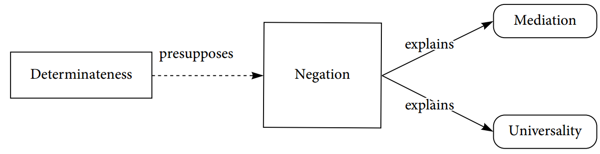
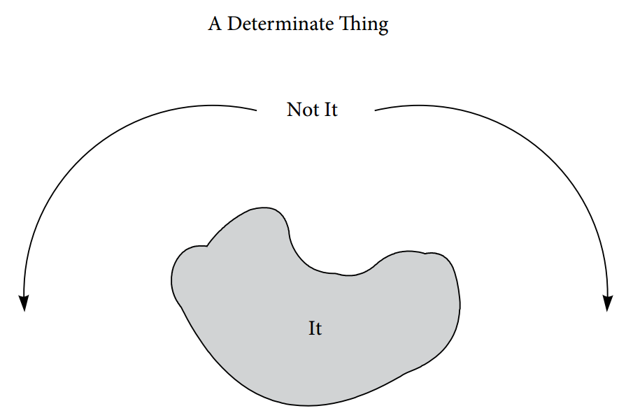
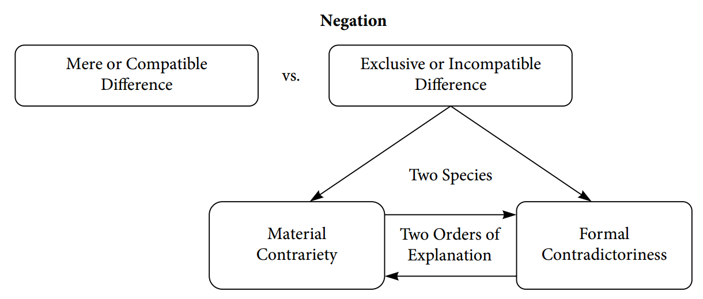

<strong>0.导论：黑格尔《精神现象学》的实用主义语义学解读</strong>

<strong>0.1.核心议题：概念的内容与使用</strong>

本书对黑格尔的《精神现象学》进行了理性重构。它在这部以现代性（modernity）为主角的、丰富而杂乱的成长小说（Bildungsroman）中勾勒出一条轨迹，揭示了一系列表面上无关的哲学洞见与创新的递进式表达与发展。这些思想的枝蔓逐渐统合，最终呈现为一条引人入胜的思想脉络。我在黑格尔文本中回溯性地辨识出的叙事，绝不是对于这个错综复杂的宏大故事而言唯一可能正确且富有成效的叙述方式。事实上，本书提供的解读在许多方面具有高度的选择性。我真正关注的只是黑格尔的论述中与一个核心议题相关的那些部分。我相信这是一个具有轴心意义的组织性议题，而聚焦于此能够为我们对其余内容的理解提供有益的视角。但是这种聚焦必然伴随着实质性的限制，因为严格遵循对主题内涵的限制必然会带来外延上的取舍。因此，原书中的若干重要章节（例如“观察理性”、整个“宗教”章节以及“精神”章节的大部分内容）在此并未被展开讨论。凡是没有既直接关联于我眼中黑格尔哲学事业的核心理论、又有助于我们阐明这套理论的内容，我都会毫不留情地将其搁置一旁。（在本书的最后，这种方法论自觉将会以回忆性告解的典型形式呈现。正因如此，它也将成为向更有能力的读者发出的、充满信任的请求原谅——在理想情况，本书提供的概念资源也将赋予这类读者以更强的表达能力。不过，这个教训还早着呢。）

我们的核心主题是<strong>概念性内容</strong>（conceptual content），它将充当本次阐释的透镜和过滤器。黑格尔思想（首先体现在他的形而上学与逻辑学）的核心是对概念性（the conceptual）的全新构想。他将任何与其他此类事物处于所谓的“规定性否定”（determinate nagetion）与“中介”（mediation）关系之中的事物都理解为具有概念性内容。黑格尔所说的“规定性否定”是指质料不相容性（material incompatibility）或亚里士多德式的反对关系（contrariety）：例如平面图形属性中三角形与圆形的互斥关系，或者金属种类中铜与铝的互斥关系。同一事物<strong>不可能</strong>同时具备这两种属性。“中介”（其灵感源自亚里士多德式三段论中项在推理中的桥接作用）是指具有反事实稳健性的（subjunctively robust）质料后承关系（relations of material consequance）：例如三角形必然属于多边形，铜必然属于导电体。如果某物具有前一种属性，则该物<strong>必然</strong>具备后一种属性。

对概念性内容的这种理解方式是非心理主义的，因为它在本质上并不依赖于把握或构想（由概念阐明的）事物的心理行为。在黑格尔的论述中，思想之间同样存在着不相容性与后承关系——这一点至关重要。认为硬币是纯铜的思维与认为它是纯铝的思维是互不相容的，并且前者还能推出硬币具有导电性。与此同时，客观属性与事态之间也存在相应的关系：硬币是纯铜这一事实与其为纯铝的事实互不相容，并且前者蕴含它是导电体这一事实。

不相容性与后承关系在客观事态那里与在主观的思考或判断行为那里并不相同。不相容的事态不可能同时存在，一个事态也不可能脱离其必然后承而独立存在。然而，提出相互矛盾的主张或者不承认已认可主张的必然后承，却<strong>不是不可能的</strong>。承诺不相容的内容、认可不相容的判断，或者在认可一个主张的情况下却不承认其必然后承，这些仅仅是不被<strong>允许</strong>的。人们不应当这样做。

黑格尔认为，“不相容”与“后承”既具有阐明认知主体态度的义务规范性意义，又具有阐明客观事实的真势模态（alethic modal）意义，二者存在着深刻的内在联系。它们是同一个概念性<strong>内容</strong>的不同<strong>形式</strong>。也就是说，这些概念性内容既可以是可思之物与可判断之物，也可以是事实。（戈特洛布·弗雷格曾说：“事实就是真实的思想”，此处的“思想”是指可思考的东西，而非思考行为本身。）这种形式与内容的形质一体结构（hylomorphic structure）构成了黑格尔关于（认识与行动这两种话语性实践\[discursive practices\]中的）主观思想与客观事态之间关系的<strong>表达性</strong>说明（expressive account）的基础。它支撑着一种概念实在论，该理论认为客观世界总是已经处于概念性形态（因而最终是可思考、可理解的形态）之中。于是，尽管这种形态不必源于任何主体的思维活动，世界在原则上对思维主体而言也是可理解的。（同样需要说明的是，这种可理解性也不归功于任何被称为“精神”的超级主体的思维活动。）这种概念实在论正是黑格尔观念论的不可或缺的基础要素。

我正是因为将概念性内容视为《精神现象学》的导向性核心关注点，才将自己提出的解读称为<strong>语义学</strong>解读。虽然这个术语的使用是时代错置的（anachronistic），但是我认为它并非不恰当或不准确。它揭示了本书所依赖的阿里阿德涅之线——这条线索将指引着我们走出黑格尔的迷宫。按照我的理解，黑格尔所采纳的对内容进行语义学理解的特殊路径是<strong>实用主义</strong>的。这在广义上意味着他认为：赋予行为、态度及语言表达以概念性内容的，是它们在主体参与的实践中所扮演的角色。在这一广义的功能主义图景中，黑格尔从使用的角度来理解意义。此外，诚然即便不存在或从未存在过任何思维主体，处于法则性关系中的对象与属性也可能具有概念性内容。但黑格尔的观点其实是，除非我们将客观世界的概念结构置于一个更宏大的故事——这个故事包含我们的某种实践<strong>活动</strong>，在其中我们把世界<strong>当作</strong>是由这些具有法则性关联的确定事实（determinate facts）构成的——中，我们就无法<strong>理解</strong>这种概念结构，即无法理解当我们在思考或言说“世界具有规定性”（所谓规定性就是具有作为客观模态结构的不相容性与必然后承关系）时，我们究竟在思考和言说什么。为了理解客观事态的概念性内容，我们必须考察赋予主观态度以概念性内容的功能系统。该系统从个体主体的感知、思维和意向行动所构成的循环向外延伸到这些主体参与的社会实践网络，并进一步涵盖这些实践的历时性维度——既向后追忆其历史渊源，又向前展望其未来发展。一般而言，功能主义的语义学故事以整体论的方式理解内容，即通过这些内容在包含诸多此类内容的更大系统中的作用来把握它们。黑格尔思想中一个显著而珍贵的特征是他在推演其语义整体主义结论时的严格性。

于是，我阅读《精神现象学》的目的是探究黑格尔关于意义与使用、概念性内容与概念应用（分别是语义学与语用学的主题），以及规范性与模态性（分别是概念性内容的主观和客观形式）之间关系的论述。按照我的理解，他试图借此阐明认知与行动主体与其对象之间的意向性语义关系。尽管人们都承认黑格尔探讨了后一个议题，但是少有人认为黑格尔关注前两个议题。这意味着我们的解读方向与现有文献中的路径相互正交，因而难以从后者中获得太多帮助。这一事实——以及将他视为语义学理论家所难免的时代错置——引出了以下问题：我们为什么应当认为黑格尔在探讨这些议题？他又是如何可能探讨这些议题的？

<strong>0.2.语义下降策略</strong>

为了回应这些问题时，我们不妨从康德的两个核心思想入手，它们共同构成了黑格尔哲学议程的框架。首先，康德认识到除了主要用于描述和解释经验事件的概念之外，还存在一类发挥着表达性功能的特殊概念，它们被用于阐明使描述与解释成为可能的框架的特征。这些“纯粹知性概念”正是黑格尔“思辨的”、逻辑的或哲学的概念的源头。与康德的范畴类似，这些概念属于元概念，其功能是表达黑格尔所谓的“确定”概念的使用方式与内容在初阶（ground-level）经验和实践活动中的关键特征。

由于这些范畴性概念显明了（make explicit）人在意向性判断和行动中所使用的<strong>任何</strong>具有确定内容的概念中隐含的东西，因此，为了对这些范畴性概念所显明的东西进行隐含的把握，人不必把握或曾经应用过任何<strong>特定的</strong>经验或实践概念。正如我所想指出的那样，在掌握如何（能够）使用普通概念时，人们其实已经掌握了理解和应用这些元概念所需的一切能力。从这个意义上说，对这些高阶概念的掌握是先天的（a priori）。为了获取它们的内容，人们无需掌握对任何初阶概念的特定用法。对我的故事而言，值得注意的是，在扮演这种表达性的元概念角色的主要候选概念中，认知的经验侧的候选者是真势模态概念，而意向性行动的实践侧的候选者则是义务规范概念。

对扮演这种独特的表达性角色的概念的发现或发明，是德国观念论的奠基性宏大理念（Big Ideas）之一。这类元概念的形成，让一种关于<strong>自我意识</strong>的新思维方式成为可能（黑格尔会坚称，一种新的自我意识也因此成为可能）。范畴性元概念正是如此理解下的自我意识的起表达作用的器官。因此，自我意识就成为这一哲学传统的核心主题。这样一来，无怪乎康德和黑格尔都将大部分时间和精力用于讨论和发展对这些框架阐明性（framework-articulating）概念的论述。在阅读他们的文本时，人们很容易完全忽视普通的经验性和实践性概念——这些确定概念在崇高的范畴性概念或思辨-逻辑的哲学概念面前似乎不值一提。但是我相信，理解他们对自己所偏爱的主题的讨论——这种讨论运行在位于充满冲撞和争吵的日常判断和行动之上的纯净领域——的最佳方式，恰恰是聚焦于元概念为那混乱而喧闹的景象所提供的澄清视角。如果高级概念的目的是阐明低级概念的使用和内容，那么对范畴性元概念的论述的价值恰恰在于，它必须教给我们某些关于普通的初阶经验和实践概念的知识。

因此，我建议并在下文中践行一种<strong>语义下降</strong>的策略。这要求我们在每一刻都牢牢将叙述的焦点锁定于以下问题：关于自我意识的各种“形态”的优缺点的论断，对我们理解普通的确定经验概念的使用与内容意味着什么。这不是黑格尔本人的实践方式。他尽管偶尔也会放下身段提供例证（例如“意识”部分的前两章所顺便讨论的经验判断案例），但是他的目光通常向上聚焦于哲学元概念的崇高天空。事实上，正如我们将要看到的，他的整个论述框架被更高阶的“理性”与“知性”（概念性思维与显像性思维）这一<strong>元</strong>元概念（<em>meta</em>-metaconcepts）层面的区分所统摄——这种区分表明了他对自己和康德使用的元概念群所展现出的不同结构的理解。在这方面，黑格尔的读者几乎总是追随他举的例子。但是我主张，为了最好地理解这些元范畴概念，我们同样需要关注它们如何指引我们思考日常的初阶确定经验概念与实践概念的使用与内容。我们所采用的语义下降方法论使本次解读与黑格尔阐释的主流传统形成了实质性的分野。

按照我对黑格尔的解读，他通过对初阶确定概念性内容的<strong>规定</strong>过程来理解这些概念的<strong>规定性</strong>。将概念性内容的规定性视为这样一个<strong>过程</strong>，而不是如康德和弗雷格那样将其视为具有清晰而完整边界的<strong>属性</strong>，这是基于理性的动态元范畴而非知性的静态元范畴来理解概念的核心特征。黑格尔将概念性内容的规定过程称为“经验”（Erfahrung）。由此被规定的内容阐明了这些概念的恰当应用的规范。因此，经验过程被理解为既是在判断和意向性行动中<strong>应用</strong>确定的、具有概念性内容的规范的过程，又是<strong>设立</strong>这些规范的过程。从<strong>回溯</strong>的视角看，这种规定过程是一种发现的过程。它以逐步的、渐进的方式<strong>发现</strong>内容一直以来具有的规范，即那种一直以来暗中统治着概念在判断中的应用的规范。从<strong>前瞻</strong>的视角看，这个规定过程也是一种发明的过程——它通过在新情境中应用概念，<strong>使得</strong>部分不确定的内容<strong>越发</strong>确定，并在这个意义上以逐步的、渐进的方式固定了内容。正因为黑格尔以这种方式理解规定性，他才否定了通过定义来传达概念内容的可能性。根据深刻的实用主义语义原则，他认为理解确定概念内容的<strong>唯一</strong>途径，是理性地重构规定该概念的表达性进步史。

这就是黑格尔关于概念性内容的模型，他还将其扩展至他所推崇的思辨元概念的内容——这些元概念同样应当被理解为按照理性这一元元概念所描述与规定的方式起作用。因此他认为，要想理解或传达那些被用于阐明自我意识的各种形式（例如那种区分了事物“在自身之中”的存在与“对意识而言”的存在的形式）的元概念内容（无论这里所考察的元概念的版本是否正确），唯一的方法是回溯性地演示表达性的进步发展——它最终指向所讨论的内容——的一种可能过程。这正是黑格尔用来传达其思辨的与逻辑的元概念的内容的方法。在《精神现象学》中，他理性地重构了这些内容的规定过程；这个重构重演了一条从现实中各种隐含性自我理解的历史中选取出来的发展轨迹，展示了这些元概念的版本从缺陷较多到缺陷较少、从较不充分到较为充分的演进。在《逻辑学》中，他理性地重构了（本质上）相同内容的确立过程，演示了由元逻辑概念的内容与结构所定义的发展轨迹——这一轨迹最终得以被充分地构想，并且完全独立于人类实际抵达该充分构想过程中所经历的曲折与坎坷的偶然性。

然而，将用于阐明黑格尔哲学观点的基本概念一般地理解为元概念（正如其所继承的、作为其灵感来源的康德知性纯粹概念一样），这凸显了初阶确定概念与逻辑和哲学概念之间在表达角色上的质的差异。即便黑格尔正确地确定了在理解或把握普通初阶确定概念内容时所必须采取的形式（我认为他在这一点上大体上是正确的），也不能推出对哲学元概念内容的理解也只能采取这种形式。恰恰因为它们是元概念，因为它们确实发挥着特殊的表达角色，即显明化隐含在普通经验概念和实践概念的使用与内容中的东西，所以我们可以采取另一条路径来理解它们的使用和内容，那就是语义下降的路径。借助这些元概念，我们能够对初阶确定概念的使用和内容有所理解和言说，而我们可以根据元概念的这种功用来理解它们。不存在相应的方式来理解或传达初阶经验和实践概念的内容，因为找不到任何其他东西与它们的使用和内容的关系，能够如同哲学元概念的使用和内容与它们的关系那样。

黑格尔本人并未采用我所推荐的推进方式。他没有利用那种可能性，即依据两者在表达角色的差异，将思辨概念区别于确定概念来加以理解。他认为，无论在哪一层次上，概念内容的本质都决定了它们必须以同一种回溯-回忆（retrospective-recollective）的历史性方式来理解。因此，采用语义下降的解释策略就意味着与黑格尔产生分歧。正是在这个意义上，这样一种策略构成对黑格尔的一种批判性阅读——这种阅读策略试图挪用和调动他自己已经提供的概念资源，去做不同于他所做之事的事情。我不需要主张语义下降是比黑格尔本人选取的道路更好的做法，因为正如双眼视觉优于单眼视觉，将语义下降的阐述方法与黑格尔自己的阐述并置起来或许能得到更好的结果。诚然，在追求这样一种解释性事业时，采用与他截然不同的手段——同时又声称最终所要传达的东西是黑格尔本人观点的内容——确实会招致一种特殊的危险（或许还显示出一种危险的傲慢）。然而，我最终的关切在于明确展示黑格尔要教给我们的最重要教训以及我们能从他那里学到的东西，这些教训关乎普通经验性描述和实践概念的使用与内容，并由此提高那些被用于表达我们的语义学和语用学自我意识的元概念的表达力。正是为了这副目的，我在此以语义下降这一准则为指导，进行一种批判性阅读。

<strong>0.3.话语性的社会维度：规范性与承认</strong>

康德的第二个启发了黑格尔的故事的主要理念是，他革命性地领会到话语意向性本质上的规范特性。康德把判断和意向性行为与非话语生物的响应的不同之处理解为，主体对前者这类施为（performances）<strong>负责</strong>。他把这类施为视为一种特殊权威的行使，即话语主体所具有的、向事物如何存在或应当如何存在而承担<strong>承诺</strong>的权威。有智慧的觉知——即统觉（apperception）——被看作一种规范性现象，话语领域被看作一个规范性领域。

康德与他所继承的传统的决裂之处在于，他把判断视为统觉性意识的最小单位——因为判断是主体能够为之负责的、对其作出承诺的最小单位。（弗雷格讲思想视为语用效力（pragmatic force）能够附着于其上的最小单位，而维特根斯坦则将语句理解为人们能够在语言游戏中走出一步棋的最小单位，就此而言他们都同意康德的观点。）判断（以及对实践准则的认可）仍然如传统所认为的那样被看作概念的应用。但概念现在被理解为“判断的功能”，也就是说，人对概念的理解应当根据概念在规定下判断者应当对什么负责时起到的功能性角色。对于“人对什么负责”这个问题而言，核心在于人拥有如此判断或行动的<strong>理由</strong>。概念是规则，这些规则规定了什么算作支持（或反对）应用它们的理由，以及应用它们又算作支持（或反对）什么的理由。在康德的用法中，“话语的”的意思是“属于或关于概念之使用的”。话语存在者在规范性的理由空间中生活、活动并拥有其存在。话语活动就是概念的应用，也就是用呈现为概念形式的规则来约束自己，从而承担起信念上和实践上的责任或承诺。早期现代哲学传统关注的是我们对概念的掌控，而康德则把注意力转向概念对我们的掌控，亦即这些规则的规范性约束力（“Verbindlichkeit”）。

判断的主观形式，即康德所说的能够伴随我们一切表征、因而是一切表征之中最空洞的“我思”，标志着谁<strong>对</strong>判断负责（take responsibility <em>for</em>）。判断的对象形式，即“对象=X”，标志着作出判断的主体在判断中使自己<strong>向</strong>什么负责(make itself responsible <em>to</em>)。这就是判断的<strong>对象性</strong>，即它的表征性意图（representational purport）。康德根据对有效性（“Gültigkeit”、“gelten”）的规范性要求来理解这一点。也就是说，他彻底从规范性的角度来理解表征性意图，即表征活动向主体显现<strong>为</strong>表征的方式——它们意向性地指向自身之外、指向由它们所表征的某物。某物之所以是一个表征，就在于它对其正确性向其对象——而这个对象正是由此才被算作它的对象——负责；也就是说，就在于它承认在评估表征的正确性时，表征的对象具有权威。

因为康德从这些规范性角度来理解话语性<strong>活动</strong>（弗雷格式的效力，即一个人在应用概念时所做的事），所以可以说（用我用来重构这些观点的、难免时代错置的词汇来说）他提出了一种规范性语用学。此外，在他的<strong>语义</strong>理论中，他是从功能上理解话语性内容的，即根据有内容的事项（概念的应用）在该话语性活动中所扮演的角色来理解话语性内容。一个人在判断中使自己对所<strong>做</strong>之事承担的责任是：把自己新承担的承诺与先前的承诺理性地整合起来，从而产生一个承诺的星丛，它展现出统觉所特有的那种理性（“综合”）统一性。为了发挥作为做这件事的规则的功能性作用，概念的内容必须决定什么会是支持或反对在判断中对这些概念的每一次特定应用的理由，以及这些概念的应用又会是支持或反对什么的理由。话语性内容的客对象性显像维度也是根据这种规范性语用学来理解的。从他的语用学——即关于话语性活动（弗雷格式的“效力”）的理论——里关于概念内容和显像内容的语义说明中可以看出，康德采取了一种广义上的<strong>实用主义</strong>解释策略。

康德观点的所有这些创新特征对黑格尔影响巨大：关于话语性活动的革命性规范语用理论、从语用学出发理解语义学的实用主义策略，以及由此产生的、带有规范论色彩的关于概念内容及其表征维度的语义理论。事实上，我在此试图初步勾勒康德在黑格尔眼中的面貌：黑格尔认为自己从中学到的教益，以及康德语义学和语用学中的那些被黑格尔继承并加以发展的特征。我已经提示过黑格尔对概念性的非心理学构想，即把概念性理解为由质料不相容关系和后承关系所阐明的东西。这种构想显然是继承来的，受到康德某些特征的启发。黑格尔在另外两个重要维度上继承、改造并发展了康德的思想：其一是他从<strong>承认</strong>（recognition）出发对规范性的社会性说明，其二是他从<strong>回忆性理性</strong>（recollective rationality）出发对概念内容的表征维度的<strong>历史性</strong>说明。本书正文提出的对《精神现象学》的实用主义语义学解读的主要工作就在于展开这两个指导性观念，并理解它们之间的多层次关系。

笛卡尔通过两种实体——心理物与物理物——的区分来理解有心灵的存在者与其他所有东西之间的区别。康德对“智慧”的规范性重构用<strong>义务论</strong>的（<em>de</em>ontological）区分取代了笛卡尔的<strong>本体论</strong>（ontological）区分。话语性存在者的特征在于拥有理性义务。他们的所思所做在多大程度上符合其承诺或责任，要接受规范性评价。笛卡尔对心灵与物体、思维实体与广延实体的区分众所周知地近乎一种二元论：这种区分所依据的术语使得被区分项之间的本质关系变得不可理解。至少存在一种潜在危险，即康德对事物的另一种区分——区分为事实与规范，即一个服从可以用真势模态词项来表达的法则的因果领域，和一个服从可以用义务规范词项来表达的规则的话语领域——同样会退化为一种二元论。至于这是否会发生，取决于人们如何理解规范，如何理解规范与非规范的、作为规范主体的认识和行动对象的客观世界之间的关联。

康德关于判断和意向性行动的规范性特征的洞见，使得对话语规范性的理解在哲学上变得紧迫。因为他将一切经验活动——无论是认知的还是实践的——都理解为概念的应用，也就是说，主体通过概念规范对自己的束缚。但是他自己关于概念规范之起源及其规范性约束力之本质的说明，其本性在某种程度上是晦暗不明的。而且无论如何，这种说明都与他的先验观念论中的某些最成问题的方面深深纠缠在一起，例如本体自我的活动与现象自我的活动之间的区分。然而，正是与康德相对，黑格尔通过将话语规范解释为社会实践的产物，从而使规范性落到了实处。（约翰·豪格兰德曾提出，这一解释策略的口号是“一切先验建构都是社会建制”。）黑格尔将权威与责任这些规范性地位理解为诸主体的规范性态度的产物，这些主体在实践中把彼此当作或对待为具有权威或负有责任的，他们承认或赋予彼此以权威，并让彼此承担责任。他对那种把某人当作或对待为规范性地位之主体的社会-实践态度的通称，就是“承认”\[Anerkennung\]。他认为，当认知态度具有一种独特的社会结构时——即当它们采取相互的或对等的\[gegenseitig\]承认的形式时——权威和责任这类规范性地位就被建立起来了。

将规范理解为社会实践之产物的方案，提供了一种在广义上将其<strong>自然化</strong>的可能性。因为它邀请我们去思考：那些通过支配我们的活动而将我们转化为话语性存在者的规范——Bildung\[教化\]，即作为我们第二天性的文化，或黑格尔的Geist\[精神\]——正是由这些活动本身所建立的。这样一种进路将我们呈现为自我建构的存在者，也就是说我们自己创造的规范反过来造就了我们。因此，它提供了这样一种前景：通过将规范安置于自然之中，并将其解释为我们彼此之间的社会互动的结果，来回应康德式二元论（它取代了笛卡尔式二元论）带来的迫近威胁。

<strong>0.4.话语性的历史维度：回忆性的理性</strong>

从我们当前的位置回望，我们可以辨认出具有这种一般性形态的图景的一个较新版本。后期维特根斯坦独立抵达了一种对语言表达式的意义和意向状态的内容的领会，其中他发现了两者本质上的规范性意涵（significance）。他也同样试图通过诉诸隐含于社会实践中的规范这一观念，来驯化并在广义上自然化我们的话语性中这一可能令人困惑的构成性特征。路标的规范性意义——它正是凭借这种意义才能够引导我们，并且可能被误解或被正确响应，而当我们把它“仅仅当作一块木头”来看时我们所抽掉的那种东西——应当根据它在那些将其<strong>当作</strong>路标来使用的人的社会实践（“习俗、用法、制度”）中所扮演的角色来理解。

对黑格尔来说（对维特根斯坦来说也是一样的）这类论述提出了一个根本性的问题。如果规范是我们制定的（通过我们的社会实践态度），那么它们又如何能够真正地约束我们？我们在什么意义上受它们制约？令人担忧的是，如果我们能够决定的（我们的实践态度所规定的）不仅包括“我们负有责任”这个事实本身（这是一个关于弗雷格式的效力或规范性地位的问题），而且包括我们对什么负责（即责任的内容），那就很难看出我们究竟如何给自己施加了规范性<strong>约束</strong>。正如维特根斯坦所表达的那样：“人们想说：凡在我看来是正确的都是正确的。而这仅仅意味着在这里我们无法谈论‘正确’。”我们可以从规范（或规范性地位）与规范性态度之间的区分入手来思考这个问题。前者是指我们<strong>实际上</strong>对什么负责或承诺了什么（即那些规范性地位的内容），后者是指我们承认或归派了哪些责任或承诺、我们在实践中把什么当作自己或他人所负责或所承诺的东西。维特根斯坦的那段话的要义在于，规范或地位只有被理解相对于对实践者对它们所持的态度具有某种独立性，才能够充当对那些态度的适当性或正确性进行规范性评估的权威标准。

这个老生常谈的观点与实践态度确立规范这个观念之间，至少乍看之下存在张力。看起来，我们至少必须做出某种区分：一方面是受话语性规范支配的态度（概念的应用、对承诺的承认和归派），另一方面是确立那些规范的态度。维特根斯坦的一些读者曾倾向于认为，他对话语规范隐含于其中的那些实践的社会性特征的强调，意味着他需要区分共同体的态度与个体的态度——前者确立规范，后者则按照那些规范接受评估。我认为这是不对的。（理由之一是，共同体不具有态度，个体才具有态度。）但是无论维特根斯坦的观点如何，可以确定黑格尔提及的话语规范性的社会性特征——即主张规范性地位只有通过相互的承认态度才能被确立——完全是以不同的方式运作的。在这里，起关键作用的是社会视角的差异：一方是<strong>承认</strong>责任的人，另一方是<strong>归派</strong>那种责任的人，即<strong>让</strong>主体承担责任的人。用黑格尔的话来说，一个自我意识<strong>在自身之中</strong>是什么（它的规范性地位），既取决于它<strong>对自己而言</strong>是什么，也取决于它<strong>对他人而言</strong>是什么。这两种不同的确立地位（status-instituting）的规范性态度，通过它们各自不同的社会视角（指向自我的和指向他人的）而被区分开来。

哪些他人对于确立一个主体的规范性地位至关重要，是由该主体自己的认知态度决定的：即主体承认谁，或者说他把权威授予（归派给）谁，从而让自己担负起某种责任。但这不是仅由那些态度决定的。共同体确实进入了图景之中。黑格尔所谓的社会“实体”是通过相互承认而综合形成的。在黑格尔运用这些逻辑元概念的一个范式中，<strong>普遍者</strong>（共同体）确实产生于特殊的、活生生的存在者之间的承认关系，这些存在者通过对彼此采取承认性的实践态度而成为具有自我意识的规范性<strong>个体</strong>主体。但是黑格尔式的共同体是相互承认的二元关系的星丛。那些使主体担负责任的他人的承认态度，与承担某一承诺的主体的规范性态度同等重要。黑格尔的版本是第二人称的、视角性的“我”-“你”社会性，而不是第一人称的、共同体的“我”-“我们”社会性。

此外，承认共同体的历时性<strong>历史</strong>维度也处于黑格尔故事的核心，这个故事是关于具有确定内容的规范性地位如何以及究竟在何种意义上从主体——这些主体通过在判断和意向性行动中<strong>应用</strong>概念性规范，而<strong>设立</strong>了概念规范——的实践态度中沉淀出来。从社会实践方面来解释规范性地位所面临的挑战，在于调和规范性地位的态度依赖性（attitude-dependence）与规范性态度的地位依赖性（status-dependence）。被应用于认知和行动主体的“依赖”与“独立”这两个术语，黑格尔谈论<strong>责任</strong>与<strong>权威</strong>这两种规范性地位的方式。因此，领会规范性地位的态度依赖性，就是领会态度对地位所具有的一种权威，以及地位对态度所具有的一种责任。这就是启蒙运动的观念：如果没有主体的那种实践态度，即把他人<strong>当作</strong>拥有权威的或负有责任的，就不存在权威和责任的地位。传统观念则认为，领会规范性态度的地位依赖性，就是领会地位相对态度所拥有的那种权威，即态度在何种意义上对其所承认和归派的地位负有责任。态度在规范上被它们所承认和归属的地位所支配——也就是说，受主体实际上对其负责的权威所支配，而这种权威其实是主体所拥有的。因为，态度之所以正确，恰恰在于主体确实拥有负有责任或拥有权威的地位，而这种地位是被他人承认或被归派给主体的。所有这些词汇，无论是黑格尔的，还是我用来翻译它的规范化（regimented）词汇，都属于语用学——我把这个词理解为关于使用的理论、关于弗雷格式的力的理论，或者关于一个人通过采取意向状态或使用语言表达来应用概念时在做什么的理论。然而，与语用学方面的规范性地位和规范性态度的相互依赖相对应，黑格尔设想了一种意义与使用的相互依赖，即概念内容与应用这些概念的实践之间的相互依赖。这就是我在“黑格尔在语用学与语义学关系这个问题上的<strong>实用主义</strong>立场”这一标题下所指称的那套精妙理论。

康德与他的理性主义前辈们一致认为，经验活动和实践活动——他将其理解为在做出判断和认可实践准则时对概念的应用——预设了具有确定内容的概念的事先可用性。这些概念的确定内容决定了人们在判断或意图中使自己承担什么责任、受什么规范约束，以及如何承诺事物是怎样的或被做成怎样的。也就是说，人们所应用的那条规则的概念性内容决定了规范性标准，而这个标准可以评估人们的话语态度是否正确或成功。在这里，我们可以想到鲁道夫·卡尔纳普为形式上受规约的语言所描述的两阶段过程：首先规定语言（所使用的表达式的意义或内容），然后构造一个理论（人们通过断言该语言的语句而采纳的信念或承担的承诺）。奎因对卡尔纳普的回应是，那种关于人工形式语言的使用的模型在自然语言的情形中具有误导性。在自然语言中，我们只发现语言表达式的<strong>使用</strong>，而这种使用必须既能被理解为有意义表达式的应用，又能被理解为赋予了被应用表达式以它的全部意义。以类似的方式，黑格尔在康德的洞见与另一洞见之间取得平衡：康德的洞见是，判断和行动预设了具有确定内容的概念规范的可用性，以便用来约束自己并要求他人遵守；另一洞见则是，建立起确定的概念内容与实践承认态度之间的关联的、从而固定态度所朝向的确定规范或规范性状态的，无非是实践态度——也就是我们对承诺的承担和归派——本身。一旦我们把规范理解为是由这些态度所设立的，如何理解规范态度真的受规范支配的问题，与如何理解规范态度设立具有确定概念内容的规范的问题，就成为了同一枚硬币的两面。这就是为什么在索尔·克里普克对维特根斯坦的表述中，他对那种把概念性规范理解为由态度所设立的观点的挑战采取了如下形式：一个表达式先前的任意实际应用序列（实践态度）如何能够赋予它一个确定的意义或内容，从而确立起一条规范，用以评估该表达式无限多的新的可能应用是否正确。

依我之见，黑格尔早在1806年撰写《精神现象学》时就已经充分领会了这个问题的种种后果。与维特根斯坦不同，他的回应方式是精心构造一套错综复杂的系统性理论，从而说明规范性态度的采纳（即在判断和意向性行动中对表达的应用）如何能够通过赋予意义或概念内容开确立具有确定内容的规范，而这些意义或概念内容在语义上超越了确立那些规范并赋予那些意义的诸态度本身。在我看来，黑格尔思想中这个故事比其他任何方面都更值得作为一个贡献被引入当代哲学对话。这一论述通过说明概念性内容如何通过它们在各种实际情况中的使用而被规定，从而调和了规范性态度的地位依赖性与规范性地位的态度依赖性。其核心是两个概念：承认与回忆，它们分别阐明了话语规范性的社会维度与历史维度。正如该论述的社会-承认维度本质上依赖于承认规范性地位与归派规范性地位这两种态度之间的社会视角区分（以及与之相关的“承认”与“被承认”之间的区分），其历史-回忆维度则依赖于一种时间视角的区分。（正如对社会维度最常见的误解是认为个体必须服从共同体常规，对历史维度最常见的误解则是认为当下必须对某种皮尔士式的最终理想共识负责。二者都是对黑格尔的精妙论述的漫画化。）

从前瞻的视角看，经验的过程是这样一种逐步规定概念性内容的过程，它通过在新情境中应用或拒绝应用这些内容，从而<strong>使</strong>这些内容变得更加确定。这一视角使规范性地位的态度依赖性变得可见：意义是由使用所赋予的。从回溯的视角看，经验的过程却是这样一种逐步规定概念内容的过程，它逐步<strong>发现</strong>概念的边界，而这些概念看起来自始至终已经隐含地完全确定。这一视角使规范性态度的地位依赖性变得可见：意义或概念性内容在规范上支配着对它的应用或使用。按照理性的元范畴来理解事物，这种做法本质就在于：这两个视角中的任何一个，如果脱离与另一个的关系就是不可理解的；而且，每一个视角的正确性都不排斥、反而蕴含着另一个的正确性。

这个故事的核心里有黑格尔的一个主要创新：他关于<strong>回忆性理性</strong>的构想。这种理性的运作就是回溯性地理性重构一个概念的各种应用，在其诸多实际用法中选取一条可以体现出<strong>表达上的进步</strong>（expressively progressive）的轨迹。也就是说，这条轨迹具有这样一种形式：一个具有确定内容的规范——被看作自始至终都隐含地存在着——的轮廓被逐步地、渐进地揭示出来，以越来越大的清晰性呈现。根据回溯性的回忆故事，这个规范一直在暗中<strong>规范性地支配着</strong>概念的应用，这有双重意义：一方面，它充当评判这些应用之正确性的规范性标准；另一方面，这些应用反事实地对它保持敏感，因为按照对这些应用的回忆式理性化，<strong>如果</strong>该规范具有不同的内容，这些应用<strong>就会</strong>有所不同。正是这双重条件设定了决定我们应当将先前的哪些实际态度纳入那条进步性的先行路径（progressive precedential path），而概念的内容就被认为是由这条路径所确定的。每一个经验片段都必须揭示（表达）一个具有确定内容的规范的某个更进一步的方面：该片段据以被视为正确的方面（一个义务规范问题），以及该片段据以被视为对之敏感的方面（一个真势模态问题）。对黑格尔来说，讲述这种回溯性的回忆重构故事，就是把一个过去转化为一部历史，就是赋予偶然的具体现实以必然性的规范形式，或者揭示出那种规范意义。它就是对直接之物的中介：给那种粗暴地现成存在的东西——无论是客观实际的东西还是感性被给予物——赋予概念形式，或者让人发现它本来就已经处于概念形式之中。回忆是黑格尔既发明又发现的一种独特的新型理性——究竟说“发明”还是“发现”，取决于人们采用的两种互补历史视角中的哪一种来看待他的成就。

回忆是黑格尔关于<strong>表达</strong>的论述的基础：即隐含之物与其显明表达之间的关系。他把经验的认识和实践阶段都理解为这样一种过程：那些回顾性地看可以被视为自始至终都隐含地存在着的东西，逐渐以更大的显明性呈现。

> <strong>内容</strong>既然已经是某种被思维的东西，它就是实体的财产；定在\[Dasein\]不再需要被转变为自在而<strong>隐含</strong>之物\[Ansichsein\]的形式，而只需要把隐含之物——它不再仅仅是某种原始的东西，也不再仅仅是隐藏在定在内部的东西，而是已经作为<strong>回忆</strong>而现成在场——转变为<strong>显明</strong>之物的形式，转变为对自身而言客观之物\[Fürsichsein\]的形式。（PG 29）

在认识方面，隐含的东西就是事实，即客观世界在自身之中（“an sich”）确定地所是的东西。在实践方面，隐含之物就是行动者的意图（“Absicht”），即行动主体自在地所是的东西。黑格尔根据表达它的过程——也就是将其显明化的过程——来解释隐含之物。回忆回溯性地把一段经验过程理性重构为在表达上具有进步性的过程：事实和意图逐渐以更大的显明性呈现，而这些事实和意图被展示为自始至终都在规范性地支配和引导着我们认识世界和自己的行动（两者都是自在的）的过程。这种以回忆来解释表达的论述，又反过来奠定了一种以表达来解释显像的论述。被明确化的东西，即事物自在所是的东西，就是由它向意识呈现的各种显像所表征的那个实在，也就是那个实在对意识而言所是的东西。实在对意识而言所是的东西，就显现为对它的各种明确的显像活动。因此，黑格尔关于回忆的语用元概念，为概念内容的表征维度提供了一种表达性的说明。

<strong>0.5.认知、承认与回忆：语义学与认识论、规范语用学和精神的历史性</strong>

<strong>第一部分 语义学与认识论</strong>

<strong>——对客观世界的认识和表征</strong>

<strong>1.概念实在论与知识的语义可能性</strong>

<strong>1.1.经典表征认识论</strong>

黑格尔在其《精神现象学》导言的第一段的开头处引入了关于认知能力的一种模型。他认为，这种模型的康德形式最为读者所熟知。

> 知识…通常被视为把握绝对者的工具或者发现绝对者的媒介。\[《精神现象学》第73页\]

他认为，任何具有这种一般性形式的论述都无法满足基本的认识论适当性标准。他希望通过证明这一点来让读者认识到一种替代模型的必要性，随后他将提供这一模型。

对于用工具或媒介的模型来构想认知能力的做法，黑格尔所持的一般性批评态度似乎相当明确。他提出了双重总结。该模式导致了“某种信念”：

1.  “试图通过开启某种知识过程来为意识谋取自在之物，这在概念上就是荒谬的。”

2.  “知识与绝对者之间存在着严格的分界线。” \[《精神现象学》第73页\]

第一种反驳认为，他所探讨的这类理论必然导致一种怀疑论，也就是说，它们不能让“认识事物的自在存在”这个观念成为可理解的。第二种批评则指出了导致这种失败的根源：该模型在意识与其对象之间挖掘了一条将二者分隔开的鸿沟。

他进一步阐述了这两点。他补充说明了工具或媒介理论会导致怀疑论的观点：

> 倘若知识是把握绝对者的本质的工具，人们便会立刻想到，将工具应用于某物并不会保持事物的原貌，反而会导致对该物的塑形和改变。又或者，倘若知识并非我们活动的工具，而是一种或多或少具有被动性的媒介——真理之光通过它抵达我们——那么我们获得的也并非真理本身，而是经过这一媒介折射后的真理。在这两种情形中，我们所使用的手段都直接导致了与其目的相反的结果；更确切地说，荒谬之处恰恰在于我们似乎不能使用任何手段。\[《精神现象学》第73页\]

无论何种情况，事物的为意识存在（运用认知能力的产物）与其自在存在（认知能力的原始材料）之间都存在一种区分。黑格尔似乎主张，这种区分的某种特性使得此类图景中的为意识存在不算对事物真实所是（“自在的”）的真正认识。

他详细阐述了从前述的第二个信念中诊断出的问题。工具或媒介的图景

> 预设了<strong>关于知识</strong>之为工具与媒介的观念，同时也预设了<strong>我们自身与这种知识之间存在差异</strong>；但尤其关键的是，它预设了绝对者<strong>居于一侧</strong>，而<strong>知识虽处于另一侧</strong>——独立于绝对者地自为存在——却仍被视为某种实在之物。因此，这种观念在假定知识外在于绝对者、因此也外在于真理的同时，竟仍认为知识可能具有真理性。采取这种立场的人与其说是害怕谬误，不如说是害怕真理。\[《精神现象学》第74页\]

显然，工具/媒介模型的本质在于它看到这种“差异”、“分离”和同一划分的两个“侧面”，并将认知官能的职责理解为桥接这一划分。

他认为，正是这种困境促使我们去研究由认知能力的使用造成的改变的本质。但他声称，认为此类研究能够消除这一困难的想法是错误的。

> 诚然，对工具运作方式的了解似乎确实有助于克服这一困难。因为这样一来，我们似乎只需从通过工具获得的关于绝对者的显像中减去工具自身所贡献的部分，就能获得纯净的真理。但这种修正实际上只会让我们回到起点。因为，第一，如果我们将工具对其所塑造之物的贡献从该物（此处指绝对者）中剔除，那么对我们而言，该物便与进行这番白忙活之前别无二致。第二，我们试图通过某个工具稍微拉近绝对者与我们的距离，如同用粘鸟网捕鸟而不对鸟造成伤害，殊不知只要绝对者不是本就自在自为地与我们亲近，那么它一定会嘲笑这种伎俩。因为在这种情况下，认知本身无非是一种诡计，它装作在为某个目标努力，实则只是建立了一种直接的、因而轻而易举的关系。第三，如果对认知（我们现将其比作介质）的考察使我们认识到介质对光的折射规律，那么从结果中减去这一因素同样徒劳；因为我们借以触及真理的知识乃是光线本身，而非对光线的折射；如果将此减去，那么留给我们的将不过是对某个纯粹方向的指示或空洞的位置。

此处的论证似乎是，如果存在一道将事物的自在存在和为意识存在分隔开的鸿沟，而人需要通过认知能力来桥接或重新统一这两侧，那么对这些认知能力的研究所能做的不过是重新确立这道鸿沟或分隔。

我认为，从这些段落中我们可以看出一个论证的大致轮廓。然而，这一轮廓的模糊性让我们既难以准确界定其所针对的观点的类别，也难以明确批判的运作机制。（这一论证的模糊性部分源于对表述的压缩，部分源于其所使用的隐喻。）为了填充论证的细节，我们必须明确黑格尔所坚持的认识理论的适当性标准、他声称哪一类理论无法满足这些标准、这些理论的哪些特征导致了这种失败，以及支持这一结论的论证的展开方式。在本章的剩余部分，我将从这四个维度出发，对黑格尔在此提出的论证进行一种可能的强化，并对黑格尔用以替代工具/媒介模型的模型的基本形态进行初步描述。

为了更好地界定黑格尔论证的靶子（即被隐喻为“工具/媒介”的模型）所涵盖的认识论理论的范围，我们需要继续向前追溯。（这正是我们将在黑格尔的实践与理论的核心处发现的方法：回溯。其口号是“退一步，进两步”。）黑格尔所讨论的理论是关于显像与实在之间关系的<strong>表征</strong>理论。<u>表征</u>是一个典型的现代概念。前现代（最初是希腊）理论通过<strong>相似性</strong>来理解显像与实在之间的关系。相似性——一个典型例子是图像与被描绘对象之间的关系——的本质在于两者共有的属性。一幅肖像画与被描绘者的相似程度，取决于它与对象在颜色和形状属性上的共有要素——例如鼻子、耳朵和下巴的特征。相似性模型背后的思想是：显像的真实性取决于它与自身所表征的实在之间的相似程度。与实在不相似的显像是显像的，是一个错误。

现代科学的兴起使得这一图景难以为继。哥白尼发现，太阳围绕静止的地球旋转的显像背后的实在是地球围绕静止的太阳旋转——二者既没有相似之处，也没有共有属性。此处的实在与显像之间的关系，必须通过更为复杂的方式来理解。伽利略提出了一种十分有效的对物理实在的构想方式：他将时间段呈现为线段的长度，将加速度呈现为三角形的面积。传统的相似性模型无助于理解这种重要的显像形式。若要把握其中可能适用的<u>共有属性</u>的观念，就必须从这种数学化（几何化）的理论显像与其所表征的实在之间的关系入手。此前并不存在任何现成的<u>属性</u>概念足以解释这种关系。[^1]

于是，笛卡尔提出了更为抽象的语义学元概念——<u>表征</u>。这一概念对于理解这些科学成就以及他自身的贡献至关重要。为了获取关于显像与实在（心灵与世界）之间关系的新模型，他一般化了一个特殊案例，这个案例就是代数与几何之间的关系。这是因为他发现了如何将代数用作某种东西——他仍然（跟随伽利略）将其视为一种本质上是几何的实在——的极具生产力和效力的显像。将诸如“ax+by=c”这样的线性的、符号性的形式视为欧几里得直线的显像，将“x2 + y2 = d”视为圆的显像，使得人们能够计算圆与直线<strong>可能</strong>有多少个交点、它们<strong>实际上</strong>有哪些交点，以及更多其他信息。这些符号序列与直线和圆毫无<strong>相似</strong>之处。然而，他的数学成果（例如，通过将几何问题转化为代数问题，解决了自古希腊以来遗留的大量几何难题）表明，代数符号以一种不仅（潜在且可靠地）<strong>忠实</strong>（veridical）、而且在概念上<strong>易于处理</strong>的形式呈现了几何事实。

为了理解代数符号串（以及作为他的发现的先驱的哥白尼和伽利略的成果）如何能够成为对几何实在的有用的、忠实的且易于处理的表征，笛卡尔需要一种构想显像与实在之间关系的新方式。针对这一风云激荡的时代的科学与数学进步，他的哲学回应是发展出一种比其所取代的相似性模型更抽象、更强大且更灵活的观念，即<u>表征</u>。他认识到，使得对几何图形的代数理解成为可能的关键在于，整个代数符号系统与整个几何图形系统之间存在一种全局<strong>同构</strong>（global <em>isomorphism</em>）关系。这种同构关系定义了一种关于<u>形式</u>的观念。按照这种观念，对代数符号串的合法操作与几何图形的可能构造方式有着相同的形式。在这种同构的背景下，那些如今被理解为表征物（representings）与被表征物（the represented）的东西的具体质料属性，对于它们之间的语义关系已变得无关紧要。<strong>唯一</strong>重要的是对表征物的操作规则与被表征物的实际可能性之间的对应关系。受新兴现代科学的理解形式的启发，笛卡尔得出结论：这种普遍的<strong>表征</strong>关系（看起来相似性不过是这种关系的一个原始亚种）是理解心灵与世界、显像与实在之间关系的关键。

这是一个卓越非凡、颠覆传统的理念，自此之后的西方哲学家的一切思考（无论是在实践层面还是理论层面）都不仅在时间顺序上源于此，而且在概念上源于此——无论我们或他们是否意识到这一点。然而，笛卡尔还将这一理念与另一个更有争议的理念相结合。后者认为：如果存在需要通过表征才能被认知或理解（无论正确与否）的事物，那么必然存在<strong>无需</strong>表征即可被<strong>直接</strong>认知或理解的事物，它们<strong>不</strong>需要表征的中介。倘若表征物本身只能通过表征才能被认知，就会引发恶性的无限倒退。因为，为了认识一个被表征的事物，我们需要认识它的表征物，为此我们又必须认识后者的表征物，如此以至于无穷。约西亚·罗伊斯在数世纪后将此明确提炼为：倘若连<strong>错误</strong>（<strong>误</strong>表征）——遑论知识——都可能存在，那么必然存在某些<strong>不</strong>可能出错的事物，即某些我们<strong>无需</strong>通过表征就能认知的事物。对于后者，不可能出现误表征意义上的错误。如果我们能够通过表征物的中介来认知（或弄错）任何事物，那么必然存在某些我们仅凭<strong>拥有</strong>它们就能<strong>直接地</strong>把握、理解或认识的表征物。

结果是一个关于表征的<strong>两阶段的</strong>故事，它基于事物固有的可理解性明确区分了两种类型的事物。某些事物——尤其是物理的、质料的、广延性的事物——的本质决定了它只能通过<strong>被表征</strong>才能被认知。而其他事物——即我们自身心灵的内容——在本质上是<strong>表征物</strong>，它们完全以另一种方式被认知。它们是<strong>直接</strong>被认知的——不是通过被表征，而是仅仅通过<strong>被拥有</strong>。它们具有内在的可理解性，因为单是它们的发生这一事实就构成了对某物的认知或理解。在这个意义上，那些在本质上作为被表征物而被认识的事物不具有内在的可理解性。它们的发生并不必然导致某人对某物的认识或理解。

正如我所指出的，我认为促使笛卡尔拥抱这一图景的动机有两个。一方面，为了理解用于呈现实在的新兴数学化科学形式（这是他那个时代最优且最有效的理解方式），他需要关于<u>表征</u>的一种更抽象的新观念，以及这样一种理念：为了最好地认识和理解事物，我们需要一种恰当的表征事物的方式。因此，我们必须区分表征物与被表征物，并关注它们之间的关系，正是这种关系使得对前者的操作能够被视为对后者的认识或理解。另一方面，如果我们不区分我们认识被表征物的方式（通过我们与它们的表征物的关系）与我们认识某些表征物的方式（至少是直接的，而非通过与其表征物的关系），那么这种两阶段模型将面临解释上无限倒退的威胁，从而失去可理解性。结果是一个两阶段模型：我们直接关联于表征物，并凭借它们与被表征物的关系与那些被表征物建立起间接的认知联系。表征物必须被理解为具有固有且直接的可理解性，而被表征物则只能在衍生的、组合的意义上被理解：对它们的理解不过是我们与表征物之间的直接关系以及表征物与被表征物之间的关系的产物。

我想说，黑格尔在《精神现象学》导论的开篇中所针对的正是这种认识论模型。他反对两阶段表征理论，该理论主张显像（表征物、事物的为意识存在）与实在（被表征物、事物的自在存在）在可理解性上存在根本差异——前者可以被内在且直接地理解，而后者则不然。他所批判的那种将显像与实在、认识活动与被认识之物分隔开的鸿沟（“差异”、“分离”和两个“侧面”），本质上正是这种可理解性的鸿沟。黑格尔的核心批判是：任何此类形式的理论都注定导向怀疑论的结局。

当然，笛卡尔的观点不是黑格尔打算批判的唯一对象。从他提到的“一种旨在为意识获取自在之物的知识过程”可以看出，黑格尔似乎暗示康德同样处于其批判范围之内。他将康德的理论视为一种两阶段的表征理论：认知活动需要被理解为心灵操作表征（即表征物）的活动以及这些表征物与被表征物之间关系的共同产物。我们在将表征物的特征归责于被表征之物时，必须同时考虑心灵对表征的操作以及表征与被表征物——对被表征物的刻画所应用的词汇，不能涉及心灵对表征的操作以及表征物与被表征物的关系——的关系。在康德看来，正是意识对表征物的所作所为造成了被表征物（用黑格尔的话来说）的“为意识”存在，即具有内容的表征物。

尽管康德的理论与笛卡尔的理论并不相同，但是它也有那种两阶段表征的结构，该结构区分了心灵与其表征物的关系与心灵通过这些表征物间接地与被表征物建立起来的关系。尽管康德有时似乎确实认为我们对自身认知活动的产物具有某种特殊访问途径，但是他不认为我们对自己的表征物的觉知（awareness）具有任何笛卡尔意义上的<strong>直接性</strong>。觉知就是统觉，而统觉的最小单位是判断。判断就是将经过概念阐述的内容整合进一个承诺集合之中，该集合展现出统觉的独特综合统一性。这一过程意味着从承诺集合中排除与所做判断不相容的承诺，并从这个判断中推导出的结果纳入承诺集合。这一过程由质料不相容性与后承关系——它将判断中运用的概念与其他可能判断中运用的概念联系起来——所中介。

因此，尽管康德的理论与笛卡尔一样都有两阶段表征的结构，但是前者不认为我们与自己的表征之间的关系是直接的觉知。然而，只要他坚持表征物与被表征物在可理解性上的差异（即表征物本身是可理解的，而被表征物本身则是不可理解的），他的观点就仍处于黑格尔批评的范围之内。我将这个承诺称为关于显像与实在“<strong>强</strong>可理解性差异”，这种观点认为一方属于可理解的种类，另一方则不然。康德提出了一种新的可理解性模型：可理解性就是拥有经过<strong>概念</strong>阐明的内容。觉知（统觉）行为中应用的概念决定了怎样才算将某个判断成功地整合进整体，后者体现了统觉的独特统一性。然而，对判断的概念性阐明是由知性的认知官能提供的一种形式。如果我们脱离了这些概念性表征与表征物（即事物的自在存在）的关系去考察被表征之物，我们就无从认识或断定这些概念性表征物所表征的对象。黑格尔之所以将康德纳入其批判的范围，是因为他觉得康德认为在可理解性层面存在一道将我们的表征物与其所表征的对象割裂开来的鸿沟。这种观点认为只有表征物处在概念性形态中，而被表征物（事物的自在存在）则不然。

为了领会黑格尔对显像与实在之间关系的两阶段表征理论——这些理论承诺了关系项在可理解性上的差异——的批评有多重要，我们不妨在此语境下考察弗雷格的理论。弗雷格认为，话语符号<strong>表达</strong>一种含义（sense,Sinn），并因此<strong>指示</strong>（designate）一个指称对象（referent , Bedeutung）。含义是人在理解表达时所把握到的东西，而指称对象则是由此被表征的东西，即人在表达该含义时的言谈或思考所<strong>关于</strong>的对象。含义是指称对象的“呈现方式”\[Art des Gegebenseins\]，因此是一个表征物。与康德一样，弗雷格并不将对含义的把握理解为笛卡尔意义上的直接行为，后者认为仅凭某个带有该含义的事物的出现，就算作心灵对该物的认识或理解。把握一个可判断内容需要掌握它与其他此类内容之间的推论和替换关系。但是和笛卡尔与康德一样，弗雷格认为，为了把握含义，并且将表征理解为表征，我们并不需要反过来再对它们进行表征，并且表征物（含义）在某种意义上是可把握的，而它们所表征的东西则不然（除了间接引语这一特殊情况，因为其中被表征的东西本身也是一个含义）。因此，如果黑格尔的论证如我所说是旨在批判两阶段表征模型（认为表征物是可理解的，而被表征物一般来说是不可理解的），那么弗雷格式的含义-指称理论以及它的康德和笛卡尔版本似乎都是黑格尔的对手。

<strong>1.2.真知与理性约束</strong>

为了考察黑格尔所寻求的能够反驳此类理论——即坚持表征物与被表征物之间在可理解性上存在强差异的两阶段表征理论——的论证是否存在，我们接下来必须思考黑格尔援引了哪些关于此类理论的适当性的判断标准。总体而言，我们知道黑格尔认为这类理论的错误在于它们会导致怀疑论。此外，他告诉我们，这意味着这类理论排除了认识事物的“自在”存在的可能性。我认为此处的关键在于，黑格尔从康德那里认识到<strong>认识论</strong>理论的薄弱环节在于其暗中依赖的<strong>语义学</strong>基础。他认为，坚持表征物与被表征物之间在可理解性上存在强差异的两阶段表征理论，在<strong>语义</strong>层面上排除了获得关于被表征物的真知的可能性。

我将黑格尔在此援引的认识论理论适当性标准称为“真知条件”（Genuine Knowledge Condition, GKC）。显然，这一标准的核心在于界定何为<strong>真正的</strong>知识。但无论如何都可以确定的是，这个标准要求认识论理论不应承诺某种特定的语义学（尤其是某种表征理论），以免让认识事物真实面貌（“真”知）的可能性沦为不可理解的。这正是我对黑格尔所说的这类认识论理论暗中表达了“对真理的恐惧”的理解。我不认为人们认识被表征物与表征物的方式存在差异这一点本身就能证明此类理论的失败。黑格尔的具体主张毋宁是：当这种差异被理解为可理解性上的强差异——即表征活动具有固有的可理解性，而被表征内容则不然——时，关于真知的怀疑论就应运而生了。并且，黑格尔还从康德那里拿来了“可理解性是由<strong>概念性</strong>阐明决定的”的理念：可理解就是处在特定的<strong>概念性</strong>形态中。如果这个解读是正确的，黑格尔的论证就必须证明以下命题：为了满足真知条件，任何认识论理论都必须不仅把显像（事物主观的为意识存在）、而且把实在（事物客观的自在存在）视为经过概念性阐明的。同样地，一个论证是否能够有力地支持这个主张，显然取决于真知条件的要求。

关于显像与实在之间关系的相似模型与表征模型都对<strong>错误</strong>的本质有所论述。当模仿品未能共享先行可理解的属性，或者表征物系统与被表征物系统之间的全局同构关系在局部被打破时，错误就发生了。在导论的中间部分，黑格尔开始提出一种替代方案，以区别于那种坚称表征物与被表征物之间在可理解性上存在强差异的两阶段认识论理论，其中对错误的探讨显得尤为突出。（这就是第二章的主题。）我认为，我们可以将此视为黑格尔为认识论理论设定的一项隐含的适当性标准：这些理论需要不仅让真知现象、而且让犯错现象成为可理解的。我将此称为“错误可理解性条件”（Intelligibility of Error Condition, IEC）。

真知条件与错误可理解性条件是<strong>认识论</strong>上的约束。一个认识论理论所预设或隐含的语义学，绝不能消除真知或错误（即弄错事物的真实所是）的可理解性。我们必须能够理解：事物如其所是地显现意味着什么，以及事物不如其所是地显现又意味着什么。一个认识论理论如果无法使这两者都具备可理解性，就不足以解释我们努力认识并理解事物的真实所是这一现象。

从语义学角度探讨认识论，意味着在这些认识论约束背后存在着更深层次的语义学约束。我认为此处的情况正是如此。我们无法直接从黑格尔在《导论》开篇段落中极为简练的论述中解读出这些约束，而必须从他针对这些挑战所最终给出的解决方案中推断出来。借用弗雷格的理论，首要的约束可被称为“呈现模式条件”（Mode of Presentation Condition,MPC），即要求显像（含义、表征物）必须在本质上——而非偶然地——是某些实在<strong>的</strong>显像。只有当人们将一次显现（appearing）把握<strong>为</strong>某物<strong>的</strong>显像（appearance），他才算恰当地把握了这次显现。当一切顺利时，对显像的把握必然构成认识被显示之物的途径。显像必须在语义上使某种实在成为可见的（或者能够以其他方式被访问）。这个主张不是要反对那种物化显像、将其视为物的做法，而是强调——例如以副词形式——从“被显示为如此这般地”（being-appeared-to-thus-ly）的角度来理解。这不是一个愚蠢的想法，但也并非当前论述的重点。关键在于：如果要通过两阶段表征模型满足认识论的真知条件，表征物就必须是被表征物的稳健语义呈现，也就是说，除非人们将表征把握<strong>为</strong>某个被表征对象<strong>的</strong>表征物，否则他所把握到的东西就不是被表征物的语义呈现，因而就不是表征。后续我们将看到黑格尔如何继承康德对这一要求的理解：在实践中将某物视为表征物，就是将其置于<strong>正确性</strong>的<strong>规范性</strong>评估之下，从而使那些由此被视为被表征物的东西成为正确性的<strong>评判标准</strong>。

我认为黑格尔对认识论上的真知条件的理解中所隐含的第二项语义约束是：为了以能够支撑真知的方式从语义上理解表征关系，人们必须将被表征物描绘为对表征物施加<strong>理性</strong>约束的存在者。也就是说，当表征关系无缺陷时，被表征物之所是必须为表征物之所是提供<strong>理由</strong>。我们所谈论或思考的对象必须能够为我们关于它的言说或思考提供理由。我们可以将此称为“理性约束条件”（Rational Constraint Condition,RCC）。尽管黑格尔在导论中没有对这个约束展开论证，但我认为这实际上是他所提出论证的关键前提。这里的想法是：单纯对某个事实或属性的在场或缺席作出不同的反应，与真正<strong>理解</strong>该事实或属性（即形成<strong>关于</strong>该物的表征性思想，在理想状态下可成为关于该对象的<strong>知识</strong>）之间的本质区别，取决于该事实或属性能否为认知者提供持有信念或作出承诺的理由。语义关于性的核心种类的前提是我们能够<strong>理性地</strong>理解事物之所是，这种理解意味着将它们<strong>当作</strong>为我们态度的提供理由的东西。正是基于这种理性的可解释性，这些态度才被认为是<strong>关于</strong>那些事物之所是的。

黑格尔从康德那里学到用规范性术语来思考表征。被表征物向表征物施加一种特有的<strong>权威</strong>。表征物对其所表征的东西负责。被表征物作为一种权威性的<strong>规范性标准</strong>，被用于评估它的表征物是否正确，而表征物之所以是表征物，无非是因为它的正确性由被表征物所提供的标准来评估。理性约束条件补充指出，作为标准的被表征物必须为这些评估提供<strong>理由</strong>。事实上，按照康德和黑格尔的观点，这不是额外的承诺。因为他们两人都未在一般的规范（或规则）与<strong>理性</strong>的（即经过<strong>概念性</strong>阐明的）规范（或规则）之间作出区分。所有规范都被理解为概念性规范。规范或规则与概念只是同一主题的两种表述方式。概念性规范是决定了何者是理由以及为何事提供理由。一个规范要具有内容，就必须拥有<strong>概念性</strong>内容：即它需要是支持或反对某事的理由，以及什么理由能够支持或反对它。这是他们所认可的唯一内容类型。德国观念论者对规范持理性主义态度，因为规范（规则）仅在具有<strong>概念性</strong>内容的意义上才被视为有内容的。

据此，理性约束条件填充了“表征”或“关于性”——这正是呈现模式条件的基础——的含义。这两个语义条件为对两个认识论条件——真知条件与错误可理解性条件——的满足提供了关键的适当性标准。因为对事物的真实样态的真知或误解之所以是可理解的，是因为这些实在对显像或表征施加了理性的规范约束。也就是说，显像或表征的正确性由那些作为标准的实在——它们为这种评估提供理由——来评估。

假设这四个条件代表了认识论理论（及其隐含的语义学理论）的适当性标准，那么我们可以对那些坚称表征物与被表征物（显像与实在）之间在可理解性上存在强差异的两阶段表征理论提出怎样的反驳呢？这类形式的理论为什么无法满足适当性标准？两阶段理论的特征——不仅是笛卡尔的理论，还包括康德和弗雷格的理论——在于它包含了两种认知或理解事物的方式之间的区别。某些事物（仅）以表征的方式被认识：即通过被表征而被认识。其他事物——根据无限倒退理论，至少包括某些表征物——则不是以表征的方式被认识的：即它们不是以被表征的方式而被认识的。如果我们有意在类似的理论框架下探究认知能力，就不得不关注表征关系本身。因为认知能力正是产生对实在的表征的工具或媒介。然而我们必须追问：对表征关系——即表征行为与其所表征的对象之间的关系——的认识是不是表征性的？如果该关系仅能通过被表征的方式得以理解，我们似乎便陷入了一种恶性的布拉德雷式（Bradleyan）倒退（他继承了笛卡尔的忧虑）。除非我们能够理解对表征关系的表征（它的<strong>为</strong>表征者存在）与表征关系本身之间的关联，进而理解对<strong>这些</strong>关系的表征，如此循环往复，否则认识论就是不可理解的。唯有把握了这无限延伸的表征之链（表征物的表征物的表征物的…），我们才能真正理解表征关系，进而理解表征的“工具或媒介”。语义怀疑论——即对所谓的“<strong>意图</strong>表征某物”究竟意味着什么的怀疑——是这种理论的必然结果。该论证本质上是笛卡尔为了确立对表征物的非表征性知识而提出的表征倒退论证。如今，它的适用范围已经从单纯的表征物扩展至表征物与被表征物之间的表征关系。

因此，在这类理论框架内，为了让认识论、从而让知识成为可理解的，我们似乎必须接受这一两难困境的另一端，即认为表征物本身可以通过<strong>非</strong>表征的方式被认识或理解。以这种方式应对关于对表征关系的理解的两难困境，实际上就是承认了“呈现方式条件”。因为这等于是说，我们必须以一种非表征的方式将显像（表征物）理解<strong>为属于</strong>某物<strong>的</strong>显像（表征物）。它们的表征属性、它们的“属于”性、它们与至少意图要表征的对象之间的关系，必须在与表征物相同的意义上是可理解的。

理性约束条件要求，为了将显像理解为某物<strong>的</strong>显像、表征或者呈现模式，我们必须将显像理解为受到它们所表征的东西的<strong>理性</strong>约束。这意味着，我们必须将被呈现的内容理解为为显像或表征的正确性评估提供<strong>理由</strong>的东西。而理由就是可以被思考或言说的东西：例如，人们为了评估某个表征是否正确、是知识还是误解，就需要援引某些理由。这就是说，为这类评估提供理由的东西，与评估本身一样，必须具有概念性形式。为采纳某种承诺（例如对正确性的评估）提供理由，就是认可一段推理，其中前提为承诺提供了良好的理由。人首先展示前提，对这些前提的认可进而让人有资格得出相应结论。因此，理由本身与它们所支持的对象一样必须经过概念性阐明。

换言之，所谓显像的可理解性，就是指它们经过了概念性阐明。为了理解对“事物是如此这般”的判断，我们需要知晓该判断运用了哪些概念，并理解这些概念本身。人们只有在实践中掌握了这些概念在推理中的作用，才能理解这些概念——即了解其适用性为提供了支持或反对哪些主张的理由，以及其他哪些概念的适用性会为当前概念的适用性提供正向或反向的依据。如果显像与其所呈现的实在——它们所表征的东西，以及它们是如何将事物表征为“如此这般”的——之间的关系能够像显像本身那样具有可理解性（从而避免表征的倒退），那么这必定是因为这种关系本身就是一种<strong>概念性</strong>关系：即概念之间或对概念的应用之间的关系，或者说经过概念阐明的事物之间的关系。

结论是，如果真知条件与错误可理解条件必须在满足理性约束条件的前提下才能被满足（也就是说，如果理性约束条件确实是满足这些认识论适当性标准的语义必要条件）——或许是因为它是满足呈现模式条件的必要条件，而呈现方式条件又是满足认识论上的真知条件与错误可理解性条件的必要语义学条件——那么，这些条件便无法通过一个坚持表征与被表征之间在可理解性上存在强差异的两阶段表征理论来满足。如果需要在经过概念性阐明的意义上具有可理解性的不只有表征物，还有表征关系，那么表征关系的两端都必须具有概念性内容。只有这样，我们才能理解被表征物是如何向表征物施加限制——即为表征物的正确性评估提供<strong>理由</strong>——的。

<strong>1.3.对概念性的非心理主义构想</strong>

我一直致力于探寻《精神现象学》的导论开篇的隐喻性表达之下潜藏的结构。到目前为止，我仅勾勒出一个潜在合理的论证框架。尤其需要进一步探究的是接受理性约束条件的理由——本文将把这个条件揭示为整个论证的核心支撑前提。我们工作的关键部分在于厘清<u>概念性阐明</u>与<u>概念性内容</u>的内涵——理性约束条件要求表征物与被表征物都必须具备这两个特征，而这种承诺恰恰与主张二者在可理解性上存在强差异的表征理论相悖。要着手后一项任务，我们不妨先考察，如果否定显像与实在之间在可理解性的存在强差异，即承诺不在表征物与被表征物之间挖掘可理解性的鸿沟时，我们还有哪些理论选择。

我们可以从弗雷格在“论思想”中提出的定义——“事实就是为真的思想”——入手。对弗雷格而言，思想就是陈述句的含义。它们是可主张的内容，而不是主张物（claimings）。他指出，事实不是与这种含义<strong>相对应</strong>或<strong>被表征</strong>的事物；它毋宁本身<strong>就是</strong>一种含义——一种为真的含义。事实是全体可主张物、含义、表征物以及认知显像的一个子集。但我认为，弗雷格在含义与其指称物（思想与真值）的关系上，仍然保留了二阶段表征模型。这一点对于理解他关于何<strong>为</strong>含义的观点至关重要：含义就是指称物的呈现模式。但当论及思想与事实的关系时，他却没有援引该模型。同样地，维特根斯坦说：“当我们言说并意谓‘事实是如此这般’时，我们和我们的意谓并未停留在事实之外的任何地方；我们所意谓的是：事实就是如此。”在这些情形中，我们所说的内容与我们的意谓<strong>就是</strong>事实。这种进路有时被称为“真理的同一理论”。它有时被归入约翰·麦克道尔的名下。

按照这种进路，显像与实在（心灵与世界）之间在可理解性上并不存在原则性的鸿沟，因为当一切顺利时，显像的内容就继承自它们所呈现的实在。思想（作为思想物\[thinkings\]）能够与为真的思想（作为可思想物\[thinkables\]）共享内容，而这些为真的思想就是它们所表征的事实。（如前所述，这不是弗雷格会采用的表述方式。因为在他看来，事实是一种表征物，而不首先是被表征物。）表征物与被表征物是截然不同的，因此两阶段表征模型依然成立。但它们被理解为同一内容得以显现的两种形式。

正如麦克道尔在《心灵与世界》中所说，此类观点最为引人注目之处在于，它们主张“概念没有外部边界”。可思考之物被等同于具有概念性内容之物。然而，客观事实与主观思想和关于它们的主张一样，都被理解为本身已具备概念形态。早期的维特根斯坦也持此观点。“世界是事实的总和，是一切实际存在的情况。”而实际情况是可以用语言表述的。事实本质上——而非偶然地——是<strong>可被陈述的</strong>。具有这些结论的观点非常有利于满足理性约束条件，进而在对认知显像与其所呈现的现实之间关系的理解中（在一种合适的康德式的对关于性的规范性理解的框架下）也满足了呈现模式条件。

这类进路是否站得住脚，主要取决于对<u>概念性</u>（<u>概念性内容</u>、<u>概念性阐述</u>）这一元概念——正是基于这个元概念，这条进路才得以被阐明——的理解的具体细节。因为，根据对概念性的某种构想，该进路就显得极不合理且难以辩护。例如，如果人们对概念的理解最终是<strong>心理主义</strong>的，那么认为思想（思考、信念）与事实可能具有相同的概念性内容，似乎就会带来不良后果。如果有人认为，最初具有概念性内容的东西是信念与思想，而其他事物——例如视觉与听觉的符号设计（记号和语音）——仅能通过对信念与思想的表达来间接获取概念性内容，并且如果他还认为（在一切顺利时）这些信念与思想（以及衍生的记号和语音）所表达的事实本身也具有概念内容，这就可能导致一个不好的结论，即这些事实（包括那些永远不会被表达或表征的事实）的存在竟然依赖于思考与相信的存在。将呈现模式条件的理性约束条件版本与戴维森“唯有信念能证成信念”的主张相结合，也会产生同样令人遗憾的推论。贝克莱声称，我们的思想所能再现的唯一对象是其他思想（即上帝的思想）。部分英国观念论者认为，在思想与信念中向我们显现的实在是由关于绝对者的思想构成的——并自认为从黑格尔那里学到了这一课。更晚近的德里达（借用费迪南·德·索绪尔在概念上前康德、前弗雷格的术语）描绘了一幅仅由能指构成的世界图景，其中唯一可供意指的对象只能是更多的能指。至此，事情已严重偏离了正轨。所有这些论证都忽略了塞拉斯所称的“臭名昭著的‘ing’/‘ed’歧义”，这一歧义的关键在于混淆了作为思考与相信活动的思想与信念，和作为所思和所信或可思和可信之事的思想与信念。如果对黑格尔在开篇提出论证的补全必然导致<strong>这</strong>类观念论的结论，我们应当运用否定后件而非肯定前件的方式来对待它。

然而，黑格尔的观点实际上是，关于显像与实在之间关系的论述的适当性标准可以通过一种对<u>概念性内容</u>的完全非心理主义的构想得到满足，从而规避了不良后果。那种在客观层面需要“世界思考者”、在主观层面需要有限思考者的观念论，确实是一种应当避免的理论。但它引导我们拒绝的不是那种认为两阶段表征理论必须避免在表征物与被表征物的可理解性之间做出强区分的观点（因为它们无法满足理性约束和呈现模式条件，进而也无法满足一般知识条件与内在解释条件），而是与之结合的对<u>概念性阐明</u>（因而包括可理解性）的心理主义构想。

受到康德的判断理论的启发，黑格尔发展出了自己的关于<u>概念性内容</u>的概念，并采纳了康德将概念视为判断功能的理解。康德从<strong>规范性</strong>和<strong>实践</strong>的维度出发来理解判断活动。在规范层面，他将判断活动理解为一种自我<strong>承诺</strong>，即对某东西承担<strong>责任</strong>、<strong>认可</strong>所判断的内容。在实践层面，他从<strong>实行</strong>的角度来理解这些规范性行为，即一个人所承诺或负责<strong>做</strong>的事项。做出某个承诺的个体的责任是将所认可的内容整合到其他承诺的集合中，而这个集合展现出统觉所特有的统一性。为了实现这种统一（即对统一体进行“综合”），人们需要从动态演进的统一体中排除与新承诺在内容上不相容的既有承诺，同时推导出并认可那些作为其内容的必然结果的承诺，从而把它们添加到集合中。判断p意味着承诺将p与已有承诺相整合，进而综合出一个新的承诺集合，后者展现了统觉特有的<strong>理性</strong>统一性。从黑格尔的视角来看，这种对不相容承诺的排除、对作为必然结果的承诺的推导与添加，正是理性主体赖以生存与发展的呼吸节奏——它们如同吸气与呼气般循环往复。

对一个规范主体——该主体必须展现出统觉所特有的综合统一性——的综合是一个理性过程，因为如果一个判断在内容上与另一个判断不相容，它就构成了<strong>拒绝</strong>采纳后者的<strong>理由</strong>；而如果一个判断在内容上可以推导出另一个判断，它就构成了<strong>支持</strong>采纳后者的<strong>理由</strong>。如果要将判断活动理解为“整合进统觉的理性统一体”的综合过程，那么可判断<strong>内容</strong>之间就必须处于质料不相容与质料后承的关联中。正是这些关系规范性地约束着统觉的综合过程，决定了何种情况可被视为判断主体恰当或成功地完成了他的整合任务的责任或承诺。概念作为判断的功能，决定了什么理由可以支持或反对其适用性，以及其适用性本身可成为支持或反对什么东西的理由。因为这一特性适用于<strong>所有</strong>概念（不仅限于形式或逻辑概念），所以概念所确定的不相容性与推论性关系通常必须被理解为内容性的关系（即涉及概念的非逻辑<strong>内容</strong>），而不仅仅是逻辑性关系（仅涉及概念的逻辑形式）。

我已经引入了（经过质料不相容和后承关系阐明的）概念性内容的理念，这个理念用康德式的规范性术语来说就是，概念性内容对作为理性整合的判断过程施加了规范：这些内容提供了此类整合是否正确或成功的标准，确定了一个人在认可一个可判断内容时承诺去做什么或有责任去做什么。但我也指出，黑格尔的概念性内容的理念<strong>不</strong>属于<strong>心理主义</strong>范畴。这一主张可能意味着，阐明概念内容的是规范性关系——即一个人<strong>应当</strong>做什么——而非那种可以直接从一个人实际所做或倾向于做的事情中读取的内容。这一区分对康德（以及对黑格尔）而言确实至关重要。但在黑格尔手中，这种处理概念性内容的方式在一种更坚定的意义上是非心理主义的。他认为，这种意义上的概念性内容不仅刻画了意向性关系的主体侧的思考过程，而且刻画了客体侧的被思考的对象。

这是因为各种客观属性——因而还有特定对象展现特定属性这个事实——<strong>同样</strong>处于质料不相容与推论关系之中。自然科学——尤其是牛顿物理学——揭示了客观属性和事实处于不相容和推论的<strong>法则性</strong>关系中。两个不受其他外力作用的物体发生碰撞，这一事实与它们速度不变在质料上（即出于某些自然法则，而非逻辑定律）是不相容的。一个有质量物体的加速度发生改变，这一事实在质料上（根据法则的必然性）可以推导出有外力作用于该物体。在第一种情形中，世界可能存在的这两种状态不是仅仅<strong>不同</strong>。根据牛顿物理学（而非逻辑学）的启示，两者<strong>不可能</strong>同时发生。这是物理上的<strong>不可能</strong>。而在第二种情形中，<strong>如果</strong>第一类事实成立，<strong>那么</strong>第二类事实也成立——这是物理法则所决定的物理必然性。

由此可见，如果我们按照黑格尔的理解，将概念性定义为处于质料不相容性与推论关系之中，那么被自然科学揭示为物理实在的客观事实与属性本身就具有概念形态。<strong>模态</strong>实在论主张某些事态必然导致其他事态，并让另一些事态成为不可能。这种对自然法则的承认必然导致<strong>概念</strong>实在论：即世界的客观存在方式自在地就是经过概念性阐明的。这种对概念性的稳健构想是非心理主义的，因为具有概念性内容——即处于质料不相容或推论关系中——不需要任何人<strong>思考</strong>或<strong>相信</strong>任何事。如果牛顿定律是正确的，那么它们在思想者诞生之前就已成立，并且即便从未有过思想者，它们也依然成立。受这些定律支配的事实——例如宇宙早期的粒子碰撞——与其他可能事实之间存在着法则性的相对不可能性与必然推论关系。因此，按照这种对概念性的构想，物理实在具有概念内容，而且这完全独立于任何主观思维过程是否曾经发生、正在发生或将来会发生（无论在这个世界还是任何其他可能世界）。

在我所使用的术语中，关于概念性的“心理主义”理论将概念理解为类似于某种特殊的心理事物，或这种事物的某些方面。也就是说，这种理论把概念性理解为在本质上是心理或意向状态——其典范是思考和相信——的特征。按照黑格尔对概念的非心理学理解，概念性就是处于非逻辑的不相容与推论关系之中。这既允许心理和意向性状态及事件被视为具有概念内容，又没有将概念谓词的适用性局限于这些状态和事件。我们在考虑他的概念实在论时必须牢记这一点。因为将关于客观世界的概念实在论与对概念的心理主义理解相结合，会导致一种贝克莱式的观念论，根据这种观点，客观事实需要一个世界思考者，而这些事实就是这个思考者的思考。这绝非黑格尔的思想（也不是弗雷格、维特根斯坦或麦克道尔的思想）——尽管他在《精神现象学》中三次使用“世界精神”一词，让一些人（包括他的一些崇拜者，如罗伊斯，甚至包括布拉德利）在这一点上产生误解。我将在后面讨论如何以其他方式理解他在序言中关于“将实体也理解为主体”的必要性的论述。

黑格尔认为，在客观实在具有概念性特征的这一观点的背后隐藏着一个更为深刻的洞见。在他看来，<u>规定性</u>这一概念本身应当通过与其他在相同意义上具有确定性的事物之间的不相容关系与推论关系来理解。他赞同斯宾诺莎“一切确定都是否定”的原则——某物之所以具有确定性，正是因为它以某种特定方式<strong>而非</strong>其他方式存在。这一思想被融入二十世纪的<u>信息</u>概念（源于香农的理论），后者将信息理解为每个比特所建立起的划分：一边是事物（根据信息）所是的状态，另一边则是事物所不是状态。我认为，所有人都会同意：如果一个属性不与其他任何属性构成<strong>对比</strong>，甚至与其他属性毫无<strong>区别</strong>，那么它就是不确定的。知道一个对象拥有<strong>这样</strong>的属性，与对它一无所知没什么两样。早在《精神现象学》的“知觉”章节中，黑格尔就指出，规定性需要的不仅是与其他事物的单纯差异，还需要他所谓的“排他的”（ausschließend）差异，而非单纯的或 “漠不相关的”（gleichgültig）差异。例如，方形和圆形是一对具有排他性差异的属性，因为一个平面图形如果拥有其中一种属性，就排除、否定或在质料上不相容于另一种属性。而方形和绿色之间则只有单纯的或漠不相关的差异，因为尽管它们是不同的属性，但拥有其中一种并不排除拥有另一种。一个属性的确定内容的核心部分——即让它成为该属性而非其他属性的关键——在于它与其他确定属性之间的质料的（而非逻辑的）、具有<strong>模态稳健性</strong>的不相容关系（例如，某种形状与其他形状的关系，某种颜色与其他颜色的关系）。我们之所以能够理解“单纯不同的属性”——例如方形和绿色——这个理念，不过是因为它们处于由若干形状和颜色组成的家族中，而这些家族中的成员彼此之间具有排他性差异。

关于黑格尔对规定性的理解——即他在知觉一章中探讨的排他性差异或质料不相容性——的合理性，一个论证是它能够支撑<strong>对象</strong>与<strong>属性</strong>（特殊者与普遍者）这两个基本本体论范畴之间的结构性差异的一个核心方面。亚里士多德早已指出这些范畴之间存在一种结构上的不对称性。我们可以合理地认为每个属性都有一个<strong>反</strong>属性，即它恰好仅被所有不具有该属性的对象所展现。“质量大于五克”这一属性便具有这种意义上的反属性。然而，如果我们类比地认为每个对象也有其反对象——即展现该对象未展现的所有属性的对象——则是不合理的。这正是因为其中某些属性是互不相容的，因而无法被单一对象同时展现。数字9具有以下属性：是数字、不是素数、是奇数、不能被5整除。如果它有一个反对象，那么该对象必须具有以下属性：不是数字、是素数、是偶数、能被5整除。但没有任何事物能够同时拥有所有<strong>这些</strong>属性。

由此可见，因为一个<strong>在范畴上确定</strong>的世界包含确定属性（及关系）与对象（通过其属性与关系得以区分），所以诸事实（即哪些对象展现哪些属性，并处于何种关系中）在黑格尔的意义上必须是确定的：这些属性之间必须处于质料不相容的关系之中。如果是这样，那么它们之间也将处于质料后承的关系之中，因为如果所有与属性Q不相容的事物都与属性P不相容，则属性P必然蕴含属性Q。例如，“是熊”这一属性蕴含“是脊椎动物”，因为所有与“是脊椎动物”不相容的属性——例如“是质数”——都与“是熊”不相容。

因为黑格尔将具有概念性内容理解为与其他此类事物处于质料不相容和后承的关系中，所以人们一旦认为客观世界——被理解为是由关于对象具有何种属性（以及彼此之间处于何种关系）的事实构成的——具有最低限度的规定性，就必须承认认为客观世界具有<strong>概念性</strong>结构的。在他看来，只有概念实在论者才有权将客观实在视为具有如此程度的规定性。（这导致了模态实在论。我们并不需要牛顿物理学来达到这种意义上的概念实在论，最基础的亚里士多德形而上学已经足够。）对<u>概念性</u>的这种构想在非常强的意义上是非心理主义的。

<strong>1.4.真势模态的与义务规范的质料不相容性</strong>

在这个意义上讲，认为显像/实在区分的两侧都具有概念性结构的观点并无问题。因此，我们无需在二者之间挖掘一道可理解性的鸿沟。基于同样的理由，满足理性约束条件以及呈现模式条件的主要障碍得以消除。（尽管我尚未就如何实现这些条件提出任何肯定性的见解。）这意味着，黑格尔所讨论的那种语义预设——即认为表征与被表征物之间在可理解性上存在强差异，从而导致无法满足真知条件与错误可理解性条件所表达的认识论适当性标准——同样可以被避免。所有这些令人满意的结果都将通过对概念性（进而对可理解性）的非心理学的结构性理解——概念性作为质料不相容（因而）与推论关系——来实现。

黑格尔把我所谓的“质料不相容性”和“质料推论”称为“规定性否定”\[bes-timmte Negation\]和“中介”\[Vermittlung\]——这一命名源于古典三段论推理中的中项的作用。在黑格尔看来，前者是更为基础的概念——或许部分原因在于——正如我在前文所论证的——凡存在不相容关系之处，必然也存在推论关系。黑格尔常将<strong>规定性否定</strong>（质料不兼容性）与“形式的”或“抽象的”否定（即逻辑不一致性）相对照：例如，正方形是对圆形的规定性否定之一（而非唯一的），而非圆形则是其唯一的形式否定。（这些是亚里士多德式的对比关系，而非矛盾关系。）我们可以理解，黑格尔之所以选择“确定”这一术语来标示此种差异，是因为他认为正是规定性否定关系使得所有事物具有确定性。这一原理既适用于思想，也适用于事物——既适用于主观认知活动侧的话语承诺，也适用于主体的认识与行动所指向的客观现实侧的事实。正因如此，尽管这一构想本质上是非心理学的，但黑格尔关于<u>概念性</u>的元概念也适用于心理状态与过程。思考与相信同样因其与其他可能的思考和相信构成质料不相容与推论关系，所以也被视为确定的，<strong>因而</strong>具备概念性内容。

但即便依据黑格尔的定义，我们是否可以宣称主观承诺在与客观事实相同的意义上具有概念性内容呢？当我们说纯铜与电绝缘体在质料上不相容时，我们指的是同一物体（物理上，而非逻辑上）不可能同时拥有这两种属性。然而，当我们说“a是纯铜”和“a是电绝缘体”这两个承诺在质料上不相容时，却不是指同一主体不可能同时承担这两种承诺，而是指主体不<strong>应当</strong>这样做。“应当”具有这样的实践意义：违反它意味着个体将面临不利的规范性评价；任何主体如果持有两个在此意义上质料不相容的承诺，便有义务采取<strong>行动</strong>，放弃（或修正）至少其中一项承诺，以修正这种不恰当的状态。然而，主体完全<strong>可能</strong>发现自己正处于这种不恰当的规范性情境中。在推论方面也存在类似的差异。如果导电是纯铜的客观属性，那么任何在某时刻具有前一属性的事物必然在该时刻具有后一属性。但某人尽管承认对某物之为纯铜的承诺，仍可能不承认对该物导电的承诺。他只是<strong>应当</strong>承认。

这就是说，客观事实与属性的确定性所依赖的质料不相容性与推论关系属于<strong>真势模态</strong>关系：它关乎有条件的不可能与必然性。而话语主体所承担的义务和所使用的谓词的确定性所依赖的物质不相容性与推论关系则属于<strong>义务规范</strong>关系：它关乎有条件的资格与责任。如果我们愿意，可以将二者视为真势与道义<strong>模态</strong>，但它们终归是<strong>不同</strong>的模态。黑格尔的论述承袭自康德对“必然性”\[Notwendigkeit\]一词的运用，后者将此视为涵盖这两种情况的属概念。在康德看来，“Notwendigkeit”意味着“按规则行事”。因此，他将“自然必然性”与“实践必然性”视为同一属下的两个种（它们对应英语中“must”一词的不同用法）。然而，这两种模态以及“必然性”（或“必须”）的两种含义具有实质性的差异。因此，我们不得不担心两种迥异的现象由此被混为一谈。而那种试图将其同化的努力，不过是对“概念的”这一相同语词标签的不加区分的使用而已。

我通过援引康德权威来主张的元承诺之一是：可理解性（这个概念的含义继承自笛卡尔）就是具有概念性结构或——在这种对内容的广义结构主义-功能主义解释中，两者是一回事——概念性内容。黑格尔依旧追随康德，从根本的<strong>实用主义</strong>角度来理解理解活动（因而可理解性）：一个人是否实行了这样的理解，取决于他是否能够在实践层面<strong>做</strong>某事。为了理解或把握自己所承担的（或者正在考虑承担的）话语性承诺的概念性内容，人们必须在实践中注意该承诺涉及的规范性义务。这意味着承认作为其推论的承诺并拒绝与之不相容的承诺。从某种意义上讲，这是承诺的<strong>直接</strong>可理解性，因为这是某人所承认的承诺，因此上述条款必然蕴含于这个人对该事物的第一态度中。当然，从另一种意义上讲，这种可理解性也不是直接的，因为它通过被与其他所有可能承诺——正是这些承诺之间的质料不相容和推论关系阐明了这个人所承认的内容——的关系所中介。

那么客观事态的可理解性又如何呢？要知道，这些事态之所以具有概念内容，是因为它们与其他类似事态之间存在着真势模态上的不相容性和推论关系，而非基于用于阐明话语承诺的概念内容的道义规范关系（后者在我刚才讨论的实践意义上是“直接”可理解的）。关键在于，为了在实践中将两个客观事态（或属性）视为真势模态上不相容的，人们如果发现自己同时持有两个这样的承诺，就有义务拒绝或修正其中至少一个承诺。同样，为了在实践中将一个客观事态视为另一个客观事态的必然（法则性）推论，人们需要承认自己对前者的相应承诺是对后者的相应承诺的结果。这里所谓的“相应”承诺，是指其义务规范概念关系与客观事态的真势模态概念关系相一致的那些承诺。不相容性与推论的义务规范概念关系与其真势模态关系之间的同构，决定了事物在人们心目中的客观存在。在实践中根据一套特定的不相容性与推论的义务规范关系来获取和调整承诺，就是将阐明事态的概念内容的客观真势模态关系视为与自身同构。

由于这些关系，规范性地承认某个具有特定概念内容的承诺，就<strong>是</strong>认为事物在客观上是如此这般，也就<strong>是</strong>承认某个事实的成立。这就是说，在直接把握承诺在义务规范上的概念内容时，人们实际上将其把握<strong>为</strong>某个事实的成立，而该事实的内容就由相应的（同构的）真势模态关系——不相容性与推论——所阐明。这便是“呈现模式条件”在这类两阶段表征模型中得以满足的方式，同时避免了可理解性的强差异。与此同时，“理性约束条件”也得到了满足，因为如果我们被问及<strong>为什么</strong>（即出于何种<strong>理由</strong>）在承认对P(a)的承诺后有义务放弃对Q(a)的承诺（这可以表达为义务规范性词汇），回答的标准形式是：因为任何事物都不可能同时具有属性P和Q（这可以表达为真势模态词汇）。承诺之间的推论关系也类似。

在此模型中，真知条件也得到了满足。因为认为思想与事实之间存在表征关系，隐含着对主观规范性的与客观模态的不相容性与推论关系之间可能存在同构关系的承诺，而该模型<strong>在语义层面</strong>并未排除这种同构性客观成立的可能性——至少在某一时空约束下成立。该模型还为<strong>错误</strong>的可能性提供了合理解释（即满足错误可理解性条件）。该模型遵循康德的理论框架，用规范性术语来诠释表征关系。当主体依据特定的概念规范（不相容性与推论的义务关系）操作（接受或拒绝）承诺时，他不仅承诺了客观模态事实（不相容性与推论的真势关系）以某种方式存在，也承诺了由这些关系所表述的基本的经验性确定事实与其认知状态相一致。因此，该模型也阐明了同构关系在现实中不成立时所需满足的条件，即主体对事实产生了错误认知，或者用不当的概念来阐明客观世界。

本章达成了以下六个目标：

- 明确界定了以笛卡尔和康德为代表的、属于黑格尔的批判目标的认识论理论的确切边界。

- 明确阐述了他对此类理论所持的反对意见。

- 阐述了黑格尔用于判定理论适当性的标准，这决定了什么样的理论能够免受他暗中提出的反对。

- 引入了对概念性的非心理学构想，它将构成黑格尔的回应的核心支柱（尽管这一观念并未在《导论》部分正式提出，在《意识》篇的开章方能展开）。

- 勾勒了基于对概念性的这种构想的认识论与语义学进路的大体轮廓。

- 说明了这样的进路如何满足黑格尔提出的适当性标准。

下一章将更细致地审视黑格尔通过本次讨论所运用的要素构建起来的<strong>表征</strong>理论。

<strong>第二章 表征和对错误的经验</strong>

<strong>——关于显像和实在间区别的功能主义进路</strong>

<strong>I. 导论</strong>

前一章的开篇阐述了黑格尔所提出的概念性内容——他将此视为知识理论的核心——理论的适当性标准。他在《精神现象学》的导论中明确指出，我们的<strong>语义</strong>理论不能从一开始就使我们陷入<strong>认识论</strong>上的怀疑论。我们对话语性内容的理解至少必须保留这样一种可能性，即通过承担具有概念性内容的思想承诺，我们（在某些情况下，当一切顺利时）能够认识事物的真实样态。他进而论证，任何在事物的主观显像（即事物“对意识而言”的存在样态）与客观实在（即事物“在自身那里”的存在方式）之间的可理解性之间挖掘鸿沟的论述，都无法满足这一条件。

自笛卡尔以来的现代认识论理论通常将知识理解为两个因素的产物：认知者对主观思想的把握，以及这些思想与客观事物之间的表征关系。因此，认知者与被表征事物之间的认知关系被它们的表征物所中介。为了避免无限倒退，认知者与其表征物之间的关系通常不能被视为同样是受中介的和表征性的。至少某些表征物必须被直接地——即非表征性地——把握。

我并不认为黑格尔从根本上否定了所有具有这种两阶段表征结构的认识论理论（尽管他的某些修辞会引导我们这样想）。为了完成他所倡导的从基于知性范畴的思维转向基于理性范畴的思维的元概念革命中，我们并不需要拒斥这种理论。实际上，黑格尔在《精神现象学》正文开篇就指出：<strong>如果</strong>人们将两阶段表征认识论解释策略与一个关于表征物与被表征物之间差异的特定辅助性假设论相结合，则必然导向怀疑主义的结论。该假设极具诱惑力，并且怎么看都显得十分自然。它认为只有表征物（显像、现象）具有概念性形态，而被表征物（实在、本体）则不然。按照这种观点，认知过程必须将非概念性的实在转化或映射为概念性的呈现，因为该过程所建立的表征关系所连接的是非概念性的被表征物与概念性的表征物。在我看来，黑格尔之所以在《导论》开篇段落中将认知比作“工具”或“媒介”，正是为了揭示这种图景。后者的问题的症结在于某种语义假设：它认为只有我们的思想具有概念性结构，从而能够被直接地（非表征性地）把握，而我们所思考的世界本身则不然。如此一来，它就在二者之间挖掘了一条可理解性的鸿沟，从而必然导致认识论上的怀疑论。

黑格尔为替代这一假设所提出的建设性建议，是一种全新的、非心理学的对概念性的构想。根据这一构想，具有概念性内容意味着与其他具有概念性内容的事物之间存在质料不相容关系（“规定性否定”）与质料推论关系（“中介”）。我称之为对概念性的“非心理学”构想，因为它独立于判断和意向性行为对概念的使用。客观的事态与属性同样处于质料不相容与推论关系之中，并因此具有可理解性——因为它们已经处于概念性形态中，并且完全独立于它们与认知和实践主体的认知及实践活动的任何可能关系。事实上，如果客观的事态与属性之间不存在此类关系，它们就不是<strong>确定的</strong>。这样一来，我们将无法理解“世界的某种存在方式是确定的”这一理念，因为它本质上依赖于与世界的其他可能存在样态（对象可能具有的其他属性）的对比。对比关系若要能够赋予事态和属性以确定性，就必须包含模态上相互排斥的差异（“一块纯铜不可能在温度高于1085°C时保持固态”），而不仅仅是单纯的差异。（红色与方形是不同但相容的属性。）

这种对概念的非心理学构想并未在导论中展开，而是后续关于“意识”章节的核心主题。尽管如此，我在前一章却已经对此进行了讨论，因为理解黑格尔如何避免在概念性的主观表征与非概念性的对象之间挖掘出不可逾越的理解鸿沟，这对后续的解读至关重要。黑格尔认为，表征的语义理论中的这种鸿沟可能会对认识论事业造成致命威胁。如果存在着这样的鸿沟，而认知过程必须跨越这样的鸿沟，那么真知——即对事物的自在（而非仅仅“对意识而言的”）存在的认识——将在原则上成为不可理解的。黑格尔提出的替代性回应方案，正是在这种全新的非心理学概念观的基础上建立起来的关于客观世界的概念实在论。

在我看来，导论后三分之二部分的任务是在优化版的两阶段表征理论——它不再将表征视为概念性表征物与非概念性被表征物之间的桥梁——的基础上，勾勒出思考表征的一种方式。这意味着展示如何满足前一章提出的两个适当性标准。呈现方式条件要求阐明某物怎样才能成为他物<strong>的</strong>表征或显像。为了满足这一条件，我们需要解释何为表征。介绍黑格尔对“如何成功地表征某物”的实用主义说明的结构与理论基础，也将有助于满足第二个要求：理性约束条件要求我们解释，认知主体（“意识”）所谈论或思考的对象（即被表征物）如何能够为人们对它的言说或思考提供<strong>理由</strong>。本章的任务是阐释黑格尔在导论中勾勒出的表征理论，并说明该理论如何满足这些条件。

<strong>II. 意向性的两个维度和解释的两种顺序</strong>

我们日常的、前系统的、非理论性的关于思考与言谈的思考与言谈，区分了我们所思所言的内容与我们所思所言的对象。因此，我们可以说意向性——即思想与言谈的内容——具有两个维度：我们在思考或言说时所表达的内容，以及在此过程中我们所表征的对象。例如，我们既可以说“Kant came to <em>believe</em> that Lampe was betraying him”，也可以说“Kant believed <em>of</em> his faithful servant that he was betraying Kant”。在前者中，“that”一词后面的陈述句表达了信念的内容；在后者中，位于“of”的统辖范围内的名词短语则表达了信念所关涉的对象。

我所提出的“黑格尔的非心理学概念观”将概念性内容视为质料不相容性与推论关系。这是对人们的所言或所思的一种模型：即意向性或内容的第一维度（“that”型意向性）。因此，我将此称为概念性内容的“表达维度”。当前探讨的核心问题在于，他如何理解另一种概念性内容的另一维度，即表征维度（“of”型意向性）。

经验主义者遵循一种解释顺序，即从表征性内容出发，并试图在此基础上自上而下地理解和解释概念性内容。这种方法的一个潜在优势在于，它将表征视为一个属，而概念性表征仅是其中的一个种。按照我的理解，黑格尔所遵循的是一种互补的解释顺序。他在导论中概述的计划是通过非心理学的<u>概念性内容</u>来阐释<u>表征</u>的观念。在下文中，我希望解释黑格尔是如何发展这种概念主义的解释顺序的。因为，我认为我们应当从黑格尔那里汲取的主要教训之一就是关于意向性的两个维度的<strong>表征主义</strong>解释顺序的替代方案。这种表征主义解释秩序不仅主导了他所继承的哲学传统，而且主导了我们所继承的上世纪哲学传统中的哲学语义学。

<strong>III. 两个康德式的理念</strong>

黑格尔提出了解释表征性内容的一种新方法，即从概念性内容——这一观念以非心理学的方式被理解为质料不相容性与推论关系——的角度出发进行解释。他对这一概念主义理念的发展，最好被理解为对两种康德式理念的综合与共同发展。其一是康德对判断的<strong>规范性</strong>阐释。判断与自然生物的反应之间的区别在于，我们以某种独特的方式对自己的判断<strong>负责</strong>。判断表达了我们的<strong>承诺</strong>。下判断是一种<strong>认可</strong>，是对主体<strong>权威</strong>的行使。<u>责任</u>、<u>承诺</u>、<u>认可</u>与<u>权威</u>都是规范性概念。康德将概念理解为“判断的功能”，这就是说，判断所应用的概念决定了主体对什么负责、承诺了什么、认可了什么，或将其权威赋予给什么。在判断过程中，主体通过规则（概念）规范性地约束自身，这些规则决定了其承诺的本性与范围。

通过这样一种形态的阐释，康德让如何理解判断中所应用的概念的规范性约束力（他所谓的“Verbindlichkeit”）成为一个紧迫问题。由笛卡尔开启的早期现代传统曾对我们对概念的（“直接的”，即非表征性的）把握感到忧虑，而对康德而言，问题则转变为了如何理解概念对我们的规范性约束。承诺或对主张p负责意味着什么？黑格尔对意向性的表征维度的概念主义研究进路所依据的第二个康德式观点是：这种责任应该被理解为一种<strong>任务</strong>责任，即<strong>做</strong>某事的责任。当人们做出承诺p时，就有责任将这个承诺整合进先前承诺的集合中，从而维持统觉所特有的统一性。（统觉是可以算作知识的认知性的或智性的觉知。统觉活动就是判断活动。判断是统觉的形式，因为判断是人们可以对其担负认知责任的最小单元。）这个整合是被康德称为“综合”的属的一个亚种（这就是为什么这里所讨论的结构统一性是统觉的<strong>综合</strong>统一性）。

这种整合任务的责任有三个维度：批判、扩展和证成。这些是<strong>理性</strong>义务的亚种，因为它们表现为哪些承诺可以充当其他承诺的正向或反向<strong>理由</strong>。

- 整合-综合任务责任的<strong>批判</strong>性维度在于，拒绝接受与自身已经承认的其他承诺在质料上不相容的承诺。

- 整合-综合任务责任的<strong>扩展</strong>性维度在于，承认那些作为已承认的承诺的质料性后果的承诺。

- 整合-综合任务责任的<strong>证成</strong>性维度在于，能够通过援引自己所承认的其他承诺——这些承诺是当前承诺的质料性推论——来为已承认的承诺提供理由。

这些应做之事对应着一些应然事态，即人们的认知承诺、判断或信念应当是前后一致的、完备的且得到证成的。它们是理性的规范。一旦得到明确的承认，它们就成为<strong>系统性</strong>的规范。因为判断活动是由批判性的、扩展性的和证成性的整合-综合任务责任构成的，所以人们在判断中总是隐含地承担了这些理性的、系统性的承诺。这些承诺共同界定了理性的、规范性的和系统性的统觉统一体。

<strong>IV. 黑格尔的实用主义-功能主义理念</strong>

黑格尔指出，对判断<strong>活动</strong>的这种阐释直接导致了对判断<strong>内容——</strong>即当人们做出判断p时对其承担责任和承诺的东西<strong>——</strong>的理解。对规范性综合-整合任务责任的理性阐释意味着我们可以通过我们在判断活动中的<strong>作为</strong>来理解可供判断的内容。因为判断活动的内容必须能够规定可供判断的内容之间的关系，即谁是谁的正向或反向理由。批判性的整合-综合任务责任要求可供判断的内容之间处于质料<strong>不相容性</strong>的关系中。扩展和证成性的整合-综合任务责任要求可供判断的内容之间处在质料<strong>推论</strong>的关系中。这就是说，可供判断的内容必须具有黑格尔意义上的<strong>概念性</strong>内容。在康德对判断活动的阐释中其实已经隐含了概念性的概念。通过

<strong>第四章 直接性、普遍性和回忆</strong>

<strong>——关于认识论合法性的结论的五个讲座</strong>

<strong>I. 感性确定性的引入</strong>

我们看到，黑格尔在《精神现象学》导论开篇便阐明了一个关于认识论适当性的基本标准：任何对于构成心灵与所知世界之间的的认知性关系的过程与实践的理解，在理想情况下都必须能够证明自己能够产生关于事物的真实样态的知识。随后他指出，某种常见且颇具诱惑的理论结构无法满足真知条件的要求，其典型在他看来便是康德在第一批判中提出的理论。这类策略将知识设想为两种存在之间的认识关系：一方是借助概念理解事物的心灵，另一方是脱离认知关系便不具有概念性形态的客观实在。黑格尔主张，任何图像，但凡它要求心灵对非概念性实在进行加工或转化、以使其符合可理解性所需的概念形式，都将导致怀疑论。这类模型必须诉诸某种关于认知和所知之物之间的“共同内容”的概念——这种内容在意向性关系的主体侧表现为具有概念性形式，在对象侧则表现为具有非概念性形式。黑格尔论证道，人们如果将可理解性等同于某种存在于概念形式中的东西，就必须承认这种两栖的共同内容的概念本身是不可理解的。这样的理论必将导向怀疑论，因为世界的真实（即黑格尔所说的“自在”）存在方式是不可理解的，只有处在合适形态中的事物的显像（事物的“为意识”存在）才是可理解的。

认识论观点建基于一个隐藏的语义学观点：要想使共同内容被视为<strong>确定的</strong>，该内容就必须在概念上得到阐明，这里的“概念性”采用的是黑格尔赋予它的意义（被定义为处在规定性否定关系中）。关于“意识”的几章致力于探索这种<u>确定性</u>的观念。因此，黑格尔并未质疑将可理解之物等同于具有概念性形式、形态或结构之物的观点。他认为，“概念性内容”的应有之义正是可理解之物本身所必然展现出来的东西。针对这一语义学与认识论的批判性论证，黑格尔提出的建设性回应是发展一种<strong>概念实在论</strong>，后者通过阐明“概念性内容”的含义，使得意向性关系中的对象侧与主体侧可以被同等地视为具有概念结构，即拥有或展现出概念内容。这一概念性内容的客观和主观形式可能呈现的差异需通过其他术语来理解。具体而言，按照我对黑格尔的解读，具有概念性内容被等同于与其他具有概念性内容的事物处于质料不相容或排他性差异（“规定性否定”）的关系中。客体侧事实的概念内容与主体侧思想的概念内容之间的差异，应当被理解为真势模态不相容性与义务规范不相容性之间的差异。一个对象不可能同时展现两个不相容的属性，而主体则仅仅不<strong>应当</strong>认为对象展现出这样的属性。世界的客体侧事实与知识的主体侧思想是确定的概念性内容可能呈现出的两种不同形式，这一观点构成了双模态形质一体概念实在论（bimodal hylomorphi-c conceptual realism）。

在《精神现象学》的第一章中，黑格尔通过考察其对立立场，展开了对这一构想的论证。他所主张的概念实在论试图将意向性关系的两极都解释为具备概念结构，从而满足真知条件。相比之下，被他称为“感性确定性”的路径虽然同样接受以下结论——如果人们将知识理解为对非概念之物的概念化，概念化就必然被视为对事物的篡改——但它试图通过将经验知识奠基于对非概念实在的纯粹<strong>非概念性</strong>接纳之上，以规避怀疑论的幽灵并满足真知条件。另一条认识论适当性标准要求，理论必须为错误的可能性留出空间（我称之为“错误的可理解性条件”）。对感性确定性来说，这一条件可以通过以下情况得到满足：当以非概念的方式被给予的内容在后来被概念化时，就产生了错误的可能性。尽管如此，人们仍然认为可以通过把感觉经验的直接给予——它与概念性活动相对立，并且认为在概念性活动之外和之前没有任何犯错的机会——解释为被动的，从而为经验性真知的奠基。[^2]

在《精神现象学》这部思想冒险故事的开篇“感性确定性”一章中，黑格尔探讨了我们的经验知识在感觉经验中的起源。他所剖析的朴素观点是一种传统的经验主义。他指出，其脆弱之处在于结构上对语义原子论的承诺。这种观点认为，由我们的感官能力直接给予的内容独立于它与其他事物的关系而存在。从语用效力而非语义内容的角度来看，这类感觉片段之所以被视为内在地具有认知权威（epistemic authority），是因为它只来自于对感觉能力的被动使用，而无需对其他东西承担相应责任。这种关于认知权威之本性的观点，必然导致对其语义内容的原子论理解。因为，如果对某一内容的把握需要以对其他内容的把握为前提，感觉片段的认知权威就会依赖于自身之外的某些因素。一个半世纪后，威尔弗里德·塞拉斯自觉地受到黑格尔思想的指引，用类似术语诊断并批判了这一观念，并称之为“被给予物的神话”。

这一观点并未过时。当代语言哲学家的一种较为广泛的看法是：与可感世界的那种因果联系——显性化为指示词的使用——应该被理解为非概念性或前概念性的。经验知识中的这种“关于事物”（de re）的要素，与经过概念性阐述的“关于言辞”（de dicto）的要素形成对比。部分学者援引了一种“纯粹关于事物”原始信念层次，这种信念<strong>仅</strong>显性化为指示词的使用（尽管这类信念也可能出现在不具备语言的生物中，因此并不依赖指示词）。[^3]当剥离其明显的笛卡尔主义外衣后，那种最低限度的认知观念——认为认知<strong>仅</strong>由接受构成，仅仅记录、注意或指出感觉所给予的内容——似乎仍具有诸多吸引力。这种认识虽然不需要被视为绝对无误的（因为机械因果链有时也可能会出错），但仍然是特别可靠的一种。因为它至少可以免受类比出错、分类出错和推论出错的影响，毕竟主体没有对被动记录、注意或指出的内容<strong>做出</strong>任何处理或操作，因此也就不存在可能<strong>犯错</strong>的行为。

同样，感性确定性认为直接性的权威源自于认识主体的<strong>被动性</strong>，原子于感知意识刻意避免承担任何义务这一事实。直接性的认知权威意味着这种情形中的接受者不必承担任何<strong>责任</strong>。此处论证的驱动力在于，感性确定性对直接性的认识<strong>权威</strong>的理解中存在着两个互不相容的特征：一是内容的直接性（在这个意义上，认可该内容并不会给认可者施加任何可能无法履行的责任，也就是说，认可者没有义务在各种直接性之间进行区分或把握各种直接性之间关系，从而规避了犯错的风险），二是内容的——哪怕是最低限度的——确定性。在认识到这一点后，为了围绕直接性重建某种站得住脚的认知权威，人们就必须将认识主体（意识）理解为不是仅仅被动地记录感觉所呈现的内容，而是需要做出区分并调用这类权威的各种实例之间的关系，而这正是从感性确定性向作为知觉的经验意识的转变。

<strong>II.“直接性”的两个含义</strong>

在感性确定性一章中，黑格尔研究了他所谓的“直接性”的认识权威。直接性和中介之间的区分是黑格尔哲学术语表的核心部分。尽管该理念有着许多种类和分支，但可以确定它源自于认识论的直接性。我们可以认为这个术语植根于康德对它的用法：

一切确定性（certainty）要么<strong>被中介</strong>，要么<strong>没有被中介</strong>；也就是说，它要么需要证明，要么是不可怀疑的，并且不需要任何证明。在我们的认识中存在着许多只能间接确定的东西，也就是说，它们的确定性需要得到证明；但也存在着某种<strong>不可证明</strong>的或<strong>直接确定</strong>的东西。我们的认识必须开始于这样<strong>直接确定</strong>的命题。[^4]

康德区分了作为<strong>推论</strong>结果的知识或信念，以及我们通过非推论的方式知道或相信的东西。获取信念的典型（尽管不是唯一的）非推论方式是观察性判断。在这种判断中，主体直接对可感事态做出响应：例如，主体通过相信“苹果是红色的”来响应苹果的红色这一可视属性。黑格尔在“直接的感性确定性”的标题下所分析的正是这类认识事件所特有的认识权威。康德习惯用“中介”来讨论推论（他把其中最可靠以及最具确证效力的一种方式称为“证明”），因为说起推论，出现在他脑海里的是古典三段论（这对他来说是推论的本真形式），其中的中项确保了前提与结论之间的推论联系。因此，通过推论达成的“确定性”或承诺就被称为“被中介的”；相反，那些不是来自于推论的确定性则被称为“直接的”。

黑格尔所探讨的“感性确定性”这一认识论概念，不仅受到康德关于认识<strong>直接性</strong>的概念的影响，更是直接源于康德的感性<strong>直观</strong>理论。康德的模型强调直接的感性知识应当被理解为<strong>非推论性</strong>认知，黑格尔的模型则强调它应当被理解为<strong>非概念性</strong>认知。这不是说黑格尔把他在感性确定性一章中驳倒的认识论进路归为康德所有，因为在康德本人看来，直观的单纯在场并不能构成任何种类的知识，正如他在A51/B75处提出的著名论断：“无概念的直观是盲的”。相反，黑格尔把康德的想法归为他在导论的开头处所批判的观点之一，按照这种观点，认识活动是一个过程，其中非概念实在（事物的自在存在）被传送入以概念的方式被清晰表达的显像（事物的为意识存在）。相比之下，感性确定性则是一种不同的认识策略，它希望为经验知识找到一个无可怀疑的（亦即满足真知条件的）基础，在它看来，这个基础是非概念的、非推论的直接感性知识，它能够接纳非概念性的事物。这种策略的想法是这样的：心灵要将自身保持为完全被动和接受性的，而不要进行推论或运用概念，如此一来就不会改变或弄错它所被动接纳的东西。然而，如果人们想追问这种非推论-非概念的、同时又在某种意义上有内容的前认识对象究竟是什么，那么还是需要回溯到康德对概念和直观的区分。

在感性确定性一章中，黑格尔把康德的直观和概念的区别区分为了许多维度。其中两个维度对于开端而言尤其重要。1.首先，在康德看来，直观/概念的区别对应于接受性/自发性的区别。直观是一种被动的能力，它只能受到感官上的刺激，或接纳主体直接身处其中的显像。相反，概念运用则是主体的主动（尽管往往不是有意的）行为。对感性确定性的认识论策略而言，这个区分维度是最重要的，因为感性确定性策略的想法就是主体只要不<strong>行动</strong>就不会<strong>犯错</strong>。2.其次，直观/概念的区别也对应于特殊/普遍显像的区别。概念应用的<strong>实质</strong>被理解为对特殊东西的<strong>归类</strong>，从而把它们置于普遍者（也就是被康德理解为“规则”的概念）之下。这种观点与第一种观点很融洽，因为为了归类我们不得不去<strong>比较</strong>有待归类的东西，从而就有犯错的可能性。归类有归<strong>错</strong>类的风险，它可能把特殊东西置于错误的——也就是不能被用于描述这些特殊东西的——普遍者之下。按照这种思路，唯当感觉所传递的东西被置于概念之下时，认识才可能犯错。

在感性确定性的第一段中，黑格尔把直观和概念的两个区分维度刻画为“直接的知识”和“对于直接东西的知识”。前者的关键在于“我们的做法（approach）是直接的或接纳式的”。这是“不加概念把握的领会”<strong>行为</strong>的直接性。与之相比，后者则是“对直接东西的知识”，其中的直接性是被领会的<strong>内容</strong>的直接性。

我们把“直接”的这两个含义分别思考为认识事件（episode）的来源（provenance）及其内容的<strong>非概念性</strong>的对应物。在此，我们可以拿上述内容与威尔弗里德·塞拉斯的《经验主义和心灵哲学》中的核心步骤作一番比较。塞拉斯希望证明，当我们把观察性报告或感知性判断说成是“非推论的”时，我们必须小心地区分“非推论性”的两种用法，即弄清楚它究竟是行动的谓词，还是内容的谓词。我们不要被他所谓的“‘ing’和‘ed’的模棱两可”给弄迷糊了。就观察性报告和感知性判断是行为而言，它们的非推论性意味着这些行为不是一系列推导的产物。事实上，它们毋宁是采取不同的可靠倾向来响应不同的环境刺激的结果，因此不应被视为从前提中推导出结果的过程。但这绝不是说，以观察性的方式被应用的概念即便脱离了它们在推论中的（亦即非观察性的）应用也是有意义的；也不是说，这类报告和判断的内容即便脱离了推论关系也是有意义的。在塞拉斯看来，对于一只能在看到红色物体时说“哇！那是红色的！”的训练有素的鹦鹉，它所采取的倾向或许和真的在观察红色物体的人没什么两样。但鹦鹉的运作方式至多只是给那个被它响应<strong>为</strong>红色的事物贴标签，或者充当一台测量仪器，总之不算是对事物的描述。

正是因为那些我们用以描述对象的表达…把这些对象定位在某个蕴涵空间中（a space of implications），所以它们才能有所描述，而非单纯地贴标签。

红色物体的真正观察者必须知道把某东西归类为红色会产生什么作用，以及这样一个归类的对错的依据何在，而这都是一个单纯的响应者所不需要做的。如果人们认为“非推论性知识”就是那些即使没有对推论规范的实践性掌握也能具备的知识，那么在塞拉斯看来，根本不存在这种知识。这一概念毋宁只适用于观察性报告或感知性判断这样的行为，在这种情况下，它意指这些特殊行为不是推论能力之实施的结果。这种意义上的非推论知识的存在并不排斥以下主张，即主体必须<strong>同时</strong>具备推论能力才能获得<strong>任何</strong>具备确定内容的认识，即使这些能力不需要在主体的每个认识行为中都得到运用。

恰好在塞拉斯的150年前，黑格尔在开篇章节中也提出了相同形态的观点。就通过感觉获得的认识不是推论能力之实施的结果而言，它确实是非推论性的，但这不意味着这种认识就是非概念的，或者说，这不意味着它即便脱离了可供施展推论能力的“意涵空间”，也能够作为具有确定内容的东西而成为可理解的。黑格尔认为，一个认识在直观的意义上是直接的，并不必然导致它具有某个不涉及普遍者的内容。康德的直观的两种含义在此分道扬镳。如果把二者混为一谈，就造成了塞拉斯所谓的“被给予物的神话”。感性确定性一章正是对这个神话的反驳。（塞拉斯很好地意识到了这一点，于是把《经验主义与心灵哲学》说成是“初步的黑格尔式的沉思”，并自视和黑格尔团结在“直接性的大敌”这一旗帜下。）

然而，在考察黑格尔对那个结论的论证后我们发现，他把塞拉斯的思路和塞拉斯所没有呈现的另一条思路结合起来了。如果我们没有恰当地区分这两组考察，就不免认为黑格尔对那个结论——要想内在一致地把握感性直接性的合法性，就需要承认感性普遍者在阐明其所传递之物的内容时起到的作用——的论证出错了。黑格尔把他的讨论划分为三个思想步骤，并在这些步骤中解析关于直接物的知识、直接知识和关于直接物的直接知识这三者的内涵。尽管以这种方式组织我们的研究在方法论层面有着充分的理由，但它模糊了两个关键区分之间的关系。第一个区分是我一直在强调的，即感知行为（的发源）的直接性和所感内容的直接性，这一区分确实反映在黑格尔用以组织其讨论的那种区别——认识行为的直接性和所知内容的直接性——中。另一个关键的导向性区分在于内容之直接性的两种含义：其一是对立于普遍性的特殊性，其二是对立于可重复认识的事件类型（types）的不可重复认识的事件实例（tokens）的权威。第一种区分的模型是单称词项（对特殊者的表征）与谓词（对普遍者或属性的表征）。第二种区分的模型是指示词与索引词（“这个”、“这时”），后者用汉斯·赖欣巴哈的话说就是实例自指词（token refelxives），它们的每一次实例化（tokening）都可以指称不同的事物；另一方面则是那样一些表达（如“树木”和“黑夜”），其所属类型的所有同型（cotypical）的具体使用都被视为指向同一对象。这些十分不同的差异对应康德的直观/概念区分在行为/内容（ing/ed）以外的两个维度。

3.  <strong>一种无效论证</strong>

我将“感性确定性”的主要智识工作视为黑格尔对康德的直观/概念区分的精细结构的分析，该分析涉及将这三重区分对齐。黑格尔承认这些区分确实表达了显像的真实维度，但他富有洞见地认识到它们实际上彼此正交。他围绕第一重区分组织讨论的方式，使得另外两重区分之间的关系比原本应有的更难以被领会。这因此容易让人误以为黑格尔提出了一个无效的论证来支持如下主张：感性直接性要想赋予其所呈现的内容以某种特殊的认知权威，那么这种权威所依托的内容就不能被理解为非概念性的。因为如果该内容要具备<strong>规定性</strong>，它就必须是<strong>概念性</strong>内容，即它至少必须涉及对感性普遍者——即可观察属性——的运用。一旦人们发现这一结论隐含于“将直接性的独特认知权威构想为承载于规定性内容之中”这一想法里，就构成了从“感性确定性”一章过渡到“知觉”一章的动力。要想对《精神现象学》的这部分给出一个聪明的解释，就需要厘清黑格尔在论证这一重要结论时所运用的各种区分，并避免陷入其论述诱使我们误认的、我称之为“无效论证”的陷阱与错觉。

这一错误论证源于未能区分黑格尔所指出的三种可重复性（repeatability），并不假思索地将它们等同于谓词所表达的——对立于单称词项所指称的特殊者的——普遍者或属性。这三种可重复性对于黑格尔所提出的论点都至关重要，但必须仔细区分它们本身以及它们所支持的论证。第一种可重复性涉及独属于感性直接性的给予物的认知权威类型。黑格尔指出，这种权威可以展现于具有<strong>不同</strong>内容的<strong>不同</strong>认识事件。“一个实际的感性确定性不仅仅是这种纯粹的直接性，而是它的一个实例。”（PG92）这一观察是黑格尔论证中的重要一步。但单凭直接性的弗雷格式<strong>效力</strong>（Fregean <em>force</em>）[^5]所蕴含的普遍性（即它可以体现在不同的行为、不同的表征<strong>活动</strong>中），并不能推导出它显现于其中的内容（<strong>被</strong>表征的对象）的普遍性。只有通过对后者的理性论证，我们才能过渡到“知觉”章节中对诸如<strong>白色</strong>与<strong>立方体</strong>等感性普遍者的讨论。黑格尔并未试图一次性地完成这一论证，尽管表面上看似如此。

然而，黑格尔很容易让人觉得他似乎在做类似结构的事情，也就是将“可重复性”的另外两种意义混为一谈。他思考的是，我们该如何用语言表达那种仅被意识——它仅仅接纳感性被给予物而不对其加以描述或分类，从而没有将其概念化——“意谓”或“指出”的东西。我们可以通过使用一个纯粹的指示词“这个”来明确表达以下事实：感性确定性将它的直接经验的理解为一种被动的<strong>记录</strong>，从而既不进行比较或分类，也不对单纯在此之物（一种从事物方面的独立性来谈论直接性的方式）做出任何确定的推论性承诺。指示词被用作<strong>直接指称</strong>的一种手段。它之所以是一种<strong>指称</strong>，是因为它仅仅<strong>指出</strong>存在于此的东西，而不对其做任何<strong>谈论</strong>。这种指称之所以是直接的（非中介的），是因为它不依赖或运用概念，从而不被概念所中介；它完全不涉及概念的应用。（这是<strong>内容</strong>直接性的一种。实例化作为一个过程——亦即就其起源而言——也是直接的，因为它并非推理过程的结果。但这不是当前的重点。）然而，黑格尔指出，“这一个”虽然是一个纯粹的指示词，但同时也是一个允许诸多不同的实例化的表达<strong>类型</strong>。“这一个”是可重复的，它具有无所不包的普遍适用性。<strong>任何事物</strong>都可以被作为类型的“这一个”的某个实例化所选中。

我们说出感性内容时，是将其作为普遍者来表述的。我们所说的“这一个”是普遍的这一个；我们所说的“它存在”是一般意义上的存在。\[PG 97\]

同样地，当我说“我”或这个个别的“我”时，我说出了一般意义上的所有“我”；每个人都是我所说的“我”，亦即这个个别的“我”。\[PG 102\]

如果我们更精确地将其描述为“这一张纸”，那么每张纸都是“这一张纸”，而我自始至终都在言说普遍者。\[PG 110\]

这三段文字分别摘自构成“感性确定性”主要部分的三个阐释运动的不同成员：第一段来自对直接认知活动的讨论，第二段来自对直接之物的认识的讨论，第三段则来自对直接之物的直接认知的讨论。因此，对这一普遍种类的观察标志着三个论证中的重要步骤。黑格尔在这里的观点<strong>表面上</strong>是：由于<strong>任何</strong>对象都能通过作为类型的“这个”的某次实例化得到恰当的响应（任何主体可以通过作为类型的“我”的某次实例化而被指示），所以这些指示性和索引性的表达必须被理解为具有某些普遍性内容，并表达出了某些绝对普遍的概念。该论证随后将采用类比形式。“红”作为可重复的表达适用于诸多特殊者，因此“红”是一个谓词，它表达出一个概念并代表了某个普遍者或属性——即所有可被恰当地称为“红”的事物所共享的普遍者或属性。同理，可重复的表达式“这个”（“我”）也适用于诸多特殊者。事实上，<strong>任何</strong>特殊者都可以通过使用作为可重复类型的“这个”的实例化而被指称（例如用“我”的实例化指称任何特殊的自我）。可见“这个”（“我”）是一个谓词，它表达出一个概念并代表着某个普遍者或属性——即所有可被恰当地称为“这个”（“我”）的事物（所有特殊者或特殊自我）所共享的普遍者或属性。

以上便是一种无效的论证。正如我刚才所阐述的，这一谬误应该是显而易见的。尽管“这个”是一个适用于任何特殊事物或情境的可重复表达类型，但它既不是在对它们进行<strong>谓述</strong>，也不是在<strong>描述</strong>它们，也没有表达出为诸多事物所共有的某个性质，并且在这个意义上是<strong>普遍者</strong>或诸多事物归属其下的<strong>概念</strong>。把某物指称为“这个”没有以任何方式描述该物，尤其没有将某个属性——哪怕是最普遍的属性——归属于它。“这个”、“我”和“红”都是可重复的表达形式，能够在不同场合应用于不同的特殊者。但“应用”一词的含义存在显著差异：它在第一种情况下是指称性的，在第二种情况下是谓述性的。“这个”与“我”对任何事物都不可能是<strong>真的</strong>。换言之，“这个”和“我”在不同的实例化场合中都意指不同的东西。为了知道“这个”所意指的是什么，或“我”所意指的是谁，仅仅掌握表达<strong>类型</strong>的一般用法是不够的，还必须知道它的特定实例化的场合。在这个意义上，指示词和索引词的表达类型具有<strong>多义性</strong>（<em>ambiguous</em>）。但这并不意味着它们表达出某个普遍者。例如，“bank”就不是一个同时适用于河岸与银行的普遍者。当然，从另一角度看这些词语并不具有多义性，因为每个具体实例的含义都由它所诞生于的情境以某种一致的方式所确定。正如卡普兰所教导的一样，这类表达的不同实例化虽然具有相同的字符（characte-r）（类型），但表达着不同的<strong>内容</strong>。而“红”这类表达则不适用此种区分。谓词/主词（普遍者/特殊者）的区分与字符/内容的区分实际上是相互正交的，因为除了这种单称词项类型（单称字符在不同的实例化中确定了不同的内容，例如“这个”和“我”）和谓词类型（字符将相同的内容分配给所有实例，例如“红”）以外，还存在另一种单称词项类型（字符将相同的内容分配给所有实例，例如“黑格尔”）和谓词类型（单称字符为不同的实例分配不同的内容，例如“…的颜色与这个样例相同”）。

<strong>4. 第一个有效论证：分类</strong>

虽然这些段落不容忽视，但我们不应把它诱导我们想象出的论证归咎于黑格尔，更不应该认为那是一种合理的论证。（在本章的一众评论者中，鲜有人能同时做到这三点。）根据我对感性确定性中出现的论证的重构，黑格尔完全意识到了那个让错误论证无效化的区分，并且实际上致力于强调这一区分。在内容的直接性方面（对立于感知行为之起源的直接性，后者的非推论性是塞拉斯和黑格尔唯一认可的非推论性，即认知可以是非推论的），康德在他对直观的理解中把直观解释为<strong>特殊者</strong>，对立于概念的<strong>普遍性</strong>。黑格尔认识到这一学说的歧义性。康德在“经验的第二类比”中仔细区分了表征之间的关系与关系的表征，前者关乎主体的表征物之间的关系，后者则关乎作为客体的被表征物之间的关系。然而，他的元概念“<u>直观</u>”却混淆了与此类似且同等重要的区分，即表征的特殊性与特殊性的表征。单称词项是对特殊事物的表征，而谓词与类词（sortals）则是对普遍属性或普遍者的表征——这些属性或普遍者可以对众多特殊事物而言是真实的，或者被这些事物所展现。在此，特殊者是<strong>被</strong>表征的对象。指示词与索引词这类实例自指表达式（token-reflexive expressions）则是特殊的表征物，它在语义上必须被评估为可重复类型的特殊的、不可重复的实例化。换言之，这些显像活动展现出一种被塞拉斯称为“实例可信性”（token credibility）的权威结构。\[EPM §32\] 这类表达之使用的认知权威源自于其特定实例化的起源特征，因而在不同实例间存在差异。“这头猪在打呼噜”和“青蛙在木头上”这类判断仅可能具有实例可信性，相比之下，“雪是白的”和“重子是强子”这类判断则具有一种同等地归属于该类型的所有实例的可信性（认识权威）。

康德将直观视为<strong>既</strong>类似于单称词项（因为它们表征着个别对象），<strong>又</strong>类似于指示词，因为它们是不可重复的、实例自指性（token(ing)-reflexive）的表征。这些特征当然可以重合，但并非必然如此。存在指示性和索引性的谓词，例如“那种形状”和“我母亲最喜欢的颜色”；也存在所有同型标记均指称同一对象的单称词项，如“格奥尔格·威廉·弗里德里希·黑格尔”和“双光眼镜的发明者”。当这些特征分离时，康德的直观/概念区分便失效了。我们已经看到，当起源的直接性与内容的直接性（无论取“内容直接性”的哪种含义）发生分离时，类似的失效也会发生。

黑格尔确实想要论证，两种内容直接性（对特殊被表征物的表征的直接性与特殊的表征物的直接性）<strong>都</strong>只有在与被中介之物的关联中才是可理解的。但二者所涉及的中介类型是不同的，这对应于“直接”一词的不同含义。黑格尔将论证，以单称词项为模型的对特殊者的表征，只有在包含以谓词和类词为模型的对普遍者的表征（即普遍属性）的语境中才是可理解的。同时，他将论证，以实例自指表达式的使用为模型的、本身具有不可重复性的特殊表征物，只有在更大的可重复性结构中——即通过回忆这些不可重复事件，并将其留待后续推论使用的方式——才是可理解的。 换言之，黑格尔主张，在为了感性确定性中赋予感官意识行为以权威的直接性，隐含地涉及这些行为的内容的<strong>两种</strong>可重复性。我们可以将其区分为<strong>分类</strong>可重复性与<strong>回忆</strong>可重复性（classificatory and recollective repeatability）。第一种是谓词与概念（黑格尔称之为“普遍者”）在分类或描述上的可重复性；第二种则体现在代词承接、重复并由此保存其先行指示词内容的方式中——对于其认知权威依赖于直接性的认可行为而言，这种可重复性实际上被第一种所预设。唯有严格区分与这两种可重复性的相应的考察，我们才能领会黑格尔在本章中试图传达的教益。“错误论证”的产生正是由于混淆了这两条论证进路。为了避免这种混淆，则必须将二者区分清楚，因为两者在构成感性确定性主要部分的三个思想运动（“辩证法”）中始终共同起作用。经过这番厘清，我们将得到两个“有效论证”。

有效论证始于这样一种观察：即直接性的权威本身是<strong>一种</strong>权威。这一点在以下两个不同维度上成立。首先，那种源自于直接的（即非推论性的）响应式激发的权威，可以被赋予不同的内容。其次，一个不可重复的认识事件若要被理解为具有任何形式的认知<strong>权威</strong>，就必须与<strong>其他</strong>能够继承或援引该权威的认识事件相关联。否则，它仅仅是一次偶发事件，如同溪流中的一个转瞬即逝的漩涡。由于我们的目标在于厘清这两条论证进路，我们将依次对它们进行考察。

黑格尔让我们不可能错过关于感性确定性的讨论的核心教益：如果脱离了与普遍性的联系，那么直接性终将是不可理解的。他反复强调诸如“感性确定性已在自身中证明，其对象的真理乃是普遍者”\[PG 99\]等观点。

第一种思路始于这类观察：“这个”的一次实例化指向一棵树，另一次实例化则指向一座房屋。这些呈现具有同种的权威，即感性直接性的权威。为便于讨论，我们将引入一些记号约定以区分认识事件或表达的<strong>类型</strong>与<strong>实例</strong>。我们把有待讨论的表达实例置入引用记号以指称表达类型，把某一实例置入双斜线以指称实例化。同一类型的不同实例化可通过下标加以区分。于是，指向树木的/this/i与指向房屋的/this/j具有不同内容，而指向石块的/this/k又具有另一内容。其中每个实例都具有直接性的权威——即人们<strong>发现</strong>自己直接身处其中的那种经验的权威。被给予或呈现给主体的<strong>东西</strong>（因情境而异）可被称为实例的“内容”——无论这个内容是概念性的还是非概念性的。必须承认此类内容具有<strong>潜在的</strong>多样性，正是这种多样性使得直接感性知识“显现为<strong>最丰富的</strong>知识类型”。\[PG 91\]不同感性认识行为的内容之间至少能够存在细微的差异，这便是这些内容可被视为确定性的最弱含义。

我们进一步看到，一个更强的必要条件也必须成立。即便是在最低限度下观察到同一种直接性认知权威可以在不同认识事件中呈现出不同的内容（若要将其理解为具有哪怕是最基本的指称或“指出”意义，就必须承认这一点），也已经暗中引入了一种适用于它们的普遍者或分类原则。因为/this/j和/this/k的共同之处在于它们都与/this/i不同。一个指代房屋的“这个”与一个指代树木的“这个”的共同点在于，它们的内容都与任何指代石头的“这个”不同（而非仅仅是不可重复的实例化之间的不同）。这是它们共有的特征。这为它们的内容提供了一种分类依据。（我们用“≠”表示内容上的纯粹差异或可区分性，例如/this/j≠ /this/i和/this/k≠/this/i，两者都属于“≠/this/i”这一类别。）单是为了区分直接性的不同实例，并将它们视为同一种权威的不同实例，就已经暗中在一种较弱的意义上在对它们进行分类、比较和描述。

然而，这只是一种相当初步的分类方式：每个认识事件都是其所是，而非其他。（正如黑格尔所言，它仅被归类为相对“这个”的其他实例化的“非-这个”。\[PG 96\]）我们能够看到，以这种方式暗中起作用的普遍性的退化特征，是纯粹差异这一关系的脆弱性（the weakness of the relation of mere difference）的结果。但认识到这一点仅仅是第一步。

因为，除了“纯粹的或漠不相关的”差异之外，黑格尔还主张，即便是依据感性确定性的高度受限的概念，在将感性经验构想为具有确定内容时，一种更强的、排他性的“差异”含义也必然暗中发挥作用。<u>白天</u>与<u>黑夜</u>的内容不是单纯地<strong>不同</strong>，而是相互<strong>排斥</strong>：一方的适用性排除了另一方的适用性。黑格尔指出，对一方的经验会取消或对立于对另一方的经验。这意味着经验可能呈现为<strong>不相容的</strong>，即它们的内容<strong>无法</strong>同时具有直接性的权威——它们不<strong>应当</strong>在单个行为中被同时认可。因为直接性的权威可能被赋予不相容的内容，所以它可能自相矛盾，也就是说，它可能授权（authorize）质料上<strong>不相容的</strong>承诺，导致这些承诺相互削弱或抵消。黑格尔对此类例子评论道：

这两个真理被赋予相同的权威\[Beglaubigung=凭证、依据\]，即直观的直接性以及二者对其认识活动所持有的确定性与确信（certainty and assurance）；然而其中一个真理消逝于另一个真理之中。\[PG 101\]

如果直接性的权威是自相矛盾的，那么它就根本算不上权威。当我们认为直接性赋予了某种可信性或认可的权利时，我们实际上在暗中区分权威的<strong>种类</strong>与其具体实例的<strong>内容</strong>。我们最终把这种不相容性视为<strong>内容</strong>——它们被赋予了直接性的权威——的一种特征。<strong>我们</strong>或许会用“这时是夜晚”（这是做出最小承诺的特征定位语言[^6]）来表达我在某时刻想要单纯指出的内容，而这一内容与另一时刻我可能类似指出的内容（可表述为“这时是白天”） 不仅存在差异，更是互不相容的。

这种不相容关系（通常被称为entgegensetzen或ausschließen）比单纯的差异更强，并相应地引出了一个更为丰富的普遍性类型。我们用“#”来表示概念的不相容性。例如，一个是夜晚的“这个”（或“这时”）（即一个可以通过 “这个”在夜晚的实例化来选中的内容）“消逝”在是白天的“这个”中，这一点可以被表示为/this/l \# /this/m。这种意义上的内容的不相容性，绝不是像内容间的单纯差异那样是一种随意的关系。例如，并不必然有/this/l \# /this/i——因为树木既可以出现在夜晚也可以出现在白天。“#/this/m”（即黑格尔所说的“非白天……一个一般意义上的否定者”\[PG 98\]），是一个真正的普遍者，/this/l 归属于其下，但/this/i 或/this/j 则不然。实际上，我们在许多情况下可以通过与某个经验或主张不相容的经验或主张的集合，来表示它的可重复内容。承诺的内容的确定性恰恰在于，一些承诺所排斥的内容与其他承诺所排斥的内容不同（单纯的不同）。

我认为黑格尔在感性确定性中所做的两个有效论证的第一个是，对“一个直接确定性消逝在另一个与之对立的直接确定性中”的经验之所以是可能的，是因为感性确定性已经暗中承认了它所明确拒斥的东西，即在它对<strong>直接性</strong>的权威的构想中存在着某种<strong>普遍性</strong>要素。/this/n所选中的“这时在下雨”与 /this/o所选中的“这是在下雪”在以下方面具有相似性：两者都与指称“晴朗”的/this/p不相容（即相互排斥、无法共存、无法在单个行为中相结合），但与用于指称“白天”的/this/m或用于指称“黑夜”的/this/l并不互斥（尽管“白天”与“黑夜”彼此互斥）。通过共有的不相容性与相容性模式，不同的感官觉知行为可以被归类为若干展示出可重复内容的种类。这些内容的确定性比源自单纯的可区分性的确定性更强。为了坚持感性觉知的认知“丰富性”，我们必须承认其内容至少在对比的意义上具有确定性，这否决了将其内容视为直接物的那种思维方式。具体而言，它否决了这些内容在以下意义上的直接性：不包含普遍性，不包含对普遍者的觉知，因而甚至不暗含归类、比较、和描述活动。

<strong>5. 第二个有效论证：回指性回忆</strong>

贯穿《感性确定性》全篇的第二条思路，在这一章的第三个运动中成为核心焦点。\[PG 103–108\] 它所探讨的问题是：一个带有时间戳的（datable）、本质上不可重复的行为或事件（即某个独特的事件）如何与某个在行为本身停歇后仍能被“保存”或“持存”的内容相关联，从而在语义层面上可被用于与其他同类行为的内容进行认识性比较。第二个有效论证的启示在于：指向性（deictic）或指示性的表达并不构成一个自治的语言层次（即一种可以脱离其他语言游戏而独立运作的语言游戏）——即便被指示对象具有事实或可判断内容的形态。指向性实例本身作为独特的、带时间戳的事件，就其不可重复性而言具有唯一性。然而，它们所指出的、注意到的或记录的内容若要具备认识上的意义，就必须是可重复调用的——例如能够出现在推理的前提中，作为条件句的前件以推导假设性结论，并被植入否定结构中从而使得人们至少能够考虑其否定情况。指示词之所以具有制造认知差异、发挥某种认识作用的潜力，是因为它们能够在语义上被其他本身不起指示作用的表达式（通常是代词）所选中。直示功能以回指关系为前提。我之所以说这一洞见不像第一条那样是哲学常识时，是因为，那些从指示词所表达的内容中看到我们对经验世界形成概念性主张的能力的非概念性基础的哲学家们，通常并未强调或深入审视回指机制——正是通过这种机制，指示词的使用为认知主体提供的内容才得以在语义上被纳入概念领域。这是我们至今仍然需要向黑格尔学习的第一课。

换言之，如果我们要成功地将不可重复（不仅具有特殊性的，而且具有事件的独一性）的感知行为视为认知权威的来源，那么该权威就必须被赋予给某个内容，且不会因为同类型权威在后续的<strong>不同</strong>行为中被赋予不相容内容而被削弱。要做到这一点，我们必须能够聚焦于<strong>那个</strong>内容——即被原初行为授权认可的内容——而不被其他行为可能引入的内容所影响。诚然，行为本身在本质上是<strong>不</strong>可重复的，但除非其<strong>内容</strong>在某种意义上是可重复的，否则我们无法认为该行为引入或认可了某个内容。这里的困难在于理解，我们在如此区分行为/内容时实际预设了什么：为了隐含地做出这种区分，我们需要具备怎样的能力。结论将是：如果我们仅考察独立于与其他行为的关系的单个行为，就无法理解这种区分。（这是实践（pragmatic）层面上的反原子主义结论。）然而，我们所必须考虑的其他行为并非具有同类权威而内容<strong>不同</strong>（甚至<strong>不相容</strong>）的行为——正如反对作为纯粹特殊性的直接性的论证那样。我们要考虑的毋宁是具有<strong>相同</strong>内容的其他行为，其权威性<strong>继承自</strong>原初行为的直接性。后续行为虽不具备原初行为那种意义上的直接性，但以原初行为的直接性作为其二手权威（secondhand authority）的来源。总而言之，这些考察将拒斥独一发生行为（内容的承载者）的不可重复性意义上的内容直接性。

黑格尔提出，“此刻”（同样的还有“这个”）的易逝性（evanescence）在被冠以“感性确定性”之名的第一个经验阶段，就已经构成了对内容直接性概念的质疑。现象性意识所指明的内容——从现象学视角看我们可以通过赋予“这时”的实例来选中它——会自发地转变为不相容的内容，继而再转变为与该内容不相容的另一内容。第三阶段所采纳的策略，是展示易逝性行为所引入的内容如何能够被另一种行为——这是对第一个内容的“指出”，它以赋予内容以可重复性的方式使之得以保存——所“固定”或“把捉”，从而挽救对直接性权威的理解。因此，我们需要思考两种行为之间的区别与联系：第一种行为本质上是易逝的（可通过“这时”或“这个”的实例来表明），另一种行为则指向第一种行为，并继承了它的内容与权威。

在此我们有必要更仔细地观察黑格尔是如何讲述这个故事的。

> 最初，我指出现在（the Now），并将<strong>其</strong>断言为真理。然而，我指出它是某种曾经存在或已被扬弃的存在；于是我取消了最初的真理。\[PG 107\]

因为那个行为已经消失，并且其内容或许已经通过另一个行为被替代为某个不相容的且同样要求认可的内容。但我们忽略它的替代者，而是仅仅思考原先的主张。

> 我现在断言它曾经存在、已被扬弃，这是第二个真理。

黑格尔说这是对第一个主张的某种否定。（但请注意，这种否定与后续的作为夜晚的/now/r对作为白昼的/now/r的否定截然不同。）他接着说，

> 但曾经存在的东西<strong>不存在</strong>；我取消了第二个真理，即<strong>它</strong>的曾在或被取代(supersession)，因此否定了对“这时”的否定，从而回到了第一个断定，即“这时”存在着。\[PG 107\]

因此第二阶段的真相显然是：直接之物并不存在。它仅仅曾经存在。过去作为未来的真理，是未来唯一的实在性，是对当下的否定。但这种否定本身又被否定。那原初的、不可重复的事件之所以具有权威性，恰恰是因为它曾经存在且<strong>作为</strong>已消逝之物存在。如今，它的权威被视为恰恰源于它是一个不可重复的事件。按照正确的理解，其权威性包含了中介、关联、对比与比较，因为它是对直接的不可重复存在的否定之否定。它之所以对当下具有意义，恰恰因为它<strong>不再</strong>是当下的。若要将权威性视为存在于不可重复的事件之中，就必须对其进行回忆。回忆\[Erinnerung\]指向某种已不复存在之物，并且将其作为已消逝者来指涉。（黑格尔使用这一术语，呼应了其浪漫主义先驱如弗里德里希·施莱格尔所开创的丰富传统，他们用这个词表达对柏拉图“回忆说”的诠释。）它此时具有的权威依赖于这种对已消逝之物的指称——因为它的权威源自它曾经存在时之所是。正如黑格尔所思考的：通过牺牲其直接性以及它与未来的关联，直接之物将它的否定作为过去否定掉（negates its negation as past），从而让直接者获得了某种意义（significance）。

这相当难懂。我对其的理解如下。问题在于，一个“这时”——就该类型的任何其他实例都将具有不同的内容而言，它是不可重复和不可持存的——的权威如何能够被赋予给某个确定的内容。那个唯一能直接指示所意指内容的瞬间的消逝，似乎否定了为确定内容赋予这种权威的可能性。但这一否定的前提是我们可用以调用那个权威的唯一工具是可重复的实例自指<strong>类型</strong>——例如“这时”（或“这个”和“我”）本身——和这些实例的不可重复的<strong>实例化</strong>。我们需要的是一种完全不同的意义类型，其内容来自于对该类型的实例化的回忆。我们需要的是诸如“<strong>然后</strong>”这样继承了原初指示词的内容与权威的表达。只有当我们用回指性代词选中和使用指示性代词，从而让它们的认识权威对其余思想而言具有某种意义，指示性代词才能以感性的方式被使用。

例如，请注意前文所引段落——其中黑格尔正在“紧紧抓住被指出的这时”——中加粗的“<strong>它</strong>”。“然后”一词的功能与“它”类似，后者作为代词从先行词中取得指代内容。这类“<strong>然后</strong>”具有可重复性和可复用性。我所说的 “这时”的每个实例化都指示着不同事物，但我可以使用多个不同的“然后”来指示那个特定“这时”所指示的东西。正是因为我们可以用这类表达进行后续回忆，才使得“这时”或“这个”的语音成为语言游戏中的一个棋子，而非仅仅是噪音（flatus vocis）或类似“哎哟”的感叹。不可重复之物意义上的直接之物需要这种中介——即与其他作为重复的实例建立关系——才能获得任何认知意义或内容，即使这种内容可能与同类型后续实例所表达的内容相矛盾。据此，任何此类实例只有被视为更大的、在时间上有所延展的整体——还包含不同类型的行动——中的一个元素（黑格尔称之为“环节”）时，才能赋予其内容以权威。

由此我们便可以理解“这时”，进而把一般意义上的直接性理解为彻底被中介的直接性。这意味着任何直接感性认识事件的权威都依赖于它在一个更大的关系性结构中的位置，而该结构还包含着非直接的构成要素。因为我们现已认识到，能够以回指的方式成为可保存或可回忆的，这乃是“这时”的存在（the being of the Now），是赋予特定内容以认识权威的直接性的可能性条件。作为类型的“这时”虽然是可重复的，但它不能保存单个实例或/now/的内容；相反，只有我们（事实上是以回指的方式）“把牢”（holding fast）这时，并让它在保存其同一（selfsame）内容的同时成为可重复的，那种赋予特定内容以权威的直接性观念才是可能的。

现在，“这时”和对“这时”的指出的构成方式表明它们都不是直接而简单的，而是一个包含着多个环节的运动。\[PG 107\]

这一论述揭示了指示词和类似的索引表达式在构建经验知识过程中的关键事实：<strong>指向</strong>（<em>Deixis</em>）<strong>以回指为前提</strong>。这一事实常被当代的指示词理论家所忽视，他们往往假设单凭指示性表达就可以构成一种自治的语言或片段。

如果仅仅关注诸如“这个”的指示表达式在其特定使用中所真正涉及的连结的直接性，人们就很容易忘记，这种直接连结之所以对知识具有某种潜在意义——例如，是什么使其所凸显的内容能够被用作<strong>推理</strong>的前提，被用以得出结论或从中学习到可以记住并再次使用的东西——是因为人们可以将其视为一个回指链的开端，以便提取其内容并让它成为可重复的：“<u>这支粉笔</u>是白色的。<u>它</u>也是圆柱形的，并且如果把<u>它</u>拿到黑板上摩擦，<u>它</u>会留下痕迹。”（这里稍微预示了后来的故事，毕竟作为认知意义的核心要素的推论性表达在黑格尔的论述中直到“知觉”部分才被引入。）“这支粉笔”…“它”…“它”…“它”这一链条是一个可重复性结构，它使得原初指示的内容能够被重复获取，就好像我们最初给这支粉笔起了一个专名（比如“查理”），并使用该可重复类型的其他实例来进行指称一样。指示性表达的使用预设了非指示性表达的使用，尤其是回指性表达。因此，从这个意义上说，回指（代词与其先行词之间的关系）比指向（指示词的使用）更为根本，或者说在解释（explanation）的顺序上更靠前：我们可以想象一套自治的语言实践（即使人们不参与其它实践也能进行该实践），它展现了回指性指称但不包含指向性指称（尽管这样一来它就不是一种<strong>经验性</strong>语言），但不可能想象一套自主的语言实践，它展现了指示性指称但不包含回指性指称。

于是，我认为黑格尔在感性确定性中提出的第二个有效论证是：具有明确内容的感觉意识的可能性暗中建基于以下条件，即这类行为的内容必须能够以回忆的方式被重复，从而让直接性的权威成为可理解的。这里需要的是另一种行为，它不是直接的感觉意识行为，而是通过继承这种直接感觉意识行为以间接获得其内容、可信性或权威的行为。因此，如果直接性被理解为作为独一事件的内容的不可重复性，那么这种直接性就是无效的。我们已经看到，由于我们要求内容至少在一种相对较弱的意义上是明确的，所以内容特定性意义上的内容直接性就被排除了。

被黑格尔称为“感性确定性”的对经验知识的构想，错误地试图通过多种内容直接性（即被认可内容的直接性）的概念，来理解起源直接性（即被用于认证某一内容的行为的直接性）的作用。如此理解的直接性是一种关于<strong>纯粹独立性</strong>的范畴，其规范性意义在于权威无需承担任何相关的责任。（黑格尔在自我意识一章的主奴寓言中批判了这一规范性概念。）感性确定性排除了感觉内容的两种意义上的直接性。作为特殊性的内容直接性否认了对比上的可重复性，即否认了普遍性或一般性以任何形式的介入。这意味着对某些感官内容的占有（或把握）独立于与具有相似或相斥内容——这些内容仿佛在水平方向上归纳出相似性维度——的其他行为的关系。我们认为，为了通过将特定内容置于普遍性之下以便对其进行分类或特征描述，需要将其与其他内容——它相对原来那个特殊者具有相克（reciprocal）的权威——进行比较。某一行为的内容应当以这种方式对其他行为的内容负责（在这个意义上它依赖于其他内容），而这正是此类内容直接性所排除的。黑格尔论证指出，内容若要保持最低限度的确定性，便不可能具有这种意义上的直接性。作为时间上的不可重复性的内容直接性否认了回忆上的可重复性。这意味着对某些感觉内容的占有（或把握）独立于与具有完全相同内容（不仅在某些方面，而是在所有方面）的其他行为的关系。然而，除了与那些从直接感官意识行为中继承其内容与权威的其他行为所形成的垂直关系外，这些行为的内容如同行为本身一样转瞬即逝。因此，任何确定的内容也不可能在这种意义上具有直接性。

在开始讨论感性确定性时，我提出黑格尔通过分析康德直观/概念的区分来补充康德的<u>直接性</u>概念，他认为这一区分实际上混淆了三个相互正交的区分：认识事件的接受性与自发性、所表征内容的特殊性与普遍性，以及表征行为的不可重复性（实例可信性）与可重复性（类型可信性）。随后我论证，如果我们混淆了黑格尔讨论中未经清晰区分的两条有效思路，便难免把黑格尔的论证理解为“无效论证”。这两条思路均始于一个观察：那些在起源上具有直接性（非推理性）的感性认识事件所具有的认知权威，本身是一个权威<strong>种类</strong>。首先，这种权威可被赋予<strong>不同</strong>甚至<strong>不相容</strong>的内容；其次，这种权威可通过回指的方式，从一个不可重复的指示性或索引性（标记自反性）认识事件传递到别的内容相同、但不像原初事件那样具有起源直接性的认识事件。起源的感性直接性所赋予的认知权威是货真价实且重要的，但其可理解性原则上仅存在于一个更广阔的语境中，该语境包含普遍性和回指性可重复结构，以此将具有直接权威的认识事件与以非直接方式继承该权威的认识事件联系起来。后一种回忆性结构呼应了导论中的一个主题，并预示了在理性章节中被归给行动者（agency）的结构。概念内容本质上具有历史性结构，这一结构通过回忆（经验的回忆阶段）在实践中得以阐明——这是本文对《精神现象学》的解读的核心主题之一。前一点已在康德哲学中充分体现，他将同时包含直观与概念的判断视为意识或经验的最小单元，并认为没有概念的直观是盲目的。

或许应该指出，黑格尔在本章中所辨识出的总体结构在康德那里其实<strong>也</strong>有预示。因为这一结构可被视为康德在《纯粹理性批判》第一版范畴演绎中所提出的先验综合结构的发展，该结构最终导向经验。康德认为，要产生任何可被识别为经验的东西，<strong>直观中的领会</strong>（<em>apprehension</em>）必须能够<strong>在想象中被再现</strong>，而这些再现必须能够在概念中被认识。为了使认识成为有意义的，我们通过指示词所明确表达的指出行为，必须能够通过回指性代词被捕捉和再现（保存）。为了形成任何可被识别为——哪怕是最低限度的——确定的内容，如此构成的可重复项必须能够被归类于各种可区分且相互对立的种类或普遍性之下。由此我们得出两个层面的结论：感觉经验的内容不能被理解为直接的，或者说我们只有能够再现或重新识别出（recognize）这些感觉内容才能真正领会它们。这正是我眼中黑格尔在感性确定性中所论证的观点。

<strong>第五章 通过否定来理解对象/属性结构</strong>

<strong>——关于黑格尔在知觉一章中的逻辑和形而上学的导论</strong>

在本章中，我将聚焦于黑格尔在《精神现象学》第二章首次引入<u>否定</u>概念的文本（其所呈现的思想对应于《逻辑学》中从事情（Sache）到物（Dinge）的过渡），详细探讨这一概念的精细结构及其形而上学后果。虽然这些只是他的复杂叙事中最初的——很快便被扬弃——蹒跚步伐，但其揭示的结构本身就具有独立价值，同时也可以警示读者不要企图对黑格尔的核心表述（例如“否定之否定”和“通过差异实现的同一”）做单义的解读。我尤其注重将黑格尔的解释秩序与开启现代逻辑传统的外延语义学（extensional semantics）进行对比——后者在黑格尔写下这些段落的60年后才真正发端，并且直至160年后才达到与之相当的表达力。我认为，驱动这种显性化叙事（将自在之物（an sich）转化为被设定之物（gesetzte））的各个要素单独看来都已为人所熟知，但当它们被恰当地调用与部署时所共同构建的论证性叙事，却成为了黑格尔式的概念生成的范式。这同样是以黑格尔式的概念原料展开的分析形而上学的论证范式，其运作场域与当今主流形而上学所论证和建构的刘易斯式可能世界（possible-worlds）框架有着实质性的差异。我认为，对这两种不同解释秩序所确立的元概念的对比本身就相当具有吸引力和启发性，而且其教益远远不止让我们更好地理解黑格尔。

<strong>1.感性确定性的教训</strong>

黑格尔所谓的“感性确定性”（自我意识的一种形式——即意识理解自身的一种方式）认知路径试图将独立于与他物的关系的感性觉知认识事件本身等同于知识，从而确保真知的可能性。按照这种想法，只有当认知意识主动处理（例如进行比较、分类或从中推导结论）被动获得的感性觉知认识事件时，它才可能犯错。感性确定性的策略在于分离出一个自治的感性知识基础层，这一层面因为将自身局限于感性被给予物，所以是不会出错的。其核心思想是：意识只要不行动就不会犯错。黑格尔试图证明，一旦其隐含的预设被展开，这种<u>感性被给予物</u>的概念便会不攻自破。

黑格尔在《感性确定性》中提出的论证的主要结论是：只有当我们不把直接感性觉知的不可重复事件的实例可信性视为独立且自治的，这种可信性才是可理解的。诚然，这种独特的认知权威性是真实且重要的，但它只有被置于一种包含两种内容——这正是被它赋予权威的内容——可重复性的框架内时，才能产生某种知识。

从历时性角度看，主体必须能够“留住”对象，从而在它不再经验到该对象时也能访问它。人们必须能够回忆并由此把牢他们在意识行为——这些行为需要对原始、权威性的感性认知负责——中所知的内容。这些依赖性的认识事件正是被实例可信性赋予权威的对象。指示词在语言上所能表达的内容，唯有作为更大结构的一部分才能构成知识，该结构包含那些可被表达为回指性实例——它建基于具有实例可信性的指示性认识事件——的语言内容。尽管感官觉知片段在起源上的直接性的意味着它本身并非推理的<strong>结论</strong>，但如果它在原则上无法作为推理的前提而发挥作用，它在认识论层面就是无效的。一个不可重复的指示性实例“那”（例如在“那是雨”中）若要能被视为表达知识，则必须能够被回指性地承接，并被用于推导出某个结论（例如“它是湿的”）。指示词以回指为前提。

作为知觉一章的核心主题的另一种可重复性内在于直接感性觉知的经验性认知权威概念，它只有在语境中才是可理解的。这种可重复性就是普遍性。为了具有哪怕是共时性的确定内容，经验也必须被构想为可重复类型的不可重复实例。更具体地说，知觉一章探究了<strong>感性</strong>普遍者概念中的隐含内容，这些内容在语言上表达为编码知觉判断的观察报告。《精神现象学》中“意识”诸章节的演进开始于对感性<strong>直接性</strong>所特有的认识权威的前提的考察，进而考察<strong>普遍性</strong>（这里指感性普遍者，即那些非推论地被应用的普遍者）所特有的认知权威的前提，最后考察理论性概念（那些仅被授权用作推论结论的概念）所特有的纯粹<strong>中介性</strong>认知权威的前提。

知觉章节的出发点，是我们在感性确定性的结尾处收获的教训：只有当感性直接性涉及作为普遍性的可重复性元素，它才可能具有确定内容。这一结论源于以下观察：感觉呈递物若要具备构成某种知识的潜力，就只能具有<strong>直接性</strong>或非推论性的两种含义——它们在经验性意识根据感性确定性的结构对其自身的理解中同时起作用——中的一种。它们可以展现<strong>起源</strong>的直接性，却不能展现<strong>内容</strong>的直接性。换言之，感觉呈递物的独特认识权威源自于被授权的不可重复心灵事件的发生机制。这种权威产生于以下事实，即这些事件是对响应性感性意识的运用，而非对推理能力的运用。这些事件的产生过程（即引发它们的过程）不是推论性过程。在此意义上它们是“直接”的：引发感官意识认识事件的过程不受推论中项（常见于三段论）的中介。然而，尽管非推论感知的呈递物在程序上是直接的，但它若要具有认识内容，就必须在另一种意义上是<strong>被中介</strong>的直接性。具体而言，它们必须包含对感官普遍性的应用：这些概念具有观察性用途，并且它们的应用不是推论性的，而是由知觉能力的实施引发的。

<strong>2.规定性和排斥性否定</strong>

为了理解这一主张的基础，需要探究一系列错综复杂、相互关联的哲学（黑格尔乐于称之为“逻辑”）元概念：<u>中介</u>、<u>普遍性</u>、<u>规定性</u>与<u>否定</u>。感性确定性一章考察了感性意识之能够成为一种知识的前提，其主要结论是：这一系列概念——它们共同阐明了概念性内容的观念——必须适用于任何可被理解为某种智能（sapience）形态的感知能力。知觉一章则论证了这一要求会带来令人惊讶的<strong>结构性</strong>后果。根据感性确定性的范畴来诠释感性觉知的行为，这原本与将觉知内容理解为斯特劳森（Strawson）所谓的“特征定位”词汇（如“天亮了”、“下雨了”）是相容的；然而，对这些内容更充分的考察表明，感觉必须呈现出“具有多重属性的对象”这一更丰富的结构，后者在语言上表达为对单称词项和谓词的区分和关联。这一论证通过梳理黑格尔的非心理学式的概念性内容的观念——表达为前述的<u>规定性</u>、<u>否定</u>（或差异）、<u>中介</u>与<u>普遍性</u>——的意涵而展开。

在考察了这些概念之间的论证关系——它们从一开始就在知觉一章中起作用——过后，我发现<u>规定性</u>概念为我们提供了入口。当我们考察规定性所要求的条件时，便发现它暗中涉及了一种复杂的<u>否定</u>概念。基于这一否定概念，我们进而能够解释并展示<u>中介</u>与<u>普遍性</u>这两个概念的可用性（如图）。这一结构的枢纽显然是否定概念。究竟什么是否定？它又是如何从对规定性的考察中产生的？

此处的核心观念是斯宾诺莎主义的经院哲学原则：Omnis determinatio est negatio；一切规定都是否定。根据这种观念，任何确定的存在都需要某种限制、对立或排斥。这种图像描绘了具有界限或边界的事物，从而在自身与他物之间形成对立。这便是否定进入我们视野的方式（如图）。

“非此”（Not it）就是一切他物，即那些外在于或不同于“此”的事物。理解界限或边界的隐喻的关键在于把握该隐喻所诉诸的“非”、“其他”、“外在”或“不同”的含义。观察性内容——它可以表达为感性确定性中引入的特征定位词——为我们提供了一对备选项。“这时是白天”中的“白天”与“这时在下雨”中的“下雨”是不同的；同样，“这时是白天”中的“白天”与“这时是黑夜”中的“黑夜”也不同。但它们的“不同”具有不同的含义。用黑格尔在知觉一章的话说，白天与下雨之间存在着<strong>单纯的</strong>或<strong>相容的</strong>\[gleichgültig\]的差异，而白天与黑夜之间存在着<strong>排斥性</strong>\[ausschließend\]的差异。因为白天与下雨之间尽管存在差异，却仍然是<strong>相容的</strong>特征（这时可以既是白天又在下雨），而白天与黑夜则<strong>互不相容</strong>（这时不可能既是白天又是黑夜）。

按照我的理解，黑格尔的一个最基本思想是：规定性必须通过排斥性差异来理解。单纯的差异是不够的。某物之具有确定性（某一特征之具有明确边界）的前提是<strong>此</strong>和<strong>非此</strong>的对立，这要求<strong>不可能</strong>存在既是<strong>此</strong>又<strong>非此</strong>的东西。这种模态上的严格排斥性内嵌于维恩图的几何表征工具中，这些图示就像先前的图示一样具有明确的边界。因为一个点不可能同时位于一个封闭平面图形的内部和外部。在同一种模态意义上，集合——例如那些表征属性之外延的集合——也具有排斥性的“边界”。因为某物<strong>不可能</strong>同时是一个集合的元素又不是该集合的元素。“非此”中的“非”是一种<strong>排斥性</strong>的否定。这正是矛盾<strong>律</strong>的核心之所在。这些区域和几何不是偶然地没有既包含又不包含某些点。相反，这是区域和几何的<strong>必要</strong>特征。否定在模态理论中被定义为属性本身的外延语义学的一部分，它表达的是一种模态上的严格排斥性差异，而非那种单纯的差异。这种模态性的强力恰恰隐藏在作为语义学表达媒介的元语言（无论是集合论的还是几何的）之中。

确定性与模态层面的排斥——即对某些可选项的排除——之间的联系编码为<u>信息</u>这一技术概念。一个信号之所以具有信息性，之所以包含或表达出某种信息，恰恰在于它排除了某些可选项。通过比较信号接收——在此过程中信号排除了一些可选项——<strong>前后</strong>的可选情况或响应方式，信息尺度得以确定信息的量。虽然信息能够区分单纯不同的可选项，但其实现方式却是通过排除其中部分可选项，并将其标记为不再可能。同样的想法还体现在可能世界语义学（possible-worlds semantics）中：一个确定的命题被等同于一组可能世界的<strong>集合</strong>，它根据与该命题的<strong>相容性</strong>将所有可能世界划分为两类。

知觉起始于这样一种思想：即便是直接给定的感性认知（即那种被黑格尔称为“感性确定性”的感性觉知行为），其内容的规定性也必须根据它所排除或否定的内容——即那些与之相斥而非单纯不同的内容——来理解。这种两种差异之间的元差异，在感官觉知行为——这种行为可以表达为特征定位词——的内容中已经显现。这些内容的确定性不能仅凭它们之间的单纯差异来阐明，毋宁必须诉诸排斥性差异。如果最小的感性认知内容仅处于相容差异——彼此互不排斥或否定——的关系中，那么这些内容的出现便毫无意义，并且无法传达任何信息。它们将仅仅是事件，是无本质的存在（“that”s without “such”es），是未被组装为机械的齿轮。它们的发生如同其他不可重复的事件一样缺乏认知意义。它们的差异将比“单纯数值上的”差异更不确定。因为数值之间的差异是排斥性的差异，而它们的差异甚至比无特征的欧几里得点更不确定——即使我们不考虑所有与这些点相关的线、圆、三角形等可能将它们联系起来的几何关系。因为，就连是一个点都排除了是另一个点的可能性，而仅仅单纯不同的内容却可以同时实例化。

事实上，不同但彼此相容的内容属于不同家族，而这些家族内的内容具有排他的或不相容的差异。例如圆形、三角形和矩形等形状彼此之间具有排斥性差异。展示其中一种形状就排除了展示其他任何形状的可能性（前提是这些形状展现出的空间维数与它们所处的空间维数相同，因为具有矩形底面的三维锥体同时展示了三角形和矩形两种形状）。颜色同样构成了一个具有排他性差异的内容家族（前提是我们限定于单色领域）。只有来自不同家族——各自由若干不相容项组成——的内容才能形成相容的差异：红色与方形、绿色与三角形等。这些具有相容差异的内容之为<strong>确定的</strong>，仅当它们同时与<strong>同</strong>家族内容之间存在<strong>不相容</strong>或<strong>排斥</strong>关系。正是通过<strong>排除同</strong>家族其他不相容成员的出现，它们的出现才传达信息。单纯差异只有在同时展现排他性差异才具有可理解性，而单就其本身而言，这种差异则过于薄弱，以至于无法支撑任何确定内容的概念。

以上便是<u>确定差异</u>（determinate difference）之隐含地涉及两种差异——即排他性差异与相容性差异——之间的元区分的根本理由。我认为黑格尔同样主张这种元差异是<strong>可观察的</strong>（<em>observable</em>），它是感性经验现象学（在一种更当代、略带胡塞尔色彩的意义上）的一部分。换言之，在我看来黑格尔认为，当我们拥有一种可以借助特征定位语言表达为“现在是白天”的感性经验时，“<u>白天</u>与<u>下雨的</u>兼容性”以及“白天与<u>黑夜</u>的不兼容性”便是被给予物的一部分。在把握这一内容的过程中，我们所把握的部分正是它在与其他可经验内容的相容性与不相容性空间中所处的位置。

黑格尔据此认为，感性经验所给予的内容比洛克和休谟等经验主义者所认为的更加丰富。被我们标记为“红”与“绿”的经验，以及被标记为“矩形”与“三角形”的经验被体验为不相容的或彼此排斥的（假设它们处于同一空间位置）；而被标记为“红”与“三角形”、“绿”与“矩形”的经验则被体验为不同但彼此相容的。我们可以按照不同的方式组合上述谓词，从而将特征排列为诸多彼此相容的家族（其中每个家族由若干不相容项组成），这在黑格尔看来是感性觉知的基础结构，而传统经验主义者则没有认识到这一点。黑格尔认为，人们只要体验到<u>红色</u>与<u>三角形</u>之间的差异和<u>红色</u>与<u>绿色</u>之间的差异，便能够认识到两种差异之间的模态性区别。

关于感性经验所给予内容的分歧是不是经验性的？该分歧原则上能否通过内省来解决？传统经验主义是否太过狭隘地把基础知识的观念局限于感性经验？黑格尔对基础感性知识的内容<strong>确定性</strong>的隐含前提的分析，为以下主张提供了论证：当主体体验到某个经验性特征时，它<strong>必定</strong>同时认识到该特征分别与哪些特征具有相斥和相容的差异。（这不意味着主体在此类问题上需要绝对无误。）

黑格尔所思考的扩充版经验主义（enriched empiricism）与传统经验主义（包括其二十世纪的变体）的一个重要区别，在于它拒斥后者关于感性经验的直接内容的<strong>原子论</strong>。如果彼此之间的排斥性差异是经验所予物的重要组成部分，那么这些所予物要想具有内容，就必须是一个相互关联的内容系列中的成员，并且在其中发挥相应的作用。一个被体验的红色三角形必须将其体验活动定位在两个家族（它们分别由若干不相容项组成）——例如颜色和形状——成员之间相容性差异中。（值得注意的是，颜色属性的内在不相容关系曾是促使维特根斯坦放弃《逻辑哲学论》中逻辑原子论观点——即认为基本事态彼此独立——的原则性考量。）由此产生了一种关于感官经验的直接所予物的整体主义观点。感性意识在感性确定性视域下的原子论特征似乎与意识的内容确定性不相容。

同样重要且根本的是，黑格尔的形而上学元范畴（primitive）<u>规定性否定</u>本质上是一个<strong>模态</strong>概念。<u>红</u>与<u>绿</u>、<u>圆形</u>与<u>三角形</u>之间的质料不相容性，涉及的是哪些谓词<strong>可以</strong>被（或<strong>不可以</strong>）被结合，哪些\[结合\]是<strong>可能</strong>（或<strong>不可能</strong>）的。模态内在于黑格尔体系的形而上学基石之中。可能性在概念上比现实性更为基本，例如一个现实经验的直接所予物之能被理解为具有确定内容，仅当它处于由相容与不相容差异关系所构成的可能性空间之中。黑格尔所考察的经验主义，是一种特别扩充了模态维度的经验主义。我们将看到，与康德不同，黑格尔认为确定事物的本质性模态结构并不局限于主观思想或经验活动，而是参与刻画了客观的确定事态——无论这些事态是不是感性经验的可能对象。

<strong>3.形式否定和两种解释顺序</strong>

如果感性经验<strong>能够</strong>给予确定的内容（这样的内容可在语言学上被表达为特征定位语言），即它们彼此之间以规定性否定——模态排斥性差异或质料不相容性——的方式相互关联，那么它们也彼此处于质料性的推理关系中。用黑格尔的术语来说，这意味着尽管感官经验的内容可能是直接被给予的，但它们本身却是“彻底被中介的”。因为某个特征A（例如“这时在下雨”）以另一个特征B（例如“这时在降水”）为其质料性推论结果，当且仅当所有B的质料不相容项（例如“这时是晴天”）也与A实质不相容。在这个意义上，<u>猩红</u>蕴含<u>红色</u>，<u>正方形</u>蕴含<u>矩形</u>。

同样地，即使感官经验借以具有确定内容的特征被认为是不可重复的，它们彼此之间的排斥性差异关系也将使得它们同样归属于可重复项之下，换言之，它们展现出一种普遍性。各种颜色之所以相似，是因为它们都与<u>红色</u>存在排斥性差异；所有形状之所以相似，是因为它们与<u>红色</u>之间的差异不是排他性的，而是相容性的。这些可重复的共相可以进一步扩展为任意的布尔结构体（Boolean complexity）。例如，两个在其他方面不相似的特征可能共享以下性质：他们都不与A或B形成排他性差异，但与C和D均形成排他性差异。通过由排斥关系定义的蕴含关系，可以构建出更自然的感性普遍者。这样一来，所有蕴含<u>红</u>的特征——例如猩红与深红等——可以被归为一类。同样地，<u>矩形</u>所蕴含的所有特征也构成一个种类。正如威尔弗里德·塞拉斯所指出的，古典经验主义者所诉诸的元范畴是确定的感性可重复项。他们关心的是，如何依据这些确定的可重复项来理解那些有待确定的感性可重复项<strong>，</strong>而非可重复项如何产生自不可重复项。

理解排斥性差异的下一步，是将其与另一种否定形式联系起来加以考察。规定性否定也区别于形式的或抽象的否定。后者是<strong>逻辑</strong>——不是黑格尔意义上的“逻辑”——否定。如果两个特征在<strong>质料上</strong>不相容，它们便处于规定性否定的关系中。此处我借用了塞拉斯的术语，而塞拉斯本人也受到了黑格尔的影响。其核心观点在于：事物的规定性否定关系源自于其非逻辑<strong>内容</strong>。事物若因其抽象逻辑形式而互不相容，则处于形式的或抽象的否定关系中。

该区分与逻辑学一样古老。它可以追溯到亚里士多德对对立（contraries）和矛盾（contradictories）的区分。红色与绿色、圆形与三角形属于对立关系，而红与非红、圆与非圆则属于矛盾关系。这两者是排斥性差异的不同类型。因此，这是一种更进一步的元差异——即两种排斥性差异之间的差异。第一个元差异（相容性差异与不相容性差异之间的差异）是一种协调结构。二者均无法通过对方来定义，毋宁都是确定性的必需要素。它们共同产生了由不相容特征组成的相容家族。相比之下，对立关系与矛盾关系则可以相互定义。因此，在阐述二者关系时根据元范畴的选取存在着两种可能的解释路径。一方面，可以通过矛盾关系来定义对立关系，亦即通过形式否定来定义规定性否定：若Q是P的对立项，则Q蕴含P的矛盾项（非P）。绿色是红色的对立项，三角形是圆形的对立项，正是因为绿蕴含非红，三角形蕴含非圆形。另一方面，也可以通过对立关系来定义矛盾关系，亦即通过确定性否定来定义形式否定：某物是P的矛盾项（非P），仅当它是P的最小对立项，即被P的所有对立项Q所蕴含。非红色被红色的所有对立项（绿色、蓝色、黄色等）所蕴含；非圆形被所有圆形的对立项（三角形、正方形、五边形等）所蕴含（如图）。

黑格尔让规定性否定在解释顺序上优先于形式或抽象否定。因此，他心中持有第二种图景，即通过对立来理解矛盾。从布尔（Boole）经罗素（Russell）到塔斯基（Tarski）和奎因（Quine）的外延逻辑（extentional logic）与语义学传统则采取了另一种解释顺序，将质料不相容性理解为基于形式不相容性（即矛盾或不一致性）的对立关系。每条进路都有其独特的优势。值得注意的是，对立与矛盾（即规定性否定与抽象的或形式的否定）的交互定义的可能性，建基于蕴含或结论概念的可用性。黑格尔的解释顺序具有一个天然的候选\[蕴含\]概念。因为正如我们已经指出的，质料不兼容性支撑着一种蕴含概念：Q是P的结论，当且仅当Q的所有质料不相容项都与P质料不相容。我称之为塔斯基式外延主义传统的理论也拥有同样可用的蕴含概念，但它无法直接通过形式逻辑的否定来定义。为了获取这种蕴含概念，人们必须拓宽塔斯基解释策略的视野。这样做将有助于阐明黑格尔在知觉一章中所追求的形而上学计划。具体而言，它揭示了黑格尔之把模态设置为形而上学的基础，与外延主义传统之将其视为迟来的、可选的补充项（例如奎因的观点）之间的根本差异。

我心中所设想的那种视野的拓宽，针对的是单称词项与谓词的结构，后者呈现了对象-属性的结构<strong>；</strong>黑格尔认为，这种结构已经隐含在由特征定位词汇所呈现的确定特征的概念之中了。我不妨把这种关于客观世界的构想——即认为世界由表现着可重复属性（普遍者）的特殊对象所构成——称为具有一种“亚里士多德式的”（aristotelian，首字母小写）结构。之所以这样拼写，是因为我认为这是一种常识性的观念，它暗含于我们语言的运作方式中，并且也是亚里士多德试图利用他那套关于个别实体及其本质的特种形而上学工具去解释的东西。我所追求的是亚里士多德的<strong>解释对象</strong>（<em>explanandum</em>），而不是他的<strong>解释工具</strong>（<em>explanans</em>）。我认为，这也是知觉一章以及以塔斯基模态理论为顶峰的外延主义语义学传统的共同解释目标。（罗素曾宣称从传统的属性逻辑向现代的关系逻辑的转变是一场革命。从某种重要的意义上来说确实如此。但这并非我在此试图进行的对比的首要关注对象。）与亚里士多德本人不同，无论是本章中的黑格尔（尽管他在《逻辑学》对此有所涉及），还是通常的外延主义传统，都没有重视类属谓词（sortal predicates）与单纯的特征刻画谓词（characterizing predicates）之间的区别——前者表达种类，如“狐狸”（它们带有同一性和个体化的标准）；后者表达属性，如“红色的”（它们不具备个体化功能）。而这一区别正是亚里士多德本质主义理论所要处理的一部分内容。

有两种广泛的解释策略可用于阐明对象与属性的亚里士多德式结构。黑格尔试图通过与类属性（property-like）特征相关的<u>规定性否定</u>来解释它。我希望通过将其与外延主义的塔斯基传统——这种传统的出发点把对象理解为<strong>仅仅</strong>是不同的——来阐明这一形而上学进路。由对立与矛盾（即规定性否定与形式或抽象否定）延伸而来的两种解释秩序，被嵌入更普适的对立解释策略中，从而根据相容和不相容差异之间的元差异来阐明亚里士多德式的对象/属性范畴结构。

适用于形而上学外延主义由之开始的对象的相容差异概念，并不需要借助<u>可能性</u>或<u>必然性</u>的模态概念。塔斯基方案中对象域元素所特有的纯粹差异，是一种原初的<strong>质料性</strong>关系，因为它——和黑格尔相反的解释策略由之开始的对立一样——不是由形式逻辑概念来定义的。在塔斯基结构中，属性被表征为对象的集合，即属性的外延。同一物的不可区分性——换言之，若对象a与b是同一的，则它们具有相同的属性——将依据集合论从该定义中推导得出。而莱布尼茨律的另一方向，即不可区分物的同一性，则无法由此推导，除非人们坚持认为<strong>每一</strong>不同的对象集合都确定或构成了一个属性。

塔斯基理论在此基础上引入了矛盾和形式否定。相互矛盾的属性可被定义为在对象域内具有互补外延的属性。非P作为P的矛盾属性，其外延包含且仅包含那些不属于P的外延的对象。而对立关系在这种外延结构中并未得到真正体现。直观上的反对属性（如<strong>方形</strong>与<strong>圆形</strong>）将具有不相交的外延，但并非所有不相交的外延都对应真正的对立关系。若对象域中恰巧没有由黄金构成的山脉，则“<strong>由黄金构成</strong>”与“<strong>是一座山脉</strong>”是一对不相交的属性，但我们知道它们并非对立关系。塔斯基式结构之所以无法表征对立关系，是因为对立概念具有模态特征。而它之所以能表征属性的矛盾性，是因为否定在所有模型中具有相同的解读：一对矛盾的属性是指那种其外延将对象域一分为二的属性对。为了表征属性的对立关系，我们可在这一基于对象的框架中对塔斯基解释函数（interpretation function）施加非逻辑的质料性约束，以确保对立属性P与Q的外延在<strong>所有</strong>模型中皆不相交。

实际上，这正是塔尔斯基模型论的可能世界版本。可以认为，模态要素是通过将属性的对立性像处理逻辑否定那样添加进来的，即作为对所有解释的一种约束。通过考察从<strong>索引</strong>到外延的<strong>函数</strong>，该理论上升到属性的<strong>内涵</strong>层面。这些索引可以是模型（即关系性结构），也可以是可能世界。我们已经认识到二者存在显著差异：一个重要区别在于模型具有对象<strong>域</strong>，而可能世界则没有；另一区别在于某些<strong>逻辑上</strong>可能的世界（即诸对象与诸属性的可能组合）并不被视为真实（形而上学或物理上）可能的。任何具有适当元数（adicities）的关系结构均可成为模型。模态性正是在此节点——在最后阶段——被纳入体系的，随后通过属性的内涵逐层渗透至属性本身。但需要强调的是，从基础原料（underlying raw materials）的角度看，这种约束是<strong>任意</strong>且<strong>外在</strong>的。人们只是简单地<strong>规定</strong>某些谓词（例如<u>方形</u>与<u>圆形</u>）的对象域在法理层面（is de jure）具有互斥性，而其他谓词（例如<u>黄金</u>和<u>山</u>）则不然。此类规定出现在语义建构过程的最终阶段，而非起始环节。因此，可能世界语义学最终<strong>也</strong>将不相容差异与相容差异（排斥性差异与纯粹差异）的区分视为既定前提，只是将其作为后期引入的要素构建在另一层面。

外延主义解释顺序的一个极端版本出现在《逻辑哲学论》中。它不仅未将模态性纳入其元范畴，而且仅提供了最弱化的模态版本，并将其作为矛盾和逻辑否定的衍生物建构于体系末端。《逻辑哲学论》体系始于对象间的纯粹差异以及对象间关系的纯粹差异。属性被理解为仅仅是不同对象之间的关系。所有基本对象皆可与任何其他对象建立任何关系。在基础层面上，除了关系元数外，组合不受任何限制。除了句法组合可能性（即“逻辑上可能的”）以外再没有别种可能性。基本对象对其可进入的事态（Sachverhalte）<strong>不</strong>作任何限制，因而对其可同时展现的属性也不作任何限制。在此层面，属性之间不存在排斥性差异关系——例如，成为A的母亲并不意味着不能成为B的父亲。（事实上，单子属性之间是否可能存在单纯的区分，这是一个值得探讨的问题。）更复杂的事实可能互不相容，但这仅当某一事实在真值函项上包含另一事实所涵盖的基本事实的逻辑否定时才可被理解。如前所述，在处理颜色的对立关系上的瑕疵似乎是促使维特根斯坦放弃《逻辑哲学论》的思维方式的重要因素。

<strong>4.属性和对象</strong>

可能世界语义学对可接受模型施加实质性的模态约束，这种做法并未改变塔斯基式外延主义的基本解释顺序。黑格尔在知觉一章中所追求的则是一种相反的解释顺序。外延主义方法的本质在于仅诉诸对象间的<strong>相容</strong>差异。黑格尔则从特征而非对象出发，并且除了承认特征的相容差异外，他还承认特征间的不相容或排斥性差异。我们已经看到，这些差异可分为两种亚里士多德式类型：形式性矛盾与质料性对立。黑格尔关注的是这些对立项的质料（而非逻辑）不相容性。基于这一非逻辑的模态元范畴，他进而阐明了“带有属性的对象”（即由普遍者所刻画的特殊者）的完整亚里士多德式结构。

一旦人们发现特征定位词汇中所部署的特征彼此之间处于相容和不相容差异的关系中，便可推知“带有属性的对象”这一形而上学结构已经隐含于纯粹特征定位词汇所要表达的内容。这一推导过程将分为三个步骤，其中每一步骤都向图景中引入一种新的差异类型，并以此进一步阐明<u>规定性否定</u>这一复杂概念。第一个步骤确立了属性与对象（或普遍者与特殊者）之间的范畴间差异（intercateforial difference）。第二步确立了特殊对象在属性中必须起到的两种作用之间的范畴内差异（intracateforial difference），后者反映了单纯不同的属性和相互排除的属性的范畴内差异。第三步记录了对象与属性在单纯差异与排斥性差异方面的一种基础的范畴间形而上学差异。

该论证的第一步指出，对象-属性（或特殊者-普遍者）的亚里士多德式结构已经隐含在以下观察中：用于表达感性经验的内容的特征之间存在着不相容或排斥性的质料性差异。可以认为该论证始于黑格尔在感性确定性中提出的“此时”的作用，它被用于区分相容和不相容两种基本差异。“这时1是夜晚”所表达的内容<strong>不是</strong>与“这时2是白天”不相容，<strong>而是</strong>与“这时1是白天”不相容。不相容性仅适用于<strong>同一个</strong>“这时”。我们可以说，“这时”在此扮演着衡量不相容性的计量单位（unit of account）角色。

如果我们结合第二种可重复性维度——它源自于对自我意识的形式的考察，在其中感性意识将自身理解为感性确定性，即某种<strong>回忆</strong>的可重复性——来思考“这时”的这种作用，其意义将变得更加清晰。例如，如果“当时1”意指对“这时1”的某种回忆或继承，那么“这时1是夜晚”所表达的内容也与“当时1是白天”所表达的内容不相容。不相容性的计量单位便是这个“继承”行为，后者可以表达为对最初的指示性“这时”的回忆的整个回指链。

此外，“这里”也表达了一种类似的不相容性计量单位。“这里1有一棵树”所表达的内容不是与“这里2有一栋房子”所表达的内容不相容，而是与“这里1有一栋房子”所表达的内容不相容。同时，如果“那里1”所表达的内容与“这里1”所表达内容构成回忆关系，亦即是对空间指示词“这里1”的一种回指性可重复“继承”（类似“当时1”与“此时1”），那么它也与“那里1有一栋房子”所表达的内容不相容。事实上，时间与空间索引词可结合为时空索引词，即“此时此地”。这类指示词所表达的仍是不相容性的计量单位。由此形成的回指性可重复表达——例如继承了“此时j此地i”所表达的内容的“彼时i彼地j”——同样如此。对于这些索引性体验成立的东西，对于那些指示性体验也成立。例如“这个1是三角形”所表达的内容不排斥“那个2是圆形”的表达，但如果“那个1”是对原初实例“这个1”的回忆，并在此意义上依赖于后者，那么二者表达的内容就是互斥的。

在所有这些情形中，同样的回指性扩展结构——它关联着不可重复的索引性或指示性体验——扮演着计量单位的角色，以排除那些质料不相容的感性特征。可见，<strong>特征</strong>之间的<u>不相容差异</u>、<u>规定性否定</u>或<u>质料不相容性</u>（我一直主张这是对同一个东西的三种表述方式）这一概念，隐含地涉及与另一种东西的对照，后者本身并非特征，却是该结构的本质性组成部分。因为特征之间的不相容性需要计量单位。两个不相容特征是可能共存的，毕竟有时下雨，有时天晴。真正不可能的是它们之显现于同一个计量单位——按照我们最初对它的把握，这种单位可以表达为“这时”、“此时此地”或“这个”的实例及其所启动的回指性可重复结构。

因此，从不同“这时”所呈现的特征的可能不相容性出发，可见感性内容的结构不仅包含那些或相容或不相容的特征，还包含某些不作为特征而起作用的东西。特征与它们的计量单位分属不同的存在论范畴。除了特征的两种差异（即相容和不相容差异）之间的范畴<strong>内</strong>差异以外，感性经验——它可以表达为特征定位语言的语句——还隐含着特征和特征之不相容性的计量单位之间的范畴<strong>间</strong>差异。

也就是说，我称之为“亚里士多德式”的对象-属性（特殊者-普遍者）结构，现在被视为始终隐含于感性经验之中，即便按照感性确定性范畴的最初构想也是如此。如果使这个隐含结构变得清晰可见，便产生了感性自我意识的一种新形式，后者被黑格尔称为“知觉”。

我们迈出了决定性的一步。不可重复的感官体验所呈现的内容可重复项（content-repeatables），不再被视为<strong>特征</strong>，而是被视为<strong>属性</strong>。推动这一转变的，在于这些感性可重复项不再关联于“it is rain”中无差别的“it”，也不再关联于“there is red”中未分化的表示存在的“there is”，而是关联于不同且相互竞争的计量单位。通观现象性自我意识从感性确定性范畴到知觉范畴的过渡，我们可以看到，其实早在感性确定性从一开始就承认的不同的“这时”之中，感性可重复项的基质就已经出现了分化。基础感性认知的内容不再表达为特征定位词，而是表达为那种能够呈现主谓结构的词汇。被经验之物现在不是被理解为单纯的特征，而是被理解为具有属性的对象，或呈现着普遍者的特殊者。

<strong>5.对象的两个形而上学角色</strong>

将不相容的感性可重复项的基本计量单位更具体地理解为<strong>对象</strong>或<strong>特殊者</strong>，这要求我们更进一步地考察具有相容和不相容差异的感性可重复项之间的区别。黑格尔在讨论特征时指出：“这些规定性…唯有通过添加一个新的规定（即物性）才真正成为属性。” \[PG 113\]他从两个维度阐述了这种<u>物性</u>概念：<strong>排斥性</strong>的物和<strong>包容性</strong>的物。在探讨“具有多重属性的<strong>物</strong>”的两个本质性构成要素时，他将两者分别描述为“‘一’或排斥性的统一体”，以及“‘并且’或漠不相关的统一体”。计量单位的统一性本质上包含“一”和“并且”之间的区分和联系。\[PG 114\]这对应着对象在处理不相容属性时所起到的排斥作用，与处理相容属性时所起到的包容作用。因此，<strong>属性</strong>间的两类差异之间的范畴内元差异，反映为<strong>对象</strong>在这两种属性中所起到的两种互补作用——即作为对不相容属性的排斥，与统一起一系列相容属性的媒介——之间的范畴内差异。

关于对象的一种作用，黑格尔说道：

> 倘若诸多规定性彼此严格漠不相关\[gleichgültig\]，或者说仅仅与自身相关，它们便不是确定的；因为只有当它们彼此区分开来\[sie sich unterscheiden\]，并作为对立面\[als entgegengesetzte\]与他者发生关联时，它们才是确定的。

这是我们已经熟知的观点：确定性要求排斥性的或不相容的差异，而不仅仅是漠不相关的或相容的差异。

> 然而，当它们如此对立\[Entgegensetzung\]时，便无法共存于其媒介的单纯统一体中——这种统一体对它们而言与否定同样重要；属性的分化\[Unterscheidun-g\]，就其…排他性\[ausschließende\]而言，每一属性皆否定其他属性，因而脱离了这种单纯的媒介。

这里的“媒介”就是物性，即展现诸属性的对象：

> 一是否定的环节…它排斥他者；它也是“物性”之所以能够被确定为一个物的原因。\[PG 114\]

若A与B为不同事物，则一方<strong>可以</strong>是圆形和红色的，而另一方<strong>可以</strong>是三角形和绿色的。但同一事物<strong>不能</strong>同时具备这些不相容的属性。A之为圆形和红色的，就<strong>排除</strong>了其之为三角形或绿色的可能性。正是通过此类<strong>排斥</strong>关系，对象才得以个体化。

另一方面，

这种可被简单地命名为“物性”的抽象普遍媒介无非是“这里”和“这时”被证明是的东西，即杂多的<strong>简单聚合体</strong>；但就其是确定的而言，杂多也是普遍者。这个盐巴是一个简单的这里，与此同时也是一个复多体：它是白色的，<strong>并且</strong>是咸的，<strong>并且</strong>是立方形的……所有这些属性都存在于一个“这里”中，它们在其中相互渗透……与此同时，它们由于没有被不同的这里分离开，所以在这种相互渗透中不会影响彼此。白色性不会影响立方形……每个属性……都与其他属性相安无事，只是通过一个漠不相关的“并且”彼此关联起来。因此，这个并且就是纯粹的普遍者（或中介，“物性”）本身，它以这种方式把属性聚集起来。\[PG 113\]

相容属性共存于其中的那个作为媒介的物就是作为“并且”的物。它是包容了若干（相容的）属性的物，而不是作为排斥不相容属性的物。早在感性意识还把自身视为为感觉确定性的时候，它就已经将“这里”的实例化视为对其经验特征的表达。这些实例化不仅承担了排斥性的功能，同时也发挥着上述包容性媒介的作用。我们在那种初级的情况中就已经看见：

这些规定在媒介中相互渗透却不彼此接触，因为每个属性正是通过参与这种普遍性才得以独立自存、与其他属性漠不相关——我们发现，这种抽象的普遍媒介（可以被称为物性）无非就是这里和这时，即杂多的简单聚合体。

从这一维度看来，物性——即那种把对象视为一种结构要素的观点——首先出现在“此时此地”的索引形式中，并且通过回指链条对不可重复的索引性实例的回忆得以推广，进而成为对“特殊者展现普遍者”的成熟逻辑构想。

[^1]: 将这个故事表述为从相似性模式向表征模式转变的想法，源自我的长期同事约翰·豪格兰所著的《人工智能：核心理念》（剑桥，马萨诸塞州：麻省理工学院出版社\[布拉德福德书系\]，1989年）的第一章。

[^2]: 除了这三种选择——非概念客观世界和概念性主观把握、概念性构成的世界和概念性把握，以及非概念世界和非概念性把握——之外，似乎还存在一种抽象的可能性，即以非概念性的方式来理解概念性构成的世界。尽管我尚未知晓任何这类形态的实际观点，但若将概念/非概念的区别替换为其他诸如无限/有限或神圣/人类的区分，则存在类似的情形。

[^3]: 关于这一一般性问题，请参阅McDowell在《论指称的意义》（《哲学季刊》第34卷第136期，1984年7月，第283–294页）中讨论的Sosa和Burge的文章。该文章的研究路径与本文以及黑格尔的研究路径相同，并且清晰地阐述了相关问题。Evans认为尽管指示性的、涉及客体的思想具有某种独特的地位，但它们也是彻头彻尾概念性的。这一观点后来受到McDowell的认可，并由《使之清晰》朝着有所不同的方向加以发展。

[^4]: 伊曼努尔·康德，《逻辑学讲义》，J. Michael·Young翻译并编辑（剑桥：剑桥大学出版社，2004年），第79页。这种对“确定性”\[Gewissheit\]的用法对于黑格尔的另一对重要二元概念——“确定性”/“真理”——同样至关重要。他试图通过这一术语来松动那种将主体与客体视为独立事物的观念框架，转而倡导一种新的理解方式：在理想情况下，思想与事实能够拥有完全相同的、经概念表述的内容。

[^5]: 弗雷格发现同一个命题内容可以以不同的方式被提出。比如“门是关着的”这个内容，可以被断言（“门是关着的”）、被询问（“门是关着的吗”）和被命令（“把门关上”）。内容（即“门处于关闭状态”这个命题）在这三种情况下是同一的，不同的是说话者对这一内容所采取的态度或所执行的言语行为类型。弗雷格把后者称作“效力”。——译者注

[^6]: “做出最小承诺的特征定位语言”：“最小承诺”是指“这时是夜晚”之类的表达仅仅报告了我当前的经验，而没有像“太阳落山了”一样假定“太阳”等实体；“特征定位语言”是指那些没有具体主语，仅仅是标示出某种“特征”的当下存在的句子。——译者注
