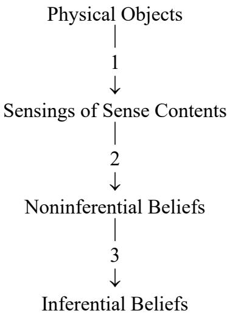

<strong>第一部分\[1\]-\[7\]：感觉材料理论中的一种歧义</strong>

<strong>第1节</strong>

塞拉斯宣称他的计划是攻击“整个被给予性框架”。他不是意在削弱我们非推论性地（典型方式是通过知觉）得出的判断与作为推论结论得出的判断之间的区别。事实上，这篇文章的肯定性任务之一恰恰是告诉我们如何理解非推论性的报告，而不至于不知不觉地滑入被塞拉斯称为“被给予性神话”的那套哲学承诺之中。作为他的直接攻击目标，感觉材料理论的重要性仅在于它是那些诉诸被给予性的理论中的一个比较突出而且有影响力的实例，而我们必须学会在许多不那么明显的伪装下识别这类诉诸。

在这些开篇部分，“被给予性的神话”以这样一种观念的面目出现，即关于认知者的某种非认识论事实可能<strong>蕴涵</strong>关于认知者的认识论事实。[^1]关于认知者的认识论事实首先是指某人知道什么的事实（尽管我们将会看到，“某人仅仅相信什么”这种事实在塞拉斯的意义上同样是“认识论的”）。笛卡尔的一个标志性的创新是用认识论术语来定义心灵：一个状态是心灵状态，当且仅当<strong>处于</strong>该状态蕴涵<strong>知道</strong>自己处于该状态（透明性，排除无知），以及相信处于该状态蕴含实际处于该状态（不可错性，排除错误）。心灵是被<strong>直接</strong>认识之物的领域，这不仅是在非推论的意义上，而且是在更强的意义上：心灵事件的发生以一种特定的方式被给予我们，以至于排除了无知和错误的可能性。（笛卡尔的想法是，如果有任何东西是<strong>间接地</strong>、即通过关于它的表征而被我们所认识，那么某些东西——某种表征——必须<strong>直接</strong>被我们认识，否则就会陷入无限倒退。）塞拉斯将试图向我们表明，笛卡尔对心灵的谈论方式源自于他混淆了认识论事项与非认识论事项这两种不同的东西，以及它们在多种解释中扮演的不同角色

在其最熟悉的形式中，“被给予性的神话”模糊了知觉（sentience）与智慧（sapience）之间的区分。这个区分的一端是单纯<strong>醒觉</strong>（awake）意义上的觉知（这是我们与非话语动物——即那些不掌握概念的动物——所共有的），另一端是涉及<strong>知识</strong>的觉知，它要么本身就是一个知识，要么潜在地可用于<strong>证成</strong>如此限定的判断。“一个红色三角形的感觉是经验知识的典型范例” \[7\]这种观念正是这类混淆的典型。“被给予性的神话”是指这样一种观念：可能存在一种兼具以下两个属性的<strong>觉知</strong>。第一，它本身就是知识，或者蕴涵对于某种<strong>知识</strong>的拥有（也许不是关于其他事物的知识，但至少是知道自己处于某个状态或某种状态）。处于某种心理状态的人仅凭处于这种状态就可以拥有这种知识。第二，人可以在不预设任何概念的习得——即独立于并且先于掌握或精通任何概念的使用（典型方式是通过学习语言）——的情况下达成这种类型的觉知。[^2]塞拉斯的批判性论证的结论是，这两个特性是不相容的，因为只有具有命题性内容、因而具有可以被概念性阐明的东西，才能够起证成作用（或者就此而言需要证成），从而奠基或构成知识。戴维森用一句口号表达了这一思想的某个版本：“持有一个信念的理由只能是另一个信念”。我们可以通过将其修改为以下论述来更好地把握塞拉斯的思想：“认可一个可相信者的理由只能是另一个可相信者”，其中可相信者是可能信念（即具有命题性内容的东西）的内容。[^3]

塞拉斯将命题性内容（propositional contentfulness）——就其是知识的候选者而言，它是认识论的——理解为事物在他所谓的“给予和要求理由的游戏”中所扮演的角色。“在将一个片段或状态刻画为知识时，我们不是在对该片段或状态进行经验性描述，而是将其置于理由的逻辑空间之中，在这个空间中我们可以为自己的话语提供辩护。”\[36\]将某物视为知识的候选者，这本身就是在谈论它在<strong>推论</strong>中作为前提和结论的潜在作用。因为对塞拉斯而言，知识性事实的一个关键的区分性特征在于，它们的表达需要使用<strong>规范性</strong>词汇，因此将某物视为知识的候选者也就同时提出了其<strong>规范性</strong>地位的问题。“所予神话”最终表现为“与伦理学中的自然主义谬误如出一辙”，即试图从“<strong>是</strong>”推出“<strong>应当</strong>”。[^4]这是因为，谈论知识不可避免地就是在谈论某人<strong>承诺</strong>了什么（可被概念性阐明的命题内容），以及他们在各种意义上是否<strong>有资格</strong>持有这些承诺。

<strong>第2节</strong>

在此，塞拉斯区分了感觉<strong>行为</strong>或感觉事件与这个行为的内容，即被感觉到的东西，后者被称为感觉<strong>内容</strong>。当一个人幻觉到一头粉红色大象时，这种活动就是感觉，而感觉内容则使得这成为“关于一头粉红色大象的”幻觉，而不是例如“关于一只绿色挪威鼠的”幻觉。在通常的知觉中，被感觉到的内容必须与被感觉到的外部对象仔细区分开来，因为这些外部对象在幻觉情形中完全不存在。

<strong>第3节</strong>

现在让我们来考虑，在笛卡尔的模型中，把以某种感觉内容为对象的感觉行为当作知识与证成的基础是否合适。

关于知识基础的一般想法可以概述如下：我们的信念只有在不仅为真而且得到证成时才构成知识，侥幸的猜测则不算知识。一个断言或信念可以辩护另一个与它有推论关系的断言或信念。如果一个人有理由承诺命题p，并且q可以从p推出，那么他同样有理由承诺命题q。这样说是为了提供一种证成的继承机制。但是人们会认为，不是所有得到辩护的承诺都能够从其他承诺那里通过推论继承其正当性。必定存在某种其他机制能够获得肯定性的正当地位，从而让继承机制有东西可传递。如果 p1的地位继承自p2，而p2的地位又继承自p3，如此类推，那么要么：

1)  在某一时刻遇到重复的主张（存在m\<n，使得pn=pm) 相同，此时的这种“辩护”就是循环的；要么

2)  永远没有重复，此时就会产生无限倒退，其中每个pn都具有一种异常的地位，即它作为一个“证成者”本身却是未经证成的，因为它要等到无数其他断言都得到证成之后才能得到证成。[^5]

结论是，必定存在某种方式，使得命题无须<strong>被</strong>证成（<em>be</em> justified）就能够<strong>是</strong>正当的（<em>being</em> justified）。我们应当区分“证成”的两个含义：第一个指示一种地位（即“是正当的”），另一种则指涉一个过程（即“证成行为”），而这个过程可以导致对这个地位的拥有。[^6]于是结论便是，除了在提供证成的意义上的证成行为以外，必定存在某种获得肯定性正当地位的其他方式。除了推论性的继承之外，必定还存在某种非推论性的获得机制来获得这种知识性地位。

到目前为止一切顺利。笛卡尔从这条思路中得出结论：存在一种可以被称为基本信念的主张或信念，它们构成了所有其他信念的基础，也就是说它们是所有其余信念的正当地位从中推论性地流出的源泉。虽然这一点不是必然成立的，但是塞拉斯不会对此提出质疑。[^7]笛卡尔进一步相信，除非这些信念是确定的（即拥有终极的肯定性正当地位），否则任何基于它们而推导出来的信念甚至就连或然的地位都无法获得（正如C.I.刘易斯在《心灵与世界秩序》中所表述的那样）。笛卡尔赋予哲学以一次决定性的认识论转向，这一转向至少到康德为止一直与主观转向相混淆。后者仅仅是出于笛卡尔对前者的独特的、可替代的处理方式。因为他从认识论地位的角度将心灵定义为位于主体的不可错性和局域全知性（local omniscience）的管辖范围内，从而是主体最知道的东西。这种认识论定义促成了对以下两类事件的同化：第一类事件的内容像<strong>句子</strong>一样组织起来，例如认为维也纳是奥地利的一座城市；第二类事件的内容像<strong>图像</strong>一样组织起来，例如想象或似乎看到绿色圆圈内部的一个红色三角形。

让我们回到把以某些感觉内容为对象的感觉行为当作知识的基础的想法。这里所描绘的过程大致如下：

在标准的感知情形中，正是因为我面前有一个带有八角形表面的红色物体，我才发现自己拥有对一种红色且八角形的感觉内容的感觉。正是因为我拥有这样的感觉内容，我才获得非推论性的信念，即我面前有一个红色且八角形的物体。正是因为我拥有这个信念，或许还连同其他信念，我进一步的推论性信念才是正当的（比如我面前有一个禁行标志）。

这里需要关注的是这些“因为”的本质。第一个因为（箭头1）可以被理解为一种因果性概念，或许是感知神经生理学所研究的那类概念。就此而言，它关联于可以用非规范性词汇描述的殊项。这是一种事实性的、非认识论的关系。另一方面，最后一个“因为”（箭头3）则指示了塞拉斯所谓的“认识论的”关系。它是一种推论性概念，关联于具有语句结构的、作为可重复抽象物的信念（或可相信者）。这里涉及的是理由，而不是原因。这种证成关系不是自然关系，而是规范性关系；对此有最终发言权的不是经验科学家，而是逻辑学家或认识论学家。

问题是：中间那个关系（箭头2）属于哪种类型？它的同类是第一个因果关系还是第三个推论关系？对感觉内容的感觉应当如何被设想为与（有充当基础的潜力的）非推论性信念相关联？正是在这里，认识论的与非认识论的、以原因语言描述的殊项与以理由语言描述的可相信者之间的区分，才开始发挥作用。

假设人们把对感觉内容的感觉理解为一个殊项（感觉内容）与另一个殊项（正在进行感知的人）之间的非认识论关系的存在。（这正是塞拉斯本人最终认可的观点。）如果是这样，就很难看出对感觉内容的感觉如何能够蕴含或辩护一个主张，例如一个非推论性信念。因为只有具有语句结构的东西（而不是以非认识论的方式被规定的殊项）才能作为推论的前提。因此，如果将感觉理解为感觉内容与感知者之间的非认识论关系，它们就不适合充当推论性继承的辩护所追溯到的最终基础。因为这样一种感觉的发生并不蕴含对任何主张的承诺，所以人们有可能拥有这种感觉而不形成任何信念，当然更不可能获得任何知识（因为后者还需要肯定性的正当性地位）。因此，希望将感觉行为设定为基础的基础主义者似乎必须将对感觉内容的感觉视为一个与感觉主体有关的认识性事实。但是这样一来，作为对象的殊项又变成了什么呢？

<strong>第4节与第5节</strong>

感觉材料理论家可以将感觉视为认识论上的非推论信念，可以从中进行推论并继承其正当性地位，从而使感觉能够起到基础的作用。为了保留被感觉到的心理性殊项（即感觉材料，或者说被设想为一种被感觉对象的感觉内容）的作用，理论家必须愿意说出以下内容：“原始概念是相信感觉内容x具有属性F。感觉到感觉内容x就是相信它具有某种（无论是哪一种）特征F。作为一个殊项，感觉内容是认识论感觉的意向对象。”关于这一分析，需要注意的很重要的一点是，这里的认识论概念是被预设的，而不是通过一种据说能够被预先理解的非认识论感觉行为（它被设想为主体和感觉内容之间的关联，在这里两者都被视为殊项）概念来解释的。事实上塞拉斯认为，将认识论性还原为非认识论性即便在原则上也是不可能的——尽管他的论证并不依赖于这一主张。

<strong>第6节</strong>

此时引入了一个进一步的考虑：按照所予性的支持者的看法，置身于被动因果关系之中的能力不是某种必须通过经验或训练而被<strong>习得</strong>的能力。相反，适当类型的有机体只需保持清醒就能够拥有这种能力。然而，拥有形如“x是F”的信念的能力却涉及将不可重复物或殊项归类于可重复物或共项之下。人们自然地会认为分类能力是习得的，因为人们必须通过经验和学习来了解类别的边界。这一思路导致了感觉材料理论家所承诺的、且希望有权主张的一个不一致的三元组：

1.  “S感觉到红色的感觉内容x”蕴含“S非推论性地相信（知道）x是红色的”。

2.  感觉到感觉内容的能力不是习得的。

3.  拥有形如“x是F”的分类型信念的能力是习得的。

如果放弃A，那么对感觉内容的感觉就成为一种非认识论事件，它至多只能是知识或非推论性信念的逻辑必要条件，而非逻辑充分条件。采取这种进路意味着抛弃\[4\]与\[5\]所追求的路线。如果放弃B，感觉材料理论家必须要么声称婴儿需要练习才能感到疼痛、饥饿、瘙痒等，要么声称对这些东西的感受不是感觉。但是这样一来什么才算是感觉呢？如果放弃C，就必须讲述一个故事，说明哪些共项概念是天生的（非习得的、与生俱来的、内置的）而哪些不是。这所要求的主张远远超出了晚近天赋论（例如乔姆斯基）的范围，因为不仅是语法形式、而且就连“红”和“高”这样的实质性概念都必须是与生俱来的。A是给予性神话的一种形式，塞拉斯将放弃它。然后他将亏欠我们（并在以后提供给我们）一种关于思想和感觉以及知识起源（既包括因果关系中的起源，又包括证成顺序中的起源）的新说明。

<strong>第7节</strong>

塞拉斯的诊断——这还不是针对所予性概念的治疗——认为，它产生自以下两条思路的混淆：第一条源自试图对知觉和经验信息的获取给出科学说明，第二条源自试图在笛卡尔模型（上文讨论\[3\]时已概述）中给出基础主义认识论说明：

1)  有一种观念认为，某些内在事件——例如红色或C#音的感觉——可以在没有任何先行的学习或概念形成过程的情况下发生于人类（以及动物）身上；并且如果没有它们，人在某种意义上就不可能看到（例如）物理物体的正向表面是红色的和三角形的，或听到某个物理声音是C#音的。

2)  有一种观点认为，存在某些内在事件，它们是对某些事物（例如红色或C#）的非推论认知活动；并且这些事件是经验知识的必要条件，因为它们为所有其他经验命题提供了证据。

第一类内在事件由殊项构成，其特征是其在因果关系中扮演的角色。第二类内在事件由像句子一样组织起来的主张构成，其特征是在推论或证成关系中扮演的角色。塞拉斯将（从\[45\]开始）着手说明这两种<strong>内在事件</strong>所属的类型。他把第一类事件称为“感觉印象”，把第二类事件称为“思想”，并分别描述它们所扮演的角色。最后，他将解释它们如何在人类知识中相互关联。（到目前为止，我一直在谈论信念，而塞拉斯谈论的是知识，这是为了强调非推论性信念的<strong>辩护</strong>或确证问题尚待讨论。）

将这两条思路合并起来的结果是“这样一种观念：对一个红色三角形的感觉是经验知识的典范。”这个观念恰恰受到塞拉斯所指出的那些彼此相关的“困惑”的影响：

- 我们是否应将有待考察的感觉视为一种殊项（像一个三角形一样被组织起来），还是应当将其视为一种信念（像一个句子一样被组织起来）？

- 拥有这种经验知识的能力是通过经验习得的，还是先于经验的？

- 它是在<strong>因果</strong>还是<strong>证成</strong>的顺序上先于我们的经验？

<strong>第二部分\[8\]-\[9\]：另一种语言？</strong>

<strong>第8节</strong>

本节和接下来的两节（在原文中均被标记为第9节！）在某种意义上是一个题外话。主线在\[10\]中被重新拾起。这个插叙的目的是引入一些将在后面得到进一步讨论的重要观点。这里的主题是感觉材料理论为了避免塞拉斯给它提出的“可以用非认识论的方式规定的殊项”与“只能用认识论的方式规定的、具有语句结构的前提”的两难。人们可能完全放弃非认识性方面，转而接受其基础的、非推论性信念的一面。因此，艾耶尔认为，对“对感觉材料的感觉”的谈论等价于并且派生于对“事物在主体看来是什么样”的谈论。这个建议分为三个部分：

1)  存在着一类非推论性信念，它们构成了我们其余经验信念的辩护基础。（请注意，这足以回应上文\[3\]中概述的倒退论证，尽管如那里所暗示的，它不是回应的必要条件。）

2)  对一种现象的三层嵌套描述。首先是一个老生常谈：我尽管可能错误地认为我面前有一个红色三角形，但是不可能错误地认为<strong>看起来</strong>有一个三角形。其次是一个具体化的步骤：按照笛卡尔主义的原则，显像和实在的区分在于，主体可能在后者上出错而不能在前者上出错，否则就会造成无限倒退。最后是一个基础性的主张：(a)中提到的那类信念是由知觉报告句子来表达的，这些句子前面附带一个特殊算子“现在在我看来…”、“现在对我来说看起来…”或“现在对我来说显得……”。

3)  形如“S正在拥有（或者觉知到）一个满足F的感觉材料”（例如，红色且三角形）的句子，按定义等价于形式为“在S看来，他似乎感觉到某个满足F的事物”的句子。按照这种理解，不存在作为感觉材料的殊项；对于那些对我们造成了相反印象的、看似有所指称的单称此项，我们应当把它们理解为类似于“it is raining”中的“it”。

<strong>第9节</strong>

塞拉斯在这里对这种进路提出了一项观察，然后为它构造了一个两难困境。他考察了<strong>类属性的</strong>看起来（<em>generic</em> lookings）的情形。某物可以看起来是多边形的，而不必看起来具有任何确定的边数。但是任何东西都不可能在没有确定边数的情况下是多边形的。（这一对比将在\[17\]中得到进一步探讨。）因此，在由（c）所断定的等价关系引入的感觉材料话语中，人们被允许做出的那些推论，与感觉材料理论家把感觉材料当作殊项来谈论时所允许的那些推论，并不是同一批推论（对后者而言，上面所说的“进一步规定的推论”是成立的）。因此，这套代码（code）是误导性的。

<strong>第9节补充</strong>

这一两难困境提出了一个更为严重的反对意见。如果关于感觉材料的谈论仅仅是一种代码，那么它哪怕不具有误导性，也是多余的。既然如此，它还有什么用处呢？它无法解释任何关于“看起来”或“显得”的事情。要做到这一点，它就必须成为一种关于显像的理论，通过将它们与某种特定类型的殊项（即感觉材料）的关系来解释它们。（塞拉斯在\[21\]和\[22\]中开始解释他如何思考理论解释。从\[39\]到\[44\]开始，我们在文章的后半部分会听到更多关于这一主题的内容。）但是这将重新引入上述（1）的思路（见\[7\]和\[\[7\]\]），而代码理论正是为了规避这一思路而被提出的。这带给我们的教训是，这种思路不是完全错误的。塞拉斯将要提供的解释构成了一种关于显像的理论，并将恰当地理解并调和（1）和（2）。因此，（c）不构成回避问题的一种方式。然而，它使我们得以审视与之结合在一起的假设（a）和（b）。塞拉斯的结论是，这一思路在步骤（b）时就已经承诺了从仅关于“事物<strong>看起来</strong>如何”的主张推论出关于“事物实际上<strong>是</strong>什么样”的主张的可能性。但是如果（a）和（b）是正确的，即所有经验证据最终都源于事物看起来如何，那么这种推论显然不可能通过显像与实在的归纳关联而获得经验上的保证。另一种选择似乎是寻找一种定义性的还原，据此“原则上可以用‘那里看起来有一个以红色三角形的为正向表面物理对象’这类句子来构造任何关于物理对象的日常话语。”由于对（a）和（b）的承诺比对（c）的承诺更为普遍，因此重要的是看清它们所表达的观点错在那里——即它们所预设的还原为什么是不可能的。为此，塞拉斯转向了“看起来”或“似乎”谈论的逻辑。

<strong>第三部分\[10\]-\[20\]：“看起来”的逻辑</strong>

<strong>第10节</strong>

为了摆脱\[6\]中的三难困境，有必要“考察这两种观念\[（1）和（2），见\[7\]和\[\[7\]\]\]，并确定每一种观念中经得起批评的部分如何恰当地与另一种观念相结合。”首先让我们考察“内在事件”这个属类，每个主体都对它具有特权通道，这一点对感觉和思想都成立。

1.  逻辑实证主义者否认可能存在这样的事件，因为它们的实存无法在主体间得到证实或证伪。这是传统他心问题以及倒置光谱问题（the inverted spectrum）的根源。为了避免考虑这种不可验证的假设，人们可以拒绝观念（1）。

2.  维特根斯坦及其一些追随者攻击了（2），即内在事件可以为基于推论的知识奠基，因为作为私人的东西，它们逃脱了公共话语的网络和语言学习（盒子中的甲虫和私人语言论证）。

塞拉斯对这两种观点都不同意。我们稍后将在“行为主义”标题下回到第一种观点（\[54\]-\[55\]）。为了避免他心问题以及倒置光谱的可能性，人们真正应当拒绝的是“所予神话”，而不是内在事件的概念。在\[45\]-\[47\]中，塞拉斯将论证（b）既太强又太弱。说它过强，是因为内在事件不是必须逃出公共话语之网。《经验主义与心灵哲学》的后半部分的任务在于向我们展示如何把内在事件思考为变得可观察的理论实体。说它太弱，是因为这种对内在事件的摒弃（正如我们在以下各节中所见）并不足以避开塞拉斯的敌人，即所予神话。

<strong>第11节</strong>

问题在于，即便，人们出于倒置光谱和盒子中甲虫的理由而拒绝谈论这些看起来（lookings）的内在属性，形如“X在S看来是F”的非推论信念仍然可能被认为是在坏的意义上被给予的。也就是说，即便人们不假定（事实上人们也不应当假定的，参见\[21\]）如果某物对S而言看起来是F，那么某物是F（即“感觉材料推论”），人们仍然可能陷入所予神话。于是，为了攻击这种更为隐蔽的所予神话形式，塞拉斯考察了“看起来”话语的概念，而不考虑它可能被认为与作为殊项的内在片段所具有的任何关系。

<strong>第12节</strong>

问题在于：在概念上（因而在解释顺序上），“看起来是红的”是否先于“是红的”？也就是说，后者能否以这样的方式用前者来定义，使得人们可以先学会使用被用于定义的概念（看起来是F），再仅凭定义学会使用被定义的概念（是F）？笛卡尔及其传统声称，“看起来是F”的话语——可以用它来形成一类关于主体的不可错的陈述——是知识的基础，因此在这个意义上必须优先于“是F”的话语（它只能用来表达可错的、推论出的信念）。这个观点正是笛卡尔基础主义的本质。

令笛卡尔感到震惊的是，显像/实在的区分似乎并不适用于显像本身。虽然我可能弄错某物是否为红色（或者远处的塔是否为方形），但我不能以同样的方式弄错它现在在我看来是否为红色。[^8]怀疑者尽管可以合理地向我提出质疑：“也许那个东西不真的是红色，而仅仅看起来是红色”，却没有余地进一步怀疑：“也许那个东西甚至看起来也不是红色的；也许它只是看起来是看起来是红色。”如果它看起来是看起来是红色，那么它确实就是看起来是红色。如果我们试图迭代“看起来”、“似乎”或“显得”这类操作符，它们就会坍缩。显像与实在之间的对比，是由“看起来是F”与“是F”之间的区分来标示的，其中“F”是普通的（指示实在的）谓词。但是“看起来是看起来是F”与“看起来是F”之间的区分却没有标示出一个相应的差异。笛卡尔将显像具体刻画为这样一些事物，它们真实的样子恰恰就是它们显现出来的样子。他推论，我们不是间接地认识它们，即通过可能引入错误表征（即它们真实样貌与它们仅显现样貌——即被表征为的样子——之间的区分）的表征来认识。相反，我们直接地认识它们——仅仅通过拥有它们。因此，外观——被设想为一个由非推论性引发的、关于事物看起来如何（就视觉情况而言），或更一般地说，似乎或显得如何的断言所报告的存在领域——显现出具有作为知识认识论上可靠基础的理想资格：我们不可能对它们犯错误。仅仅拥有一个外观（在塞拉斯讨论的变体中，“被以F方式显现”），就算作知道某事物：当然不是知道某物是F，但至少知道某物看起来、似乎或显得是F。因此，就产生了这样一种可能性：通过仅从这类知识——即关于事物看起来、似乎或显得如何的知识——出发，并以某种方式构建起我们关于事物真实样貌（外观领域之外）的知识（如果有的话），来重建我们的知识。

这个计划要求，具有“看起来是F”形式的概念，原则上必须在掌握相应的“是F”（或“为F”）概念之前就能被理解。塞拉斯在概念秩序上是一位语言实用主义者；也就是说，对他来说，掌握一个概念就是掌握一个词语的用法。\$^{9}\$ 因此，他系统地采用一种方法论，将概念优先性的问题转化为关于各种语言游戏相对自主性的问题。他将论证，在这种情况下，笛卡尔把事情搞反了。

“看起来”的谈论并不构成语言的一个自主层次——它不是一个可以独立于其他语言游戏而玩的游戏。一个人必须已经能够使用“是F”的谈论，才能掌握“看起来是F”的谈论，而后者实际上是寄生在前者之上的。在这个精确的实践意义上，“是F”在概念上（塞拉斯常说“逻辑上”）优先于“看起来是F”。

第13节：为在笛卡尔式的解释秩序（并因此最终是辩护秩序）中加以利用而考虑的定义是：

x是红色 \$=\_{df}\$ 。在标准条件下，x看起来是红色。

塞拉斯将表明，如何承认这一主张在定义上为真，同时却不认可“看起来”谈论的概念优先性，从而不给所予性及其所支持的那种基础主义以任何帮助或安慰。

第14节：句子既可以有报告性（非推论性）用法，也可以有（仅）陈述事实性（推论性）用法。\$^{10}\$对于可靠的报告者，人们可以从以下事实进行推论：某人倾向于说\$x\$是\$F\$，并且条件据其所知是标准的，而且在这些条件下，当某人如此倾向时，通常\$x\$确实是\$F\$，从而得出结论：\$x\$事实上是\$F\$。（报告者必须相信这一切，并因此理解它，这对塞拉斯后来的论证至关重要）。理解报告者反应倾向中系统性错误的可能性，为报告实践与推论实践之间的关系引入了新的维度。在此，塞拉斯引入了领带店中年轻约翰的说明性寓言。

第15节：当附带信念表明系统性错误可能发生时，主体学会不再做出“\$x\$是\$F\$”这一报告（他先前被灌输的反应倾向促使他做出此报告），而是做出一种新的主张：“\$x\$看起来（或似乎）是\$F\$”。当然，人们很容易将此视为一种新型报告，甚至是对一种特殊殊相（即感觉材料）的报告。这种报告自然被认为是对一种最小的、非推论可确定的、具有基础根本性的事实进行报告，而每个主体对此类事实都是不可纠正的。这里有两个要点，或许可以加以区分。首先，无论如何，将所报告的内容视为基础根本性事实都是错误的，因为用以表述这些事实的概念被证明依赖于其他概念，而这些其他概念并非通过任何类似“看起来”算子的方式形成的。（参见\[32\]。）进一步的主张是，将这些视为报告本身就是错误的——因为它们表明了一种将某物称为\$F\$的倾向，但可能不宜被视为在陈述某人具有这种倾向。塞拉斯在第二点上有所动摇，但他对第一点立场坚定。

第16节：塞拉斯提出的替代性分析，依赖于区分非推论性报告之使用的两个不同维度。首先，每一份报告都是某种可靠的分辨性回应倾向（differential responsive disposition）的体现。也就是说，报告是一个人经过训练后，在特定环境情境下以某种方式行事的结果（就像一只鸽子被训练得在红灯亮起时啄红色方块）。一只被训练得在且仅在面对某个红色事物的可见呈现时说“那是红的！”的鹦鹉，与一个对同样情形进行真正非推论性报告的人，两者之间有何区别？仅仅具有分辨性回应倾向并不足以拥有概念，否则，一块在潮湿环境中生锈而在干燥环境中不生锈的铁块，也得被算作拥有“潮湿环境”和“干燥环境”的概念了。除了鹦鹉所具有的感受性（sentience）之外，还需要什么才能构成那种通过运用概念做出分辨性回应而体现的理智性（sapience）？塞拉斯的回答——援引报告的第二维度——是：这种回应必须是在理由空间（space of reasons）中占据一个位置——即在给出理由和追问理由的游戏中走出一步。真正的非推论性红色事物报告者已经掌握了该类报告所扮演的推论性角色，而鹦鹉则没有——所谓推论性角色，是指当这类陈述被旁人听到时，人们有权从中得出什么结论，什么可以算作支持它的理由，什么与它不相容因而构成反对它的理由。这关乎报告者因做出报告这一行为而承担的断言性承诺（assertional commitment）所具有的、以推论方式加以阐发的内容：即报告者所负责任的内容。塞拉斯对第二维度所用的术语是“认可”（endorsement），这关乎一个人因其断言性行为而在语言上承诺了什么（其主张的推论性后果），或对什么负责（它如何可能被证成）。这种责任概念——即一个人赋予了他人何种推论权利，或自己有何种推论义务，以及哪些其他承诺可以算作使一个人有权做出其所承担之承诺——是语言行为中的规范性要素；它不可还原为描述性方面（如回应倾向），这一点正位于认知性/非认知性区分的基础之上，也是塞拉斯在\[5\]末尾关于自然主义谬误之评论的根源。

按照塞拉斯的理解，正确使用“x看起来是绿的”这一说法的能力，所诉诸的正是学习正确使用“x是绿的”时所获得的那些回应倾向。但是，依据这些倾向所引发的两类言说，却支持相当不同的推论。特别是，领带店的寓言表明，当一个人说某物仅仅是看起来绿时，可以被理解为在做两件事：表达自己将其称为绿色的非推论性分辨回应倾向（即承诺“它是绿的”这一主张，连同其所有的推论性后果和证成义务），同时明确地暂缓对该主张的认可。因为关于在当下观察环境中可能存在系统性错误的附带信念，已经削弱了报告者对其可靠性的信心——也就是说，对其从“X被倾向以非推论方式报告某个绿色事物的在场（在电灯光下所见）”推出“那里（大概）有一个绿色事物”这一推论之正确性的信心。

对“使用‘看起来’时人在做什么”的这一分析，解释了“看起来”说法的不可纠正性。一个人可能弄错某物是否为绿色，因为他所认可的断言、所承担的承诺，可能最终被证明是不正确的。例如，其推论后果可能与其他已知或后来独立得知的事实不相容。但在说某物看起来是绿色时，他并非在认可一个断言，而是在拒绝认可一个断言。这样的报告者只是表露了一种倾向，即去做某件出于其他理由（例如怀疑观察环境会导致系统误差）他不愿做的事——也就是认可一个断言。这样的报告者不可能出错，因为他已克制自己不去做出承诺。这就是为什么“看起来”、“似乎”和“显得”这些算子不能迭代。它们的功能是表达对算子范围内那个句子的认可予以拒绝。在“看起来-看起来是F”与“看起来是F”之间，不存在像“看起来是F”与“（是）F”之间那种有意义的对比，因为第一个“看起来”已经对附近唯一可能让人承诺的内容（某物是F）拒绝了认可。第二个“看起来”没有进一步可做的拒绝工作。没有什么可再收回的了。既然断言“X看起来是F”并非承担一个具有命题内容的承诺——而只是表达一种可被推翻的倾向——那么就不存在该承诺（哪一个？）是否正确的问题。

塞拉斯因此解释了外观断言的不可纠正性，这一点曾给笛卡尔留下深刻印象。他是从使用语词的实践角度来解释的，而根据其方法论的语言实用主义，对相关外观概念的把握必然归结为这些实践。但一旦我们以脚踏实地、实践性的、坚决非形而上学的术语看清了这种不可纠正性的来源和本质，我们也就明白了为什么它恰恰不适合用作我们其余（有风险的、可纠正的）经验知识的基础。因为，第一，关于事物仅仅看起来如何的断言的不可纠正性，只是反映了它们的空洞性：即它们实际上根本不是断言。第二，同一个故事也告诉我们，“看起来”的说法并不是一种自主的语言游戏——一种可以独立于其他游戏而玩的游戏。它完全寄生在作出关于事物实际如何的有风险的、经验性报告这一实践之上。因此，笛卡尔抓住了一个真实的现象——外观断言的不可纠正性，反映了“看起来”、“似乎”和“显得”等算子的不可迭代性——但误解了其本质，因而错误地认为它可以扮演一个它完全不适合的认识论基础角色。

这一对“‘看起来’说法的逻辑”的分析，以及由此对基于我们对外观的认识通道之不可纠正性的基础主义的错误所作的诊断，是塞拉斯对笛卡尔主义批判的建设性核心。它并不自诩为一种压倒性的论证；因为它只能与其对“看起来”说法如何运作的说明同样具有说服力，而替代性解释总是可能的。\$^{11}\$ 它的目的是通过解释那种诱惑的确切本质而不将其消解掉，来消除走上笛卡尔式基础主义道路的诱惑。

第17节：（这一思路在\[22\]中完成。）我们开始寻找对“看起来”说法之双管齐下说明的某种确证，即它表达了一种作出特定非推论性报告的差异反应倾向，同时拒绝认可该断言。这种确证以解释外观说法中其他令人费解特征的形式出现。考虑以下三个句子：

i\) 那边那个苹果是红色的。

ii\) 那边那个苹果看起来是红色的。

iii\) 看起来那边有一个红苹果。

这些句子的表达可以体现相同的反应倾向，即报告存在一个红苹果，但它们对那一主张的不同部分予以认可（承担其推论后果的责任）。(i) 既认可苹果的存在，也认可其红色的性质。(ii) 只认可苹果的存在。“看起来”这一说法明确取消了定性承诺或认可。(iii) 明确取消了存在性和定性两方面的认可。因此，如果有人声称那边实际上没有苹果，他就是在断言与 (i) 和 (ii) 不相容的内容，但不与 (iii) 相冲突。如果他否认那边有任何红色的东西，他就是在断言与 (i) 不相容的内容，但不与 (ii) 或 (iii) 相冲突。塞拉斯对使用“看起来”这一实践的解释，即当人们怀疑自己的反应倾向存在系统性错误时便不予认可，可以说明 (i)-(iii) 所展示的认可范围差异。但在感觉材料理论中，这种差异又如何能得到解释呢？

在本节中，塞拉斯指出了他的解释相对于感觉材料理论的另一个优点，即有可能报告一种仅仅是一般的（更准确地说，仅仅是可确定的）外观。（回想一下，塞拉斯在\[9\]中已经引入了这一现象。）因此，一个苹果可能看起来是红色的，而不必看起来是某种特定的红色色调（深红、猩红等）。一个平面图形可能看起来是多边的，而不必看起来具有某个特定的边数（比如119条）。但如果“看起来”陈述要被理解为对心灵之眼前存在某个是\$F\$的特殊物的报告，那么这种可能性又如何理解呢？特殊物是完全确定的。一匹马有特定数量的毛发，尽管如塞拉斯所指出的，它可能看起来只是“很多”毛。它是某种特定的棕色色调（或几种色调），即使它可能看起来只是深色的。那么，这种一般的、仅仅是可确定的外观是如何可能的呢？塞拉斯的解释是从认可范围的角度进行的。当一个人只愿意认可（承担为更一般的主张辩护的责任）时，他就会说平面图形看起来是“多边的”，而不是“119边的”。这涉及一个人愿意在多大程度上信任自己的反应倾向，即他认为这些倾向值得或能够维持的认知可信度。特殊物，即使它们是感觉内容，也不可能在没有某种确定颜色和色调的情况下被着色。那么，感觉材料理论家——他想说当某物对S看起来是F时，S中的某物是F——如何解释某物可以看起来是有颜色的，而不看起来是任何特定颜色，或看起来是红色的，而不看起来是任何特定红色色调这一事实呢？因此，塞拉斯从认可角度对“看起来”话语的解释可以说明这类话语的两个方面，而任何援引所予的理论都无法解释：定性与存在性外观之间的范围区分，以及仅仅是一般的或可确定的外观的可能性。

第18节：因此，首先必须获得报告红色对象的实践（既要获得相应的反应倾向，也要理解通过作出此类断言所认可的内容），然后才能学会作出表达相同倾向但在认可上更为谨慎的报告。正如前一节的论证所示，掌握所需的不同认可程度可能相当复杂。例如，人们可以区分存在性的和性质性的“看起来”，以及各种程度的可确定性。因此，要知道某物何时看起来是红色的，必须理解红色意味着什么，以及许多其他内容。\$^{12}\$ 在这一点上，我们可以看到，我们在\[13\]中担心的那个句子之所以为真，是因为它是一个定义，不是关于“是红的”的定义，而是关于标准条件的定义。因为标准条件正是那些反应倾向可以被信任并应被完全认可的条件。有了这样的定义，人们就可以经验性地研究这些条件是什么。

第19节和第20节：这两节回到掌握观察概念所涉及的各种能力的习得问题，即提出\[6\]中三重困境的那个问题。我们现在知道，这些能力既包括规律性的反应倾向，也包括一种在推论上操作认可的能力，分别是一种非认识技能和一种认识技能。为使认可具有概念内容而需要的特定推论表达，在塞拉斯的图景中引入了至少有限整体论：一个人不可能拥有一个概念，除非他拥有许多与之有推论关系的其他概念：“关键在于，即使拥有更基本的概念（比如绿色的概念），也预设了拥有一系列其他概念。”这要求拒绝这样一种观点，即“关于可观察事实的基本概念具有那种逻辑独立性，这是经验主义传统的特征。”这两节并未以清晰甚至线性的方式呈现塞拉斯的论证，该论证在\[33\]-\[37\]中以更令人满意的形式重复出现，我们将在那里讨论它。

第四部分 \[21\]-\[23\]：解释“看起来”

第21节和第22节：\[17\]讨论了认可范围的问题，这在\[21\]的第三段中得到了处理。塞拉斯以事件（即“看起来”和“看见”）的术语重新表述了这一说明，而之前我们讨论的是由这些事件因果引发的报告。\[22\]的前两段和\[21\]的第三段随后对两种解释现象的方式之间的区别提出了初步说明：

i\) 通过从完全以可观察项（即可以被非推论地报告的事物）表述的经验概括中演绎出该现象。通过诉诸定律PV=kT，并结合适当的背景条件，来解释气体样品压力的变化，就是一个例子。

ii\) 通过假定不可观察的实体，并将该现象归入涉及这些理论实体的定律之下。通过诉诸气体动力学理论及其假定的分子及其相互作用，来解释气体压力的变化，就是一个例子。

同样，这一讨论在此处确实有些不合时宜，仅作为对后来将更详细探讨的论证线索（始于\[39\]-\[44\]）的一种隐晦预示。塞拉斯在此确实提出了一个重要问题，即使在我们将存在性的、性质性的和无条件的“看起来”陈述理解为认可范围（如\[17\]所述）之后，这个问题仍然存在，即这三种情况中共同的东西是什么？我们将看到，答案是：“红色的感觉印象。”但直到文章结尾（\[62\]），我们才能理解这个答案。

第23节：本节讨论的是，什么东西能够真正地是红色的问题。塞拉斯的观点是，只有物理对象能够如此，并且认为即使是朝外的表面也不能，除非是在派生的意义上，这是一种错误。目前的讨论并不令人满意，因为关于首要性和归因字面性的标准尚未给出。再一次，这里预示了后面的讨论，在这种情况下涉及\[60\]-\[61\]中感觉的“红之性”。

第五部分和第六部分（\[24\]-\[29\]节）对英国经验论者对印象的处理进行了讨论。它们填补了塞拉斯讨论的一些历史背景，但对于其论证的发展并非核心或必要。

第五部分 \[24\]-\[25\]：印象与观念：一个逻辑要点

第24节和第25节：讨论“对……的感觉”的意向性。塞拉斯的观点是，笛卡尔错误地将感觉和思想同化，因为二者各自都“关于”或“指向”某物。我可以没有红色三角形而有对它的感觉，也可以没有金山而有对它的思想。但这是表面上的相似性，因为在这两种情况下，关于性的种类实际上相当不同。塞拉斯在这里没有提到的另一个同样重要的同化动机，是赋予感觉和思想报告以不可纠正性和透明性，即认识论上的特权。在这里，塞拉斯指出了应用于经验概念时臭名昭著的“ing”/“ed”歧义。

第六部分 \[26\]-\[29\]：印象与观念：一个历史要点

第26节：倒置光谱问题如果不诉诸某种版本的“所予神话”，就无法陈述。

第27节：经验论者洛克、贝克莱和休谟的一个核心认识论问题被认为是：鉴于我们能够意识到完全确定的感觉可重复体，我们如何也能意识到可确定的感觉可重复体。确定/可确定类似于种/属，只是没有单独可指定的区分因素。颜色是首要例子：猩红色是可确定颜色红色的更确定色调，正如红色是可确定颜色“有色的”的一种确定。

第28节：英国经验论者“……都理所当然地认为，人类心智具有一种天生的能力来意识到某些确定的种类——事实上，我们仅仅通过拥有感觉和意象就能意识到它们。”也就是说，他们没有提出一个相应的问题：鉴于我们能够意识到特定的不可重复的个别感觉内容，我们如何也能意识到它们的可重复类型，即使是最大程度确定的类型。

第29节：针对这一点，塞拉斯将主张他所谓的“心理唯名论”（并非最理想的名称），根据这种观点，对所有可重复体（无论是确定的还是可确定的）的意识都是语言性的事情，因此在一个人关于语言习得和运作的说明中，不能预设这种意识。塞拉斯提出了一种语言的、社会的意识理论。他用这个术语所指的不仅仅是醒着（不是睡着）：他追求的是智慧意义上的意识，而非感觉意义上的意识。它是分类性的意识，即把某物视为某物的意识。但并非所有的分类行为都是意识行为。正如上文\[\[16\]\]所指出的，任何对刺激具有稳定区分性反应倾向的东西，都可以被认为根据刺激所引发的可重复反应来对刺激进行分类。一只被训练对其环境中红色事物做出区分性反应的鹦鹉，并不表现出塞拉斯所解释的那种意识。这种意识，特别是概念性意识，要求超越醒着和通过区分性反应进行分类。

第七部分 \[30\]-\[31\]：“意味着”的逻辑

第30节：任何认为使语言习得成为可能的前语言意识具有推论结构（塞拉斯说是“逻辑的”，但那只是20世纪50年代对“概念的”的说法，而塞拉斯可将“概念的”解析为“推论的”）的人，都承诺了“所与神话”。这种概念意识不仅涉及分类，还涉及使分类在推论中具有意义。正是在这一点上，事实陈述得以作出，特殊物被指称并在共相下被归类。在塞拉斯反对“所与神话”的那类说明中，概念内容是以推论方式联结的。但推论是一种只在“给出与索求理由的游戏”中产生的过程，而这一过程本质上涉及信念。这是一个规范性领域，涉及承诺与对主张的资格、认可与辩护。这正是塞拉斯一直所称的“认识论的”。“所与神话”是指认为任何东西都能内在地、自然地或必然地对此领域具有特定意义，而独立于对其具有该意义者获得或运用概念。按传统所设想的那种意识行为——即意味着存在某种足够类似信念的东西，能充当经验知识的最终推论基础（更不用说其本身构成知识）——就必须具有恰好这样的属性。

第31节：因此，学习一个意义不应被理解为将某种自己已意识到的东西与一个语词符号联系起来。但这不是理解像“‘rot’（德语）意为red”这类陈述的自然方式吗？塞拉斯除了将此句理解为表达了对可确定的可重复性质之意识与“rot”一词之间的关联外，还能如何理解它呢？他的回答是，这类意义主张实际上断言，被提及的表达（“rot”）与所使用的表达（“red”）起着相同的概念功能作用。“这些考虑表明，从语义陈述‘“red”意指red这种性质’的真实性中，关于‘red’一词与红色事物之间确切关联方式的任何内容都无法被推论出来。”

第八部分 \[32\]—\[38\]：经验知识是否有基础？

第32节：这里描述了另一种错误的、基础主义的说明。塞拉斯只不同意这一故事中的一点，尽管事实证明这一点很重要。基础主义主张存在一种特定信念的结构，使得：

1）每一个信念都是非推论地获得的。

2）（1）中的信念不预设任何其他信念，无论是个别的还是一般的。

3）这些非推论获得的信念构成所有事实主张的最终上诉法庭。

塞拉斯接受（1）和（3），但否认（2）。他此时的任务是表明，一部分知识（信念）如何能够——而且事实上全部知识都确实如此——预设其他知识（信念），即使它不是从那些其他知识或信念中推论出来的。这种可能性并未被古典认识论传统认真考察。塞拉斯所拒绝的是一种关于理解的特定层级图景（在此层面上，这是相信的必要条件）。他并不反对关于辩护的层级图景，只要它已与关于信念之性质与获得的坏基础主义适当区分开来。

对塞拉斯而言，不存在所谓非推论信念——如果这指的是那种无需把握其与至少某些其他信念的推论联系便能拥有的信念。因为理解一个句子、把握一个命题内容（拥有信念的必要条件），就是将其置于理由空间之中，在给予与索取理由的游戏中为其指派一个推论角色，即它蕴含某些其他内容，并与另一些内容不相容。一个非推论报告或信念之所以能恰当地被称为“非推论的”，仅在于报告者对一种本质上由推论阐发的内容的承诺，是在此场合下以非推论方式被引发的——也就是说，它是作为对某种非语言、非认知的环境状况的回应而被引发，而非作为对另一个信念或断言的回应。非推论信念并不构成一个自主的话语层次：不可能存在完全由非推论报告组成的语言游戏。（注意，这比上文关于“看起来”之谈所提出的主张更强，因为这一主张涉及任何种类的非推论报告，无论其报告的是内在还是外在、现象还是经验实在。）任何句子要有非推论用法，就必须有些句子具有推论用法。因为句子所表达的概念内容（即所相信者）本质上涉及其作为推论前提和结论的潜能。除非人们能将非推论获得的信念用作推论的前提以导向进一步信念，否则获得它们根本不能算作获得信念（即某种具有命题内容的东西）。在这种关于概念内容的推论主义图景中，人不可能只拥有一个概念而不拥有许多相互推论关联的概念。然而，这并不意味着不可能存在一种只由可观察物表达式组成的语言，因为可观察物的概念是具有非推论、报告用法的概念。要求仅在于：那些可用于作出非推论报告的概念，也必须能够被推论地应用，即作为以其他概念的非推论应用为前提的推论结论。

塞拉斯首先追问非推论信念之权威（一个显然规范性的概念）的性质，即它们证成其他主张的能力。A

首先需要区分句子类型和句子标记：类型是可重复的，可以在不同场合被实例化，而标记是不可重复的。它是句子在特定场合的说出或书写。因此，如果将此区分应用于字母而非句子，序列‘aeaaeea’包含两个字母类型和七个字母标记，其中四个属于一种类型，三个属于另一种类型。现在可以看出，正当性所涉及的是句子标记。因为虽然有些句子在被标记时，如果它们有任何正当性的话，总是被正当化的，例如‘2+2=4’和‘红色是一种颜色’，但另一些句子在一个场合可以被正当化（且为真），而在另一个场合则不被正当化或不为真。那么只有标记而非类型才能被说成是正当的。这些句子如‘那辆车是红色的’或‘我现在饿了’，它们包含的词语的指称由句子被标记时的实际环境决定。这些被称为“标记自反”表达式。上述（1）-（3）所描述的非推论信念中，许多（尽管不是全部）是标记自反的。权威性或可信性（正的正当性状态）要么是外在的，来自其他事物，在这种情况下通过推论继承而来，要么是内在的。内在可信性可以与类型相关联，如意义分析性陈述‘所有单身汉都是未婚男性’，或与标记相关联，如‘这是红色的’（或，鉴于塞拉斯对“看起来”的说明，‘这看起来是红色的’）。

第33节：塞拉斯现在考虑一种思路，根据这种思路，内在可信的类型和内在可信的标记，即分析性主张\$^{13}\$和观察报告，是相似的，因为它们都是这样的类型：它们被正确标记，即按照所有组成表达式的使用规则被标记，是它们为真且被正当化（因此不仅被相信而且被知道）的充分条件，而不仅仅是必要条件。塞拉斯可以接受这一切，除了关于规则的部分。他将拒绝的想法是：分析性陈述凭借话语定义（根据其他语言表达式对语言表达式的定义）而为真，而观察报告凭借实指定义为真。实指定义是我们能给出的像‘红色’这样的术语的唯一一种定义。它们通过展示该表达式所适用事物的样本来定义该表达式（指向红色物体）。通常的基础主义无限倒退论证可以用来表明，并非语言中的所有表达式都能被话语定义，否则会导致循环或无限倒退（在任一情况下都无法获得定义）。因此语言中必须有实指定义。这些定义，就像话语定义一样，编纂了它们所定义表达式的适当使用规则。正如遵循这些规则足以保证分析性陈述的真理性，遵循实指定义的“规则”也足以保证观察报告的真理性。（这样的规则可能看起来像\[13\]中的定义。）在这一点上塞拉斯不同意。人们可以想象遵循‘这’、‘是’和‘绿色’的使用规则，但前提是人们对绿色的前语言意识有一些概念——即神话。对塞拉斯来说，谈论实指定义建立使用‘绿色’的规则是不连贯的，因为没有可用的语言来陈述这样的规则。

实指定义建立实践；它们是常规的，但不受规则支配。\$^{14}\$

第34节：非推论报告的权威性依赖于非语言因而非概念性意识的片段，而语言表达表达了这些片段，这种观念是神话的一个版本。从塞拉斯的观点来看，这样的片段是支撑大象的乌龟。

第35节：在此，塞拉斯提出了他的替代性观点。该观点始于这样一个观察：“……在绿色物体在场的情况下，‘这是绿的’这一语句的某个实例……只有当它是产生‘这是绿的’语句之倾向的一种表现时——在某种特定的‘背景’（附带承诺与情境的语境）下，当且仅当一个绿色物体在标准条件下被注视时——才表达观察性知识。”也就是说，它必须是某种可靠的区分性回应倾向的表达。但光电管和鹦鹉也能满足这一条件，这表明到目前为止，观察报告仅指定了回应倾向的部分。仍需补充条件以捕捉其认识论层面，即认可维度，即承担推论性阐明的承诺，以及产生具有独特权威性的行为。

要具有知识的权威性，报告不仅必须是可靠的，还必须被视为可靠的。事实上，塞拉斯声称，报告者必须知道它是可靠的（在这一点上他或许走得太远）：“……感知者必须知道，‘这是绿的’这一语句的实例是绿色物体在视觉感知标准条件下存在的征兆。”“辩护”一词具有“进行/已获”的歧义（参见\[24\]）：辩护是一种实践活动，而被辩护则是一种规范性状态。塞拉斯声称，除非有可能通过从事辩护活动来兑现那种权威和认识特权的声称，否则一个人无法拥有这种状态。这种实践优先于状态的主张是实用主义的一种特定变体，塞拉斯对此表示赞同。非推论性报告者与光电管或鹦鹉（后者被训练在温度上升时发出“变暖了”的叫声）之间的区别，并不在于其回应倾向的可靠性或范围，而在于报告者通过为声称提供理由（若受到挑战）来辩护其已承担的承诺和报告所声称的权威的能力。迄今为止已为人熟知的基本观点是，要算作提出一个声称（表达一种信念），报告者必须“处于给予和索求理由的空间中”，并且还需具备正确的回应倾向。此处进一步提出的主张是，要使非推论性报告表达知识（或其表达的信念构成知识），报告者必须能够通过展示理由来为其辩护。也就是说，报告者必须能够将其展示为某个推论的结果，尽管这并非该承诺最初产生的方式。

所涉及的推论可称为“可靠性推论”。一个人通过注意到自己非推论性地倾向于将“红色”这一概念应用于某物，并指出自己在这些情况下是红色事物的可靠报告者，来为某个非推论引发的报告（即某物是红色的）进行辩护。说自己是可靠的，就是说从自己倾向于称某物为红色到其实际上……的推论是成立的。

是红色的就是一个好的例子。因此，一个人的差异化回应倾向的可靠性，加上报告正是这些倾向的运用，共同证成——为报告提供了好的理由——该报告。塞拉斯坚持认为，为了被恰当地认为具有知识，报告者必须能够对所涉信念提供推论性证成，这表明他赞同一种认识论上的内在主义，这使他与近代认识论中更偏向可靠论的外在主义者产生了分歧。后者的主张是，传统知识证成条件的真正功能在于排除偶然为真的信念。如果是这样，那么对各类信念是否够格成为知识进行评估的理据，完全可以仅通过坚持候选信念源于可靠的信念形成机制来满足——即那些很可能导向真理的机制，无论报告者是否知道这些机制是可靠的。这样一来，形成自己能证成的信念，便只是众多可靠机制中的一种。

当然，从塞拉斯的观点来看，从这条思路得出结论说人们可以全盘地用可靠的信念形成来取代推论性证成，将是一个错误。因为，所形成的是信念，所做的是运用概念，这恰恰取决于它们特有的推论性联结——它们在给予和索求理由、证成和要求证成的游戏中所扮演的角色。然而，在这种推论实践的背景下，塞拉斯为何要抵制可靠论者的建议，并不显而易见。为何知识归属者知道报告者是可靠的还不够？为何知识归属者认可从报告者的回应倾向非推论地推出该事物（可能）是红色的这一推论还不够？为何报告者本人必须能够为其非推论性报告提供推论性证成？（这就是上文第二段开头括号中限定语背后的想法。）

第36节：其要义在于，按照正确的观点，“一个人不可能拥有关于任何事实的观察知识，除非他还知道许多其他事情”。这并不是说观察报告终究是某种推论的结果，而只是说，尽管它们是非推论性的，它们必须可被证成才能算作被证成的。错误的观点认为，它应当给出关于知识如何被拥有的因果描述，但是：“……在将某个片段或状态刻画为知道时，我们并不是在给出对该片段或状态的经验描述：我们是在将其置于理由的逻辑空间之中，即证成并能够证成自己所言说的东西。”因此，一切与证成无关的东西——无论是与知道什么构成证成有关，还是与有权提出一个证成有关——都是非认知的因果前件，或许是经验知识的必要条件，但并非构成性条件。而且，这一普遍观点并非专门针对知识的规范性、认识论地位——尽管塞拉斯并未指出这一点。他同样可以说，在将某个片段或状态刻画为相信、运用概念或把握命题内容时，我们并不是在给出对该片段或状态的经验描述，而是在将其置于理由的逻辑空间之中，即证成并能够证成自己所言说的东西。因为，只有具有推论性联结的东西才具有概念内容（因而才够格成为可相信的或可断言的）。然而，正如我们在上一节所看到的，塞拉斯确实还想进一步坚持认为，一个人不能非推论地知道某物是绿色的，除非他还知道自己是在当前环境下对绿色事物做出可靠报告的报告者。

第37节：这种观点——也就是塞拉斯所赞同的观点——似乎涉及一种无限倒退。因为，除非我们事先已经知道诸如“这是绿的”为真，以及“这是‘这是绿的’的一个语例”这类事实，否则我们怎么可能获得关于“这是绿的”的语例是可靠征兆的知识呢？\$^{15}\$ 塞拉斯的回答是，我们可以同时获得这三类事实的知识，但我们可以知道那些涉及在我们获得任何这些知识之前发生的事件的事实。因此：“……这只需要说，琼斯现在知道，从而记得，这些特定的事实确实发生过，是正确的。它并不要求说，在这些事实确实发生的时候，他当时就知道它们发生过，是正确的。于是倒退就消失了。”因此，六岁的孩子可以知道，他们四岁时看见过——在可靠地作出回应的意义上——一场火，尽管在四岁时，他们所能做的只是像鹦鹉学舌般地说“火”，而并不知道有一场火。\$^{16}\$ 重要的区别不在于回应倾向，而在于认可的能力。六岁的孩子已经进入了给出和追问理由的空间；他能够对一项主张作出承诺，并被当作具有权威性；他对自己所承担的主张负有责任。为此，他至少必须能够说出自己由此承诺了什么，以及什么证据使他有权作出这一承诺，也就是说，他必须理解自己的主张。但即使这样也不够。因为这种新的规范性地位是社会性地授予的。对于候选报告者的任何非认识论描述，都不足以授予这种地位，除非且仅当授予该地位的共同体——将该个体视为负责任的、可靠的等等——认为它足够时，才算充分。

试比较达到成年年龄，以及首次能够承担契约义务。这种地位在于共同体的承认。有些未成年人比许多年过21岁的人更可靠地履行其所承担的承诺，但这一事实并不使他们的签名意味着他们已订立了契约。这就是“光明如何慢慢地普照整体”的方式：在某个时刻，一个人充分掌握了那些推论性的和非推论性的步骤，以至于他的声音开始被其共同体视为具有作出主张、承担承诺、给出理由的意义。

第38节：经验知识没有基础，唯一的意义在于：观察报告——在某种意义上作为其基础——本身（不是在推论上，而是在理解秩序中，有时也在辩护秩序中）依赖于其他种类的知识。观察报告，无论涉及内在事件还是外在发生之事，都不构成语言的一个自主层次——即一种即使尚未掌握任何表达的推论性用法也能掌握的游戏。也就是说，塞拉斯只拒斥了\[32\]中所考察的三个基础主义论题中的主张（2）。但在这个意义上并不需要基础：“经验知识是理性的，不是因为它有一个基础，而是因为它是一项自我修正的事业，它可以使任何主张陷入危险，尽管不能同时使所有主张陷入危险。”

第九部分 \[39\]-\[44\]：科学与日常用法

第39—44节：在此，塞拉斯勾勒了他的科学实在论。他之所以加入这一讨论，是因为如果以相反的实证主义方式来理解科学，那么他即将引入的“内在片段作为理论实体”这一概念便是不连贯的。因此，\[42\]声称“科学是万物的尺度……”。这是一种关于以科学词汇表述的主张之权威，相对于以其他词汇表述的主张之权威的观点。\[43\]简要指出了实证主义的观点。按照实证主义的框架，存在一种观察语言，数据在其中被表述，实验结果在其中被表达。我们直接知道的只是观察对象（观察报告即\[33\]中的Konstatierungen）。根据这种说法，引入理论语言是为了系统化我们的观察，并促进预测和控制。但理论所设定的对象是虚拟的，仅仅是表达和系统化观察的计算装置或工具。理论是工具，其断言不应被视为意味着其所设定对象的存在。塞拉斯指出，只有那些认为观察本身是被给予的、而非通过学习用于报告的概念之产物的人，才会被这种图景所吸引。一旦抛弃这一观点，另一种思考理论对象与可观察对象及概念之区分的方式便显现出来。

根据塞拉斯的观点，纯理论对象与可观察对象之间的区分是方法论上的，而非本体论上的。也就是说，理论对象与可观察对象并非不同种类的事物。它们仅在认识方式上有所不同。理论对象是我们只能通过推论认识的对象，而可观察对象也能被非推论地认识；理论概念是我们只能作为推论结论而有资格应用的概念，而关于可观察对象的概念也有非推论的用法。但我们对之仅有推论认知通道的事物与我们对之也有非推论认知通道的事物之间的界限，会随着时间推移而变化，例如随着新仪器的发展而变化。因此，当冥王星最初被设定以解释海王星轨道的摄动时，它是一个纯理论对象；我们所能作出的关于它的主张只是推论的结论。但更强大望远镜的发展最终使其可被观察，从而成为非推论报告的对象。冥王星并未经历本体论上的变化；变化的只是它与我们的关系。（请注意，这种关于理论实体的实在论并不蕴含那种赋予科学优于其他认知活动之特权的科学实在论，尽管塞拉斯通常将这两种主张放在一起讨论。）

可能有人会反对这一观点，认为当提出理论实体的本体论地位问题时，它们并不仅仅被视为原则上与其他对象一样、只是碰巧目前超出我们观察能力的对象。它们被认为在一种更强的意义上不可观察：永久且原则上无法被观察。但塞拉斯否认任何事物在这种意义上不可观察。可观察仅仅意味着可非推论地报告。非推论的可报告性只要求存在这样的情境：报告者能够通过行使对相关对象作出可靠区分的倾向（因果维度），应用相关概念（推论阐明的认可维度），并知道自己正在这样做。在这种意义上，受过适当训练的物理学家可以在气泡室中非推论地报告μ介子的存在。

在这种“观察”的意义上，原则上没有什么真实的东西是超出观察范围之外的。（事实上，在塞拉斯的意义上，一个掌握了可靠的区分性回应倾向、能够非推论地应用规范性词汇的人，将直接观察到规范性事实。正是在这种意义上，我们可以说不仅能听到别人发出的声音，还能听到他们的话语，甚至他们所说的内容——即他们的意义。）

一旦人们认识到观察并非基于某种原始的前概念觉知（即驮着大象的乌龟），那么，某些观察报告比其他报告更具风险性，并且当我们受到质疑时，有时会退回到更安全的报告，再从这些报告中推论出原始报告——这一事实就不会诱使人们认为原始报告实际上是从那些基本或最小观察中推论出来的产物。物理学家若被质疑其关于μ介子的报告，确实可以通过引用气泡室中特有的钩状蒸汽径迹来为自己的主张辩护。这是另一种可观察的事物，在适当情况下，可以从中推论出μ介子的存在。但这样说并不意味着原始报告终究是推论的产物。它是对一整套可靠共变事件（包括μ介子、钩状蒸汽径迹和视网膜图像）所对应的可靠区分性回应倾向的运用。使其成为关于μ介子的报告，而非关于钩状蒸汽径迹或视网膜图像的报告的，是物理学家非推论地应用的那个概念的推论作用。（例如，某物是μ介子这一事实的一个后果是，它比手指小得多，而这并不能从某物是钩状蒸汽径迹这一事实中推出。）如果μ介子是物理学家非推论地应用的概念，那么如果他足够可靠，当

他正确时，那就是他所看到的。当问题被提出时，他退回到关于钩状蒸汽径迹的报告——该径迹的存在为原始的、非推论引发的断言提供了良好的推论理由——这种退回到更安全报告的行为，其意义在于：他对钩状蒸汽径迹的报告比他对μ介子的报告更可靠，而且要可靠地报告某种形状的蒸汽径迹所需的训练更少，因此这是一种更广泛共享的技能。但是，能够提供推论性辩护，以及要求这种辩护可能是恰当的，这一事实并不比以下相应事实更能削弱原始报告作为非推论性（即真正观察）的地位：在各种情况下，我可能不得不通过援引自己作为在这些情况下红色事物报告者的可靠性来支持我关于某物是红色的报告——从这一可靠性，连同我将它称为红色的倾向，可以推论出最初非推论地认可的那个主张。

第十部分 \[45\]：私人印象：问题

第45节：塞拉斯首先提出了将占据他余下论文篇幅的问题：“关于看到那边一个物体是红色的经验、它看起来是红色的经验（当事实上它不是红色时），以及它看起来好像那边有一个红色物体的经验（当事实上那边什么也没有时）之间的相似性问题。我们看到，这种相似性的一部分在于，它们都涉及……命题……即那边那个物体是红色的。但除此之外，当然还有那个方面，许多哲学家

曾试图通过印象或直接经验的概念来澄清它。”塞拉斯对这个问题的回应要到\[62\]节才会完全到位。

接下来，塞拉斯总结了\[32\]-\[38\]（他认识论讨论的核心部分）：我们现在认识到，我们并非因为注意到了某类事物才获得关于它的概念；相反，拥有注意的能力已经预设了概念的存在，因而无法用注意来解释概念的获得。因为注意到某事物——即在与评估智性（而非仅仅感性）相关的意义上意识到它——就是通过应用一个概念来对它作出回应，从而形成关于它的非推论判断。因此，除非一个人已经拥有“绿色”这个概念，否则他无法注意到或意识到绿色的事物，尽管他可以对其作出区分性反应——显然，这种反应方式不同于应用绿色概念的方式。这篇文章的标题是《经验主义与心灵哲学》，但塞拉斯从未直截了当地告诉我们他对经验主义的态度。有人可能会认为他赞同经验主义，这是被他在\[6\]中讨论古典感觉材料理论特有的不一致三元组时所发表的言论误导了。因为在那里，他排除了拒绝三元困境中第三个要素的选项，仅仅指出放弃它将“违背经验主义传统中占主导地位的唯名论倾向”（他在\[24\]-\[28\]中更详细地讨论了这些倾向）。但将这句话解释为塞拉斯对他此处援引的经验主义唯名论倾向的认可，将是误解这句话在其论证中所扮演的角色。我们往往很难判断塞拉斯何时是在以自己的声音说话，而此处正是他并非如此的场合之一。承诺这一经验主义信条的是古典感觉材料理论家，而非塞拉斯——尽管，正如稍后将显现的，他事实上确实与经验主义者共享这样一种信念：“拥有‘x是F’这种分类信念的能力是习得的。”

事实上，我们在这一点上可以看到，整篇文章的主要任务之一就是拆解经验主义。因为传统经验主义依赖于非言语、非概念的觉知片段，这些片段既充当抽象过程的原材料——通过抽象，概念得以形成和理解——又作为我们在地面层面（非推论）应用这些概念的保证。（参见\[34\]。）这整个图景本质上依赖于“所予神话”。塞拉斯自己的观点是他乐意在其他地方称之为“理性主义”的\$^{17}\$：有意识的经验预设了经验者已经拥有概念，因而无法解释概念的获得。在这一主张中，塞拉斯与《新 essays》中的莱布尼茨站在一起，反对其洛克式的论敌。塞拉斯在文章其余部分的任务是表明，一旦人们既拒绝了笛卡尔主义又拒绝了经验主义，并认识到两者都依赖于“所予神话”，心灵哲学如何能够理解内在片段。

古典的前康德理性主义者，在艰难地认识到那种将我们与前理性动物区分开来的觉知预设了概念的拥有之后，认为这一主张使他们不得不将概念视为天赋的——也许不是所有概念，但至少是最基本或最一般的概念。塞拉斯表明事实并非如此。因为他展示了如何将以下两者结合起来：

a\) 可靠的区别性反应倾向，与事物因果关联，以及

b\) 概念推论性的使用，这些概念实际应用于那些事物，

每一种能力都可以分别获得，从而具备对事物进行有意识的概念性觉察的能力。他向我们展示了如何从这些成分中构建出非推论引发的报告，在这些报告中，概念被应用于因果性地引发这些报告的事物。通过这种方式，他可以解释诸如红色和绿色这样的概念如何通过一条不预设对红色和绿色事物的前概念觉察的途径被获得（尽管这确实需要前概念性的区分能力，从而能够可靠地学会对它们作出差异性的反应）。这使他能够同意经验主义者的观点（而不沉溺于他们的“唯名论倾向”——见\[24\]-\[29\]），即“拥有形式为‘x是F’的分类信念的能力是被获得的”，正如他在\[6\]中所表述的那样。在文章的其余部分，他将讲述一个关于思想和感觉印象概念的相应故事，最终达到我们能够直接（即非推论意义上）觉察它们的能力。

他此刻的问题是：如果这种理性主义的“心理唯名论”\$^{18}\$是正确的（塞拉斯坚持认为它是正确的），我们怎么可能产生关于内在片段（inner episode）的观念？笛卡尔认为，对这个问题的满意回答是，我们仅仅通过拥有内在片段就获得了这个观念。但这现在必须被否认为我们注意到（觉察到、相信我们拥有）它们的充分条件，因为这正是那个神话。经验主义者认为，我们可以通过从我们已经觉察到的思想和印象中进行抽象来获得思想和印象的概念。那也是这个神话的一个版本。“简而言之，我们被直接面对一个普遍问题，即理解如何可能存在内在片段——也就是说，这些片段以某种方式

将私人性（即我们每个人都对自己的片段有特权访问）与主体间性（即我们每个人原则上都能了解他人的片段）结合起来。”换句话说，鉴于我们无法像对“这是红色的”那样通过归纳进行经验相关性验证，我们怎么可能知道诸如“我看到某个看起来是红色的东西”或“我在想维也纳在奥地利”这样的报告是某些内在事实的可靠标志？琼斯神话就是对这个问题的回答——事实上，一旦我们放弃了笛卡尔和经验主义者的自我确证的非言语片段观念，以及赖尔和维特根斯坦的反内在片段倾向（如\[10\]中所承诺的），这就是唯一可用的回答。

塞拉斯将“用一个神话来杀死一个神话”\[63\]。他将讲述一个故事，关于一个结果证明始终已经拥有思想和感觉印象的共同体，如何逐步上升到拥有思想和感觉印象的概念，然后能够非推论地应用它们，从而第一次注意到并觉察到那些思想和感觉印象。这被明确地提出为一个神话。塞拉斯并不是在声称事情实际上就是这样发生的，即我们真的有赖尔式的祖先，或者我们的概念归功于一个原始天才（更不用说一个叫“琼斯”的人了）。塞拉斯的实用主义要求将概念优先性的问题转化为不同语言层次相对自主性的问题——也就是说，转化为关于哪些语言游戏可以独立于其他语言游戏并先于它们被玩的问题。讲述一个仿佛历史的、发展性的故事，是展示那些概念依赖和预设关系的一种方式。

第十一部分 \[46\]-\[47\]：思想：古典观点

\</input\>

第46节：上一节解释了（与赖尔相反）确实存在需要说明的印象。本节只是对思想说了同样的话。这里没有多少论证：塞拉斯指出，很难将这些现象解释掉，我们可以同意，一个能够保留这些现象的理论，在其他条件相同的情况下，优于一个必须否认它们的理论。

第47节：这部分直接针对赖尔，并驳斥了他的主张，即：

a）“特权通道”必定意味着不变的通道——塞拉斯拒绝这一点，因为通常别人能说出我必定在想什么，即使我并未意识到自己想过，以及

b）可内省的思想只是无声的言语意象：脑海中掠过的词语，仿佛这些词语被听到或看到那样被“感知”。（这一点在\[56\]中进一步讨论。）

如果我们要理解塞拉斯关于思想和感觉印象的正面论述，就必须摆脱这些先入之见。

第十二部分 \[48\]-\[50\]：我们的赖尔式祖先

第48节：塞拉斯引入了“我们的赖尔式祖先”的概念，他们拥有并能够谈论相对长期的倾向性特征，这类东西正是赖尔的理论适用良好的对象：信念、欲望、希望、恐惧、计划、情绪、性格特征等。赖尔在这些方面大体上是正确的（我们仍然需要对他的原子主义方法加以整体论限定），但他不明智地认为，他在对此类心理现象给出倾向-行为说明上的成功，意味着任何无法以这种方式解释的东西都必定是形而上学的和非法的。塞拉斯将通过琼斯表明并非如此。塞拉斯坚持（基于倾向与事件之间的区分），拥有赖尔式的虚拟条件句并不足以使赖尔人获得谈论思想和经验的能力。塞拉斯将展示他们需要哪些额外的概念资源来发展思想概念，然后在此基础上发展感觉印象概念。

第49节：问题在于，必须向赖尔式语言添加什么，才能使说这种语言的人“可能开始认识到彼此和自己是以我们所使用的术语来思考、观察并拥有感受和感觉的动物。”（最后一句旨在排除那些仅仅可作倾向性分析的心理话语成分——典型地包括诸如信念和欲望这样的命题态度，它们是心理性的，但不构成心理事件。）第一个要求是语义话语（见\[30\]）。语义话语属于认知的一面。它不是“关于言语行为的原因和效果的陈述的定义性简写”，尽管它可能以这类陈述作为偶然后果。语义话语是一种规范性话语，讨论表达应当如何使用，或如何被恰当或正确地使用。这是塞拉斯最基本的思想之一，几乎出现在他所有最早的论文中。（\[51\]和\[52\]将告诉我们第二个要求。）

第50节：“我眼前的问题是，看看我能否将思想的古典观念——即思想是内在的片段，既非外在行为也非言语意象，并且应当用意向性的词汇来恰当指称——与另一种观念调和起来，即意向性的范畴归根结底是语义学的范畴，涉及外在的言语行为。”后一种观念认为，思想必须通过与言说的类比来理解，也就是说，我们用来谈论思想意义或内容的那些概念，其理解依据是它们在原初的或“本乡的”语言游戏中的作用，即谈论我们所说的话，而非我们所想的东西。（比较达米特的主张：把判断理解为断定行为的内化，而不是把断定理解为判断行为的外化。\$^{19}\$）

第十三部分 \[51\]-\[52\]：理论与模型

第51节：回到对理论语言的讨论（在第九部分“科学实在论”标题下已讨论过）。理论话语只是日常经验语言某一维度的精细化。它产生的一种途径是模型与评注。塞拉斯告诉我们这一点，是因为“理论话语与观察话语的区分涉及关于内在片段的概念的逻辑。”

第52节：因此，“他们赖尔式语言丰富化的第二阶段是增加理论话语。”这一点很重要，因为塞拉斯声称“理论话语与观察话语的区分涉及关于内在片段的概念的逻辑。”

第十四部分 \[53\]-\[55\]：方法论行为主义与哲学行为主义

第53节：琼斯是方法论行为主义（下文将阐明，塞拉斯赞同此立场）的先驱。

第54节：行为主义者不必将其说明呈现为对我们已使用概念的分析，也不必通过显式定义来引入其理论概念。前者是分析行为主义或逻辑行为主义，后者则是一种工具主义。两者都是错误的。相反，行为主义的要求——即所有概念都应以外在行为的基本词汇来引入——与以下观点是相容的：某些行为主义概念是作为理论概念引入的，相对于行为观察词汇而言。一旦人们认识到（正如我们在\[39\]-\[44\]中所做的），理论与可观察对象之间的区分是方法论的而非本体论的，即它涉及我们通达这些对象的方式——要么纯粹是推论性的，要么也是非推论性的——而不涉及对象的种类，这种观点就变得可行了。说它们是这个意义上的理论概念，就是说（在该语言游戏发展的这一阶段）它们只能作为推论的结论而被应用。因此，它们不等同于任何行为的描述（这些描述可以在观察上应用）。这一思想是塞拉斯的核心创新之一。

第55节：这种方法论意义上的行为主义与物理主义相容，因为它所采用的理论概念可能最终指称可用神经生理学描述的项目（正如“冥王星”作为对扰动海王星轨道的任何东西的命名而被引入，结果可能适用于一个天文学上的奶酪球）。但它也与否认这种物理主义相容。行为主义和物理主义是两种不同且相互独立的承诺。

第十五部分 \[56\]-\[59\]：私人片段（思想）的逻辑

第56节：琼斯对思维的模型是内在言语。他的评注确保这不被设想为言语意象。关于言语意象的提议（在\[47\]中引入）之所以令人反感，在于它使用了准知觉模型：听到内在舌头的摆动。

第57节：模型将语义范畴的适用性从公开话语延伸到思想；因此，思想可以“关于”事物。

第58节：

1\) 这种琼斯式理论与二元论和唯物主义都相容。

2\) 内在片段应当像分子或水坝裂缝的原因那样不可观察，而不是像幽灵那样不可观察。也就是说，在（故事的）这个阶段，我们碰巧无法非推论地报告它们，尽管原则上没有任何东西排除这种观察的可能性。因此，它们可能被证明与生理事件相同。然而，在这一点上，只有第三人称用法可用，即使是为了描述我们自己的片段。

3\) 一个人必须先学会说话才能思考——一个人必须先掌握公开断言的社交实践，才能“在心里”断言任何东西（对自己想……）。因此，在解释的顺序上，话语先于思想。然而，一旦一个人同时学会了说话和思考，在因果顺序上，思想往往先于话语。

4\) 因此，语言具有意义、能“关于”事物的概念，不应根据思想具有意义来解释（例如，以笛卡尔式或洛克式的方式）。这一计划必须根据话语的意义来解释思想的意义，而话语的意义必须通过其他方式（例如，以社会实践的方式）来解释。\$^{20}\$

5\) 琼斯并不把这些片段视为直接经验，即思想者对其拥有特权通道的事物，因为他还没有这个概念。他的片段之所以是“内在的”，仅仅是在“皮肤之下”这一平凡意义上说的。

第59节：但事实证明，当琼斯把他的理论教给其他人时，他们“可以被训练成使用该理论的语言给出相当可靠的自我描述，而无需观察\[他们自己的\]公开行为。”也就是说，人们可以在某人身上培养出一种条件反射（也许依赖于某种最终可发现的、与其思想相关的神经生理事件），以非推论的方式报告那些此前只能被推论的东西。“最初作为纯粹理论用途的语言，如今获得了报告的角色。”事情本可能不是这样发展的。但就琼斯的理论是一个好理论而言（原则上，这是一个独立于这些片段最终能否与可用神经生理学术语描述的片段相等同的问题），他的同伴们已经在可靠地区分性地回应这些片段了。因此，人们会预期他们能够学会扩展其区分性回应，以包括报告。这个故事解释了原因：认识到“这些概念具有一种报告用途，在这种用途中，人们不是从行为证据中进行推论，\[该解释\]却仍然坚持认为，公开行为是这些片段的证据这一事实，已内置于这些概念本身的逻辑之中，正如气体的可观察行为是分子片段的证据这一事实，已内置于分子话语本身的逻辑之中。”

第十六部分 \[60\]-\[63\]：私人片段的逻辑：印象

\</input\>

第60节：琼斯现在对感觉印象所做的，正如他先前对思想所做的那样。这一范畴预设了思想的范畴。我们从思想的一个子类——“知觉”——出发。看见某物如此这般，在琼斯式理论中是一种内在片段，其模型是对看见某物如此这般的报告。但这些知觉还不是感觉印象。我们仍然拥有某种主张，某种处于认识秩序中的东西，而不是某种特殊物，某种处于因果秩序中的东西。要获得感觉印象，我们需要“知觉者状态”这一概念，它共同存在于知觉者关于某物是红色且三角形这一点上正确与错误的场合。这将是塞拉斯在\[45\]和\[22\]第三段中所谈论的印象的“内在刻画”。以下是\[7\]中所诉诸的知觉理论在因果方面的概要。

第61节：思想以句子为模型，而印象则以图像为模型，更一般地说，以复本为模型，复本是特殊物。该模型的本质特征在于，视觉印象彼此之间处于一种相似与差异的方式系统中，这一系统在结构上类似于可见对象的颜色和形状彼此相似与差异的方式。也就是说，知觉者存在着某些状态，它们虽然既非红色也非三角形，却具有与可见物理对象所具有的那类特征同构的特征（称之为“红的”和“三角形的”）。这是一种关于感觉印象的功能主义。这些复本的发生应被理解为特殊物之间的非认识关系（神经生理学或二元论心灵科学可能为我们进一步加以规定）。“因此，一个红色三角形的印象的模型是一个红色且三角形的复本，而不是对红色且三角形复本的看见”，后者将是一种认识性事件。它们的总体解释作用可以概括如下：正是感觉印象，“（从理论的角度来看）当有机体看起来仿佛那边有一个红色且三角形的物理对象时，有机体所回应的东西”。

第62节：这一节对感觉印象所做的，正如\[59\]对思想所做的那样。它指出，人们可以经过训练，发展出条件反射，用以报告这些被称为“印象”的理论实体。（也许最终会发现某种神经生理学机制，能够解释这类反应性倾向的获得。）此时，由于琼斯的学生既能对其思想做出非推论性报告，也能对其感觉印象做出非推论性报告，他们便直接（在非推论的意义上——在“所与神话”被拒斥之后，这是唯一可用的意义）意识到这两种内在片段。就感觉印象而言，这种意识是对“那种印象”的意识，“这类印象与以下经验中共同的东西相同：我们或者看到某物是红的且三角形的，或者某物仅仅看起来是红的且三角形的，或者那边仅仅看起来有一个红的且三角形的对象\[45\]。”这类对感觉印象的非推论性报告，即“我现在正在感觉一个红色三角形的感觉印象”这种形式的报告，与文章前半部分所考察的使用“看起来”的报告截然不同。使用“看起来”的非推论性报告以“that”从句作为其内容规定，并标示出被提出来作为待认可候选的推论潜能。对感觉印象的非推论性报告则以对某种以复本为模型的特例之描述作为其内容规定，并标示出关于事物如何存在的报告与关于事物如何看起来的报告所共有的因果先在项。（回顾\[7\]的诊断。）将两者混为一谈，就会重演“所与神话”。这两个本质上派生的、寄生的语言层次，都集中于非推论性用法，表达了知觉经验的不同方面。塞拉斯现在以一种不再神秘、不再具有威胁性的方式所提供的对感觉印象的概念性意识，就是我们的知觉所涉及的“更多的东西”（根据\[16\]的开头几句），它超出了对“由被知觉对象\[非推论性地\]从知觉者那里逼出”的命题内容的认可。它们

正是\[45\]第一段所承诺的东西。我们意识到的感觉印象（一旦感觉印象的概念以及相应的非推论性报告实践完全就位）解释了这样一个事实：“当我说‘X现在在我看来是绿的’……我的经验，可以说，内在地，作为一种与真实地看到X是绿的这一确证性经验无法区分的经验\[16\]。”因为这两种言语行为都是行使可靠的分化性倾向以回应感觉印象之在场的结果——正如在琼斯给予我们那些概念之前（没有那些概念我们就无法意识到它们）它们已经是这样。只需在这些反应性倾向之上添加新的概念“感觉印象”，并赋予其与其模型——例如可见表面的复本——相适应的那种推论性连接。

塞拉斯现已完成他的任务。我们现在有了各种“处方”，告诉我们如何诊断和治疗“所予神话”在其多种多样表现中的形态，无论所予之物是以特殊个体的形式出现，而这些特殊个体的发生蕴含着知道或相信某事（例如感觉材料理论），还是以非推论获得的、具有命题内容的信念的形式出现（例如“看起来”这类谈论所表达的内容）。认识论上基础主义者对笛卡尔式所予的诉诸已被证明是失败的，因为概念的非推论性使用（无论其主题被理解为“内在”还是“外在”）结果都预设了概念的推论性使用。经验主义者诉诸前概念性的所予来解释概念的获得（无论是通过抽象还是其他方式），这也是失败的，因为“我们现在认识到，我们并非因为注意到了某类事物才获得关于它的概念，而是，拥有注意到某类事物的能力，就已经拥有了关于该类事物的概念，并且这种能力无法解释概念的获得\[45\]。”尽管如此，塞拉斯已经向我们展示了，我们如何能够理解我们直接意识到心理片段（即对思想和感觉印象的推论性阐述的概念，由思想和感觉印象非推论性地引发而得到应用）这一观念，包括我们每个人对这种内在片段所具有的有限但非常真实的特权通道，而无需使自己陷入“所予神话”。

第63节：盛大终曲

[^1]: \[32\]中对基础主义的讨论表明，人们即便将基础构想为认知事实，仍然可能执着于“被给予性的神话”——只要他们认为认识这些事实的能力独立于推理能力，从而独立于普通经验概念的习得。

[^2]: 正如麦克道尔所指出的：“被给予物的观念等同于如下观念：理由空间、证成或担保的空间超出了概念王国的疆域。”\[《心灵与世界》第7页\] 也就是说，被给予物可以作为辩护的依据，而为了让它被给予，我们不需要运用任何概念能力。

[^3]: 这个修正允许不是信念状态的却拥有命题性内容的事项（例如事实）充当认知的证成。

[^4]: “这里的观点是，认识论事实——甚至“在原则上”——可以被无所剩余地分析为非认识论事实…这是一个彻头彻尾的错误，一个与伦理学中所谓的‘自然主义谬误’如出一辙的错误”\[5\]。这个主题在塞拉斯的写作中很早就出现了。例如，《身心问题的语义学解决方案》（由J. Sicha 编辑的重印版），《纯粹语用学与可能世界：威尔弗里德·塞拉斯的早期文集》（加利福尼亚州里西达：Ridgeview出版社，1980年）。

[^5]: 这个论证显然在许多方面被过度简化了。证成当然不必是单个的陈述——但是如果允许前提的集合，就会出现相应的两难困境。该论证还忽略了一个事实，即在许多方面存在一种与这种前提回溯相类似的推论回溯，并且这两种回溯可能以复杂而且重要的方式相互作用。

[^6]: 这是塞拉斯所谓的“臭名昭著的‘ing/ed’歧义性”的一个例子。

[^7]: 参见\[32\]。就目前而言，该论证依赖于一种无效的量词倒置。从基础主义回溯论证中直接得出的结论至多是：<strong>对于每一条</strong>证成链条，都<strong>存在</strong>一个信念，它无需<strong>被</strong>另一个信念所证成就能够<strong>是</strong>正当的（拥有肯定的正当性地位）。但是由此不能推出，<strong>存在</strong>一个信念类型，使得<strong>每一条</strong>证成链条的终点都是该类型的信念。在某个语境中需要证成的信念，在另一个语境中可以充当未被证成的证成者。试比较：对于<strong>每一</strong>分钟，都<strong>存在</strong>一个女人在那一时刻分娩。这是真的。但是由此不能推出，<strong>存在</strong>一个女人，使得对于<strong>每一</strong>分钟，她都在那一时刻分娩。如果这是能够推出的，那么只需找到那个女人并让她停下来就能解决人口过剩问题！

[^8]: 我可能弄错红色是不是它看起来的样子，也就是说，“红色”一词所表达的属性是否就是它看起来所具有的那种属性。但是人们会认为，那是另一回事。我不可能弄错它看起来像什么样，其中后一个短语被理解为一种非比较性的用法。它看起来是红的，这是一种独特的现象属性，而我们可能仅仅是恰好只能通过它与一个表示现实世界属性的词的联系来辨识它。
