<strong>1.弗雷格的逻辑学和数学哲学</strong>

通过发展一种更为清晰的形式化方法来表示思想与推论的逻辑，弗雷格为现代逻辑学科奠定了基础。为了实现这一点，他发展出了以下内容：(a) 一个允许人们形式化地研究推论的系统，(b) 对复杂语句和量词短语的分析，揭示了某些类型的推理的潜在统一性，(c) 对<strong>证明</strong>和<strong>定义</strong>的分析，(d) 一个外延理论，尽管存在严重缺陷，却为数学基础提供了一幅吸引人的图景，(e) 对关于数的陈述（即对“有多少？”这一问题的回答）的分析，(f) 从一组有限的逻辑初始概念和公理出发，对数论中的某些基本公理的定义和证明，以及 (g) 将逻辑视为一门具有突出特征的学科的构想。我们将在以下各小节中讨论这些发展。然而，应当指出的是，对于那些初次接触它的人来说，我们在许多方面简化了弗雷格逻辑的表述。对于那些已经熟悉其记号并表示希望看到更精确表述的人，请参阅关于“弗雷格的逻辑”条目。

<strong>1.1弗雷格词项逻辑与谓词运算的基础</strong>

为了实现莱布尼茨关于普遍形式语言和理性运算的构想，弗雷格发展了一种用于规整（regiment）思想和推理的形式记号系统（formal notation）。尽管这一记号系统最初是在他的《概念文字》（1879年）中得到概述的，但弗雷格体系最成熟的表述出现在他两卷本的《算术基础》（1893/1903年）中。弗雷格的这两个系统最好被描述为词项逻辑，因为所有完整的表达式都是有所指称的词项。另外，鉴于弗雷格在这些系统中分析了普通谓述，因此它们也可以被视为谓词运算。谓词运算是一种形式系统（由一个形式语言和一个证明方法组成），在其中可以表示谓述（亦即把某些属性归派给某些对象的陈述）之间的有效推理。

在本小节中，我们将考察弗雷格1893/1903年的词项逻辑和谓词运算的最基本要素，即涉及函数应用的陈述以及作为特例出现的简单谓述。

<strong>1.1.1弗雷格项逻辑的基础</strong>

在弗雷格的词项逻辑中，所有词项和合式公式（well-formed formulas）都是有所指称表达式。这些表达式包括：(a) 对象的简单名称，如“2“和“π”，(b) 指称对象的复杂词项，例如“22”和“3+1”，以及 (c) 语句（也是复杂词项）。(b) 和 (c) 中的复杂词项是借助 “不完整表达式”（被用来表示某个函数）形成的，例如一元平方函数“( )2”和二元加法函数“( ) + ( )”。在这些函数表达式中，“( )”被用作弗雷格所谓的函数<strong>主目</strong>（arguments）的占位符；这个占位符表明，在弗雷格看来，与 (a)、(b) 和 (c) 中的完整表达式相比，这些表示函数的表达式是不完整的。（尽管弗雷格认为把表示函数的不完全表达式称为“名称”是不恰当的，但是在下文中我们有时会这样做，不过读者应当注意，弗雷格有理由不遵循这种做法。）因此，诸如“22”这样的数学表达式指称的是将函数 ( )2应用于作为主目的数2所得到的结果，即数4。类似地，表达式“7 + 1”指称的是将二元函数 +(( ), ( )) 按此顺序应用于作为主目的数7和数1的结果。

即便是在弗雷格成熟逻辑系统中，语句也被视为（复杂的）指称词项；它们是指称<strong>真值</strong>的词项。弗雷格区分了真与假两种真值，并将其视为对象。弗雷格系统的基本语句是使用表达式“( ) = ( )”来构造的，该表达式表示一个二元函数，如果对象x与y是同一的，则将这一对对象映射为真，否则映射为假。因此，诸如 “22 = 4”这样的语句指称真，而语句“22 = 6”则指称假。

这类同一性陈述的一个重要类别是形如“f(x) = y”的陈述，其中f( )是任意的<strong>一元</strong>函数（即单变量函数），x是函数的主目，而f(x)是函数在主目x处的值。类似地，f(x,y) = z是涉及二元函数的同一性陈述。以此类推，对于多于两个变量的函数也是如此。

如果我们用一个占位符替换语句中出现的一个完整名称，就会得到一个不完整的表达式，它表示一种特殊类型的函数，弗雷格称之为<strong>概念</strong>。

<strong>概念</strong>是将每个主目都映射到两个真值中的一个的函数。因此，“( ) \> 2”表示概念“大于2”，它将每个大于2的对象映射为真，并将其他对象映射为假。类似地，“( )² = 4”表示概念“平方等于4的对象”。弗雷格会说，只要一个对象被概念映射为真，它就落在这个概念之下。因此，数字2落在概念“平方等于4的对象”之下。在下文中，我们使用像 f( ) 这样的小写表达式来一般地谈论函数，使用像 F( )这样的大写表达式来专门谈论那些是概念的函数。

弗雷格认为，诸如“2是素数”这样的数学主张应当被形式化地表示为“P(2)”。动词短语“是素数”因此被分析为指称着概念P( )，该概念将素数映射为真，并将其他东西映射为假。因此，在弗雷格的符号系统中，像“2是素数”这样的简单谓述被分析为函数应用的一个特例。

<strong>1.1.2 弗雷格词项逻辑中的谓词运算</strong>

前面对简单数学谓述的分析引导着弗雷格将该符号系统的适用性延拓至非数学的思想和谓述的表示。这一举措构成了现代谓词运算的基础。弗雷格将类似于“是快乐的”这样的非数学谓词分析为表示一个单变量函数，后者将它的主目映射为一个真值。因此，“是快乐的”表示一个概念，可在形式系统中表示为“H( )”。H( ) 将那些快乐的主目映射为真，并将其他东西映射为假。语句“约翰是快乐的”被表示为“H(j)”，进而被分析为：由“约翰”指称的对象落在“( )是快乐的”所表示的概念之下。因此，简单谓述被分析为落在某个概念之下，而后者又被分析为将主目映射为真值的函数。相比之下，现代谓词运算没有假定这最后一步，即根据函数来分析谓述；谓述被视为比函数应用更为基本。语句“约翰是快乐的”被形式化地表示为“Hj”，这是一种基本的谓述形式（“对象j实例化或示例属性H”）。 我们很快就会看到，在现代谓词运算中，可以根据谓述来分析函数的应用。

按照弗雷格的分析，动词短语“爱”表示一个包含两个变量的二元函数：L(( ),( ))。该函数取一对参数x和y，如果x爱y则将其映射为真，并将其他参数对映射为假。尽管现代谓词运算是弗雷格系统的后裔，但是它将“爱”分析为二元关系（写作Lxy）而非函数；有些对象处于该关系中，有些则不然。弗雷格对谓述的理解与现代谓词算所体现的理解之间的区别仅仅在于，在现代谓词运算中关系被视为基本的，而函数被定义为关系的一种特殊情况：如果关系R满足“对于任意对象x,y,z，如果Rxy且Rxz，则y = z”，它就是一个函数。相比之下，弗雷格认为函数比关系更为基本。他的逻辑建基于函数应用而非谓述；二元关系被分析为将一对参数映射到真值的二元函数。因此，像“给予”这样的三元关系在弗雷格的逻辑中会被分析为一个函数，该函数根据x是否将y给予z，将参数x、y和z映射到适当的真值；像“购买”这样的四元关系会被分析为一个函数，该函数根据x是否以金额u从z处购买y，将参数x、y、z和u映射到适当的真值；以此类推。

<strong>1.2复杂陈述与一般性</strong>

到目前为止，我们一直在讨论弗雷格对“原子”陈述的分析。为了完成思想的基本逻辑表示，弗雷格添加了一些用于表示更复杂的陈述（例如否定陈述和条件陈述）以及一般性陈述（涉及“全部”和“有些”等表达式的陈述）的记号。尽管我们不再使用他的记号来表示复杂和普遍陈述，但重要的是要看到弗雷格词项逻辑中的记号已经包含了现代谓词运算的全部表达力量。

弗雷格的符号系统中有四个特殊的函数表达式用于表达复杂的和一般性的陈述：

| <strong>直观意蕴</strong> | <strong>函数表达式</strong> | <strong>它所意指的函数</strong> |
|:--:|----|----|
| 陈述 | \- ( ) | 将真映射为真并将其他对象映射为假的函数；用于表达该函数的主目是一个真陈述。 |
| 否定 | 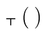 | 将真映射为假并将其他对象映射为真的函数 |
| 条件 | 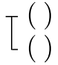 | 对于一对对象，如果第一个（即位于底部的符号所命名的对象）为真而第二个不为真，则将其映射为假，并将所有其他对象对映射为真 |
| 一般性 | 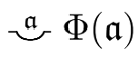 | 这是一个二阶函数。如果一个一阶概念Φ将所有对象映射为真，则它将Φ映射为真，否则映射为假。 |

理解这套记号的最佳方式是借助一些表格，这些表格展示了一些特定的陈述示例，以及它们在弗雷格记号中和现代谓词算中分别是如何被表达的。

| <strong>例子</strong> | <strong>弗雷格的记号</strong> | <strong>现代记号</strong> |
|----|----|----|
| 约翰是快乐的 | \- H(j) | Hj |
| “约翰是快乐的”不是事实 | 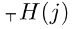 | <strong>¬</strong> Hj |
| 如果出太阳了，那么约翰是快乐的 | 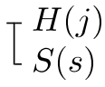 | Ss → Hj |
| 出太阳了并且约翰是快乐的 | 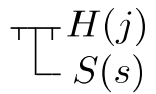 | Ss & Hj |
| 要么出太阳了，要么约翰是快乐的 | 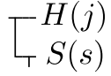 | Ss ∨ Hj |
| 出太阳了当且仅当约翰是快乐的 | \- S(s) = H(j) | Ss <strong>≡</strong> Hj |

<strong>1.2.1 真值函数联结词</strong>

第一个表格展示了弗雷格的逻辑如何表达作为真值函数的联结词，例如“非”、“如果-那么”、“且”、“或”和“当且仅当”。

如我们所见，弗雷格没有使用初始联结词“并且”、“或者”或“当且仅当”，而总是使用由否定和条件句定义的典范等价形式。注意表格的最后一行，当弗雷格想要断言两个条件在实质上等价时，他使用的是同一性符号，因为这表明它们指称相同的真值。在现代语句运算中，双条件句具有等价的作用，因为形如 φ ≡ ψ 的陈述在 φ 和 ψ 同真或同假时为真。唯一的区别在于，在现代语句运算中，φ 和 ψ 不被解释为指称真值的词项，而是被解释为具有真值条件的语句。当然，弗雷格也可以在他的记号中使用语句“（φ→ψ）&（ψ→φ）”来断言φ ≡ ψ 。

<strong>1.2.2 量化陈述</strong>

下表比较了弗雷格记号与现代谓词运算中的全称陈述。弗雷格在全称陈述中为变量使用了一种特殊字体（哥特体）。

| <strong>例子</strong> | <strong>弗雷格的记号</strong> | <strong>现代记号</strong> |
|:--:|----|----|
| 一切都是可朽的 | 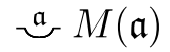 | ∀ xMx |
| 某物是可朽的 | 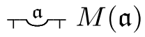 | ¬ ∀ x¬ Mx 亦即 ∃ xMx |
| 无物是可朽的 | 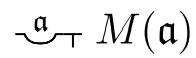 | ∀ x¬ Mx 亦即 ¬ ∃ xMx |
| 每个人都是可朽的 | 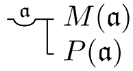 | ∀ x(Px → Mx) |
| 有些人是可朽的 | 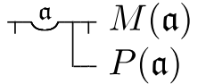 | ¬ ∀ x(Px → ¬ Mx) 亦即 ∃ x(Px & Mx) |
| 没有人是可朽的 | 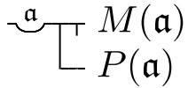 | ∀ x(Px → ¬ Mx) 亦即 ¬ ∃ x(Px & Mx) |
| 所有人并且只有人是可朽的 | 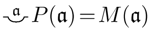 | ∀ x(Px ≡ Mx) |

注意最后一行。这里弗雷格再次使用同一性符号来帮助陈述两个概念的实质等价性。他能够这样做，是因为如果概念F和 G是实质等价的，那么当 G 将对象 x 映射为真时，F 也将 x 映射为真；也就是说，对于所有主目 x，F 和 G 将 x 映射到相同的真值。

在现代谓词运算中，符号“∀”（“每个”）和“∃”（“有些”）分别被称为“全称”和“存在”量词，而语句“∀xMx”中的变量“x”被称为“量化变量”或者“被量词约束的变量”。我们将遵循这一做法，把涉及这些量词短语之一的陈述称为“量化陈述”。从上表可以看出，弗雷格没有使用存在量词。他意识到，形式为“∃xφ”的陈述总是可以定义为“¬∀x¬φ”，其中φ是任意公式。

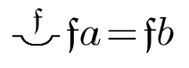这里必须指出，在弗雷格的逻辑中可表述的谓词运算是“二阶”谓词运算。这意味着它既允许对对象进行量化，也允许对函数进行量化；也就是说，允许形式为“每个函数f都使得……”和“有些函数f使得……”的陈述。因此，陈述“对象a和b落在相同的概念之下”在弗雷格的记号中将写为：，而在现代二阶谓词运算中，我们将其写为：∀ F (F a ≡ F b)。有兴趣进一步了解弗雷格记号的读者可以查阅 Beaney (1997, Appendix 2), Furth (1967), Reck & Awodey (2004, 26–34), 和 Cook (2013)。然而，在下文中，我们将继续使用现代谓词运算的记号，而不是弗雷格的记号。特别是，我们采用以下约定：

1.  我们经常使用“Fx”而不是“F(x)”来表示x落在概念F之下这一事实；我们使用“Rxy”而不是“R(x, y)”来表示x与y处于关系R之中；等等。

2.  我们不使用带有占位符的表达式（例如“( ) = ( )”和“P( )”）来表示函数和概念，而是直接使用“=”和“P”。

3.  当人们用变量替换语句中的一个完整名称时，得到的表达式将被称为开语句或开公式。因此，“3 \< 2”是语句，而“3 \< x”是开语句；并且，“Hj”可能是用来表示“约翰是快乐的”的形式语句，而表达式“Hx”是开公式，在自然语言中可能被表达为“x是快乐的”。

4.  最后，我们有时会使用希腊符号φ作为元变量（metavariable），它的取值范围涵盖形式语句，这些语句可能是开的，也可能不是。因此，“φ(a)”将被用于表示名称“a”出现在其中的任何语句（无论是简单的还是复杂的）；“φ(a)”不应被理解为弗雷格记号中函数φ应用于主目a。类似地，“φ(x)”将用于表示变量x可能是自由的也可能不是自由的开语句，而不是x的函数。

再次强调，以上内容是为初次接触弗雷格逻辑的人准备的简化介绍。掌握这些基础知识后，请参阅“弗雷格的逻辑”条目以获得更精确的表述。

<strong>1.2.3 弗雷格的量化逻辑</strong>

弗雷格对谓述的功能性分析再加上他对一般性的理解，使他摆脱了普通语言语句的“主谓”分析——这种分析构成了亚里士多德逻辑的基础——的局限性，并使他能够对涉及“每一个”和“某些”的推理进行更一般的处理。在传统的亚里士多德逻辑中，语句的主词和动词的直接宾词在逻辑上是不对等的。相较具有不同但相关的动词补语的陈述之间的推理，具有不同但相关的主词的陈述之间的推理服从于不同的规则。例如，亚里士多德逻辑中赋予从“约翰爱玛丽”到“某物爱玛丽”的推理以有效性的规则，不同于赋予从“约翰爱玛丽”到“约翰爱某物”推理以有效性的规则。支配第一个推理的规则是仅适用于主词的规则，而支配第二个推理的规则支配谓词内部的推理，因此仅适用于及物动词的补语（即直接宾词）。在亚里士多德逻辑中，这些推理毫无共同之处。

然而，在弗雷格的逻辑中，一条单一规则同时支配从“约翰爱玛丽”到“某物爱玛丽”的推理以及从“约翰爱玛丽”到“约翰爱某物”的推理。这是因为主词约翰和直接宾词玛丽在逻辑上被视为对等的，都是函数“爱”的主目。实际上，弗雷格认为主词“约翰”和直接宾词“玛丽”之间在逻辑上没有区别。逻辑上重要的是，“爱”表示一个具有两个主目的函数。无论量化表达式“某物”是作为主词出现（“某物爱玛丽”），还是出现在谓词内部（“约翰爱某物”），都应当被加以相同的处理。实际上，弗雷格将这些量化表达式视为变量绑定算子（variable-binding operators）。变量绑定算子“存在一个x满足”既可以绑定开语句“x爱玛丽”中的变量“x”，也可以绑定开语句“约翰爱x”中的变量“x”。因此，弗雷格以下列一般性方式分析了上述推理：

- 约翰爱玛丽。因此存在一个x满足x爱玛丽。

- 约翰爱玛丽。因此存在一个x满足约翰爱x。

这两个推理都是同一个有效推理规则的实例。为了更清楚地看到这一点，以下是上述非形式论证的形式表示：

- Ljm ∴ ∃ x(Lxm)

- Ljm ∴ ∃ x (Ljx)

授权这两个推理的逻辑公理具有以下形式：

Ra1…ai…an → ∃x(Ra1…x…an)

其中R是一个可以接受n个主目的关系，a1,…,an是任意常量（名称），且1≤ i ≤n。这条逻辑公理告诉我们，从涉及n元关系的简单谓述中，可以对任意主目进行存在性一般化推理（existentially generalize），并有效地推导出一个存在陈述。

事实上，这条公理可以变得更加一般。如果φ(a)是任何包含常量（名称）a的陈述（公式），而φ(x)是用x替换一个或多个a的出现的结果，那么以下是一条逻辑公理：

φ(a) → ∃xφ(x)

上面展示的以“约翰爱玛丽”为前提的推理的正当性都来自于这条公理。这条公理实际上可以从弗雷格的《基本法则IIa》（1893，第47节）中作为定理推导出来。《基本法则IIa》被表述为 ∀ xφ(x) → φ(a) ，其中 φ(a) 是用 a 替换一个或多个被量词约束的变量 x 的结果（关于这条公理的更细致讨论，见下文）。因此，上面展示的关于存在量词的公理可以利用条件句、否定以及上文讨论过的 ∃xφ 的定义所服从于的规则，从IIa推导出来。

弗雷格的量化逻辑还有一个值得一提的后果。弗雷格把形如 ∃xφ 的断言视为存在断言。他认为，存在不是一个对象归属于其下的概念，而是一个一阶概念归属于其下的二阶概念。一个概念F归属于这个二阶概念，当且仅当F把至少一个对象映射为真。因此，“火星人不存在”这一断言被分析为关于火星人这一概念的断言，即没有任何东西归属于它。因此，弗雷格把存在视为这样一个二阶概念：它把一个一阶概念F映射为真，当且仅当 ∃ xFx。一些哲学家认为，这种分析肯定了康德的观点，即存在不是一个（实在的）谓词。

<strong>2.3 证明与定义</strong>

<strong>2.3.1 证明</strong>

弗雷格的体系（即他的词项逻辑/谓词运算）由一门语言和一套用于证明陈述的装置组成。后者由一组逻辑公理（被当作逻辑真理的陈述）和一组推理规则组成，这些规则规定了语言中的某些陈述在什么条件下可以正确地由其他陈述推出。弗雷格特意表明，一个命题证明中的每一步的正当性如何要么来自其中一条公理、要么来自其中一条推理规则，要么由来自已经证明过的定理或派生性的规则。

因此，作为其形式系统的一部分，弗雷格发展出了对“证明”的严格理解。本质上，他把证明定义为一个有限的陈述序列，使得该序列中的每个陈述要么是一条公理，要么通过一条有效推理规则从先前成员推出。因此，一个逻辑定理（比如 φ）的证明就是任何有限的陈述序列（φ 是这个序列的最后一个陈述），使得该序列的每个成员要么(a) 是形式系统的一条逻辑公理，要么 (b) 通过一条推理规则从该序列的先前成员推出。这些本质上就是逻辑学家今天仍然使用的定义。

<strong>2.3.2定义</strong>

弗雷格对逻辑和数学概念的恰当描述和定义极为谨慎。他对那些不符合其清晰性标准的数学工作提出了有力而深刻的批评。例如，他批评那些把变量定义为“变化的数”而不是一种语言表达式——它是可变的，从而决定它取哪一个值——的数学家。

然而，更重要的是，弗雷格是第一个主张一个合式的定义必须具有两个重要的元理论性质的人。让我们把定义中引入的新定义符号称为被定义项（definiendum），把用来定义新术语的术语称为定义项（definiens）。于是，弗雷格是第一个提出恰当定义必须同时具有可消除性（在任何出现被定义项的公式中，被定义项必须总是可以被其定义项替换）和保守性（定义不应使人们能够证明以前无法证明的公式之间的新关系）的人。关于他在《概念文字》（第24节）中的一个定义，弗雷格写道：

> 我们可以不使用由这个语句引入的记号，从而也不把这个语句本身用作它的定义；如果不用这个语句时推不出某东西，那么用了它也同样推不出。我们引入这类定义的唯一目的，是通过约定一个缩写来实现一种外在的简化。

弗雷格后来批评了那些提出“零敲碎打” 的定义或“创造性”定义的数学家。在《算术基础II》（1903年，第56–67节）中，弗雷格批评了在给定对象范围上定义一个概念、随后又在更广、更具包容性的对象范围上重新定义该概念的做法。这种“零敲碎打”式的定义常常导致冲突，因为当人们把范围限制在最初的那类对象上时，被重新定义的概念并不总能还原为原来的概念。在同一著作中（1903年，第139–147节），弗雷格批评了这样一种数学实践：引入记号来命名（唯一的）实体，却不首先证明存在（唯一的）这样的实体。他指出，这种“创造性定义”完全是不正当的。正如上文所解释的那样，创造性定义不是保守的。

<strong>2.4 值域、外延与数学基础</strong>

<strong>2.4.1 值域与外延</strong>

弗雷格的存在论由两类根本不同的存在者组成，即函数和对象（1891，1892b，1904）。函数在某种意义上是“不饱和的”；也就是说，它们是那种以对象为主目、并把那些主目映射到一个值的东西。这使它们区别于对象。正如我们已经看到的，对象的领域中包括两个特殊对象，即作为真值的真和假。

在1893/1903年的著作中，弗雷格试图通过系统地为每个函数f关联一个对象来扩展对象的领域，他称这个对象为 f 的<strong>值域</strong>（course-of-values）。函数的值域是该函数对于每个主目的值的一个记录。弗雷格用来将值域系统化的原则是基本法则 V（1893/§20）：

> 概念 f 的值域与概念 g 的值域相同，当且仅当 f 和 g 对每个主目的值都一致（即对于每个对象 x，f(x) = g(x)）。

弗雷格使用一个带有送气符号的希腊字母epsilon作为记号的一部分，用来表示函数 f 的值域：

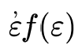

其中希腊字母ε（上方带有送气符号）的第一次出现是作为一个“变量约束算子”，我们可以把它读作“…的值域”。为了避免变量冲突的外观，我们也可以使用希腊字母α（上方同样带有送气符号）作为变量约束算子。使用这种记号，弗雷格在其系统中将基本法则 V 正式表示为：

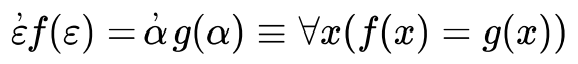

（实际上，由于上文所述的原因，弗雷格使用同一性符号而不是双条件句作为这一原则的主要联结词。）

弗雷格把概念F的值域称为其<strong>外延</strong>。概念F的外延只记录那些F映射到真的对象。因此，基本法则 V 同样适用于概念的外延。设“φ(x)”是任何复杂度的开放语句，其中 x 是自由变量（尽管变量 x 在 φ(x) 中可能出现不止一次，但是为简单起见，我们假设它只出现过一次）。那么弗雷格会使用表达式：

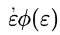

其中第二个 epsilon 替换了 φ(x) 中的 x，以表示概念 φ 的外延。弗雷格可以用以下的简单术语来定义什么叫“对象 n 是概念 φ 的外延的一个元素”：“概念φ将 n 映射到真”，即 φ(n)。例如，数字 3 是概念“大于 2 的奇数”的外延的一个元素，当且仅当该概念将 3 映射到真。

不幸的是，基本法则 V 蕴含矛盾，这一点是伯特兰·罗素在《算术基础》第二卷即将付印时向弗雷格指出的。罗素认识到，有些外延是自身的元素，有些则不是；概念“<strong>外延</strong>”的外延是自身的元素，因为该概念会将其自身的外延映射到真。概念“<strong>勺子</strong>”的外延不是自身的元素，因为该概念会将其自身的外延映射到假（因为外延不是勺子）。但现在，概念“<strong>不是自身元素的外延</strong>”又如何呢？令 E 表示这个概念，并令 e 命名 E 的外延。e 是自身的元素吗？那么，根据上一段末尾对“元素”的定义，e 是自身的元素，当且仅当 E 将 e 映射到真。但 E 将 e 映射到真，当且仅当 e 是一个不是自身元素的外延，即当且仅当 e 不是自身的元素。我们因此推理出，e 是自身的元素当且仅当它不是，这表明弗雷格外延概念中的不一致性。

关于这个问题的进一步讨论参见“罗素悖论”条目，而关于该悖论如何生发自弗雷格系统的更完整解释，参见“弗雷格的算术理论与算术基础”条目。

<strong>2.4.2 为数学奠基</strong>

<strong>2.5 对数陈述的分析</strong>

<strong>2.6 自然数</strong>

<strong>2.7 弗雷格的逻辑观</strong>

<strong>2.7.1 弗雷格的逻辑观与康德的逻辑观有何不同</strong>

<strong>2.7.2 弗雷格的构想与后世逻辑学家的差异</strong>

<strong>3.弗雷格的语言哲学</strong>

在研究数学和逻辑的过程中（很可能也是为了给这些研究奠定基础），弗雷格他逐渐发展出了一套语言哲学。他的语言哲学所产生的影响，即便不比他对于逻辑学和数学的贡献更大，也至少是同样深远的。许多学者都讨论过弗雷格明确采纳的一条原则（即前文讨论过的语境原则，即“词语的意义不能被孤立地询问，而是只能在命题的语境中询问”）与他似乎在1892a和1923年中假定但从未明确表述过的一条原则（即组合性原则，“一个语句的意义是其组成部分的意义以及这些组成部分的排列方式的函数”）之间的张力。关于弗雷格对这些原则的接受情况的详尽讨论，请参见佩尔蒂埃2001和扬森2001中的讨论。

然而，在本节中，我们将首先梳理弗雷格语言哲学的一个关键要素，即<strong>涵义</strong>与<strong>指称</strong>之间的区分。为了说明这一区分的动机，我们将逐一考察弗雷格试图解决的两个关键谜题（第3.1节），然后审视词项（以及语句）的涵义与指称之间的区分如何解决这些谜题（第3.2节）。

<strong>3.1弗雷格的谜题</strong>

弗雷格在语言哲学领域的开创性论文是《Über Sinn und Bedeutung》（《论涵义与指称》，1892a）。在这篇论文中，弗雷格考察了关于语言的两个谜题，并在每一种情况下都注意到，人们不能仅仅根据语句中的词项（名称和描述\[descriptions\]）的指称来解释某些语句的有意义性或逻辑行为。其中一个谜题涉及同一性陈述，另一个涉及带有从句的语句，如对命题态度的报道。为了解决这些谜题，弗雷格提出，一门语言的词项既有涵义又有指称；也就是说，至少需要两种语义关系才能解释一种语言中词项的意蕴（significance）或意义（meaning）。这一思想在一个多世纪以来一直激励着该领域的研究，我们将在下文中加以讨论。（关于弗雷格对语言哲学的贡献的进一步讨论，参见Heck and May 2006。）

<strong>3.1.1 弗雷格关于同一性陈述的谜题</strong>

以下是一些同一性陈述的例子：

117 + 136 = 253。

晨星与昏星是同一个东西。

马克·吐温是塞缪尔·克莱门斯。

比尔是黛比的父亲。

弗雷格认为，这些陈述都具有“a = b”的形式，其中“a”和“b”要么是名称，要么是描述，但无论如何都<strong>指称</strong>着某些个体（individuals）。他自然而然地假定，一个形如“a = b”的语句为真，当且仅当对象a就是（同一于）对象b。例如，语句“117 + 136 = 253”为真，当且仅当数117 + 136就是数253。而陈述“马克·吐温是塞缪尔·克莱门斯”为真，当且仅当马克·吐温这个人就是塞缪尔·克莱门斯这个人。

但是弗雷格注意到（1892a），这种关于真理的说明未能穷尽同一性陈述的全部意义。语句“a = a”在认知上的意蕴（或意义）必定不同于“a = b”在认知上的意蕴。只需看一眼，我们就能知道“马克·吐温 = 马克·吐温”为真，但是不能以这种方式得知“马克·吐温 = 塞缪尔·克莱门斯”为真；相反，我们必须考察世界，看看这两个人是否是同一个人。类似地，虽然我们看一眼就能知道“117 + 136 = 117 + 136”和“晨星与晨星同一”为真，但不能以这种方式知道“117 + 136 = 253”和“晨星与昏星同一”为真。在后一种情况下，我们必须做一些算术工作或天文研究，才能得知这些同一性主张为真。现在问题变得清楚了：“a = a”的意义显然不同于“a = b”的意义，但根据先前段落对真的说明只要，这两个同一性陈述为真，它们似乎就具有相同的意义！例如，“马克·吐温 = 马克·吐温”为真，当且仅当马克·吐温这个人同一于马克·吐温这个人。而“马克·吐温 = 塞缪尔·克莱门斯”为真，当且仅当马克·吐温这个人同一于塞缪尔·克莱门斯这个人。但是鉴于马克·吐温就是塞缪尔·克莱门斯，所以这两种情况是同一种情况，而这并不能解释这两个同一性语句在意义上的差异。类似的情况也适用于所有其他具有“a = a”和“a = b”形式的同一性陈述例子。

因此，弗雷格发现的谜题是：当“a = b”和“a = a”均为真时，我们如何解释它们之间在认知意义上的差异？

<strong>3.1.2 弗雷格关于命题态度报告的谜题</strong>

人们通常认为弗雷格发现了以下关于命题态度报告的谜题，尽管他并没有完全用下面所使用的术语来描述这个谜题。信念、欲望、意图、发现和知识等命题态度是人与命题之间的一种心理关系。当我们报告他人的命题态度时，这些报告也都具有类似的逻辑形式：

x 相信 p

x 欲求 p

x 意向 p

x 发现 p

x 知道 p

如果我们用一个人的名称替换变量“x”，并用描述其态度的命题对象的语句来替换变量“p”，我们就得到具体的态度报告。因此，在第一个例子中用“约翰”替换“x”，用“马克·吐温写了《哈克贝利·费恩历险记》”替换“p”，结果将是以下具体的信念报告：

约翰相信马克·吐温写了《哈克贝利·费恩历险记》。

为了看清对命题态度报告的分析为我们提出的问题，请考虑一个看起来简单的推理原则，即同一性替换原则（不要把它与前面讨论的替换规则混淆）：如果一个名称n出现在一个真语句 S 中，并且同一性语句 n = m 为真，那么同一性替换原则告诉我们，在 S 中用名称 m 替换名称 n 不会影响 S 的真值。例如，令S为真语句“马克·吐温是一位作家”，令n为名称“马克·吐温”，令m为名称“塞缪尔·克莱门斯”。那么，因为同一性语句“马克·吐温 = 塞缪尔·克莱门斯”为真，我们可以用“塞缪尔·克莱门斯”替换“马克·吐温”，而不会影响该语句的真值。事实上，所得语句“塞缪尔·克莱门斯是一位作家”为真。换句话说，以下论证是有效的：

马克·吐温是一位作家。

马克·吐温 = 塞缪尔·克莱门斯。

因此，塞缪尔·克莱门斯是一位作家。

4 \> 3

4 = 8 / 2

因此，8/2 \> 3

那么，一般性的同一性替换原则似乎采取以下形式，其中 S 是一个语句，n 和 m 是名称，而S(n)与S(m)的区别仅在于至少一次用m替换n：

从S(n)和n = m，推出S(m)

这个原则似乎捕捉到了这样一种想法：如果我们对某个对象说了某件真事，那么即使我们改变了指称该对象的名称，我们仍然应该是在言说关于该对象的某件真事。

但弗雷格实际上注意到了对同一性替换原则的以下反例。考虑以下论证：

约翰相信马克·吐温写了《哈克贝利·费恩历险记》。

马克·吐温 = 塞缪尔·克莱门斯

因此，约翰相信塞缪尔·克莱门斯写了《哈克贝利·费恩历险记》。

这个论证是无效的。存在前提为真而结论为假的情况。我们已经描述了这样的情况，即假若约翰是通过阅读《哈克贝利·费恩历险记》来得知“马克·吐温”这个名字的，并且是在学习19世纪美国作家时得知“塞缪尔·克莱门斯”这个名字的，却没有得知“马克·吐温”这个名字是塞缪尔·克莱门斯的笔名，那么约翰可能不相信塞缪尔·克莱门斯写了《哈克贝利·费恩历险记》。因此，上述论证的前提在逻辑上并不蕴涵结论。所以，同一性替换原则似乎在命题态度报告的语境下失效了。那么，难题就在于说明是什么导致该原则在这些语境中失败。如果我们所做的只是改变我们指称那个人的名称，为什么我们不再是在说关于那个人的某件真事呢？

<strong>3.2 弗雷格的意义与指称理论</strong>

为了解释这些难题，弗雷格（1892a）提出，名称和描述除了具有指称之外，还会表达一个<strong>涵义</strong>。一个表达式的涵义说明了它的认知意蕴：它是人们对于词项的指称的构想方式。“4”和“8/2”这两个表达式具有相同的指称，却表达了不同的涵义，即构想同一个数的不同方式。“晨星”和“昏星”这两个描述指称同一颗行星，即金星，却表达了构想金星的不同方式，因此具有不同的涵义。“珀伽索斯”这个名称和“最强大的希腊神”这个描述都具有涵义（而且它们的涵义不同），但是二者都没有指称。然而，尽管“马克·吐温”和“塞缪尔·克莱门斯”这两个名称指称同一个体，它们却表达不同的涵义。（关于弗雷格是否认为名称的涵义因人而异的讨论，见May 2006。）借助涵义与指称之间的区分，弗雷格能够解释“a = a”形式和“a = b”形式的同一性陈述在认知意义方面的差异。因为“a”的意义不同于“b”的涵义，所以“a = a”的涵义和“a = b”的涵义具有不同的组成部分。弗雷格可以主张，整个表达式的涵义在两种情况下是不同的。因为一个表达式的涵义说明了它的认知意义，所以弗雷格解释了“a = a”和“a = b”在认知意义方面的差异，从而解决了第一个难题。

此外，弗雷格提出，当一个词项（名称或描述）跟在命题态度动词之后时，它不再指称它通常所指称的东西。相反，弗雷格主张，在此类语境中，一个词项指称其通常的涵义。这解释了为什么对于命题态度报告中跟在命题态度动词之后的词项，同一替换原则会失效。该原则断言，当我们用一个名称替换另一个具有相同指称的名称时，真值得以保持。但是根据弗雷格的理论，名称“马克·吐温”和“塞缪尔·克莱门斯”在下列语句中出现时指称不同的涵义：

约翰相信马克·吐温写了《哈克贝利·费恩历险记》。

约翰相信塞缪尔·克莱门斯写了《哈克贝利·费恩历险记》。

如果它们并不指称同一个对象，就没有理由认为用一个名称替换另一个名称会保持真值。

弗雷格将意义与指称的理论发展为一套彻底的语言哲学。这套哲学至少可以通过考察一个简单语句例如“约翰爱玛丽”来大致说明。在弗雷格看来，这个语句中的“约翰”和“玛丽”这两个词是名称，表达式“爱”表示一个函数，而且整个语句也是一个复合名称。这些表达式中的每一个都既有涵义又有指称。名称的涵义和指称是基本的；但是借助名称的意义和指称，以及这些词连同表达式“爱”在语句中的排列方式，我们也可以描述作为一个整体的语句的涵义和指称（不过，关于谓词的涵义是否将名称的涵义映射为一个思想，参见 Heck & May 2011 的讨论）。让我们以如下方式来指示（refers to）这些词语的指称和涵义：

d\[j\] 指示名称“约翰”的指称。

d\[m\] 指示名称“玛丽”的指称。

d\[L\] 指示表达式“爱”的指称。

s\[j\] 指示名称“约翰”的涵义。

s\[m\] 指示名称“玛丽”的涵义。

s\[L\] 指示表达式“爱”的涵义。

我们现在努力就整个语句的指称给出一个理论描述。在弗雷格看来，d\[j\] 和 d\[m\] 分别是实在个体约翰和玛丽。d\[L\] 是一个函数，它将 d\[m\]（即玛丽）映射到函数 “( )爱玛丽”。后一个函数充当谓词“爱玛丽”的指称，我们可以在语义上使用记号d\[Lm\] 来指示它。现在，函数 d\[Lm\] 将 d\[j\]（即约翰）映射到语句“约翰爱玛丽”的指称。让我们把该语句的指称称为 d\[jLm\]。弗雷格认为这个语句的指称是两个真值之一。因为 d\[Lm\] 将对象映射到真值，所以它是一个概念。于是，如果约翰落于概念 d\[Lm\] 之下，那么 d\[jLm\] 就取值为真；否则它就取值为假。所以，在弗雷格看来，语句“约翰爱玛丽”命名了一个真值。

语句“约翰爱玛丽”也表达一个涵义。它的涵义可以描述如下。尽管弗雷格似乎没有明确这样说，但他的工作表明 s\[L\]（表达式“爱”的涵义）是一个函数。这个函数会将 s\[m\]（名称“玛丽”的意义）映射到谓词“爱玛丽”的涵义。让我们把“爱玛丽”的涵义称为 s\[Lm\]。现在看来，弗雷格的工作似乎再次暗示我们应当把 s\[Lm\] 视为一个函数，它将 s\[j\]（名称“约翰”的涵义）映射到整个语句的涵义。让我们把整个语句的意义称为 s\[jLm\]。弗雷格把语句的涵义称为思想，因此他可以设想有无限多的思想，尽管只有两个真值。

有了这种对语言的描述，弗雷格就可以对形如“a = a”和“a = b”的同一性陈述在认知意义方面的差异给出一般性说明。认知意蕴不在指称层面得到说明。在弗雷格看来，“4 = 8/2”和“4 = 4”这两个语句指称同一个真值。函数( ) = ( )将 4 和 8/2 映射到真，即把4和4映射到真。因此，d\[4 = 8/2\] 与 d\[4 = 4\] 相同；它们都是真。然而，所讨论的这两个语句表达了不同的思想：因为 s\[4\] 不同于 s\[8/2\]。所以思想 s\[4 = 8/2\] 不同于思想 s\[4 = 4\]。类似地，“马克·吐温 = 马克·吐温”和“马克·吐温 = 塞缪尔·克莱门斯”指称同一个真值。然而，因为 s\[马克·吐温\] 不同于 s\[塞缪尔·克莱门斯\]，所以弗雷格会主张思想 s\[马克·吐温 = 马克·吐温\] 不同于思想 s\[马克·吐温 = 塞缪尔·克莱门斯\]。

此外，回忆一下，弗雷格指出命题态度动词之后的词项并不指称它们通常的指称，而是指称它们通常表达的意义。事实上，在下面的命题态度报告中，不仅“马克·吐温”、“写了”和“哈克贝利·费恩”这些词指称它们通常的涵义，而且整个语句“马克·吐温写了哈克贝利·费恩”也指称它通常的涵义（即一个思想）：

约翰相信马克·吐温写了哈克贝利·费恩。

因此，弗雷格会这样分析这个态度报告：“相信”指称一个函数，该函数把语句“马克·吐温写了哈克贝利·费恩”的指称映射到一个概念。然而，在这种情况下，语句“马克·吐温写了哈克贝利·费恩”的指称不是一个真值，而是一个思想。它所指称的思想不同于下面这个命题态度报告中的“塞缪尔·克莱门斯写了哈克贝利·费恩”所指称的思想：

因为在这个语境中“塞缪尔·克莱门斯写了哈克贝利·费恩”所指称的思想不同于在同样语境中“马克·吐温写了哈克贝利·费恩”所指称的思想，所以“相信马克·吐温写了哈克贝利·费恩”所指称的概念不同于“相信塞缪尔·克莱门斯写了哈克贝利·费恩”所指称的概念。人们可以一致地设想，前一个谓词所指称的概念把约翰映射到真，而后一个谓词所指称的概念则不然。因此，弗雷格的分析保留了我们的直觉：约翰可以相信马克·吐温写了《哈克贝利·费恩》，而不相信塞缪尔·克莱门斯写了这本书。它也保留了同一性替换原则——诚然，当这些名字出现在命题态度动词之后时，不能把“塞缪尔·克莱门斯”替换为“马克·吐温”，但是这一事实并不构成反对该原则的证据。因为如果弗雷格是对的，那么名字在这些语境中出现时并不具有它们通常的指称。
