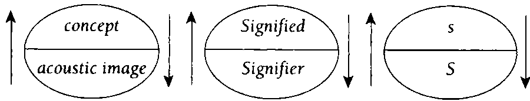
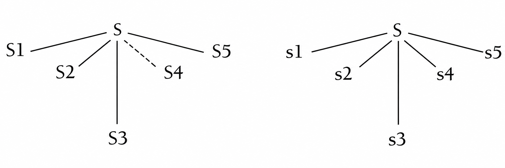
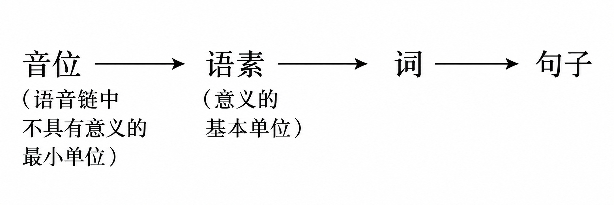
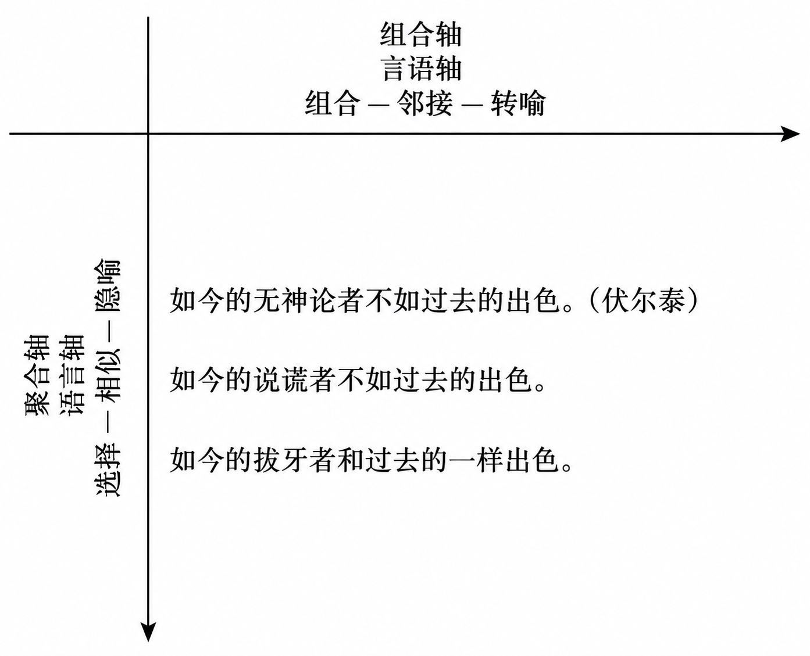
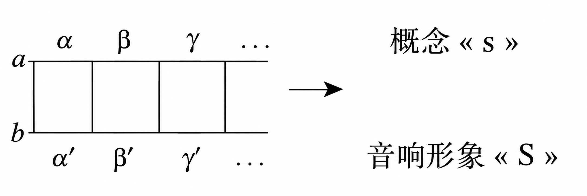
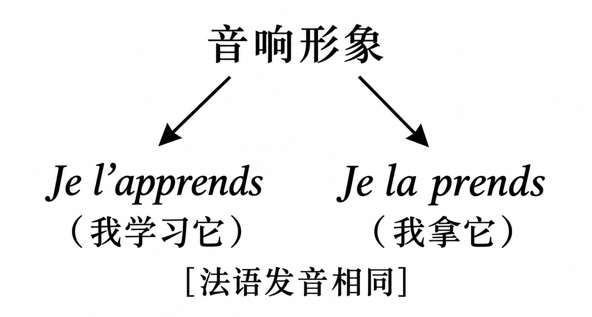
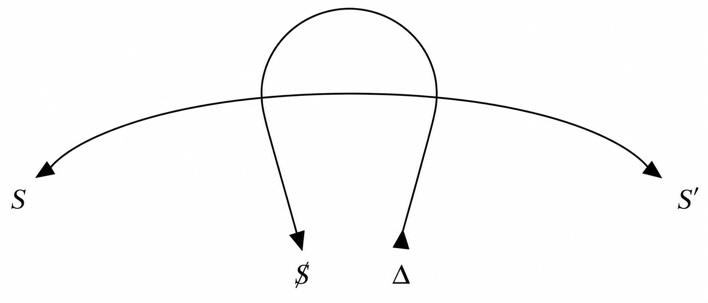

<strong>导论 “回到弗洛伊德”</strong>

对拉康著作的介绍应当通过一种可能尚属初步、但既不浅显也不过分简化的方法，来界定其理论的主要关节。最重要的是标定出拉康本人由之出发的地形。无论从理论还是实践的层面看来，这都是弗洛伊德的地形、<strong>弗洛伊德的领域</strong>，它构成了拉康全部著作中的理论建筑的基础结构。

拉康对弗洛伊德的参考，首先是对理解无意识的某种方式的参考。与此同时，它标示出一种有严格规则的实践，这种实践建基于一项研究原则，而该原则的根本原创性是不容置疑的。因此，我们必须从一开始就界定什么属于真正的精神分析实践，以区别于其他研究无意识的程序——那些程序尽管可能声称源自精神分析，却已完全丧失了与它的联系。

弗洛伊德对无意识的研究带有某种精神性的（psychic）“印记”，这确保我们所面对的不是一个抽象的或形而上学的存在物。同样，我们也不处于生物学存在者的领域，或某种可测量、可量化的精神基质的领域。按照弗洛伊德在发现他所描述的无意识过程时所依据的根本原则，这些过程依赖于语言的精神性维度，以及支撑起语言的移情（transference）。

因此存在着两个极：语言与移情，它们是弗洛伊德所真正开创的实践的组织原则。但是必须指出，尽管分析实践是一种语言的实践，但并非所有语言的实践都必然是精神分析的。此外，如果无意识本质上需要在言说中来阐明（articulation），我们就可以质疑某些自称以精神分析为基础的、却已经与语言断绝一切联系的实践，是否误解了精神分析。

哪怕仅仅是出于第二个极（移情）锚定了弗洛伊德式的无意识以及由此衍生的实践，拉康在这些基本区分上也绝不会让步。鉴于弗洛伊德的箴言“哪里有移情，哪里就有精神分析”，移情的维度尤其需要被关注。但这是否意味着，移情的建立就足以使一种实践有资格被称为真正的精神分析？为了充分理解弗洛伊德的话，还需要一些补充说明。一旦一个主体对另一个主体说话，移情就已经存在。（“我们所考虑的有效的移情本质上不过是言语行为而已。每当一个人以本真\[authentic\]而饱满\[full\]的方式对另一个人说话时，就存在着真正意义上的移情，即符号性的移情——某种事情发生了，它改变了在场的两个存在者的本性”\[拉康1953–1954，第109页\]。）但是，如果移情可以在任何相遇中发展出来，那么<strong>对移情进行某种操控</strong>的全部条件就已经隐含于那次相遇之中。将弗洛伊德意义上的分析实践与那些可能错误地自称与精神分析有亲缘关系的其他实践从根本上区分开来的，是被保留给移情维度的命运。任何以所谓的治疗为目标的相遇，都很容易在操控移情的领域中发展。而在分析实践所建立于的框架中，任何操控移情的企图都必须被消除。精神分析实践在<strong>对移情的分析</strong>这一领域之中展开：正是在这个操作空间中，患者被要求去探究自己的无意识；因此，也正是在这个空间中，他必将最确实地面对自身欲望的问题。

这不过是一个非常一般性的提醒，它是关于拉康对弗洛伊德的参考，以及建基于这个参考之上的实践。然而，正是这种老生常谈，有时却被第一代分析师不知不觉地误解了。实际情况是，无意识经验的基本要求很快就经过了妥协和调整。拉康始终关注的一件事是，在“<strong>无意识像语言一样被结构起来</strong>”这一大胆假设的旗帜下，恢复弗洛伊德所说的无意识经验的原创性。我们甚至可以将此视为拉康全部理论著作中最根本的假设，哪怕仅仅因为它既预设又体现了拉康在其整个职业生涯中所不断倡导的<strong>回到弗洛伊德</strong>的意义。

拉康在1953年的“罗马话语”中首次宣布了这一回归弗洛伊德的主张。（完整标题是“精神分析中的言说和语言的功能与场域”\[Lacan 1953b\]。）他在这里所要说的话的全部意蕴，必须放在当年法国精神分析运动的内部分裂的背景下加以理解。在序言中，拉康明确指出了关键所在：

> 在进入报告本身之前，应当先谈谈周围的情况。因为它们对本次报告产生了一些影响。
>
> 这一主题是作为该学会——它在当时代表着法国的精神分析——的年度会议的惯例性理论报告的基础而向作者提议的。十八年来，这个学会在“法语精神分析师大会”的名下，一直延续着一种已成为可敬传统的做法。随后两年，这个大会扩展至所有罗曼语系的精神分析家（出于语言上的宽容，荷兰也被包括在内）。这里提到的这次大会于\[1953年\]9月在罗马举行。
>
> 与此同时，一些严重的分歧导致了法国团体的分裂。这些分歧在成立“精神分析研究所”之际达到了顶点。这个团体成功地将自己的章程和纲领强加于新的研究所，随后宣称将会竭尽全力地阻止那些与其他同仁一起、试图向研究所引入不同理念的成员在罗马发言。\[Lacan 1953b, p. 30\]

拉康被指责的“不同理念”，恰恰是他为回归弗洛伊德的必要性所作的辩护。“紧迫的任务”是指“通过重新审视其历史和反思它们在主体那里的基础，从因为惯常的使用而变得僵化的概念中重新解放出它们的意义”（p. 33）。换言之，拉康关注的是谴责“引导着分析家去放弃作为基础的言说的诱惑”（p. 36）。正是在这里，拉康（1955）明确指出，“回到弗洛伊德就意味着回到弗洛伊德的意义”（the meaning of a return to Freud is a return to the meaning of Freud）（p. 117），或者说回归“弗洛伊德的物”（Freudian Thing）的秩序。他提醒我们，一位精神分析家“应当能够相当容易地把握能指与所指之间的根本区分，并开始使用它们分别组织起来的两个互不重叠的关系网络”（p. 126）。

在他关于“精神分析在1956年的处境”的评论中，拉康（1956）再次强调要将焦点转回弗洛伊德基于他的无意识经验而定义的符号性维度：

> 为了知道在分析中发生了什么，我们必须知道言语从何而来。为了知道什么是抵抗，我们必须知道是什么构成了阻碍言语降临的屏幕…
>
> 为什么要回避无意识提出的问题？
>
> 如果所谓的“自由”联想能够让我们通达\[无意识\]，那么它这种释放类似于神经生物学的自动过程吗？
>
> 如果\[在无意识中\]被发现的驱力处于间脑（diencephalic）甚至嗅脑的（rhinencephalic）水平，我们如何能将它们理解为以语言的方式被结构起来的？
>
> 因为如果从一开始，\[驱力\]就是在语言中显露其效果的，那么我们已经认识到的它们的那些诡计，无论是平庸还是精妙，都同样指示着一种语言学的程序。\[第461、466页\]

弗洛伊德曾将语文学研究的范围纳入理想的精神分析培训机构的课程中，以弗洛伊德为榜样的拉康（1956）则为受训的分析家规定了语言学的入门知识，其核心概念是“能指与所指之间的区分，我们为此理应尊崇费尔迪南·德·索绪尔，因为正是通过他的教导，这一区分如今已成为人文学科的基础”（第467页）。

从1956年起，拉康强调了“能指对所指的优先性”这一概念，认为它是《梦的解析》的最明显后果之一。

> 弗洛伊德说，梦是一个画谜（rebus）。他无需对此详加阐述，我们便能理解他所指的是灵魂的词语。画谜中的短语可曾有过丝毫的涵义？而我们解读它的兴趣，难道不正是来自这样一个事实：它的图像所呈现出的意义被无效化了，这意义除了使得那被伪装起来的能指变得可理解之外，别无任何用处？\[拉康1956，第470页\]

拉康描述了主体是如何从一开始就被这种能指的优先性所捕获的，特别是通过他与其症状所培育的异化。正如它在分析的情境下所浮现出的那样，症状的意义恰恰证实了这样一个观点：“精神分析的技术运作于主体与能指的关系之上，它所获得的仅仅是围绕这一关系组织起来的知识”（拉康1956，第472页）。

但直到1957年拉康才给出了他对这种回到弗洛伊德的影响的决定性定义，其本质直接与语言的概念有关。这就是他那篇权威演讲的主题：《无意识中的字母的作用，或自弗洛伊德以来的理性》（拉康1957a）。从开篇我们就可以清楚地看出他的创新性意义：

> 今天的精神分析家怎能没有意识到，言说是通往那一真理的钥匙，而他的全部经验只有在言说中才能找到其工具、语境、材料，甚至其不确定性的背景噪音…正如我的标题所表明的，精神分析经验在无意识中发现的超越这种“言说”的东西就是语言的整个结构。\[第147页\]

一本拉康导论必须为“无意识像语言一样被结构起来”这一命题的所有细节建立起基础。首先，有必要在弗洛伊德的著作中寻找这一原则及其重要性的证据。由于《梦的解析》被视为弗洛伊德的代表作，我们将使用其中的一些核心论点来展开这一论证。

我们必须记住，弗洛伊德关于梦的天才假说涉及将他的一套探索技术应用于梦，而这套技术曾被成功地应用于强迫和焦虑等心理表现：这就是自由联想法。这一技术之所以受到青睐，是因为他在使用催眠法和宣泄法时遇到了不足和困境。自由联想让弗洛伊德得以识别源自无意识的那些心理表现的意义。由于它在操作上的特性，它还导向了了无意识的<strong>构成物</strong>（an unconscious formation）这一概念——换言之，即引向了对众多心理表现的概括，这些表现的共同特征是，它们所意指的东西完全不同于它们乍看起来意指的东西。

在弗洛伊德对“伊尔玛注射之梦”（Dream of Irma’s injection）（弗洛伊德1900）进行细致分析的过程中，一个观念逐渐成形：梦是一种被伪装、扭曲或凝缩了的话语；主体已经丢失了解读它的密码，但隐藏在它的奇异外观之下的秘密却可以通过艰辛的联想工作以清晰而富有意义的形式被揭示出来。在这方面，弗洛伊德就像对待其他无意识的构成物一样来探究梦，他将梦视为是由许多有能指元素（signifying elements）组成的系统，类似于语言。他一再提醒我们回到这种语言秩序，因为对无意识之物的探究总是停留在联想之链的流动中，而这些联想之链——无非是思想之链——不断把我们带回词语之链。因此，任何满足于预先编撰的意义索引、满足于一把解梦钥匙的企图，都必须被放弃。即便如我们所知，弗洛伊德重视梦中的象征和象征系统，但是他的梦理论绝不允许人们在揭示无意识之物时忽视主体的言说。这里存在着拉康回到弗洛伊德的一个决定性论据：他的计划是把言语的这一维度重新带回精神分析领域的前沿。

我们在这里也发现了拉康从弗洛伊德那里汲取的另一个基本观念的轮廓，它关乎无意识的一个最根本属性：主体无法通过任何可以事先预测的能指元素使自己被理解。当我们继续辨认拉康思想的基本要点时，我们可以注意到，在弗洛伊德关于梦中潜隐内容和显现内容的区分之外，一种直觉逐渐成形：一个话语所说出的东西总是比预期的更多，首先因为它可能具有与最初说出的东西完全不同的意义。拉康把无意识在话语网络中的这种指涉性牵连（referential entanglement）扩展到其最极端的后果，甚至把它视为言说主体的结构所不可避免地带来的一种属性。

<strong>第一部分 语言学与无意识的构成物</strong>

<strong>1.梦的运作中的凝缩与置换</strong>

“无意识像语言一样结构起来”这一假说背后的主要拉康概念，根植于弗洛伊德的梦境理论。这里最重要的概念是梦的运作（弗洛伊德1900），它直接建立在初级过程（primary process）的种种无意识机制的运作之上。

梦的运作的两种基本机制是<strong>凝缩</strong>（condensation）与<strong>置换</strong>（displayment）。经验观察使弗洛伊德意识到这两种机制的活跃在场；从根本上说，他所察觉到的是显现的材料与隐梦的思想之间在“容量”（volume）上的差异，以及伪装这些隐梦思想的意义的必要性。

由此他区分出了凝缩的几种范式。首先是通过<strong>省略</strong>的凝缩。一个绝佳的例子是对“植物学专著之梦”（ Dream of the Botanical Monograph）的分析（弗洛伊德 1900），其中对潜隐思想的重构在显现内容层面是非常不完整的。另一种凝缩形式是隐梦材料的<strong>融合</strong>或<strong>叠加</strong>。其最引人注目的例子是通过连续的组合与融合而加工出的<strong>复合人物</strong>或<strong>新词</strong>的创造。例如，伊尔玛就是一个复合人物，她代表了一整系列曾被“献祭于凝缩工作”的人（第293页）。类似的例子还有“伊尔玛注射之梦”中的“丙基”（第293–294页）以及弗洛伊德另一个梦中的“积极的诺雷克达尔风格”（第296页）。童年期关于狼人的强迫性梦境（弗洛伊德 1918）也是梦的运作中的凝缩过程的典型例子。

在梦的工作中，从隐梦思想的内容向显梦内容的过渡所发生的种种改变，并不仅仅取决于不同的凝缩过程。隐梦观念可能在经历了被弗洛伊德称为价值或意义反转的重大转移之后，才在显现内容的层面得到表现。换言之，梦的工作启动了一个置换过程，其作用从根本上说是在显现层面遮蔽潜隐思想中具有根本重要性的东西。

> 因此似乎可以合理地设想，在梦的工作中有一种心理力量在运作，它一方面剥去那些具有较高心理价值的元素所具有的强度，另一方面又<strong>通过多重决定</strong>（overdetermination），从心理价值较低的元素中创造出新的价值，这些新价值随后进入梦的内容。如果情况如此，那么在梦的形成过程中就发生了心理强度的<strong>转移</strong>与<strong>置换</strong>，而正是出于这一点，梦之内容的材料与梦之思想的材料之间的差异才得以产生。我们在此所假定的这个过程，正是梦的运作的本质部分；它理应被称为“梦的置换”。\[弗洛伊德 1900，第307–308页；原文强调\]

概括地说，这些是弗洛伊德的梦境理论的主要要素，而拉康正是用这些要素来建立并支撑他关于无意识过程的运作方式与语言的某些方面之间类比的基础。然而，作为拉康理论发展的根本，这一观念只有在对语言的结构主义构想的背景下才能得到辩护。这种结构性视角源于费尔迪南·德·索绪尔的工作，将在后文加以考察。但首先有必要偏离我们的主题，转而进入结构主义原则这一更广阔的领域。这至少有两个原因：首先，因为对结构主义的参考构成了拉康的全部理论的基础，改变了其方向和意蕴；[^1]第二，因为当前对结构一词的使用常常是不正确的，这暴露出对一个其基础已经被严格界定的概念的外延和内涵的误解。

<strong>2.结构的概念</strong>

结构主义立场是一种催生新的可理解性的策略，它打破了对于对象的某些思考方式。尽管我们不应高估其效力，但是这种转变在某些领域确实富有成果。

结构主义在精确科学和人文学科中开辟了新的视野，因为它能够揭示出元素或对象之间按照并非直接显现的系统相互关联。这种方法要求我们暂时背离某种与对象打交道的方式；我们必须放弃对对象的本性、性质和特定属性的某种描述方式。重点在于，我们要乐于接受揭示对象或对象的元素之间的隐藏关系的可能性。这当然预设了我们希望在所考虑的对象类型中建立某种融贯性。这些对象必须属于相似的命名或归属于相似的组群。这是新的关系原则出现的必要条件。这些关系可能属于不同类型：它们可能对这些对象进行对比、区分、转换和激活等等。它们是在对象或其元素之间建立起来的法则，这些法则能够揭示出使我们得以规定对象及其元素的集合所特有的<strong>结构</strong>。

我们可以立即看到这种新认识论方法的可能后果。首先，它使我们能够抛弃某一学科内部的“隔间式的”分析原则。其次，单一学科内各个研究领域之间的任意划分被搁置。例如，随着分隔代数、数值分析、几何学、概率论等的隔间化被取消，这种策略的影响可以立即在数学领域中得到评估；在心理学中，对心理空间的原子式切割可以被放弃；在语言学中，历时性划定被搁置；等等。

让我们用数学中的一个例子来看看结构的发展。十九世纪数学家埃瓦里斯特·伽罗瓦发展出了最基本结构之一的概念，即群的概念。根据布尔巴基，群结构的定义如下：对于一个集合G，如果定义于其上的一个内部合成法则满足结合律，并且具有单位元，并且G的每个元素都有对称元，那么我们可以说它确定了一个群结构。

因此，结构的存在意味着我们不仅需要一组元素，还需要一个作用于它们的法则。为此，该法则必须在以下条件下运作：

1.首先，集合中两个元素的组合必须始终构成集合中的一个元素：

``` math
E*E \rightarrow E
```

``` math
例如\ 2 + 3 = 5
```

2.其次，若干元素的组合必须能够从序列中的任何位置进行：

``` math
(a*b)*c = a*(b*c)
```

这是一条<strong>结合律规则</strong>。

3.再次，元素集合中必须包含一个可被指定为中性的元素，使得当它与集合中任何其他元素组合时，都使该元素保持自身同一：

``` math
\left\{ \begin{matrix}
\exists e \in E \\
e^{*}a = a
\end{matrix} \right.\ 
```

对于乘法，单位元是 $`1:1 \cdot x = x`$。对于加法，单位元是 $`0:0 + 4 = 4`$

4.最后，对于每个元素，必须存在一个对称元素，使得它们的组合等于单位元：

``` math
\begin{matrix}
a*a' = e \\
3 \times \frac{1}{3} = 1 \\
2 + ( - 2) = 0
\end{matrix}
```

无论所选择的数学元素的性质如何，这种群结构都仍然有效。因此，这些元素可以是数，可以是几何元素（比如向量），也可以是解析函数或向量函数等。在这些条件下，人们可以定义非常普遍的对象域，例如相对整数群、仿射变换群、位似变换群或相似变换群。这些对象域的共同之处在于，它们相对于某种组合其元素的特定法则具有相同的群结构。

在这个例子之上，我们很容易以一般的方式理解结构主义目标的认识论意义。结构方法是一种通过<strong>包容性泛化</strong>（inclusive generalization）进行的启发式方法。这种包容性概括的一个很好的例子（尽管严格来说它不是一种结构主义策略）是十九世纪非欧几里得几何的发现。波尔约、罗巴切夫斯基和黎曼的工作揭示了比欧几里得几何更一般的系统，但是这些更一般的方面不是使欧几里得几何无效，而是使之成为包含它的更大几何系统的一个特例。

如果我们能够说结构主义态度在某种程度上以同样的方式发挥作用，那是因为它导向结构本身之间的包容性泛化。因此，存在一种结构的等级体系，即某些更强的结构能够包含较弱的结构。这样，庞大的形式化系统就可以被组织起来，开辟新的研究视野。最后，让我们考察让·皮亚杰（1970）对“结构”一词的定义：

> 结构是一个转换系统。因为是一个系统，而不是元素及其属性的简单集合，所以这些转换涉及若干法则：结构通过其转换法则的相互作用而得到保存和丰富，这些法则从不产生系统外部的结果，也不使用系统外部的元素。简而言之，结构的概念由三个关键思想组成：整体、转换和自我调节。\[第5页\]

根据皮亚杰的观点，整体既是构成结构的元素相互依赖的结果，也是所有元素的集合必然不同于它们的总和这一事实的结果。<strong>转换</strong>的概念预设了若干组合法则，这些法则以某种方式定义了给定结构内的运算，使得这些运算赋予了一个已经被结构化的现实以结构。最后，作为结构的本质特征，自我调节意味着结构是自我保存的。例如，如果结构的两个元素通过组合法则被联系起来，那么由这一运算产生的第三个元素也将被结构化。换句话说，人们可以谈论系统的稳定性。这样的结构定义特别适合语言研究。作为例证，我们可以简要回顾费尔迪南·德·索绪尔的工作，它影响了拉康在语言与无意识之间建立起的联系的主要元素。

<strong>4.结构语言学摘要</strong>

语言学中的结构主义观点随着语言研究中的<strong>历时性维度</strong>的引入而出现。我们应归功于费迪南·德·索绪尔，他发现了语言研究不能被化约为纯粹的历时性视角，即历史视角。因为，一个词的历史其实不能解释其当下意义，因为这一意义取决于它所隶属的语言系统。该系统存在于某些直接依赖于共时性的平衡法则（laws of equilibrium）之中。此外，意义与指号（signs）之间存在一种根本关系，而这种关系只能从共时性视角加以把握。

索绪尔（1966）引入的共时性视角刻画了一种在语言学领域特别有效的进路，因为结构主义观点揭示了语言的根本新属性。但是这种语言学研究的新视角已扩展到人文科学的其他领域，为这些领域的更新提供了异常丰饶的源泉。拉康将结构语言学中的若干原则引入精神分析理论，从而将结构主义策略应用于精神分析领域。这些原则在元心理学层面引发了根本性的认识论变革。

从《罗马话语》（1953b）开始，拉康将无意识的问题域重新置于一个基于结构语言学原理的可理解性网络之中。这段摘录准确地指出了其思想的主要要素：

> 让我们从《梦的解析》开始再次拿起弗洛伊德的著作，以提醒自己梦具有句子的结构，或者更严格地说，按照该著作的字面表述，梦具有画谜的结构；也就是说，它具有一种书写形式的结构，儿童的梦代表了这种书写的原初象形系统（ideography），而在成人那里它再现了能指要素的使用，这种使用既是语音的，又是符号性的，可见于古埃及的象形文字以及中国仍在使用的汉字中。
>
> 但是即便如此，这也只不过是对工具的解码。重要的部分始于文本的翻译。弗洛伊德告诉我们，这一重要部分是在梦的加工中给出的——也就是说，是在其修辞中给出的。省略与赘言、倒装或兼用法、回归、重复、同位——这些是句法上的置换；隐喻、词语误用、代称、寓言、转喻和提喻——这些是语义上的凝缩，弗洛伊德教导我们在其中读出那些张扬性的意图，或那些掩饰性的、说服性的、报复性的或诱惑性的展示，主体正是通过这些过程塑造其梦境的话语。\[第57–58页，译文有改动\]

拉康如此优雅地援引的一系列话语修辞，不应当让我们误以为这种类比局限于梦的话语。它毋宁无一例外地适用于无意识的一切形成物：

> 在日常生活的精神病理学这一弗洛伊德曾专门著述的另一领域中，每一个失败行为显然都是一种成功的、甚至可以说是“精心构思”的话语，而在口误中，正是那个噱头扣住了言语，而且恰恰是在正确的地方，使其话语足以让智者明白。\[Lacan 1953b, p. 58, 翻译有改动\]

可见，拉康清楚地看到，弗洛伊德本人的著作要求将某些语言学概念引入精神分析理论领域。然而，尽管拉康不知疲倦地挖掘这一新矿脉，但是分析师埃拉·弗里曼·夏普早在1937年就在其《梦的分析》（1961）中就已暗示了这一点。拉康的独创性在于将这一直觉系统化为一个理论，并将其提升为关于无意识的一般性假设。这就是为什么某些语言过程与无意识的动力机制之间的结构性类比预设了对语言学的了解。事实上，结构的概念在拉康的著作中之所以处于核心地位，仅仅是因为他频繁地援引语言的结构：这首先是因为这一结构被拉康设定为与无意识相关，其次是因为无意识是在语言行为中浮现并找到其表达场所的。一旦我们考察了索绪尔语言学的两个基本原则，既能指与所指之间的根本区分以及语言的两个轴之间的差异，这一类比就变得更加清晰。以下是对这两个原则的简要讨论。

<strong>4.1.语言指号</strong>

索绪尔（1966）在本世纪初发展的语言结构算法首先建立在<strong>语言指号</strong>的概念之上。为了确立这种指号的性质，索绪尔不得不与某些思想传统决裂，特别是与那种直觉上似乎合理的观念决裂，即语言单位是一个词项与一个事物的联合。因为，事实上“语言指号联结的不是一个事物和一个名称，而是一个概念和一个音像（sound-image）”（第66页）。但我们所说的“音像”是什么意思呢？根据索绪尔的说法，它“不是物质的声音，不是纯粹物理的东西，而是声音的心理印迹，是声音给我们的感官留下的印象。音像是感官性的；如果我碰巧说它是‘物质的’，那也只是在这个意义上，并且是为了将它与联合中的另一个项——即概念——区分开，因为概念通常是更为抽象的”（第66页）。

我们必须注意到诸如心理印迹和印象这样的表达，它们预示了le langage、la langue（二者在英语中均译为“language”）和parole（“言说”）之间的根本区分。作为“心理的”存在物，语言单位属于la langue的范围，而不是言说的产物。正是由于这个原因，langage被视为一个主体所说的langue的使用，或实际的说出。正如索绪尔所说，“对我们而言，langue是langage减去parole”（“语言是言说减去说话”）（第77页）。语言符号因此表现为一个“具有两面的心理实体”，它的两个组成部分从一开始就处于<strong>联结关系</strong>（associative relation）之中。如果语言指号首先是一种关系，那么这种在la langue的系统中显得稳定的关系，在langage的维度中就容易发生变化。此外，虽然索绪尔保留了“指号”一词来指称语言单位，但他用“所指”替代了概念，用“能指”替代了音响形象。（“我建议保留指号\[signe\]一词来指称整体，并分别用所指\[signifié\]和能指\[signifiant\]替代概念和音响形象；后两个术语的优点在于表明了将它们彼此区分开、并将它们与它们作为其组成部分的整体区分开来的那个对立关系”\[第67页\]。）指号因此成为一个能指与一个所指的关系，如图所示：



这是一种对立关系，它将所涉及的各项元素分离开来。它揭示了符号的被拉康加以利用的一种属性，即能指相对于所指的自主性。这种自主性只有在能指与所指并非处于固定关系之中时才有可能。

如果我们把语言符号视为语言系统中的基本元素，那么对其在系统中运作方式的简要考察会立刻揭示出一些看似矛盾的属性。我们将逐一考察这些属性，它们分别是：（1）指号的任意性；（2）指号的不变性；（3）指号的变动；（4）指号的线性。

<strong>4.2.指号的偶然性</strong>

符号的偶然性（arbitraty nature）体现在能指与所指之间的联结上。事实上，一个概念与代表它的音象之间并不存在必然联系，其证据在于，同一个所指的声音形象在不同语言中各不相同。然而，指号的偶然性并不意味着它本质上是随意的，因为这种偶然性只是相对于某个特定的语言共同体而言的：“任意这个词……不意味着能指的选择完全取决于说话者。……我的意思毋宁是它是没有动机的，在这个意义上它是偶然的，因为它实际上与所指没有自然的联系”（第68–69页）。

<strong>4.3.临床评注</strong>

语言符号的任意性问题出现在某些妄想性的语言和由精神病理学引起的胡言乱语症（glossolalias）等临床情境中，这里仅举两例。主要是在（但不是仅限于）精神分裂症的案例中，我们会遇到严重的语言障碍，其中言语的妄想性结构恰恰凸显了指号的偶然性（arbitary nature）与任意性（aleatory nature）之间的这一区别。尽管我们必须牢记弗洛伊德（1915b）的观察，即词表象（word presentations）在精神分裂症中的作用与物表象（thing presentations）相同，但是索绪尔关于语言指号的理论使我们能够澄清能指与所指之间的联结的这种任意性。这种将能指与所指断开连接的机制，促使拉康讨论<strong>能指的脱链</strong>（the unchaining of the signifier）。能指脱链现象是语言指号的使用发生特定改变的结果，正如索绪尔所说，“能指的选择完全由说话者决定”（第69页）。

语言指号的加工与使用的这种任意性，在塞尔日·勒克莱尔（1958）的一篇论文中得到了特别出色的描述。勒克莱尔展示了在指号的变动中可能有两种过程在起作用：要么一个所指可以与任何一个能指相联结，要么反过来，一个能指可以与任何一个所指相联结。



在两种情况下，我们最终都面对符号的一种被严格限制在个体和主观层面上的任意性，而不是属于一个语言共同体的任意性。就这里的任意性被限制于一个言说主体而言，可以说能指与所指完全可能以任意的方式相结合。当然，我们有必要仔细考察以这种方式组合起来的能指材料中的无意识多重决定问题，而拉康思想的主要部分正是针对这一问题。

回到被称为胡言乱语症的精神病理学语言障碍。尽管能指与所指之间的结合表面上具有偶然性，但无意识过程对语言指号的改动所产生的影响却是完全清楚的（参见 Dor 1982）。

我们可以简略地将胡言乱语症定义为发明并说出除说话者以外无人能完全理解的新语言的能力。这些原创性的语言建构具有一种或多或少退化了的句法结构，而这种结构几乎总是类似于说话者母语的结构。在相当多情况下，这些相对有结构的语言将会稳定下来并逐渐变得更加丰富。这种稳定性本质上来自于能指与所指的联结中的某种固定性；然而，这种固定性绝对不是来自于一种由习俗建立的、并且被语言共同体的使用所接纳的任意性。在胡言乱语症中，联结过程毋宁是偶然的，但也是<strong>自发的</strong>。这些指号就好像是在说话者不知情的情况下出现的，以至于可以说他自己的语言发明的产物让他感到手足无措。这些能指与所指的结合似乎是在违背他意愿的情况下形成的，以至于往往正是他自己对此最为惊讶。

胡言乱语症与某些妄想性语言对语言指号的加工是不同的。尤其是，在所指与能指或者能指与所指之间并不存在真正的离散或纯粹任意的联结。在这种能指的结晶中，能指完全脱离了通常被编码在日常语言中的音素对立（phonemic opposition）。尽管如此，这种结合的任意性仍然值得根据基本的精神分析原则来加以考察。

这些原则让我们认为，能指的发明（这是胡言乱语症的规则），正如它们与所指的关系一样，只在表面上是随机的。事实上，在胡言乱语症中发生的事情主要来自于能指对主体的捕获，因为指号的结构似乎完全取决于无意识的初级过程。这种效果在某些情况下是如此的明显，以至于由凝缩和移置的颠覆性效果所产生的新词，可以被视为无意识的真正意义上的能指突破（signifying breakthrough），这与拉康关于无意识像语言一样被结构的理论相一致。

<strong>4.4.符号的不变性</strong>

我们刚刚看到，指号的内在偶然性建立在这样一个事实之上：能指相对于它所表征的观念是可以自由选择的。但是一旦它被选定，这个能指就在整个语言共同体中——用索绪尔的话说，在“言说大众”中——获得了信任。它就是这样变得不可改变的。因此，我们必须承认，指号的偶然性在某种意义上是一个语言共同体从属于其语言的原因。正如索绪尔（1966）所说：“即使他愿意，也没有任何个体能够以任何方式改变已经作出的选择；更重要的是，共同体本身甚至不能控制一个词；它受制于现存的语言”（第71页）。

因此，语言的这种表面上的固定性（源自于语言共同体所采纳的共识）是言说主体臣服于其语言的根源。语言共同体必须通过这种偶然的约定在一个传统中——换言之，在一段时间中——把指号建立起来。然而，一个表面上的矛盾已经在这里埋下了种子。正如索绪尔（1966）所指出的，

> 在两种对立的力量之间存在着一种纽带——通过偶然的约定，选择是自由的，而时间则使选择固定下来。因为指号是偶然的，所以它不遵循传统之外的任何法则；又因为它基于传统，所以它是偶然的。\[第74页\]

但是我们必须承认，悖论性的是，正是时间维度导致了指号发生某种变化。

<strong>4.5.指号的变化</strong>

社会使用语言一段时间后，其指号就会改变。指号的持久性或许是因为它是不可变的，但也正是因为具有时间延续性，它才能够发生变化。在此，我们面对的是不变性与可变性之间一种矛盾性的相互关系。指号的变化既涉及能指也涉及所指。在能指的层面上，变化主要发生在语音层面；而在所指的层面上，变化则发生于概念本身。换言之，所指的变化就是人们对概念的理解的变化，以及概念之外延的变化。一般来说，指号的变化属于“能指与所指之间关系的改变”（索绪尔 1966，第74页）。

<strong>4.6.能指的线性</strong>

如果指号的变化与语言在时间进程中的实践直接相关，那么时间因素的影响反过来又内在地依赖于能指的性质。能指本身是一个在时间中展开的音素序列。言语和发音不过是对能指的时间展开的一种实现。能指的这种时间跨度是语言的一个基本属性的来源，即语言是以一种有方向的方式展开的，这被称为<strong>对立轴</strong>或<strong>组合轴</strong>（oppositions or the syntagmatic axis）。拉康所谓的<strong>能指链</strong>指的就是能指的组织中的这种方向性。

在我们确立能指序列之秩序的同时，我们也预设了语言结构的另一个基本属性。语言之所以是结构化的，是因为它已经植根于一组既定要素：指号。然而，如果我们所能支配的只有语言指号，我们就不会拥有一个结构系统——我们只会拥有一部词汇表。语言之所以是一种结构，是因为除了符号之外，它还预设了一套支配指号的法则。因为这些法则是在能指的线性的背景中发挥作用的，所以它们必定涉及能指链所提出的两个具体问题：能指连接的问题，以及可以取代既有要素的替代项的问题。每一种语言都有其内部法则，根据它管辖的是连接还是替代，可以将这些法则氛围不同类别。因此，语言可以从两个维度的角度进行分析，而每个维度都有其自身的特定属性：这就是<strong>组合维度</strong>（the syntagmatic dimension）和<strong>聚合维度</strong>（the paradigmatic dimension）。

<strong>语言的两个轴</strong>

在定义了语言指号之后，索绪尔（1966）的第二个根本性创新是区分了语言系统的这两个划分。然而，鉴于拉康对这一创新的特殊运用，更合适的做法是将其置于罗曼·雅各布森（1956）的著作背景中来考察。当我们说话时，我们同时执行了两个系列的操作：我们从词汇表中选择一定数量的语言单位，并将它们组合起来。因此，语言可以通过选择和组合这两种方式来划分。选择是指从其他词项中挑选一出个词项，这意味着存在若干可以互换的词项。组合则要求语言单位之间具有某种类型的连接，这首先是指在按照某种顺序来排布若干意义单位。这一顺序可以被表示为复杂度递进的图：



因此，语言单位的组合取决于意义要素之间的<strong>邻接关系</strong>。更一般地说，有两条轴将语言整体划分为<strong>选择</strong>（聚合轴）和<strong>组合</strong>（组合轴）。在此我们可以辨认出索绪尔对语言（langue）与言说（parole）的区分。就二者都是langage的一个方面而言，各自依据两条轴中的一条运作。选择轴与语言（langue）系统有关，因为它涉及词汇的选择，而言语（parole）——即对所选词项的使用——则取决于组合轴。这是雅各布森依据语言系统的各项是以相似性还是以邻接性相关联来看待语言系统的原因之一。事实上，他正是在对失语症的研究（1956, 1964）中得出了这一结论。

雅各布森指出两种主要的失语症类型，其区分的依据在于受损的是选择过程还是组合过程。当损伤波及词汇的选择时，失语者将会难以找到词语。他会常常用一个与其所寻找的词处于邻接关系的词来代替它。相反，当受损的是词汇的连接（组合）时，失语者则是按照词汇的相似性来说话的。这两种病理学症状凸显了话语的一种特定属性：话语依据隐喻（在选择轴上）和转喻（在组合轴上）这两种类型的操作展开：

> 话语的发展可以沿着两条不同的语义路线进行：一个话题既可以通过它们的相似性、又可以通过它们的邻接性来引向另一个话题。<strong>隐喻的方式</strong>将是第一种情况最合适的术语，而<strong>转喻的方式</strong>则适用于第二种，因为这两种情况分别在隐喻和转喻中找到了最凝缩的表达。\[Jakobson 1956, p. 77\]

下图概括了语言的这一划分：



以上对语言指号以及依据两条轴对语言进行划分的考察，引导着我们去审视语言的两种属性，即指号的价值以及隐喻和转喻的构造，而这将直接把我们引向拉康理论的要点。索绪尔对指号价值的定义提供了一条通向拉康的锚定点（point de capiton）概念的途径。隐喻和转喻则导向拉康关于能指优先性的基本观念，以及这一观念对于<strong>无意识的形成物</strong>所造成的影响。

<strong>5.语言指号的价值与拉康的锚定点</strong>

如果“语言实体仅通过能指与所指的联结而存在”（Saussure 1966, p. 102），那么它在定义上就是<strong>被划定的</strong>（delimited）。指号的划界问题引发了一系列问题，其中包括言语（utterance）这一关键问题，对拉康而言，这一问题对精神分析是如此的重要，以至于正如我们将看到的，他把“无意识的主体”和“欲望的主体”等同于“言语的主体”。遵循索绪尔，我们可以把言语链设想为双重的：一条概念链和一条音像链，以至于在音像链中引入任何划定都必然导致概念链中的划定。这可以由以下的索绪尔式图式加以说明（Saussure 1966, p. 104）：



从这个角度来看，我们可以认为，当<strong>能指要素</strong>被孤立地看待时，对它们进行划定总是可能的。我们只需接受能指与所指之间的一一对应原则（$`\alpha \rightarrow \alpha'`$；$`\beta \rightarrow \beta'`$；$`\gamma \rightarrow \gamma'`$；$`\ldots`$），就能确认这种划定的观念。此外，语言指号这一概念本身就导向这一观念。既然我们知道能指与所指之间的关系具有一定的固定性，我们就可以想象，每当我们在言语链中遇到一个能指（S1）时，它必然与一个所指（s1）相联系，从而确保一个意蕴（Sign.1）。这意味着，当一个语言指号从言语链中被孤立出来时，其意蕴得到了保全。但情况绝非如此，因为当一个指号与其他指号相孤立时，一个给定的音象并不对应着一个给定的意蕴。让我们看一个来自索绪尔的例子。一个被说出的音象可能连接着两个可能的所指，进而产生两种不同的意蕴：



因此，这个音象可能来自于两个截然不同的指号；我们只有根据言语链的语境才能确定其意蕴。因此，指号的划定与意蕴的划定是同延的。所以，索绪尔（1966）为指号的划定制定了如下规则：

> 为了确保我们确实在处理一个单位，我们必须能够在比较包含同一单位的一系列句子时，将该单位与语境的其他部分分离，并在每一个实例中发现意义证成了这一划定。\[第104–105页\]

所谓“语境划定符号”，仅仅意味着指号唯有作为其语境的一个功能才是一个指号。既然这一语境是一组其他指号，那么语言指号的实在性就只能作为所有这些其他符号的功能而存在。索绪尔把指号的这种属性称为<strong>指号的价值</strong>。价值使一个声音片段成为实在的和具体的，将它划定为有意义的东西，从而使之成为语言指号。正如索绪尔所指出的，“每个语言项都从它与所有其他项的对立中获得其价值”，正如在下棋中“每个棋子的价值取决于它们在棋盘上的位置”（第88页）。与下棋一样，语言中的各个词项的价值取决于一套既定的规则。

价值概念为我们提供了将语言视为一个<strong>结构系统</strong>的最有力依据之一。语言指号之所以有意义，不仅是因为其内容，而且是——实际上主要是——因为它们彼此之间在言语链内部的对立关系。因此，归根结底是系统赋予了它们在意指层面的身份。语言是一系列同时引入思想之流与声音之流的区分。既然“语言在两种无形之团块之间成形时制定其单位”（第112页），语言指号就对应于这两种无定形的团块的联系：一个观念在声音中被固定下来，与此同时一个音素序列将自身建构为某一观念的能指。于是有了索绪尔那个著名的比喻：

> 语言可以……被比作一张纸：思想是其正面，声音是其背面。正如人们不能切开正面而不同时切开背面，在语言中人们既不能把声音与思想分开，也不能把思想与声音分开。\[第113页\]

总之，我们可以看到，语言首先且首要地是由诸要素之间的差异与对立所构成的系统。仿佛语言指号的结构是在声音与思想之流中发生的一次“切割”的结果。“无论是对于所指还是能指而言，语言都不具有先于语言系统而存在的观念或声音，而只有从该系统中产生的概念差异和语音差异”（Saussure 1966，第120页）。

如果能指是通过这样一种切割而生成的，就没有严格意义上的“能指之流”。正是切割的发生创造了能指的秩序，同时也将能指与一个概念关联起来。因此，能指的出现与语言指号之总体的创造是不可分离的。

拉康在某些方面修改了索绪尔的论点（参见Nancy and Lacoue-Labarthe 1992）。思想之流与声音之流被不假思索地称为所指之流与能指之流。而且，正如拉康所写，语言符号的图式被颠倒了：

``` math
\frac{S}{s}
```

于是，问题被拉康重新表述为能指流与所指流之间的关系模式。相较于索绪尔，这种关系也发生了重要变化。拉康并不认同那种将能指与所指统一起来、同时规定两者“切割”概念。相反，他通过一个他称之为锚定点的原创概念来呈现这种划定。

这一创新直接建基于精神分析经验，后者向我们表明，能指与所指的关系“总是显得流动不定，随时都可能瓦解”（拉康 1955–1956，第261页）。拉康关于通过锚定点进行划定的概念，得到了精神病经验的支持，因为这种纽结（knotting）在精神病经验中似乎缺席了。

关于锚定点，有必要先作一点说明。这一概念具有索绪尔意义上的“划定”价值，但是为了理解它在拉康思想中的完整意义，我们必须把它与欲望的领域联系起来。事实上，锚定点是拉康在两次相继的研讨班——“无意识的形成”（拉康 1957–1958）和“欲望及其解释”（拉康 1958–1959）——中发展出的欲望图的基本构成要素。他在这些未刊研讨班中提出的理论阐发，可以在其论文“弗洛伊德无意识中主体的颠覆与欲望的辩证法”（拉康 1960b）中找到其浓缩形式。但早在1956年，拉康（1955–1956）就已经提出了锚定点的概念，其意图明显是指出索绪尔关于能指流与所指流之间对应关系的局限性，并以一种基于分析经验的更充分的替代性解释。（“我们必须向前迈出一步，以便赋予这里所涉及的东西以一种在我们的经验中真正可用的意义。索绪尔为了区分这两种流，试图定义这两种流之间的某种对应关系。但是他的解决方案是悬而未决的，因为它使短语和整个句子都成为问题，单是这个事实就清楚地表明了他的方法的意义和局限”\[拉康 1955–1956，第262页\]。）

对拉康而言，锚定点首先是这样一种操作：“能指阻止了本来会滑动的意蕴”（拉康 1960b，第303页）。换言之，正是由于这一点，能指在话语链条中与所指相关联。锚定点可以以如下方式表示为图形：



在这个图中，向量$`\overrightarrow{\Delta\$}`$代表锚定点，将能指链SS'“钩在”两个点上。这有些类似于索绪尔的“切分”，其中一系列同时的停顿$`\frac{\alpha}{\alpha'}`$ ; $`\frac{\beta}{\beta'}`$; $`\frac{\gamma}{\gamma'}`$决定了意指的单位。但是对拉康而言，意蕴的划定从一开始就局限于言语序列的整体，而不是连续的初级单位。

> 这个锚定点的历时性功能可以在句子中找到，因为句子的意蕴只有在其最后一项处才真正完成，在建设靠前的词项时我们总是在预期着靠后的词项；反过来，我们也通过靠后词项的回溯性效果来固定靠前词项的意义。\[Lacan 1960b, p. 303; 翻译有改动\]

这里直接提及了索绪尔所分析的指号价值问题。一个指号只有在与言语序列中所有其他指号保持对立关系时才有意义。因此，正如拉康所做的那样，人们可以说，一个符号的意义总是回溯性地产生的，因为一段消息的意蕴只有在能指表述本身结束时才浮现。意义的这种回溯维度在锚定点的图中由向量$`\overrightarrow{\Delta\$}`$的反向表示；换言之，锚定点是在事后才停止意指的滑动。言语问题的模糊性在很大程度上取决于这种发生在表达“之后”的意义划定。

为了进一步地研究能指表述在言语序列中的展开方式，我们需要考察其在隐喻和转喻这两个语义层面上的后果，这两个层面在聚合方向和组合方向上构成了语言过程的基础。

<strong>6.隐喻、转喻和能指的优先性</strong>

有了锚定点的概念，下一步或许是引入作为拉康精神分析工作之基础的语言学参照点。这段以“能指的逻辑”为终点的旅程开始于对主体话语中的隐喻和转喻过程的分析，这为能指的优先性提供了不容反驳的证据。

一些年代上的参照点将会帮助我们理解拉康是如何比较无意识的机制与语言的机制的。拉康第一次清楚地提及隐喻和转喻是在他关于施雷伯病例（弗洛伊德，1911）的颇受赞誉的讨论中，参见研讨班《精神病》（拉康，1955-1956）。我们同样在研讨班《对象关系》中发现了这些概念的展开（拉康，1956-1957；尤其参见1957年5月8日的研讨课）。

在施雷伯病例的分析中，拉康（1955-1956）得出结论，在病人的妄想中仿佛发生了一种能指的逐渐侵入，也就是说，能指逐渐从所指中挣脱开来。这一结论在对隐喻机制的研究中得到了强化，该研究揭示了能指相对于所指的优先性。这两个论据使拉康能够提出能指优先性的论点，并将其视为对回到弗洛伊德的唯一的和最佳的定义。他在两处用符号表示了能指相对所指的优先性：首先是通过颠倒索绪尔的语言指号算法；其次是通过用大写S来代表能指：

``` math
\frac{S}{s}
```

[^1]: 拉康经常强调，他所从事的严格说来不是语言学，而是“语言术”（linguisterie）。关于拉康的“语言术”，参见N. Kress-Rosen（1981）的精彩文章。
