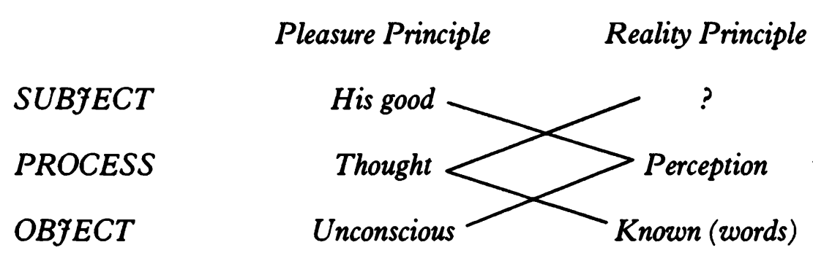

<strong>第一章 研讨班大纲</strong>

逾越（transgression）[^1]的诱惑

从亚里士多德到弗洛伊德

现实

三个理想

我宣布今年研讨班的主题是“精神分析的伦理”。我认为这一主题的选择本身并不令人惊讶，尽管它确实会让你们中的一些人对我的意图感到困惑。

当我决定着手此事的时候确实不是没有犹豫的，甚至还感到有些惶恐。实际上，我之所以决定这样做，是因为该主题直接延续了去年研讨班——如果我们可以认为这项工作已经圆满完成的话——的主题。

无论如何，我们必须继续前进。根据这一表述所蕴含的全部内容，精神分析的伦理学——再没有比它更合适的途径了——将允许我去检验一些范畴；我相信，通过我的教学，这些范畴将为你们提供最合适的工具，以便理解弗洛伊德的著作及其衍生出的精神分析经验之中的创新。

在哪方面的创新？在一种既十分普遍又非常具体的方面。创新之所以是普遍的，是因为精神分析经验对人类历史的特定时刻——也就是我们正生活于其中的时刻——具有重大意义，尽管这不意味着我们能够（其实我们还远远不能）确定自己所参与的这项集体工作的内涵。之所以是具体的，是因为就像我们的日常工作一样，它涉及我们在\[过往\]经验中应当如何回应那种我曾教你们表述为“要求”的东西，也就是病人的要求；正是我们的回应赋予这一要求以确切的意义。而当我们做出回应时，我们必须保持最严格的纪律，以免让其中深层的无意识意义被这个要求所搀杂、篡改或稀释。

在谈及精神分析的伦理时，我对词语的选择不是出于意外。我本可以用“道德”这个词的。你们很快就会明白我选择“伦理”这个词的原因。这不是因为我希望通过使用冷僻词汇来取乐。

<strong>第一节</strong>

为了让这次研讨班的主题更好理解，甚至更具吸引力，我们不妨先注意如下一点。我相信，凡是涉足精神分析的人，没有不被它对伦理主题的处理所吸引的。这个表达不是我首创的。此外，我们不得不承认，我们确实深陷严格意义上的道德问题中。

我们的经验引导我们以前所未有的深度去探索逾越的领域（the universe of transgression）。我这个表述是我的同事赫斯纳德最先使用的，不过他还添加了一个额外的形容词：病态的（morbid）逾越领域。毫无疑问，我们正是从这一病态的视角出发，从这个领域的最高点接近它。

实际上，这一视角无法与逾越的领域本身相分离。在我们这个时代，逾越与病态的联系已经烙印在所有关于道德的思考上。正如之前我在旁白中曾提请你们注意的一样，在宗教圈子里，当那些思考道德问题的人直面我们经验所呈现的内容时，他们会陷入某种眩晕。这实在令人感到奇怪。值得注意的是，他们似乎屈服于一种过度的甚至滑稽的乐观主义的诱惑，开始认为病态的减少可能会导致越界行为的消失。

实际上，我们正在处理的正是逾越的诱惑。

那么这种逾越究竟是什么呢？它当然不同于病人怀着受罚的期待、或者以自我惩罚的方式所实施的那种逾越。当我们谈到“对惩罚的需要”时，我们当然是在说一种逾越：这种逾越处在这一需要的通路上，并且正是为了获得这种惩罚而被追求的。但是，沿着这条路我们只不过被稍稍带远了一点，走向了某种更鲜为人知的逾越——一种渴望惩罚的逾越。

弗洛伊德的研究从一开始指向的逾越是弑父吗？是那被他置于文明发展之起源的宏大神话吗？或者是他在其著作的结尾处所命名的那更鲜为人知、更本源的逾越——这种逾越简言之就是死亡本能（death instinct），人类发现自己深陷于这种可怕的辩证运动中——吗？

道德经验本身总是涉及某种裁决，它将人置于与他自己的行动的某种关联中，而这种关联不仅涉及一种被明确道出的法律，还涉及一种方向、一种轨迹，简言之，一种他所诉诸的善，从而催生了行为的理想。严格来说，所有这些也构成了伦理的维度，并超越了命令的概念，以及那些被呈现为义务感的东西。正因如此，我认为有必要将我们经验的维度与试图在我们时代发扬道德思想的那些人所做的贡献联系起来——我指的实际上是弗里茨·劳赫，我们将在此次探讨中将他作为我们的参照点之一。

但我绝不属于那些乐于对义务感置之不理的人。如果精神分析确实有提请人们注意什么，那便是在严格意义上的义务感之外，还有一种重要甚至无处不在的内疚感。伦理思想的某些内在倾向试图回避道德经验中的这一令人不快的方面。如果说我绝不属于那些试图淡化、钝化或减轻内疚感的人，那是因为在我的日常经验中，我太过执拗地被带回到它那里，并被它所提醒。

然而不可否认的是，精神分析这种经验以最强有力的方式重新肯定了欲望本身的生产性功能。这一点是如此的明显，以至于我们完全可以说，弗洛伊德的理论构建中道德维度的根源恰恰位于欲望本身。那个在发展的终点演化为审查的心理机构正是从欲望的能量中分离出来的。

可见，某种东西被包围在一个强加于我们的循环中，而这一循环是从我们经验的最特别的特征中推导出来的。

十八世纪的一种哲学是与弗洛伊德事业关系最紧密的哲学的直接前身，并且在十九世纪传承到我们手里。这种哲学将欲望的所谓自然主义解放作为其任务。人们或许可以将这种尤其具有实践性质的思想描述为享乐者的思想。但是欲望的自然主义解放已经失败了。理论越多，社会批判工作越多，越是为了将义务限缩为社会秩序的某种精密功能而去筛选经验，越是希望相对化道德经验中的命令性、对立性乃至冲突性特征，我们实际上见证的真正病理现象就越多。欲望的自然主义解放已经历史性地失败了。在经历了所谓的解禁（libertine）思想的伟大批判之后，我们并未发现人类所受的律令与责任负担有所减轻。

如果我们反思精神分析对关于倒错经验的知识和情境做出的贡献，以此来回顾享乐者的经验，就会很快发现这种道德理论中的一切实际上都注定失败。

实际上，尽管享乐者的经验呈现出一种自然主义解放的理想，但只需阅读那些主要作者——我指的是那些在这个主题上表达自己时，能够对解禁乃至纵情声色本身采取最大胆态度的人——的作品就能认识到，这种经验中蕴含着一丝挑衅的意味，一种考验性的试炼，而它所针对的正是这一论述的终点，一个虽然已经被削弱但是依然稳固的参照点——神圣者。

作为自然的创造者，上帝被召唤来解释那些极端异常现象——萨德侯爵、米拉波和狄德罗等人已使我们注意到这些现象的存在。这一挑战、这一召唤、这一考验性的试炼，除了历史上实际实现的那条出路外，不应当允许任何其他出路。经受了这次考验的人最终会发现这场考研的前提，即它所指向的大他者（the Other）；归根结底也就是它的审判者。正是这一点赋予了这类文学作品以特殊的基调，它以空前绝后的方式向我们呈现了情色的维度。在我们的研究过程中，我们必须明确地将精神分析中与这种经验保有亲缘性、关联性以及共同根源的部分，提交给我们的判断。

在此我们正在接触一个在精神分析中很少被探索的视角。看起来从最初的探索开始，从弗洛伊德对欲望的悖论性起源及其婴儿期形态的多形倒错特征（polymorphously perverse character）的一闪而过的洞察开始，一种普遍趋势便引导着精神分析学家们去消解这些悖论性的起源，展示它们如何汇聚于一个和谐的结论。这一动向在整体上刻画了精神分析思想的发展，以至于我们值得追问：这种理论进步是否最终导向了一种比以往任何道德主义都更加无所不包的道德主义？精神分析的唯一目标似乎是平息内疚，尽管我们从实践经验中深知这条进路所必然导致的困难、障碍乃至各种反作用。通过证明倒错的普遍性和功能，这条进路完成了对倒错享乐（jouissance）的驯化，

毫无疑问，在这种情况下用于指称倒错驱力的“成分”一词获得完整的分量。去年我们探讨了“成分驱力”这一表述；在有关这个主题的整个章节中，我们关注精神分析为欲望功能提供了什么洞见，以及那种引人注目的多样性具有怎样的深层目的；正是这种多样性说明了精神分析让我们得以编纂一部人类本能目录的价值。

或许只有当我们将“欲望”这一术语的视角所导向的立场与（例如）亚里士多德在伦理学著作中所阐述的立场进行对比时，这一问题的轮廓才会格外鲜明。我将在本次讨论中给予他重要位置，特别是那部以最详尽地阐述了亚里士多德的伦理学思想的著作——《尼各马可伦理学》。亚里士多德在他的著作中两次表明，他是如何将欲望领域置于道德领域之外的。

在涉及某一类欲望时，亚里士多德认为这里实际上不存在伦理问题。但是这些欲望恰恰是那些位于我们经验的前台的概念。构成我们的性欲领域的整个巨大范畴被亚里士多德简单地归类为怪异的反常现象——他称之为“兽性”。这一层面内发生的事情与道德评价无关。亚里士多德提出的伦理问题完全位于别处——我稍后会向你们阐述这些问题的要点与本质。这一点尤其重要。

另一方面，如果有人认为亚里士多德的全部道德理论在当代道德哲学中丝毫没有损失其适用性，那么从这一事实出发就可以衡量我们的经验是多么的巨头颠覆性，因为正是这种经验让亚里士多德的理论显得令人惊讶、原始粗陋、充满悖论，并且实际上是难以理解的。

但是这一切不过是我们的整个旅程的一站。我在这个早晨真正想做的是向你们呈现本次研讨班的大纲。

<strong>第二节</strong>

我们面临的问题是，根据精神分析我们应当如何制定对道德起源的关切。

精神分析的贡献是否仅限于构建一种比自称来自天启的神话更可信、更世俗化的神话？我指的是《图腾与禁忌》中重构的神话，它开始于源初的弑父经验，以及引发这一事件的环境及其后果。从这个角度看，正是欲望能量的转化使得关于欲望压抑之起源的观念成为可能。因此，在这个例子中，逾越不是仅仅正式地强加于我们；它毋宁值得我们的赞美（“幸运的罪过”），因为它催生了更高的复杂性，而文明领域的发展正是归功于它。

简言之，精神分析的全部内容是否局限于超我的发生学，而对超我的描述随着弗洛伊德著作的推进而逐渐被阐述、完善、深化和复杂化？我们将看到，超我的这种发生学并不仅仅是心理发生学和社会发生学。事实上，如果我们仅仅局限于集体需求的层面，就无法阐明其发生。这里毋宁引入了某种新东西，其管辖范围应当与单纯的社会必要性区分开——确切地说，这是一个独特的范畴，而我正试图通过它与能指和话语法则的关系来让诸位领会其意义。如果我们想要准确或正确地定位我们的经验，就必须保持这一术语的自主性。

<strong>第二章 快乐与现实</strong>

道德主体将实在现实化

惰性与矫正

现实是不稳固的

诸原则的对立和交叉

我试图带给你们的是蜜糖，是由我对某件事的思考所带来的蜜糖。我已经从事这件事（天哪！）很多年，并且开始累积起一些成果，但随着时间的推移，我最终发现我并不比你们投入的时间多出很多。

如果这里的交流有时会呈现出一些困难，那么不妨想想各位对蜜糖的经验。蜜糖要么太硬，要么太稀。蜜糖如果太硬就很难切，因为不存在天然的断点；如果太稀，就容易突然弄得到处都是——我假定你们都有在早饭时间躺在床上吃蜂蜜的经验。

因而就有了罐子的问题。蜜罐让人联想起我之前探讨过的芥末罐。两者如今具有完全相同的含义，因为我们不再想象用来储存收成的六边形蜂巢同世界结构之间有什么天然的联系。因此，我们提出的问题归根到底总是同一个：词语的作用究竟是什么？

今年我们更加具体地关注我们实践中的伦理问题如何与我们长久以来隐约察觉的另一问题密切相关：即所有心理学（包括我们借助精神分析建立的体系）中普遍存在的深层不满，其实源于心理学仅仅是我们对自身行为的\[正当性\]问题——这个问题才是本质，是一切伦理反思的基础——的探讨所戴上的一副面具，有时甚至是一句开脱。换言之，我们需要知道我们是否真的迈出了超越伦理学的一小步，或者我们的理论体系与其他心理学派一样，本质上仍然是伦理反思的延伸，仍然是在探寻某种指引或路径。这种探寻归根结底可以被表述为：“鉴于我们作为人的境遇，我们应当做什么才算做出了正确的行动？”

在我看来，很难有人不同意这个提醒，因为在我们生活的每一天里，我们的行动无时无刻不暗示着我们离这个问题并不遥远。[^2]诚然，事情以各不相同的方式呈现给我们。我们引入、呈现并证成自己行动的方式也各不相同。它的开端带有要求、呼求和紧迫性的特征，这些特征的专门化意义让我们在阐明一种伦理学时似乎更接近具体经验。但这并不改变一个事实：我们最终（或者在任何时刻）都可能重新发现这种阐明的完整形态——它向来为那些反思道德并构建各种伦理学的人们提供意义和论据。

<strong>第一节</strong>

上次我勾勒了我今年想要讨论的内容的大纲。它开始于对道德律令的广布性、以及它对我们全部经验的渗透的认识，然后推进到另一极，即道德受虐倾向，我们在那里或许能够悖论性地发现一种二阶快乐。

顺带一提，我指出了我打算发展的一种出人意料且具有原创性的进路，它涉及我用来引导你们理解自身经验的那些基本范畴：符号界、想象界和实在界。我的论点——正如我已经提示过的那样，如果它一开始显得有些混乱，请不要惊讶，因为正是我的论证展开才会赋予它分量——是：道德律、道德命令、道德机制在我们的活动中的在场，只要是由符号界所结构化的，就是使实在界得以现实化的东西；也就是说，它将实在界本身和实在界的重量现实化。

这一论点看起来也许既像是一个平凡的真理，又像是一个悖论。我的论点包含这样一种想法：道德律是在与快乐的对立中确立其自身的；并且我们也能够感觉到，如果在与道德律的关联中谈论实在界，似乎会让我们通常纳入“理想”概念之中的那些价值受到质疑。因此，目前我暂且不再进一步磨砺我论证的锋芒，因为我目的的要义很可能恰恰就在于说明，在我作为分析师、并依据我们的实践提出的那套范畴系统中，究竟应当赋予“实在界”这个术语以什么意义。

这个术语的意义不是立刻可获取的，但是各位如果曾经思考过我可能赋予这个术语的意义，就会注意到它的意义必然与贯穿弗洛伊德思想的整体运动有某种关系。这个运动让他首先在现实原则与快乐原则之间建立初步的对立，随后经过一系列的摇摆、波动和微妙的参照变化，最终在理论表述的结尾处提出一种超越快乐原则的东西，这可能会让我们好奇，它与最初的那个对立之间有着怎样的关系。我们在快乐原则之外遇到了那种不透明的表面，它对某些人而言显得如此的难以理解，以至于成为了一切思想（不仅是生物学思想，还包括一般的科学思想）的二律背反（antimony）。它被称为死亡本能。

什么是死亡本能？它超越了一切法则，只能被设定为一个终极结构，或者一切可能达到的现实的消失点。[^3]在快乐原则与现实原则的结合中，现实原则看似只是快乐原则的延续或应用。但是另一方面，这种有所依赖的、有限的立场似乎导致了某种东西的出现，后者在最广泛的意义上控制着我们与世界的整体关系。《超越快乐原则》正是要揭示或重新发现这一点。我们将会在这个过程中看到被弗洛伊德称为“现实”的东西的成问题性。

这是一个关于日常现实、关于直接的社会现实的问题吗？是关于对某些既定范畴或实践的顺从的问题吗？是关于由科学发现或未被发现的现实的问题吗？是关于心理现实的问题吗？

在考察这个现实的过程中，我们将自己视为分析师，并且发现这条道路将我们带离了那种可以用整体性范畴来表达的东西，转而引领我们进入一个特殊的领域，即心理现实领域，它呈现出一种前所未有的秩序所蕴含的种种问题。

因此我将会首先尝试探讨“现实”这一术语在精神分析的创始人的思想中所扮演的角色，及其在我们这些追随者的思想中扮演的角色。另一方面，对于那些倾向于忘记这一点的人，以及那些认为我之所以选择这个方向，是因为我们的经验中\[偶然\]出现了道德律令的人，我将向他们指出，道德行动对我们而言之所以是成问题的，精神分析仅仅让我们为它做好了准备，最终却仍然把我们留在门口。

实际上，道德行动是被嫁接到实在界之上的。它向实在界引入某种新元素，从而开启了一条将我们的存在点位（the point of presence）正当化的路径。倘若果真如此，那么精神分析是如何帮助我们为这样的行动做好准备的？精神分析是如何让我们准备好去做实事的？它为什么以这种方式引导我们？它为什么又止步于门槛？这正是另一个极点，我希望把我在此试图表述的东西集中到这个极点上来——当然，我们要明白，我上次指出的东西构成了我在此所要谈论的事情的边界，也限定了精神分析在什么意义上可被称为一种伦理学。我现在就直说：精神分析的伦理限度与其实践的限度相重合。精神分析实践只是严格意义上的道德行动的预备阶段；而所谓行动就是我们借以进入实在界的手段。

放眼曾经对伦理学进行过分析的前辈，亚里士多德应当被归类为最典型和无疑最有成绩的一位。阅读他的著作将是一项激动人心的活动，并且我十分推荐你们以练习的方式自行去探索——你们不会感到无聊的。学者似乎认为《尼科马克伦理学》是最确定地归属于亚里士多德、并且最易读的一部著作。尽管文本的离题和论证顺序无疑会造成许多困难，但你们可以跳过那些看起来太过复杂的段落，或者获取一版附带良好注释的书籍，以便更好地了解他的逻辑，从而理解他所提出的问题。最重要的是，不要因为试图逐段理解所有内容而给自己徒增负担。只要尝试读完整本书，你们就一定能得到回报。

至少有一件事是引人注目的，它在某种程度上是这部著作与其他伦理学著作所共有的，即这本书倾向于援引某种秩序。这种秩序首先呈现为一门epistēmē\[科学\]，这门科学是关于“必须做什么”的科学，是关于一种无可争议的秩序——它定义了特定ēthos\[品格\]的规范——的科学。因此，问题在于如何在主体之中建立起这种秩序。如果在主体之中实现某种适配性，以便让他进入并服从于这个秩序？

习惯的建立被设定为使有生命的存在者区别于无生命的惰性存在者的要素。正如亚里士多德所指出的，无论你频繁地抛出一块石头，它都无法获得其轨迹的习惯；而人类则可以获得习惯。从亚里士多德的逻辑的视角看来，这种习惯必须走向一种至高的善——这是一个插入点、附着点或汇聚点，特殊的秩序和更加普遍的秩序在这个点上达成统一，伦理学也变成政治学，并进一步变成对宇宙秩序的模仿。亚里士多德的思想一开始就预设了宏观与微观宇宙的概念。

这就产生了一个问题，即如何使得主体遵从某种东西，这种东西由于已经预设了那种秩序的路径，所以是不可置疑的。那个在亚里士多德伦理学中持续不断地被提出的问题是什么？让我们从拥有这种知识的人开始说起。当然，因为亚里士多德所面对的那个人（也就是他的学生）正在聆听，所以他已经被假定为参与了这种科学话语。因此这里所说的话语——即正当的逻各斯、正确的言说、合宜的理性——在如此提出伦理问题的同时就被引入了。这样一来，问题就清楚地回到了苏格拉底曾经停下的那个地方；苏格拉底带着一种过度的乐观主义停留在那里，而这种乐观主义不能不使他的直接后继者感到震动。倘若行动的规则就在正当的逻各斯之中，倘若除了符合这种正当的逻各斯之外就不可能有善的行动，那么亚里士多德所谓的“不节制”又怎么可能继续存在呢？一个主体的冲动怎么可能把他牵引到别处去呢？这该如何解释呢？

尽管我们会因为相信自己在这个问题上了解得更多，而认为这种对解释的需求是肤浅的，但它确实构成了亚里士多德在《伦理学》中思想实质的主要部分。我将在后面联系弗洛伊德对这同一个主题的思考，重新讨论这个问题。

对于亚里士多德而言，这个问题是由某种人类理想施加的条件所界定的；我已经简要提及过这一理想，即“主人”的理想。对他而言，问题在于阐明无节制与相对于主人的基本美德所犯下的过失之间可能存在怎样的关系。

我认为我上次已经充分指出，古代的主人不完全是黑格尔辩证法所表现的野蛮英雄——他在黑格尔的理论中起到一个轴心和转折点的作用。这里我不会详细阐述这一类型的代表性特征；我们只需知道，这使得我们能够恰当地领会亚里士多德伦理学的贡献。这无疑会促使我们为其伦理学的价值设定界限，并将其历史化；而如果人们认为这是唯一的结论，那就错了。从亚里士多德的角度看，古代的主人是一个在场者，是一种人类状态，他与奴隶的关系远没有黑格尔所断言的那样狭隘地具有批判性。事实上，在黑格尔看来，真正被提出而没有被解决的问题，是关于“主人社会”的问题。

还有一些评述同样可能帮助我们限定亚里士多德伦理学的价值。例如我们注意到这位大师的理想似乎是尽可能避免劳动，就像一个处在由理性主宰的亚里士多德式世界的中心的神一样。我的意思是，他将对奴隶的管理留给管家，以便专注于一种沉思的理想，而如果没有这种理想，伦理学就无法实现其应有的目标。这表明了亚里士多德的伦理学视角是多么的理想化。

因此亚里士多德的伦理学尤其局限性，我几乎可以说它局限于一种社会类型，局限于一种闲暇的特权代表。但在另一方面，令人惊讶的是，在如此特定条件下建构的伦理学仍然带来如此多的共鸣和教训。它所提出的图式不是无用的。在我们对弗洛伊德的经验的考察中，这些图式中的一部分可能以不可辨识的形式出现。这些图式可以被重组和修改，让我们不至于用旧瓶装新酒。

人们可以不假思索地说，在我们的经验中存在着对某种道路、某种真理的追求。毕竟我们在精神分析中追求的不正是一种解放性的真理吗？

但我们必须小心。人绝不能总是信任词语和标签。我们在具体经验中寻求的这个真理不是那种居高临下的法则。如果我们所寻求的真理是一种解放性的真理，那么它一定是由我们在自身主体中的隐秘处找到的。它一定是一个特殊的真理。

但是，如果我们所发现的这种真理的表达形式，在每个人那里既是相同的、又总是各不相同的，那是因为它对每个人来说都是以其最内在的特异性显现出来的，并且带有一种强制性的Wunsch\[愿望\]的性质。没有任何东西可以与它相比，因此它不可能受到来自外部的判断。最能刻画它的性质的是：它乃是真正的Wunsch，而这种Wunsch正是某种偏离常规的或非典型的行为的根源。

我们遇到的这种特殊的、不可化约的Wunsch\[愿望\]，表现为一种分殊（modification）；这种分殊不预设任何正常化形式，而是仅仅预设一种快乐或痛苦的经验——而且是一种最终性的经验，Wunsch正是从那里发生，并随后以不可化约的形式保存在主体深处。Wunsch不是一条普遍的法则，而是许多最特殊的法则——即便“这种特殊性存在于每个人之中”这一点本身是普遍的。我们是在一种已经被我们归类为退行的、幼儿的、非现实的阶段的形式中发现它的；这一阶段的特征是：思想被交付给欲望，而欲望被当作现实。

这无疑构成了我们经验的文本。但这就是我们发现的全部吗？这就是我们道德的全部吗？这种弱化、这种\[把欲望\]暴露于阳光之下的举措、这种对欲望思想的发现、这种对思想之真理的揭示就是全部吗？我们是否在期望仅仅通过单纯的揭示就能够为另一种的思想让出空间呢？在某种意义上确实如此，事情就是这样简单。然而，与此同时，如果我们以这种方式表述，那么一切仍然对我们保持遮蔽。

如果精神分析经验的回报或创新性仅限于此，它就不会超出一个早于精神分析的过时观念，即“儿童是成人之父”。这句诗出自英国浪漫派诗人华兹华斯，并被弗洛伊德所重视和引用。

这种思想出现在十九世纪初的英国不是偶然，因为正是在那段时期，工业革命以它的新奇、震撼乃至令人屏息凝神的特质爆发于受它影响最深的国家——英国。英国浪漫派的独特特征包括对童年记忆、整个童年世界以及儿童时代的理想和愿望的重视。当时的诗人不仅将此作为他们灵感的源泉，更将其用于其主要课题的发展——他们在这个方面与以往的诗人截然不同，尤其不同于十七和十八世纪的那些精彩的诗歌，后者出于一些我不知道的原因被描述为形而上学的。

诉诸童年、认为每个成人中都有一个儿童、认为成人虽然必须不同于儿童但是儿童的需求永远存在于成人心中——这一切在心理学领域都可以被历史性地定位。

另一位生活在十九世纪上半叶的维多利亚时代的历史学家麦考利指出，那个时期的人类\[在批评他人时\]倾向于使用一种更好的武器，即断定你的心智尚未完全成熟，而不是直接说你是一个不诚实的人或一个彻头彻尾的白痴。这种态度可以定位在特定的历史时期，它标志着一个间隔、一个历史发展的断裂，因为在任何先前的历史中都找不到相关的证据。在帕斯卡的时代，当人们谈及儿童时仅仅会说“儿童还不是成人”；而当人们谈及成人的思想时，绝不会试图在其中找到幼儿思想的痕迹。

对我们来说，问题并不是以这种表述提出的。可是，如果我们仍然不断地以这种方式提出它；即便我们与神经症患者的关系、以及我们对个体生成的经验证成了这个提法，这种提法同时也遮蔽了它背后的东西。因为无论这种说法多么真实，在我们必须处理的无意识思想与那种被称为（天知道为什么）成人思想之间，始终存在着一种完全不同的张力。我们不断碰到这样一个事实：相对于那个被用于评判成人的所谓儿童思想，这种成人思想总是软弱无力（runs out of steam）。我们不是把儿童思想当作一件衬托物来使用，而是把它当作一个参照点、一个消失点；在那里，各种未完成、甚至各种退化聚拢到一起，并达到它们的终点。我们在援引这些东西时始终存在一种持续的矛盾。

在今天的课程之前，我在琼斯的著作中读到了一种对社会压力的崇高美德的赞扬。他认为如果没有这种压力，我们的同代人、我们的同类将是虚荣、自我中心、卑劣、死气沉沉的等等。人们不禁想在一旁评论：“他们不就是这样吗？”而当我们谈论成年人时，我们的参照是什么？成年人的模型是什么？

这些考量促使我们重新审视弗洛伊德思想的真正坚实的基础。毫无疑问，精神分析最终按照一种理想的发展来整理它的经验材料。但在其起始阶段，它的术语则发源于一个完全不同的参照体系，而发展和生成仅仅对这个体系提供了间歇性的支持——我相信，我已经让你们对此有了足够的认识，即使这次我只能简要提及这一点。这种根本的参照物是一种紧张关系，是初级过程与次级过程之间、快乐原则与现实原则之间的对立。

<strong>第二节</strong>

在他所谓“自我分析”的过程中，弗洛伊德在一封短信（第73号信）中写道：“我的分析仍在继续。这是我最主要的兴趣。一切仍然晦暗难明，连这里所涉及的问题本身也仍然晦暗，但有一种舒适感。这就好像一个人只需把手伸进食品柜，就能取出自己想要的东西。令人不快的东西是那些Stimmungen\[情绪\]”——我们可以在最广泛的意义上理解这个词；它在德语中有一种特殊的回响，也就是情绪或感受。它因其本性而会遮蔽和隐藏某些东西——隐藏什么呢？Die Wirklichkeit，现实<strong>。</strong>

弗洛伊德站在Wirklichkeit\[现实\]的角度质疑那种被呈现为Stimmung\[情绪\]的东西。Stimmung向他揭示了他在自我分析中必须寻找的东西，揭示了他正在追问的东西：在某个时刻，他觉得自己仿佛置身于一间暗室、一只Vorratskam-mer\[食品柜\]之中，那里有他所需要的一切；这些东西就在那里等着他，为他储备着。但是，他并不是被自己的Stimmungen引向这些东西的。这就是他那句话的意思：最令人不快的经验（das Unangenehmste）就是这些Stimmungen。弗洛伊德的经验始于对某种现实的寻找，而这种现实就位于他自身内部的某处。正是这一点构成了他出发点的原创性。此外，他还以同样的口吻补充说：“对于像我这样的人来说，即便是性兴奋在这种进路中也是不可使用的。即便在那里，也不相信自己能够看出最终的现实在哪里。”他又说：“在整个事情中，我保持着良好的心情。”在取得结果之前，我们还必须再多一点耐心。

我想请你们注意一本最近由埃里希·弗洛姆所著的小书，但我不会推荐这本书，因为这是一部异常地不和谐、几乎可以说是阴险的著作，甚至近乎于诽谤。它的名字叫《西格蒙德·弗洛伊德的使命》，其中提出了一些暗示性的观点。这些观点都不是无意为之，它们涉及弗洛伊德个性的特殊特征，而这些特征总是以明显贬低的视角被看待的。特别是他从文本中挑选了弗洛伊德关于性兴奋的句子，以诱导我们得出结论：弗洛伊德在四十岁时阳痿了。

我们现在已经准备好分析弗洛伊德1895年的草稿，该草稿涉及他对心理结构的基本构想，并且机缘巧合地落入我们手中。他曾考虑将其命名为《神经病学者的心理学》。由于他从未发表它，所以该草稿一直放在与弗利斯的信件包裹中。得益于这些文献的收购，我们才得以接触到它。

因此，我们的分析不仅应当、而且必须从这一点开始，即在弗洛伊德的思想中，现实原则与快乐原则的对立究竟意味着什么？在弗洛伊德的思想发展中，同时也在我们自身经验所采取的方向中，是否存在某种独特的东西？正是在这里，我们也许能够找到我认为此刻所需要的那条隐藏的主线。

快乐原则与现实原则之间的对立在弗洛伊德的作品中不断被重新阐述—— 1895年的《科学心理学草稿》；1900年，《梦的解析》第七章首次公开阐述了所谓的初级过程和次级过程，前者受快乐原则支配，而后者受现实原则支配； 1914年，回到那份我去年详细探讨过的、关于死去父亲的梦的文章，“他不知道”；“Formulieringen über die Zwei Prinzipen des Psychischen Geschehens”，或许可以被翻译为“论心理结构”；1930年，《文明及其不满》，我向你承诺过，我们将以结论的方式探讨这本书。

在弗洛伊德以前，其他人已经将快乐视为伦理的指导功能。亚里士多德不仅对此非常重视，更是发现必须将快乐置于伦理教学的中心。毕竟没有了快乐的绽放，幸福又算什么呢？《尼科马科伦理学》中的一部分重要讨论旨在恢复快乐应有的真实功能；奇怪的是，这一概念的引入使其获得了一种不仅仅是被动的价值。亚里士多德的快乐是一种活动，类似于青春活力所散发的奔放气息——如果你愿意，可以称之为一种光辉。此外，它也是行动绽放的信号，从字面意义上讲，energeia这个词表达了真正的实践，即包含自身目的的行动。

历史上，快乐无疑呈现为标志、污点、奖励或心理生活的实质等多种变体。但让我们考察那个直接向我们提问的人，即看看快乐在弗洛伊德那里是什么样的。

我们会立刻注意到，弗洛伊德的快乐原则是一种惰性原则（inertia principl-e）。它的功能是通过某种自动机制来调节一切，而这一切都汇聚在一个过程中。弗洛伊德在其最初表述中倾向于把这一过程呈现为依赖于一个预先形成的、被严格限制在神经元之内的装置（apparatus）。这个神经元装置在经受了各种作用之后会保留这些作用留下的易化通路（facilitations），并对这些通路加以调节。这里本质上涉及的是一种基本的释放倾向所产生的所有结果；在这种倾向中，某个给定的\[刺激/兴奋\]量注定要被耗散掉。弗洛伊德最初就是从这一视角来阐明快乐原则的运作的。

对这种假设性表述的尝试，在弗洛伊德的现存著作中是独一无二的。而且我们不应忘记，他后来对这种表述产生了厌恶、不想发表它。毫无疑问，这个表述是他在面对自己时，为了回应他向自己提出的对一致性的要求而写下的。但不得不说，尽管这一表述表面上并没有诉诸临床事实，但是这些临床事实无疑构成了他所必须应对的那些要求的全部力量。他是在同自己、或者通弗里斯讨论这些问题，而在当时的情形下这两者其实是一回事。他向自己呈现出一种可能的、内在一致的表象，一种工作假设，以便回应某种东西；而这种东西的具体的、实验性的维度在这里却被遮蔽和回避了。

他声称，问题在于解释心智的正常运作。为了做到这一点，他从一个装置出发，而这个装置的基础与一种以适配和均衡为结果的机制完全相反。他从一个天然倾向于欺骗和错误的系统出发。这一整个有机体看起来似乎不是被设计来满足需要的，而是被设计来产生这种满足的幻觉。因此，无怪乎有一个与之对立的装置，后者作为现实的代理者（agency）而运作；它本质上呈现为一种矫正原则，一种召唤着秩序的原则。我没有夸大其词。弗洛伊德本人也坚持认为必须区分这两种装置，尽管他承认，他在支撑它们的解剖学结构中找不到这种区分的踪迹。

现实原则——它是神经元装置的运作效力的最终来源——呈现为一种远远超出单纯检查的装置；它毋宁关乎矫正。它以迂回、预防、修正和克制的模式运作。它矫正并补偿那些看似是心理装置的自然倾向的东西，并且从根本上与之对立。

在此，冲突作为根基、作为一个有机体的起源而被引入；可以说，这个有机体似乎终究是要活下去的。在弗洛伊德以前，没有任何人，也没有任何关于人类行为的说明，能够如此深入地强调其根本上的冲突性。也没有任何人曾经如此彻底地把有机体解释为一种根本的不适配——以至于两个系统的二元性本身，就是为了克服其中一个系统的根本性不适配而被设想出来的。

φ系统和ψ系统的这种贯穿始终的对立看起来几乎像是一次赌博。毕竟，除了弗洛伊德在\[处理\]神经症的经历中所面对的那种不可控的\[兴奋\]量以外，还有什么可以为之提供依据呢？这就是整个系统背后的驱动性要求。

我们立刻发现，弗洛伊德之所以如此重视\[兴奋\]量，不是因为他希望让自己的理论与亥姆霍兹和布吕克的机械论观念相一致。在他看来这毋宁对应于最直接的生活经验，即对那种惰性的经验。在症状的层面上，这种惰性向他呈现出一些障碍，而他认识到这些障碍具有某种不可逆的性质。正是在这里，我们发现他第一次在黑暗中向Wirklichkeit\[现实\]的概念推进；他的追问总是回到这一点。它是他的整个体系的钥匙，是其独特特征。我请求你们重新阅读这篇文本。不要像那些编辑它的注释者、评论者和牵强附会的阐释者那样，去追问这里或那里究竟更接近心理学思想还是生理学思想，究竟是在指涉赫尔巴特、亥姆霍兹还是其他人。你们将会看到，在一种冷静、抽象、经院式、复杂而枯燥的表达方式之下能够感到一种生活经验；而这种经验在根本上是道德性质的。

人们可以在这个话题上扮演历史学家，好像能够通过他的影响、通过他的表述与先前处在不同背景中的思想家之间的相似性，来评判弗洛伊德这样的人的价值。然而，既然这人们都参与到这种活动中，为什么我不应当以自己的方式做同样的事情呢？支撑着现实原则的装置的运作难道不是与亚里士多德所阐述的内容令人惊讶地相似吗？

弗洛伊德的任务是解释审查与克制的活动如何起作用；换言之，是解释那个支撑次级过程的装置如何避免一些灾难的发生。如果时间拖延得太长或太短，或者放任快乐原则自行其是，那么这些灾难就必然会随之而来。如果快乐原则被释放得太早，那么运动就会仅仅由一个Wunschgedanke\[愿望思想/愿望表象\]所触发；这种运动必将是痛苦的，并且会产生不快。另一方面，如果次级装置介入得太晚，如果它没有给出那一点必要的小量释放，促使主体通过行动来尝试开启一种适当的解决，就会出现一种退行性的释放，也就是说一种幻觉；而这同样是不快的来源。

这一理论与亚里士多德关于有知识者如何可能放纵自己的观念不无关系。亚里士多德提供了几种解决方案。我将会跳过那些引入三段论和辩证元素的早期方案，因为它们与我们的关切相距较远。亚里士多德还尝试了一种非辩证而是物理的解决方案——尽管如此，他还是希望以可欲之物（the desirable）的三段论的形式呈现这个方案。

我认为第七卷第五章关于快乐的部分值得通读。除了“每个人必定总是享受甜食”这一大前提以外，还有一个特殊的、具体的小前提，即“这是甜的”。而错误行动的原则就在于与小前提有关的特殊判断的出错。错误出在哪里呢？正是在于那个位于大前提之下的欲望，它导致主体错判了行动所指向的、其自认为的甘甜。

我不禁想到，弗洛伊德在1887年参加了布伦塔诺的亚里士多德讲座，他在那里将对问题的伦理学表述转换为一种假设性的机械论视角。他的转化方式是纯粹形式化的，并且赋予了这个问题以完全不同的重点。

实际上，这不比当时其他人提出的心理学理论更具心理学性质。我们不要抱有幻想；对心理学而言，迄今为止还没有什么著作的成就超过了弗洛伊德的《草稿》。凡是在这种假设——即认为神经系统的机制能够说明被我们视为心理活动领域的那些东西——之下构想出来的理论，都同样带有一种幻想性假设的气息。

如果弗洛伊德回归伦理哲学家们在其领域中一直在使用的三段论逻辑表达式，那么他的目的是赋予它们以一种截然不同的意义。在解读他思想的真实内容——也就是我曾经教授给你们的内容——时，你们必须记住这一点。这里与我们有关的ὀρθός λόγος\[正当的逻各斯\]不单纯是大前提；相反，它们更关乎我曾教你们用来表述无意识中所发生之事的方式；它们关乎\[主体\]在快乐原则层面上所采用的那种话语。

正是考虑到这个被引号讽刺性地凸显出来的ὀρθός\[正当的\]，现实原则才必须引导主体，以便让他能够完成一个可能的行动。

<strong>第三节</strong>

从弗洛伊德的视角来看，现实原则的运作方式本质上是不稳固的。

此前没有任何哲学曾经在这个方向上走得这么远。这不是说现实\[在弗洛伊德那里\]受到了质疑，至少绝不是以唯心主义的方式受到质疑。与弗洛伊德相比，哲学传统中的唯心主义者实在算不了什么；因为他们归根到底并没有严肃地挑战那个著名的现实，他们只是把它驯服了。唯心主义无非是断言：是我们赋予现实以形态，除此之外没有理由再往下追问。这是一个舒服的位置。弗洛伊德的位置——或者说任何明智之人的位置——则完全是另一回事。

现实是不稳固的。正是因为通达现实的道路如此的不稳固，那些标画出这条道路的命令才如此专横。作为通向现实的向导，情感是欺骗性的。驱动了弗洛伊德的整个自我分析的那种直觉，在关于通向实在的问题上，就是这样表达出来的。接近实在的运动本身只有通过一种原初防御才可能开始发生。人所要求的这种接近实在的方式，具有一种深重的模糊性；这种模糊性首先是以一种防御的形式被铭写下来的——甚至在严格意义上的压抑条件被表述出来之前，这种防御就已经存在了。

为了强调弗洛伊德那里\[主体\]与现实之关系的悖论，我要把这个图式写在黑板上：一边是快乐原则，另一边是现实原则。你们一旦被这两个术语温和地安顿下来，事情似乎就会自行运转下去。粗略地说，一边是无意识，另一边是意识。你们在试图跟上我所要提出的几点时，请把这一点记在心里。

按照之前的指引，我们应当把知觉装置接合到（articulate on）什么之上呢？当然是接合到现实之上。但是如果我们遵循弗洛伊德的假设，那么快乐原则的控制\[作用\]从理论上讲究竟施加到什么之上呢？恰恰是施加到知觉之上；弗洛伊德贡献的原创性就在于此。正如他在《梦的解析》第七部分告诉我们的那样，初级过程的运作倾向于以一种知觉同一性（an identity of perception）为目标。至于这种同一性是现实的还是幻觉的，这不重要。这种同一性总是倾向于被建立起来，而如果它没有幸运到恰好与现实相符合，它就会以幻觉的方式被建立起来。危险就在于初级过程有可能占上风。

另一方面，次级过程的目标是什么呢？你们仍应当去看《梦的解析》第七章，不过这一点在《科学心理学草稿》中已经被表述出来了。它趋向于一种思想同一性（an identity of thought）。也就是说，心理装置的内部运作——下一次我会讨论如何用图式来表示它——是以一种摸索前进的方式进行的，是一种有所校正的试验。借助这种试验，已经建立起来的Bahnungen\[易化通路\]将释放出一些信号，而主体则根据这些信号进行一系列测试或迂回；这些测试或迂回会逐渐把他引向某种吻合（anastomosis），从而不再停留于对当下经验的周围对象的试探。我们可以说，经验的背景板就在于对某种Wunsch\[愿望\]的构建，或者说对某种快乐的Erwartung\[期待\]；这种快乐被定义为预期的快乐。正因为如此，这个系统倾向于在它自身的领域中独立自主地实现自己，理论上并不期待任何来自外部的东西。它直接朝向一种完成，而这种完成同触发它的东西高度相反。

在这种初步考察中，思想似乎应当与现实原则出现在同一层面上、放在同一栏里。但事实绝非如此。因为按照弗洛伊德的描述，这一过程本身并且就其本性而言是无意识的。你们要理解，与从外部世界以知觉的秩序抵达主体的东西不同，在这些测试的层面上发生的事情本身是不可知觉的。而正是借助这些测试，心理装置以近似的方式形成了那些易化通路，使主体能够做出适当的行动。可是这些事情就其自身而言并不能被知觉到。一切思想就其本性而言都是以无意识的方式发生的。无疑，它并不受快乐原则控制；但是，它发生在一个空间之中，而这个空间作为无意识空间，应当被看作服从于快乐原则。

在弗洛伊德看来，所有发生在内在过程层面的东西——思想本身也是一种过程——的唯一能够被主体察觉到的信号，就是快乐或痛苦的信号。正如其他无意识过程一样，除了这些信号以外再没有别的东西能够达到意识层面。

那么我们如何才能对这些思维过程有所理解呢？在此，弗洛伊德再次给出了一个足够清晰的回答：只有在词语被说出时，我们才可能把握它们。这个观念通常被这样解释，而这种解释带有一种所有思想都具有的好逸恶劳的倾向。思想总是不自知地沾染了某种平行论：“弗洛伊德在这里要告诉我们的东西显然是，词语乃是标志着过渡为前意识（preconscious）的东西。”但是究竟是什么东西发生了过渡呢？

除了属于无意识的那些运动之外，还能是什么发生了过渡呢？弗洛伊德告诉我们，思维过程只有通过词语才为我们所知；我们关于无意识所知道的东西，是作为词语的功能而抵达我们的。这个观念在《科学心理学草稿》中以最精确、最有力的方式被表述出来。例如，如果没有由它所引发的喊叫，我们对于一个令人不快的对象只会有一种极其混乱的观念；这种观念事实上无法把这个对象从其所在的情境中分离出来。它只会是那个情境中的邪恶中心。相反，经由喊叫，这个对象就会从其具体情境的特殊性中被剥离出来。弗洛伊德告诉我们，只有当痛苦使主体发出哭喊时，一个敌意对象才会在意识层面上被承认为敌意对象。这个feindlicher Objekt\[敌意对象\]本身的存在就是主体的喊叫。这一观念在《科学心理学草稿》中得到了表达。喊叫履行了一种释放的功能；它扮演了一座桥梁的角色，借助它，正在发生的某种东西可以在主体的意识中被把握和识别。如果不是喊叫把一个符号借给它，使它在意识层面上获得自身的分量、在场和结构，那么这个东西就会继续保持为晦暗和无意识的。哭喊还赋予它一种潜能；这是因为，对于一个人类主体来说，重要的对象乃是会说话的对象，而这将使他能够看到，那些实际上栖居于他自身无意识中的过程在他人的话语中被揭示出来。

我们只有在无意识被阐明时才能最终把握它，也就是说，我们只是在无意识中的那个通过进入词语而被表达出来的部分中把握到它。正因为如此，我们有理由认为——而且随着弗洛伊德发现的发展，这一点会越来越得到证明——除了语言的结构之外，无意识本身最终并没有别的结构。

正是这一点赋予了原子论理论以价值。尽管原子论未能涵盖它自称要涵盖的东西，并不能真正说明神经装置中\[存在着\]一定数目的原子，即神经系统中的那些被假定为个体的元素。但是另一方面，关于邻接和连续关系的理论却很好地展示了能指结构本身，展示了这种结构如何关乎任何语言运作。

我们在现实原则与快乐原则的相互作用的双重交叉中看到了什么？

现实原则控制了发生在思维层面的事；但只有当某种东西从思维中浮现出来，并且能够在人际经验（interhuman experience）中用词语表达出来时，它才能够作为思维的原则在主体的意识中成为主体的知识。

反过来说，无意识本身应当被安置在一些元素、也就是一些逻辑成分的层面上；这些成分属于λόγος的秩序，并以一种隐藏在某个核心位置的ὀρθός λόγος\[正当的逻各斯\]的形式被表达出来。这个位置，正是对于主体而言发生各种过渡和转移的地方：那些由吸引力和需要所推动的转移以及快乐的惰性所发生之处。简言之，正是这些运作让一个符号而不是另一个符号对主体而言获得了价值。这个符号之所以获得价值，是因为它可能替代了先前的符号；或者相反，是因为附着于某个最初经验的情感负荷被转移到了它身上。

因此，我们在这三个层面上看到了三种如下的秩序。

首先，可以说存在着一种心理经验的载体（substance）或主体，它对应于现实原则与快乐原则的对立；

其次，存在着一种经验过程，它对应于思想与感知之间的对立。那么，我们在这里发现了什么呢？根据它所涉及的究竟是知觉还是思想，这个过程被划分为两部分。如果它涉及感知，它就与幻觉活动相联系，也与快乐原则相联系；如果它涉及思想则是另一回事。这就是弗洛伊德所谓的心理现实。它一方面是虚构性过程，另一方面则是思维过程，正是通过这些思维过程，本能活动才被有效地实现。也就是说，思维过程是一个欲求（appetite）过程，一个寻找和认出的过程，并且如弗洛伊德后来所说，是重新寻回对象的过程。这就是心理现实的另一面：它的无意识过程，同时也是它的欲求过程。

最后，在对象化或对象的层面上有已知之物与未知之物相互对立。正因为已知之物只能在词语中被认识，未知之物才呈现为具有一种语言结构。这使我们能够重新提出这样一个问题：在主体的层面有什么呢？

可见，虚构/欲求和可知/不可知这两组对立分别划分了位于过程层面的东西和对象层面的东西。那么，在主体的层面又有什么呢？我们需要问自己：在这个层面上，这两个原则的两侧是如何被划分的。

我将提出以下观点。就快乐原则而言，作为载体呈现给主体的东西，就是他的善。善或善的观念之所以是主体活动的支撑，是因为快乐原则支撑着这种活动。也正因为如此，历来的伦理思想家总是无法避免地试图把这两个术语等同起来；但它们归根到底是根本相反的两个东西。

但是与此相对的，我们又该如何确定主体活动之现实性的载体呢？

在现实原则与快乐原则的对立中，弗洛伊德给我们提供了的怎样的新图景？这无疑是一个成问题的图景。弗洛伊德从来没有考虑过把“适合现实”等同于某种特定的善。他在《文明及其不满》中告诉我们，文明或文化确实向主体要求得太多。如果确实有什么东西可以称作主体的善或者幸福，那么在这方面，无论是在小宇宙还是大宇宙那里都没有什么可期待的。

我今天就以这个问题作结。

<strong>第三章 重读《科学心理学草稿》</strong>

伦理学不是心理学

现实是如何被建构的

主体性的拓扑学

到目前为止，我已经考虑了弗洛伊德著作中的多个要点。上次你们看到我特别提及了那部定位奇特的著作，即《科学心理学草稿》。

你们知道，对于弗洛伊德与弗利斯的通信材料，人们完全可以持有某些保留意见。它本身不是一部严格意义上的著作；我们现有的文本也并不完整。不过它无疑具有极高的价值，尤其是其中那些补充材料；而在这些材料中，《草稿》占据着一个特殊的位置。

<strong>第一节</strong>

《草稿》很能揭示弗洛伊德思想的一种底层结构。它与弗洛伊德随后对他所有\[临床\]经验的表述之间有着明显关系，这一点让它变得尤其珍贵。

我上一次关于它的论述，已经充分表明了它今年将以何种方式出现在我的评论中。与通常的看法相反，我认为，快乐原则与现实原则之间或初级过程与次级过程之间的对立，所涉及的与其说是心理学领域，不如说是伦理学领域。

在弗洛伊德那里，已经存在着一种对于人类行动真正展开于其中的那个维度的洞察。而对于《草稿》所公开承认的那种机械论还原理想，我们应当只把它看作一种补偿性的运动，或者说，看作弗洛伊德发现神经症这一事实的另一面。因为从一开始，神经症就是在它实际上所处的伦理维度中被看待的。这一点的证据是：冲突始终位于前台，而且这种冲突从一开始就与道德秩序有着很大关系。

这不是一个非常创新的观点。每一位伦理学的构建者都必须面对这样的问题。就此而言，撰写一部道德的历史或谱系是很有吸引力的。这不是尼采意义上的谱系，而是一系列伦理学体系或者说对道德经验的理论反思。以这种方式，人们能够理解那些从一开始就被提出、并且持续被探索的问题的中心地位。

重要的是，为什么在谈及道德观点对人类行为的指导时，伦理思想家总是出于某种必要性回到“快乐与至善（the final good）”这一伦理学问题？他们为什么总是回到快乐这一主题？人们该如何解释这样一种内在的要求，它迫使伦理哲学家试图消解围绕这一主题产生的种种二律背反？——因为在许多情况下，快乐作为目的似乎恰恰与道德努力相对立，但是道德努力最终又不得不在快乐那里找到自己的最终参照点；而且，据说应当引导人类行动的善最后也被还原到这个参照点上。这只是我们在各种问题的解决方案中所遇到的那类结 （knot）中的一个例子，而且绝不是唯一的例子。对我们而言以下现象颇具启发性：在每一种关于道德的讨论中，冲突问题的提法总是如此恒定。

弗洛伊德尽管在这方面看起来不过是一位继承者，但是做出了一些无与伦比的重要贡献。他改变了我们对伦理视角下的问题的理解，而我们尚未察觉这一点。这就是为什么我们需要一些参照物，而我已经提到了其中一些我们今年需要考察的参照物。

我们必须有所选择，因为我不打算强调所有探讨过道德问题的作者。我之所以谈及亚里士多德，是因为我相信《尼各马可伦理学》可以说是第一部以伦理问题为中心组织起来的著作。你们知道，在亚里士多德之前、之后，以及在他自己的其他著作中，还有许多作者以快乐问题为主要关注点。我在此不打算提及提及埃皮克提图（Epictetus）或塞内卡（Seneca），但我将讨论功利主义理论（utilitarian theory），因为他对以弗洛伊德为高峰的新\[伦理学\]方向有着很大影响。

我今天将借用弗洛伊德在《草稿》中曾用过的一个术语，来说明我将要分析的那些著作为什么值得关注。弗洛伊德在那部著作中\[用那个术语\]命名了某种东西；至少在我看来，这个名称非常接近我这些年来一直教你们去注意的那种语言，也就是初级过程起作用时所呈现的语言。这个术语就是Bahnung，也就是易化通路。

显然，我们在阅读《草稿》时之所以感到热切的兴趣，不是因为它对幻想生理学做出的微末贡献。

尽管你们无疑会听说这篇文本很难，但它也是令人兴奋的。与法语相比，德语的表达更为出色，因为法语翻译极其笨拙，在整个过程中缺乏精确性、重音和回响。简言之，我在此或许不得不让一些不懂德语的人感到遗憾。在德语中，这是一段辉煌而纯粹的文本；它就像一个非凡的纯洁源泉。法语翻译的轮廓掩盖了这一点，使其显得灰暗。努力去阅读它，你就会意识到我说的都是真的，即那篇文本完全不是由一系列假设构建起来的著作。这是弗洛伊德首次与他在患者身上遭遇的“对现实的夸大”（hyperbole of reality）展开交锋。在这里，大约四十岁的他发现了这种现实的真正尺度，发现了这种现实的深刻而意蕴深远的生命。

我之所以让你们注意《草稿》，不是因为希望从事徒劳无功的文本考据。不过话说回来，即便如此又有何不可呢？你们知道，我有时很懂得怎样不拘泥于弗洛伊德的文本，并保持我与他的距离。例如，我之所以曾经向你们讲授过这样一种学说，即一个主体的无意识链条中的某个能指具有支配性的地位，那是为了突出我们经验中的某些特征。按照一种我并不完全赞同、但毕竟表达了某些东西的区分，昨晚我们听到的那篇报告把上述东西称为“对内容的经验”；与之相对，它又提出了“概念的脚手架”。好吧，今年我宣布我们不只是忠实于弗洛伊德的文本，也不是要充当他的注释者，仿佛他的文本是一种不变真理的源泉，是一个必须强加于我们全部经验之上的模型、模具和着装规范。

那么我们将要做什么呢？我们将要追索弗洛伊德的这些概念的谱系及其发展：首先是在《草稿》中；接着是在《梦的解析》第七章中，弗洛伊德在那里第一次正式提出初级过程与次级过程的对立，以及他关于意识、前意识与无意识三者关系的构想；然后是自恋概念被引入这一经济学体系；再往后则是所谓的第二拓扑学，其中重点转向自我、超我与外部世界之间的相互作用，我们在《草稿》中或许已经隐约看到的那些苗头在其中获得了完整的表达；最后则是那些仍然围绕同一主题展开的晚期文本，即“人的现实是如何被构成的？”具体来说，包括1925年的《论否定》——我们还会一起重新考察它——以及《文明及其不满》，即人对自身在世界中的处境的不满。德文所用的词是Kultur\[文明\]，我们也许必须设法界定这个词在弗洛伊德著作中的确切含义。弗洛伊德从来不会以一种中性的、约定俗成的意义接纳一个概念；一个概念在他那里总是具有一种被充分承担起来的意义。

因此，如果我们今年如此密切地关注弗洛伊德的元心理学的方式，那是为了从中揭示出一种理论的轨迹，而这种理论反映了一种伦理思想。事实上，这种伦理思想正处在我们作为分析师的工作中心，尽管我们要充分意识到这一点并不容易；也正是这种伦理思想，把精神分析共同体的所有成员维系在一起。这个共同体看上去往往只是同一个根本直觉的四散碎片，而我们每个人都只是从这个或那个角度接纳了这个根本直觉。

我们之所以总是回到弗洛伊德，是因为他的出发点是一个初始的、核心的直观，而这个直观在种类上是伦理的。我认为，如果我们想要理解和激活我们的经验，如果我们不想迷失方向并且使我们的经验免于褪色，我们就需要强调这一点。这就是我今年要探讨这个主题的原因。

<strong>第二节</strong>

上次我很高兴听到了一声回响、一种回应。

你们中的两个人出于其他原因——因为他们在编纂一部词典或者其他个人原因——参与了对《草稿》的重读。这两人在研讨班结束后告诉我，他们对我讨论弗洛伊德文本的方式感到高兴；这帮助证明了他们对重读的兴趣。

因此，我时常记起——这件事我是颇为痛苦地意识到的——这里毕竟是一场研讨班；我们最好不要让“研讨班”这个能指独自维持着它享有这一名称的资格。正因为如此，我将请两位中的一位到这里来，给我们谈谈：我把本次研讨班的主题同《草稿》联系起来的方式，引发了他怎样的思考。你们今天将听到让-贝特朗·勒费弗尔-蓬塔利斯的发言。不过，目前他和他的同事让·拉普朗什可以说都正埋头于《草稿》之中。正如瓦拉布雷加刚才指出的，如果你想对这部文本说出任何站得住脚的话，似乎就必须把它鲜明地保存在记忆中。真的是这样吗？我也不知道，因为到最后你会发现，它其实没有那么复杂。

勒费弗尔-蓬塔利斯先生<strong>：</strong>“这里似乎有一点小小的误会，我想先澄清一下。我绝不是什么《草稿》专家，而且我也没有重新读完它——我现在还正在读。拉康博士请我重新考察他上周研讨班中提出的若干问题，其中尤其包括与现实之关系的问题；他曾指出，在弗洛伊德这篇早期文本中，这种与现实的关系显得尤其成问题，甚至可以说是一个彻头彻尾的悖论。”（随后是勒费弗尔-蓬塔利斯先生的报告。）

<strong>第三节</strong>

我感谢您今天所做的事情。这或许让我们能够在今年引入一种划分研讨会的方式，这不仅将让我能够不时停下来休息，而且还有其他作用。

在我看来，您以卓越的优雅呈现了一个问题的关键框架，特别是在我看来，您以出众的优雅呈现了一个问题的关键框架，而没有像许多人一样迷失于那些极具诱惑力的细节。但是我确实偶尔感到遗憾，您没有深入探讨Bahnung\[易化\]和Befriedigungserlebnis\[满足体验\]的位置。我也遗憾您没有提醒我们系统φ、ψ和ω所预设的拓扑结构。所有这些或许能够带来更深刻的启示。但显然，单是尝试纠正对某些关于《草稿》的原始直觉的扭曲——这些扭曲是由英文翻译造成的——就可能花费整整一个学期，甚至一年。

我或多或少偶然地注意到一个例子。Bahnung\[易化通路\]被翻译成英语为“facilitation”。但这个词显然具有完全相反的含义。Bahnung意味着创造一条连续的路径、一条链条，我甚至有一种感觉，它可能与能指链相关，因为弗洛伊德说，ψ装置用\[兴奋\]量和Bahnung——即\[兴奋\]量\[之间\]的接合（articulation）——替代了简单的数量。英语翻译“facilitation”错过了实事。

法语翻译是以英语文本为基础形成的。因此它犯了双倍的错误，甚至在一些情况下与简单的德语文本相比显得完全不可理解。

不过，我确实认为您已经突出了我们接下来的讨论将要继续处理的那些要点；而这些讨论最终还会把我们带回现实原则与快乐原则之间的关系。您通过指出快乐原则无法被安置在一个生物学系统之中，揭示了这里所包含的悖论。可是说到底，如果我们看到这一情形是由如下事实支撑的，那么其中的奥秘也就没有那么大了：主体的满足体验完全依赖于他者，依赖于弗洛伊德用Nebenmensch\[身边人\]这个优美表达所指称的东西——遗憾的是，您没有特别强调这个词。我以后会有机会引用若干段落来说明，正是通过作为言说主体的Nebenmensch的中介，所有与思维过程有关的东西才得以在主体的主体性中成形。

我请你们重新看一下我上次给你们画的那个双栏表。这个图式会一直对我们有用，直到整个讲述结束；它将使我们能够把快乐功能与现实功能构想为一种关系；随着研究的深入，这种关系变得越发密切。如果从另一种方式来理解这两个原则，就会陷入你今天或许过度强调的那个悖论：根本没有什么可信的理由能够说明，为什么应当听取现实，为什么现实最终应当占上风。经验表明，人类这个物种在应对现实时游刃有余；至少人类在当下并没有灭绝的危险。情况恰恰相反。在人的\[心理\]经济学中，快乐从来只能在与某个点的特定关系中被清晰表达。这个点无疑始终保持为空洞和神秘的，但它与被人当作现实的东西之间却保持着某种关系。正是通过这一点，我们才能越来越接近那种直觉，那种对于现实的领会；正是这种领会推动着弗洛伊德全部思想的发展。

弗洛伊德提出，ψ系统必定总是包含一定水平的Qη量，这一点有着贯穿始终的根本性作用。事实上，排放不可能是彻底的或者说达到零水平，仿佛在那之后心理装置便进入了一种最终的静止状态。这样的状态显然不可能是快乐原则运作的合理目标或终点。因此，弗洛伊德提出了这样一个问题（法文翻译未能传达这一点）：我们该如何说明，那个调节一切的\[兴奋\]量为什么恰好被维持在这样一个水平上？

您对ψ系统与φ系统的说明或许有些太草率了。如果说其中一个系统与外源性刺激有关，那么仅仅说另一个系统与内源性刺激有关，还是不够的。事实上，ψ系统中有一个重要部分，是由来自外部的、原始的量Q所构成的；这些量经过转换以后已经完全不能同原先那些纯粹的量相比。正是通过这种对量的转换，ψ系统组织着一切从外部到达它的东西。弗洛伊德对这种组织方式的表述非常明确，而且看起来与费希纳（Fechner）的理论颇为相似：这里所涉及的是把纯粹而简单的量转化为一个“复杂体”。弗洛伊德甚至使用了同一个拉丁词：complicationes。

因而，我们得到如下图式。一边是φ系统，另一边是ψ系统。后者是一个高度复杂的网络，既能够发生收缩，也能够进行Aufbau，也就是说能够扩建自身。在理论的这一点上，两者之间发生了一次交叠；弗洛伊德的小图中已经标示出了这一点。一旦越过某个界限，作为\[兴奋\]量而被给予的东西就发生了彻底的结构性转化。弗洛伊德非常重视这种结构、这种Aufbau的观念。他在ψ装置中区分了两种功能：一方面是它的Aufbau，其作用是保留\[兴奋\]量\[的影响\]；另一方面是它排放\[兴奋\]量的功能，即die Funktion der Abfuhr。因此，这一功能并不只是让\[兴奋\]量流通并把它排出去；ψ装置在这个层面上表现为一种分裂的功能。

我们必须认识到，这个装置是作为一个从生命体中孤立出来的装置呈现给我们的。研究的不是整个有机体，而是神经系统。这是一个极其重要的点，在我看来它的意义是显而易见的。这一点以一种完全不同于那些假设的方式确立并维持着自身。说到那些假设，弗洛伊德曾相当幽默地指出：假如一个人真的喜欢这些假设，那么只有当它们的任意性（die Willkürlichkeit der Constructio ad hoc\[构造的任意性\]）有所减弱之后，他才应该认真对待它们。在我看来显而易见的是：这个装置本质上是一种主体性的拓扑学——只要主体性是在一个有机体的表面上出现并被构造出来的。

在ψ系统中还有一个重要部分。弗洛伊德把它与那个被称为核心的部分区分开来，也就是所谓的Spinalneuronen\[脊髓神经元\]。这些神经元向内源性刺激敞开；而在这一侧并不存在一个能够对\[兴奋\]量进行转换的装置。

尽管在那里可以找到大量有用的材料，但您出于完全正当的简化目的并没有提及这一点。为了与我下次将要讲述的内容相衔接，我必须这么做。

例如，弗洛伊德提出了Schlüsselneuronen\[关键神经元\]这个概念。它们对于ψ系统中朝向内源性刺激、并从那里接受\[兴奋\]量的部分，发挥着某种特殊功能。Schlüsselneuronen是发生在ψ系统内部的一种特殊排放方式。但是悖论在于：这种排放的功能却是进一步增加压力。弗洛伊德又把这些Schlüsselneuronen称为motorische Neuronen\[运动神经元\]，而我不认为这是一个笔误。它们使ψ系统内部发生的兴奋引发一系列确实来自内部的运动，而这些运动又进一步增加了系统的紧张；因此，它们构成了所谓的现时神经症（current neuroses）的根源。这个问题尤其受到忽视，但是对我们来说却很有吸引力。

不过我们现在不打算深入这个问题。重要的是，这里发生的一切呈现出一个悖论——它们全都发生在同一个场域。这是既由Bahnung\[易化通路\]所支配的联结原则占统治地位的场所，也是整个感知的幻觉现象发生的场所，亦即那种虚假的现实发生之处，而人类有机体似乎注定要趋向这种虚假的现实。但同样是在这个场所中，那些以现实为导向、受现实支配的过程也以无意识的方式形成——只要这里涉及主体寻找通向满足的道路。这里的满足不能同快乐原则混为一谈。奇怪的是，这个问题是在文本第三部分的结尾才出现的。当然，您不可能带领我们把这样一篇如此丰富的文本从头到尾全部领略一遍。当弗洛伊德勾勒这个装置的正常运作可能是什么样子时，他谈的不是“特定的反射”，而是与满足相对应的spezifische Aktion\[特定的行动\]。在这种spezifische Aktion 的背后存在着一整套庞大的系统，因为事实上它只能对应于那个被再次找到的对象（refound object）。我们在这里发现了弗洛伊德的重复原则的基础，而我们还必须回来再次讨论这一点。这种特定行动总会缺少某种东西。就实际发生的过程而言，它与运动反应发生时的情况并不能区分，因为它事实上仍然是一种反应、一个纯粹的行动，是一个行动的排放。

有一段非常长的文字，我将会有机会回过头来为你们提炼。关于人类经验中固有的裂隙，关于在人身上显现出来的那种距离——即一个愿望的清晰表达，与他的欲望真正踏上实现道路之后发生的事情之间的距离——再没有比那段文字更有力、更鲜活的评注了。弗洛伊德在那里说明了为什么总会有某种东西远远没有得到满足，为什么实际发生的事情总是不具有那种在“特定行动”中被寻求的特征。最后，他用这样几个词语作结（我记得它们似乎就是那篇文章最后的几个词）：“单调的性质”（monotonous quality）。与主体所寻求的任何东西相比，在运动性排放的领域中实际发生的东西总是带有一种减损了的性质。

对于这一评论，我们最深刻的道德经验也会表示赞同。

今天，在结束这些思考之前，我想请你们注意这样一种相似性：一方面，是一种对某种古老的（甚至几乎可以说是退行性的）、不可界定的快乐质性（quality of indefinable pleasure）的追寻；这种追寻推动着整个无意识的驱力倾向。另一方面，则是在最充分的意义上、也就是在严格的道德意义上，真正得到实现并获得满足的东西。

这远不只是一种类比。它触及了一个极其深刻的层面，而这个层面此前也许从未以这样的方式被明确表达出来。

<strong>第四章 物</strong>

事情与词语

铭刻

身边人

陌异之物

我将尝试与你们谈论物——das Ding。

如果我引入这个词，那是因为，在理解快乐原则与现实原则在弗洛伊德那里的对立的真正含义时，存在着某些含混和不足；这些含混涉及我今年正试图与你们共同探究的那份材料，我希望由此使你们理解，它对于我们的实践——作为一种伦理实践——具有怎样的重要性。而这些含混与某种属于能指秩序、甚至属于语言秩序的东西有关。在这里，我们需要的是一个具体的、肯定性的、特定的能指。可是我在法语中找不到任何一个对应于德语中的那种微妙对立的词语（假如你们中有人被我的这些评论所启发，能够提出一个解决办法，我将十分感激）；这种对立很难充分呈现出来，而它存在于两个意思都是“事物”的词语之间：das Ding与die Sache。

<strong>第一节</strong>

在法语中我们只有一个词，即la chose；这个词来自拉丁语causa。它在词源上与法律领域的联系让我们想到，它仿佛是对具体事态的一种包装与命名。毫无疑问，在德语中也是如此：“物”的原初意义与诉讼程序、审议或法律争辩的观念有关。不过，das Ding与其说意味着法律程序本身，不如说意味着使这种程序成为可能的那个集会，即Volksversammlung\[民众集会\]。

不要以为我喜欢用词源学来给自己指路。不要以为这些洞见和对词源的探索是我偏爱的指导方式。尽管弗洛伊德确实不断提醒我们，如果想要追踪传统以及过去世代所积累的经验，语言研究就是最可靠的传递载体，因为语言传递着一种发展，而这种发展在心理现实上留下了印记。但是对我们来说，更重要的是考察能指的共时性使用。我们更加重视Ding与Sache在当下言语中究竟怎样被使用。此外，如果我们查阅词源词典就会发现，Sache原本同样与法律程序有关。Sache是那个在法律上受到质询的事情；或者用我们的术语来说，它是人与人之间的冲突向符号秩序的过渡。

但是这两个词绝不是等价的。说到这里你们或许还记得，上次勒费弗尔-蓬塔利斯先生的发言中曾引用过一组术语。从他在报告中所强调的要点来看，我认为他是在以此提出一个似乎与我的学说相对立的问题；而考虑到他并不懂德语，这一点在他身上尤其值得称赞。他所涉及的是弗洛伊德的那篇题为《无意识》的文章中的一段。在那里Sachvorstellung\[事情表象\]始终与Wortvorstellung\[词语表象\]相对立。

今天我不打算着手讨论那些因素；这些因素本来可以让我们能够回应这一段文字所提出的问题。你们中有些人受到我的课程启发而去阅读弗洛伊德，常常会援引这段文字，至少是把它作为一个问题提出来。在这些人看来，这段文字似乎构成了对我的观点的一项反驳，因为我强调无意识的真实结构是能指的切分勾连（articulation）。

所讨论的那段文字似乎确实与我的观点相抵触，因为它把属于无意识的Sachvorstellung\[事情表象\]与属于前意识的Wortvorstellung\[词表象\]对立起来。不过，我想请那些停留在这番话的人——我猜，你们大多数人大概不会真的跑去弗洛伊德的原文里核查我在这里评论时所作的断言——把几篇文章按次序连起来读：先读位于《无意识》之前的《压抑》，再读《无意识》本身，一直读到这里所涉及的那一段。对于其他人我只想指出：这里所涉及的恰恰是精神分裂症患者的状态给弗洛伊德提出的问题，也就是说，在我们或许可以称为“精神分裂症的世界”中，词与词之间的亲近关系表现出一种明显异常的支配地位。

我刚才所讨论的一切，在我看来都只指向一个方向：Verdrängung\[压抑\]的作用对象无非就是能指。压抑的基本情形是围绕着主体与能指之间的关系组织起来的。正如弗洛伊德所强调的，我们只有从这一视角出发才可能以一种严格的、分析性的方式——我甚至愿意说，以一种操作性的方式——谈论无意识与意识。弗洛伊德意识到，与任何其他形式的神经症相比，精神分裂症的特殊情形更清楚地把我们置于表象问题面前。

我以后或许还会有机会重新回到这篇文章。不过，你们会注意到，弗洛伊德通过把Wortvorstellung\[词表象\]与Sachvorstellung\[事情表象\]对立起来，似乎提出了一个解决办法；但这里仍然存在一个问题、一个僵局，而弗洛伊德本人也特别强调了它。这个僵局可以由他那个时代的语言学状况来解释。尽管如此，弗洛伊德仍然极其出色地理解并表述出了一个必须作出的区分：一方面是语言作为一种功能的运作——也就是说，在语言被切分勾连、并且在前意识中发挥根本作用的时刻；另一方面是语言的结构，由于这种结构，那些在无意识中被调用的要素得以组织起来。那些协调关系、Bahnungen\[易化通路\]或者说链接（concatenation）正是在两者之间建立起来的，并且支配着无意识的整个经济体。

我已经离题太远，因为今天我只想做出这样一个评论：弗洛伊德谈论的是 Sachvorsrellung\[事情表象\]而非Dingvostellung\[物表象\]。此外，他将Sachvorsrellung与Wortvorstellung\[词表象\]联系起来也不是偶然，因为他正是要以这种方式告诉我们在事情和词语之间存在着某种关系。词语的谷壳之所以在我们眼中仅仅显得是谷壳，仅仅是因为我们将其与事情的谷粒分隔开，而最初正是谷壳承载了那些谷粒。

我并不想在这里开始发展一种知识论，但是人类世界中的“事情”显然都存在于一个由词语结构起来的宇宙之中；语言和符号过程支配并统摄着这一切。当我们试图考察动物世界与人类世界之间的边界时，就会发现动物世界中严格说来显然没有符号过程在起作用——这对我们而言一定是一件令人惊讶的事情。仅仅诉诸智力水平、灵活性和相关装置复杂程度的差异是不足以解释这种缺失的。人被卷入一种动物所无法进入的符号过程，这一点不能用心理学术语来解释，因为为了做出解释，我们首先必须对“符号过程究竟意味着什么”拥有一种完整而精确的认识。

Sache显然就是事情，是工艺——或者说受语言支配的人类行动——的产物。无论这些事情在行动发生之初是多么的隐含，它们都总是处在表面，总是处在可解释的范围之内。由于这种活动潜伏并隐含于每一种人类行动之中，所以这种缔造了各种事情的活动就属于前意识秩序；也就是说，我们只要给予足够的注意、对它加以留意，就能够把它带入意识。与此同时，词处在一种与事情对应的位置上：一方面，词自身被切分勾连，并在事情旁边展开自身；另一方面，正是某种本身受语言、甚至受命令支配的行动把这个对象分离、从而制造出来。

因此，Sache\[事情\]和Wort\[词语\]的关系十分紧密；它们组成了一个对子。Das Ding\[物\]则只能出现在其他地方。

我今天希望向您展示生活和现实原则中的这个Ding\[物\]，它贯穿了弗洛伊德思想的始终。我将指出《科学心理学手稿》中的相关段落，以及它在题为《否定》的文章中的重要地位。

这个Ding\[物\]并不处在这样一种关系之中——这种关系在某种程度上是可解释的，因此在某种程度上是经过计算的；正是在这种关系中，人会追问自己的词语，追问它们如何指向自身所创造的事情。das Ding中有某种不同的东西。

das Ding\[物\]那里有一个真正的秘密。因为现实原则有一个秘密；正如莱费弗尔-庞塔利斯上次指出的，这个秘密是悖论性的。弗洛伊德之所以谈论现实原则，正是为了向我们揭示：从某个角度来看，现实原则总是失败的；它只能在边缘地带勉强确立自身。造成这种情况的原因是一种压力。弗洛伊德在德文原文中用来指称这种压力的词语不是人们为了强调次级过程而常说的“各种生命需求”（the vital needs），而是die Not des Lebens\[生命的急迫\]。这是一个更有力的表达，它意味着某种欲求着的东西，是单数的“Need”而不是复数的“needs”。压力，紧迫性。Not的状态就是生命中的紧急状态。

这种Not des Lebens\[生命的急迫\]在次级过程的层面介入，但它的介入比那种单纯通过纠正性活动的介入要更深。它的作用在于规定Qη的水平——也就是有机体相对于其反应而保存下来的能量的大小；这个水平对于生命的维持是必要的。请注意，正是在次级过程的层面上，这种对必要水平的规定才得以实施。

让我们回到现实原则。现在我们是从它所产生的“急迫性效果”（necessity effect）这一角度来考察它的。刚才的说明把我们引向了我所谓的现实原则的秘密：只要我们试图把现实原则清晰表达出来，并使它依赖于物理世界——弗洛伊德论述的目的似乎正是要求我们把它同物理世界联系起来——那么马上就会清楚，现实原则的作用实际上是把主体与现实隔离开来。

我们在这里所发现的东西，生物学事实上都已经告诉过我们：一个生物的结构受到某种稳态过程的支配，也就是说，受到一种将自身与现实隔离开的过程的支配。那么，当弗洛伊德谈到现实原则的运作时，他要告诉我们的难道仅仅就是这些吗？表面看来是的。而且弗洛伊德曾向我们表明：现实中的量因素和质因素都没有进入次级过程的领域——他所使用的词是Reich\[王国/领域\]。

来自外部的数量首先与一个被称为φ系统的装置发生接触。也就是说，它接触的是整个神经元装置中直接朝向外部的那一部分；粗略地说就是皮肤层面的神经末梢，以及肌腱、甚至肌肉和骨骼层面的神经末梢，即所谓的深部感觉。整个装置的一切安排都是为了\[兴奋\]量Q被明确地阻挡和截停，不让它与另一种量——Qη——所维持的东西相接触。正是后者规定了一个水平，而这个水平将ψ装置从神经元整体中区分出来。因为《手稿》所提出的事实上是一种神经元装置理论；相对于这个神经元装置，就连有机体本身也与外部世界一样仍然处在外部。

让我们转向质。在这里同样如此：尽管外部世界的质并没有完全丧失，但是正如感官理论所显示的，这些质是以一种不连续的方式被铭写下来的；对于不同的感觉领域而言，相应的尺度在两端都被截断，而且是经过缩减的。弗洛伊德告诉我们，感觉装置不仅像一般的φ装置那样起着灭火器或减震器的作用，还起着筛子的作用。

弗洛伊德并没有沿着那些真正属于生理学研究领域的可能解答继续深入——例如《感觉》的作者皮耶龙先生所从事的那类研究。他没有进一步追问：在那些可能引起视觉、听觉或其他知觉的刺激领域中，有机体究竟是以这种方式还是那种方式做出选择的。不过，我们在这里仍然已经得到了一种关于外部世界被深度主体化的观念。某种东西在进行筛选和过滤，以至于至少对于处在其自然的、自发状态中的人而言，现实只能以一种经过彻底筛选的方式被知觉。人只与现实中被挑选出来的片段打交道。

事实上，这种情况只发生在一个相对于整体的经济运作而言具有特定位置的功能中；这里所涉及的不是那种能够提供更深层信息、使我们达到某种本质的质，而只是一些标志。弗洛伊德只是在这些质作为Qualitätszeichen\[质性标志\]发挥作用时，才承认它们的功能。但是，标志的功能并不在于它相对于那种晦暗而神秘的质本身具有某种意义。它之所以是一个标志，只是因为它提醒我们某种与外部世界有关的东西出现了；它向意识发出信号，告诉意识现在必须同外部世界打交道。

但是考虑到这一点，莫非这就是弗洛伊德所说的现实原则的全部内涵吗？这种关系不正是某些行为主义理论家所提出的那种关系吗？按照这类理论，一个有机体面对着一个世界；它无疑会在其中偶然碰到可食用的东西，也能够同化其中的某些成分。但是，这个世界原则上是由随机事件和偶然遭遇构成的，是混沌的。弗洛伊德在谈论现实原则时所表达的难道只有这些吗？

以上就是我今天就das Ding\[物\]的概念提出的问题。

<strong>第二节</strong>

在进一步考察之前，我将再次提请你们注意我两周前介绍的那张双栏表的内容。

其中一栏是Lustprinzip\[快乐原则\]，另一栏是Realitätsprinzip\[现实原则\]。无意识活动站在快乐原则这一边。而现实原则所支配的东西无论是有意识的还是前意识的，总之都处在有逻辑的言说秩序中，是可以被切分勾连的、可访问的、可以从前意识中浮现出来的。我已经指出，思想过程就其受快乐原则的支配而言是无意识的——弗洛伊德明确强调过这一点。思想过程只有在能够被言语化的时候，才可以被意识访问；只有当一种有条理的说明把它们带到现实原则所能触及的范围之内，它们才进入一种意识所能把握的范围。这样的意识始终保持警觉，留心去发现某种可能发生的事情，从而使自身能够在现实世界中辨明方位。

主体只能以一种非常勉强的方式在他自己的言语中把握那些花招，而正是借助这些花招，他的各种观念才在思想中彼此拼接起来；而这些观念本身又常常以最令人费解的方式浮现。那种对把它们说出来、把它们切分勾连起来的需要，往往会在这些观念之间引入一种造作出来的秩序。弗洛伊德很喜欢强调这一点。他说，当某种态度或心情接连袭来时，我们总能够找到理由来解释为什么会有这种态度或心情；但是归根结底没有任何东西能够证实，我们是否得到了它们接连出现的真正原因。精神分析告诉我们的恰恰就是这一点。

总是存在大量理由让我们相信，自己的内心形式的有序性有着某种理性解释。但是我们知道，这些形式之间的真实关联往往位于完全不同的地方。

因此，思想过程应当在无意识的领域中去寻找——这里所谓的思想过程开辟了通向现实的道路；Not des Lebens\[生命的急迫\]把装置的投注维持在某一个水平上，而这种思想过程正是在这样的条件下运作的。只有借助被说出的言语这种造作出来的东西，我们才能访问思想过程。弗洛伊德甚至说，只有当关系被说出来时，我们才能听见自己在说话，才会出现一种Bewegung\[运动\]，即言语的运动。我认为这个词在德语中的这种用法并不很常见；弗洛伊德之所以这样使用它，正是为了强调他所主张的这个观念有多么奇特。只有当这种Bewegung在ω系统中显现出来时，我们才可能对任何已经在某种程度上进入回路中的东西有所认识。至于这个回路，在φ装置的层面，它首先倾向于通过运动来完成排放，以便把紧张维持在尽可能低的水平。

意识主体只是在Abfuhr\[排放\]过程中出现某种回返运动时，才能觉察到其中发生了什么；也就是说，当存在一种朝向言语的运动感、一种努力感时，这一过程才在快乐原则的标志下向主体显现。如果不存在某些具有另一种结构的运动，也就是词语的那种被切分勾连起来的运动，那么这种意识至多只会局限于一种朦胧的知觉，只能够在世界中区分弗洛伊德所谓的两种重要却又“单调”的质：静止与运动，能够被移动的东西与不可能被移动的东西。虽然词语的分节运动本身同样是单调、苍白和缺乏色彩的，但正是通过这种方式，一切与思想过程有关的东西——也就是那些从一个Vorstellung\[表象\]试探着走向另一个Vorstellung的微小尝试——才抵达意识；整个人类世界正是围绕这些过程组织起来的。只有当感觉-运动回路中的某种东西在某个层面上成功地引起了ψ系统的关注，某种东西才会被回溯性地知觉到，获得一种可把握的形式，即 Wortvorstellung\[词表象\]。

这就是为什么有意识的系统（即ω系统）能够登记某些出现在心理层面的东西。弗洛伊德在多个场合提到这一点，尽管他将其谨慎地、有时模棱两可地称为内心感知。

让我进一步强调ψ系统中发生了什么。在《手稿》之后，弗洛伊德分离出 Ich\[自我\]系统。我们将在他的理论的后续发展中看到这个系统的变形和转化，但是它刚出现时就已经带有弗洛伊德后来还会再次确认的全部暧昧性——也就是，弗洛伊德说Ich\[自我\]在很大程度上是无意识的时所表达的那种暧昧性。

在Einführung des Ichs\[自我的引入\]这一部分，Ich\[自我\]被非常明确地规定为一个受到均匀投注的系统——可以说这里有一种 Gleichbesetzung\[均匀投注\]。弗洛伊德本人并没有用这个词，我是顺着他关于一种相等、均匀投注的论述方向来说的。在ψ系统中有某种东西被构成为一个Ich\[自我\]；弗洛伊德说它是“一组神经元……它们持续地受到投注，因此相当于次级功能所要求的储备的承载者”。这里尤其值得注意的是，Vorrat\[储备\]这个词再次出现了。对这种投注的维持在此勾勒出了一种调节性功能。我这里说的是功能。如果说这里存在某种无意识的东西，那么它正是作为一种无意识功能的Ich。我们所要处理的，也正是这个由Besetzung\[投注\]、由这种Gleichbesetzung调节的Ich。由此也就可以看出我一直强调的那种交叠（decussation）的价值；我们将看到，在弗洛伊德思想后来的整个发展过程中，这种交叉的二重结构始终被保持下来。

现在，那个负责感知和登记的系统——后来将被称为Wahrnehmungsbewusstsein\[知觉-意识\]系统——并不处在Ich的层面上。因为自我的特征是把那种调节思想运作的Besetzung\[投注\]维持在均等、均匀并且尽可能恒定的状态。意识毋宁位于别处；它是弗洛伊德不得不另行设想出来的一个装置。弗洛伊德告诉我们，它位于ψ系统和φ系统之间；但与此同时，文本中的一切又都在告诉我们，不能简单地把它放在二者的边界线上。因为事实上ψ系统会直接进入——当然，是通过某种装置——并扩展到整个φ系统之中；在那里，它只放弃自身所携带兴奋量的一部分。

ω系统在别处发挥作用，它处在一个更为孤立的位置；与其他任何装置相比，它都更难被准确定位。事实上，弗洛伊德告诉我们，ω神经元不是从外部兴奋量中取得其能量的；至多只能假定它们“sich die Periode aneignen”——摄取了周期性。这正是我刚才谈到感觉装置的选择作用时所暗指的东西。面对来自Qualitätszeichen\[质性标志\]的输入，ω系统在这里发挥一种引导作用：它让装置能够以尽可能少的运动启动那些个别化的微小偏移——这些偏移表现为向回路上这个或那个被选中的点投注注意力；因此，相比快乐原则趋向于自动做出的过程，ω系统让装置能够更好地逼近实际发生的过程。

一旦弗洛伊德试图说明这个系统的功能，有一点就会使我们感到惊讶：那就是在Wahrnehmung\[知觉\]与Bewusstsein\[意识\]之间所建立的这种耦合，看起来甚至像是一种融合。你们最好回顾一下第52封信；正如勒费夫尔-庞塔利斯上次指出的，我已经不止一次评论过这封信。这封信中，弗洛伊德开始私下向弗里斯说明他关于无意识的运作方式的构想。他的整个记忆理论都与一系列 Niederschriften\[铭写\]有关。整个系统所回应的根本要求，就是在一种关于心理装置的连贯构想中赋予那些不同的领域以秩序；而他发现这些不同的领域确实在记忆的痕迹中发挥作用。

在第52封信中，Wahrnehmung——也就是外部世界作为原始的、最初的、未加工的东西所留下的印象——是处在那个领域之外的；而那个领域对应于一种值得关注的经验，即一种实际上被铭写在某种东西之中的经验。非常值得注意的是，弗洛伊德在其思想一开始就把这种东西称为Niederschrift\[铭写\]；它不是简单地呈现为Prägung\[压痕\]或印象，而是呈现为能够制造一个标志的东西、某种属于书写秩序的东西。并且不是我让弗洛伊德选择这个术语的。

第一层Niederschrift\[铭写\]发生在某个年龄阶段；按照最初的估计，弗洛伊德把它放在四岁以前，不过这并不重要。此后一直到八岁左右，会有另一种更有组织的Niederschrift，它是按照记忆组织起来的；在我看来，这更准确地构成了一个无意识维度。弗洛伊德在这里究竟对不对并不重要；因为我们此后已经看到，我们可以把无意识及其思想组织追溯到更早的时期。重要的是，随后我们才拥有Vorbewusstsein\[前意识\]的层次，然后是Bewusstsein\[意识\]的层次；意识在这里不是标志着一个阶段，而是标志着一个终点。换言之，从世界的意义走向能够被表述的言语，这一推进过程——如链条一般从最古老的无意识延伸至主体之中言语的切分勾连形式——全部发生在Wahrnehmung\[感知\]与Bewusstsein\[意识\]之间，可以说就发生在手套与手之间。因此，从主体拓扑学的角度看，弗洛伊德所感兴趣的进程所处的位置并不能轻易地与一个神经元装置对应起来。然而，在Wahrnehmung与Bewusstsein之间发生的一切终究必定与无意识有关，因为弗洛伊德这次不是简单地把这个过程呈现为一种功能，而是呈现为一种Aufbau\[结构\]，一种结构；他在做出那个对立时就是这样说的。

换言之，正是在能指结构插入知觉与意识之间的限度内，无意识和快乐原则才得以介入。可是它现在不再是以Gleichbesetzung\[均等投注\]的形式，也不再是以维持某种投注水平的功能形式介入，而是以Bahnungen\[易化通路\]的形式介入。积累经验的结构就居留在那里，并且一直被铭写在那里。

在Ich\[自我\]的层面，也就是在功能性无意识的层面，有某种东西在进行自我调节，并且趋向于把外部世界排除在外。另一方面，在Übung\[运作\]的层面上表现出来的东西则是排放。于是，我们在这里又发现了同一种交叉，这种交叉贯穿于整个装置的经济运作之中：结构调节排放，而功能抑制排放。弗洛伊德也把这种东西称作Vorrat，即储备；他也用这个词来指称自己无意识中的“橱柜”——Vorratskammer。而Vorratsträger，即储备的承载者，就是Ich：它作为兴奋量和能量的基础，构成了心理装置的核心。

在这个基础上，某种东西开始发挥作用；我们将会看到，它构成了主体对现实的最初把握。正是在这一点上，那种与主体最亲密的现实——即Nebenmensch\[身边人\]——才得以介入。这个公式之所以惊人，是因为它有力地表达了“在旁边而又相似”的观念，表达了分离与同一。

尽管我确实应该为你们通读整篇文章，但是我将仅限于朗读最精彩的句子：“因此，Nebenmensch\[身边人\]的复合体被分隔为两个部分，其中一部分通过一个不变的装置来设立自身，而这个装置作为物（als Ding）保持为一个整体。”

你们手中糟糕的法语译本“某物保持为一个连贯的整体”就遗漏了这一点。这个句子根本不是在暗示从动词道名词的转换中出现了一个“连贯的整体”；情况恰恰相反。Ding\[物\]是主体在其关于Nebenmensch\[身边人\]的经验中最初分离出来的那个元素；它就其本性而言是Fremde\[陌异的\]。对象的复合体分为两个部分；在通向判断的方式上，有一种分裂、一种差异。对象中凡是属于质的东西都可以被表述为某个属性；它属于ψ系统的投注，并构成最早的Vorstellungen\[表象\]。主体最初的那些受Lust\[快乐\]与Unlust \[不快乐\]的法则支配的命运，都会围绕这些表象展开；我们可以把这些称为主体的原初涌现。而das Ding则是完全不同的东西。

我们在这里看到的是现实经验的一种原初分裂。我们在《否定》一文中也能找到它。你们如果去查阅那篇文本，就会在那里发现同一个功能，而且具有同样的意义：某种来自主体内部的东西一开始就被引向一个最初的外部——而 弗洛伊德告诉我们，这个外部与主体后来必须在其中定位Qualitätszeichen\[质性标志\]的那种现实毫无关系。那些Qualitätszeichen会告诉主体，在追求满足的过程中，他正走在正确的道路上。

这种东西甚至在这种寻找的检验开始之前就已经设定了这种寻找的终点和目标。这正是弗洛伊德下面一席话的意思：“现实检验的第一个、最直接的目标不是在一个真实的知觉中找到某个对象，使它与主体此刻向自己呈现出来的东西相对应；而是重新找到那个对象，确认它仍然存在于现实之中。”

于是，主体的整个进程都围绕作为Fremde\[陌异者\]的Ding\[物\]来开展的：它是陌异的，有时甚至是敌意的；无论如何，它是第一个外部。这显然是一种试探性的推进形式；它在寻找参照点。相对什么的参照点呢？——相对于愿望的世界。它表明某种东西毕竟在那里，并且在某种程度上可能是有用的。可是对什么有用呢？——无非是作为参照点服务于愿望和期待的世界；它朝向某种东西，即那些在某些情况下有助于抵达das Ding的东西。当所有条件最终都被满足时，那个对象就会在那里——当然，那个被设想为需要被找到的东西明显是不可能被重新找到的。这样一种对象就其本性而言就是失落的。它永远不可能被重新找到。在人等待某种更好或者更糟的东西——但无论如何是他所欲求的东西——时，总会有某种东西出现在那里。

因此，我们的经验世界——也就是弗洛伊德的世界——假定：人所要重新找到的对象正是作为主体之绝对他者（the absolute Other of subject）的das Ding。但是它最多只能作为某种“错过的东西”而被找到。人不能找到它，而只能找到与它相关的、可以提供快乐的联结。正是在这种对它的欲求和等待的状态中，主体才会在快乐原则的名义下去寻求最优的张力水平；低于这个水平就既没有感知，也没有努力。

最终，一个知觉世界如果缺少某种以参照系统的形式使它产生幻觉的东西，就无法以有效的方式被组织起来，也无法以一种人类的方式被构成。弗洛伊德认为，知觉世界依赖于这样一种根本性的幻觉；如果没有这种幻觉，就不会有可供支配的注意力。

<strong>第三节</strong>

在这里，我们来探讨弗洛伊德多次提到的spezifische Aktion\[特定行动\]概念，我希望对此做出一些阐释。实际上，Befriedigungserlebnis\[满足体验\]存在一定的模糊性。人所追求的是与快乐原则的运作相关的对象。这种运作存在于物质、网络和所有实践经验所依赖的媒介中。那么，弗洛伊德是如何构想这种体验、这种特定行动的呢？

为了领会这个问题的重要性，必须阅读弗洛伊德与弗里斯的通信，尤其是前面提到的那封信——它仍然有许多东西可以告诉我们。弗洛伊德说，癔症 （hysteria）的发作并不是一次排放。对于那些总觉得必须强调兴奋量在情感运作中的作用的人来说，这是一则警告。没有哪个领域比癔症更能揭示，在心理事件的串接中，一个事件在多大程度上取决于相对的偶然性。它绝不是一次排放， sondern eine Aktion——而是一种行动；而且，这种行动是Mittel von Reproduktion von Lust\[再生产快乐的手段\]。

我们将会看到，弗洛伊德究竟是如何阐明他所说的行动的。任何行动的本质特征都在于它是一种Mittel\[手段\]，一种再生产的手段。它至少在根源上是这样的：“Das ist er \[der hysterische Anfall\] wenigstens in der Wurzel\[癔症的发作至少在根源上就是这样一种东西\]”弗洛伊德在别处又说：“sonst motiviert er sich von dem Vorbewusstsein \[her\] mit allerlei Gründen\[除此之外，它还可以从前意识那里获得各种各样的动机或理由\]”。换言之，一个行动可以由位于前意识层面的种种理由来加以推动和说明。

弗洛伊德随即解释了这种行动的本质，同时也说明了“行动作为一种再生产的手段”意味着什么。在癔症的情形中，例如一场泪失禁，一切都经过了计算和调节，并且仿佛都聚焦于den Anderen——那个他者，那个前历史的（prehistoric）、不可遗忘的他者；后来任何人都再也无法真正抵达他的位置。

这里所表达的思想让我们能够初步接近神经症问题，并理解与神经症相关、并且对它起调节作用的那个概念。假如果以满足体验为导向的特定行动的目标之一就是再生产最初的状态、重新找到das Ding——即那个对象，我们就能够理解神经症行为的许多形式。

例如，癔症患者的行为的目标就在于重新创造一种以对象为中心的状态；而正是这个对象，即das Ding，正如弗洛伊德在某处所写的那样，支撑起了某种厌恶。正因为原初对象是一个未能给予满足的对象，癔症患者的那种特殊的 Erlebnis\[体验\]才得以围绕这一点被组织起来。

另一方面——这是弗洛伊德所作的区分，我们没有必要放弃它——在强迫性神经症中，作为那种根本体验（即快乐体验）的组织中心的对象，是一个在字面意义上给予了过多快乐的对象。弗洛伊德清楚地把握到了这一点；这是他对强迫性神经症的最初洞见。

在它时而推进、时而走入种种迂回岔路的过程中，强迫性神经症患者的行为所揭示并表达出来的是：他调节自己的行为，以避开那个主体本人往往看得相当清楚的东西——即其欲望的目标和终点。这种回避的动机往往极其根本，因为快乐原则在这里向我们显示出一种特有的运作方式：它所要避免的，恰恰是过度，是过多的快乐。

为了加快进度——像弗洛伊德在最初把握伦理现实时那样迅速；这里所谓伦理现实，是指它如何在他所处理的主体身上发挥作用——我将简要勾勒主体在弗洛伊德最初区分出的第三个主要范畴中的位置。这三个范畴是：癔症、强迫性神经症和偏执。关于偏执，弗洛伊德给出了一个术语，我请你们思考它最初出现时的含义，即Versagen des Glaubens\[信念的失败\]。主体本来必须相对于那个最初的陌异者来确定自己的方位，而偏执狂却不相信它。

在我看来，这里“信念”一词含义并不像乍看之下那样主要是心理学的。弗洛伊德用这个词所指明的偏执狂的根本态度，涉及人与现实关系的最深层次，也就是那个被表述为“信赖”的层次。在这里，你们很容易看出，这一观点如何与另一种前来与它汇合的视角建立联系。我已经提到过这一视角：我曾说，偏执狂的驱动力从根本上说是对符号秩序中的某种支撑的拒绝；而这个特定的支撑，正是人与das Ding的关系分裂为两面时所围绕的支点——这一点我们将在后面的讨论中看到。

我将把das Ding称作所指之外的存在。正是凭借这个所指之外的存在的作用，并通过与它建立的某种情感关系，主体才与它保持距离，并在一种以原初情感为特征的关系中构成自身；这种关系先于任何压抑。《手稿》最初的整个表述结构都是围绕它展开的。不要忘记，当时压抑对于弗洛伊德来说仍然是一个问题。后来他关于压抑所说的一切——那些异常精细复杂的理论——都只能被理解为对这样一种需要的回应：必须弄清压抑相对其他一切防御形式所具有的特殊性。

于是，正是在与原初的das Ding的关系中，主体的第一次定向、第一次选择、主体定位的第一个立足点发生了。我有时会把它称作Neuronenwahl，即“神经症的选择”。最初开辟出来的这条通路此后将调节快乐原则的运作。

[^1]: 拉康在此处使用的“la faute”很难被翻译为英语，因为它的潜在译名有很多——从错误、谬误、失误到过失、不当行为和冒犯——并且最直接的选择无法体现法语中的道德意蕴。“过错的诱惑”不仅未能传达任何东西，甚至听起来像是某种混杂语言。“过错的领域”也存在同样的问题。——英译注

[^2]: “提醒”指上文提到的心理学不是纯粹的事实科学，相反它的某些部分可能只是伦理学的一副面具；“我们”指分析师；“行动”指分析师的实践行动。——译者注

[^3]: “消失点”是一个绘画术语，指所有线条都指向但无法达到的透视点。——译者注
